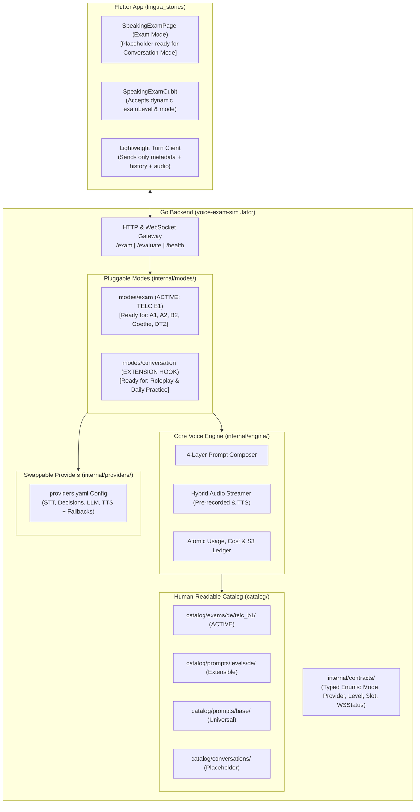

# Plug-and-Play Voice Engine Architecture & Extensibility Plan

> [!IMPORTANT]
> **Planning & Architecture Document — Current State & Extensibility Blueprint.**
> - **Active & Production-Ready**: **TELC B1 Speaking Exam (Teil 1, 2, 3)** is 100% active, fully wired to S3 modular audio, and verified with zero regressions.
> - **Extensibility-Ready (Zero Premature Bloat)**: The architecture is now decoupled and open for **Conversation Practice (Basic Talk)** and **Other Exam Levels & Types (A1, A2, B2, Goethe, DTZ)** via plug-and-play placeholders without generating unneeded content or audio upfront.

---

## 1. Summary of Completed Architecture Refactor

The entire system across [`voice-exam-simulator`](file:///Users/sarbjyot/StudioProjects/voice-exam-simulator) and [`lingua_stories`](file:///Users/sarbjyot/StudioProjects/lingua_stories) has been reorganized into clean, decoupled layers:

---

## 2. Current Active State vs. Future Extension Placeholders

| Area | Current Active Production State | Future Extensibility Hook (Ready When Needed) |
| :--- | :--- | :--- |
| **Speaking Exam (TELC B1)** | **100% Active**: Teil 1, 2, and 3 use S3 pre-recorded audio, OpenAI Decisions (`gpt-6-luna`), and Formblatt M10 evaluation. | Adding **TELC A2, B2 or Goethe** requires only adding a subfolder in `catalog/exams/` + S3 audio. **Zero Go code or Flutter architecture changes needed.** |
| **Conversation Helper (Basic Talk)** | **Architecture Hook Active**: `internal/modes/conversation` is registered in the engine. | Adding roleplay scenarios (*At the Doctor*, *Job Interview*) requires only adding a `spec.yaml` + Markdown prompt in `catalog/conversations/` and a UI entry button in Flutter. |
| **Supported Levels** | **B1 Fully Active**: Evaluated against CEFR B1 rules. | `catalog/prompts/levels/de/` and Flutter's `SpeakingExamCubit(examLevel: ...)` accept `A1`, `A2`, `B1`, `B2`, `C1` dynamically. |
| **AI Providers** | **Config-Driven**: Groq STT, OpenAI Decisions, Groq Chat LLM, ElevenLabs TTS. | `catalog/providers.yaml` allows swapping to Deepgram, OpenAI TTS, Cartesia, or Anthropic by changing configuration. |
| **Payload Size** | **Lightweight**: Turns send ~300 bytes of metadata + audio (no more 40KB prompt uploads). | Backwards-compatible fallback handles legacy requests automatically. |

---

## 3. How to Plug in New Features in the Future (Without Code Rewrites)

### A. Adding a New Exam Level (e.g., TELC A2 or B2)
1. Add `catalog/exams/de/telc_<level>/` with `exam.yaml` and `teil_1..3/spec.yaml`.
2. Generate modular audio with `exam_generator/` and upload to `s3://lingua-stories-exams/telc/<level>/speaking/`.
3. In Flutter, pass the level to `SpeakingExamPage(teilIndex: X, examLevel: '<level>')`. That's it!

### B. Adding a Conversation Scenario (Roleplay / Free Talk)
1. Add `catalog/conversations/de/<scenario_name>/spec.yaml` with situation, partner role, and prompt.
2. Flutter connects to WebSocket with `"mode": "conversation"`, `"scenario_id": "<scenario_name>"`.

---

## 4. Final Verification Checklist

- [x] Backend compiles cleanly with modular `internal/contracts/`, `internal/providers/`, `internal/engine/`, and `internal/modes/`.
- [x] All prompts moved out of Flutter assets into clean Markdown files in `catalog/`.
- [x] Flutter client is parameterized for dynamic `examLevel` and sends lightweight payloads.
- [x] Existing TELC B1 exam functionality preserved without breaking changes.
