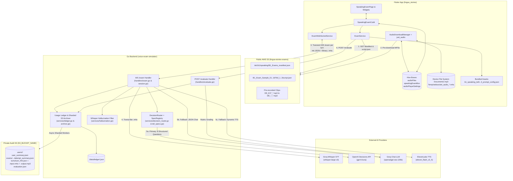
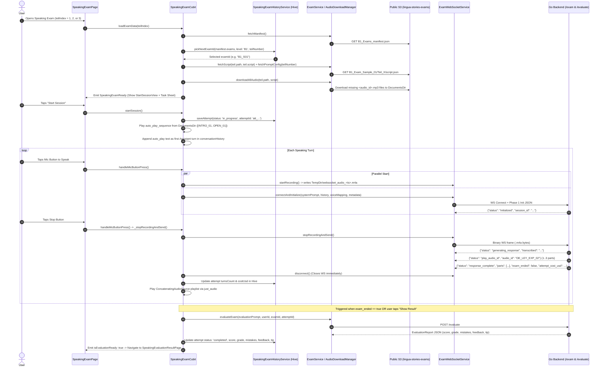
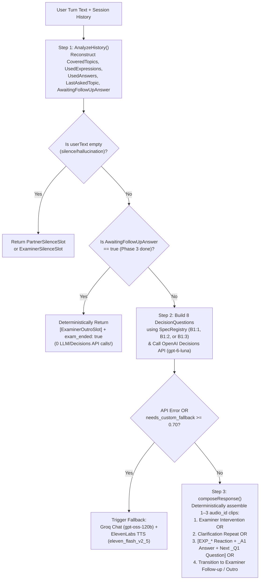
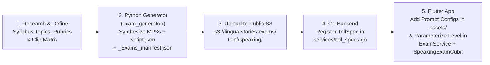

# Speaking Exam System — End-to-End Architecture, Storage Map & Exam Creation Blueprint

> [!NOTE]
> This single-source-of-truth technical reference documents **every moving part** of the Speaking Exam system across both repositories:
> 1. **Backend & Content Generation Repository**: [`voice-exam-simulator`](file:///Users/sarbjyot/StudioProjects/voice-exam-simulator) (Go WebSocket/HTTP server + Python empirical research & ElevenLabs audio packaging pipeline)
> 2. **Flutter Mobile App Repository**: [`lingua_stories`](file:///Users/sarbjyot/StudioProjects/lingua_stories) (Flutter client, state management, local Hive stores, audio pre-caching, transient WebSocket turn engine, and evaluation UI)
>
> It also provides a **complete blueprint** explaining how **TELC B1 Sprechen (Teil 1, Teil 2, Teil 3)** was engineered from scratch and **step-by-step instructions** to create new exams and levels (e.g., TELC A1, A2, B2, C1, DTZ, Goethe).

---

## Table of Contents

1. [Executive Overview & High-Level System Architecture](#1-executive-overview--high-level-system-architecture)
2. [Complete Storage & File Inventory (Where Everything Lives)](#2-complete-storage--file-inventory-where-everything-lives)
   - [2.1 Public AWS S3 Content Bucket (`lingua-stories-exams`)](#21-public-aws-s3-content-bucket-lingua-stories-exams)
   - [2.2 Private AWS S3 Audit & Cost-Tracking Bucket (`S3_BUCKET_NAME`)](#22-private-aws-s3-audit--cost-tracking-bucket-s3_bucket_name)
   - [2.3 Backend Local Disk Storage (`./data/ledger`)](#23-backend-local-disk-storage-dataledger)
   - [2.4 Mobile App Local Stores (Hive Boxes, Documents Dir, Temp Dir, Assets)](#24-mobile-app-local-stores-hive-boxes-documents-dir-temp-dir-assets)
   - [2.5 Exam Generator Local Caches & Packaging Folders](#25-exam-generator-local-caches--packaging-folders)
3. [Data Schemas — What Is Extracted, Needed, and Used at Each Stage](#3-data-schemas--what-is-extracted-needed-and-used-at-each-stage)
   - [3.1 S3 Master Manifest (`B1_Exams_manifest.json`)](#31-s3-master-manifest-b1_exams_manifestjson)
   - [3.2 S3 Scenario Script (`script.json`)](#32-s3-scenario-script-scriptjson)
   - [3.3 Bundled App Prompt Config (`b1_speaking_teilX_prompt_config.json`) & Placeholder Resolution](#33-bundled-app-prompt-config-b1_speaking_teilx_prompt_configjson--placeholder-resolution)
   - [3.4 WebSocket Phase 1 Initialization Payload](#34-websocket-phase-1-initialization-payload)
   - [3.5 WebSocket Phase 2 Turn Protocol (Client Binary Audio → Server Events)](#35-websocket-phase-2-turn-protocol-client-binary-audio--server-events)
   - [3.6 Evaluation HTTP Payload (`POST /evaluate`) & `EvaluationReport`](#36-evaluation-http-payload-post-evaluate--evaluationreport)
   - [3.7 Ledger & Private S3 Audit Schemas](#37-ledger--private-s3-audit-schemas)
4. [Deep Dive: Flutter Mobile App (`lingua_stories`)](#4-deep-dive-flutter-mobile-app-lingua_stories)
   - [4.1 File-by-File Inventory & Responsibilities](#41-file-by-file-inventory--responsibilities)
   - [4.2 Step-by-Step Runtime Lifecycle in `SpeakingExamCubit`](#42-step-by-step-runtime-lifecycle-in-speakingexamcubit)
   - [4.3 Exam Paper Selection & Deduplication (`SpeakingExamHistoryService.pickNextExamId`)](#43-exam-paper-selection--deduplication-speakingexamhistoryservicepicknextexamid)
   - [4.4 Zero-Latency Local Audio Caching (`AudioDownloadManager`)](#44-zero-latency-local-audio-caching-audiodownloadmanager)
   - [4.5 Transient Per-Turn WebSocket Architecture (`ExamWebSocketService`)](#45-transient-per-turn-websocket-architecture-examwebsocketservice)
5. [Deep Dive: Go Backend (`voice-exam-simulator`)](#5-deep-dive-go-backend-voice-exam-simulator)
   - [5.1 File-by-File Inventory & Responsibilities](#51-file-by-file-inventory--responsibilities)
   - [5.2 Session Initialization & Script Catalogue Extraction (`handlers/session.go`)](#52-session-initialization--script-catalogue-extraction-handlerssessiongo)
   - [5.3 Speech-to-Text & Whisper Hallucination Filtering (`services/groq.go`, `services/hallucination.go`)](#53-speech-to-text--whisper-hallucination-filtering-servicesgroqgo-serviceshallucinationgo)
   - [5.4 Primary Turn Router: OpenAI Decisions API + Deterministic Clip Composition (`services/decision_router.go`, `services/teil_specs.go`)](#54-primary-turn-router-openai-decisions-api--deterministic-clip-composition-servicesdecision_routergo-servicesteil_specsgo)
   - [5.5 Fallback Path: Groq Chat LLM + Dynamic ElevenLabs TTS (`handlers/exam.go`, `services/elevenlabs.go`)](#55-fallback-path-groq-chat-llm--dynamic-elevenlabs-tts-handlersexamgo-serviceselevenlabsgo)
   - [5.6 Evaluation Engine & Guardrails (`handlers/evaluate.go`, `config/constants.go`)](#56-evaluation-engine--guardrails-handlersevaluatego-configconstantsgo)
   - [5.7 Cost Metering, Local Ledger & Sharded S3 Archiver (`services/usage.go`, `services/ledger.go`, `services/archive.go`)](#57-cost-metering-local-ledger--sharded-s3-archiver-servicesusagego-servicesledgergo-servicesarchivego)
6. [How We Created the TELC B1 Speaking Exam (`Sprechen` Teil 1, 2, 3)](#6-how-we-created-the-telc-b1-speaking-exam-sprechen-teil-1-2-3)
   - [6.1 Phase 1: Empirical Extraction from Real Exam Videos (`transcribe_telc_videos.py`)](#61-phase-1-empirical-extraction-from-real-exam-videos-transcribe_telc_videospy)
   - [6.2 Phase 2: Cast of Characters & ElevenLabs Voices (5 Examiners + 5 Partner Personas)](#62-phase-2-cast-of-characters--elevenlabs-voices-5-examiners--5-partner-personas)
   - [6.3 Phase 3: Modular Two-Category Audio Clip Architecture (`Category A` + `Category B`)](#63-phase-3-modular-two-category-audio-clip-architecture-category-a--category-b)
   - [6.4 Phase 4: Designing Teil 1, Teil 2, and Teil 3 Specifications](#64-phase-4-designing-teil-1-teil-2-and-teil-3-specifications)
   - [6.5 Phase 5: Audio Synthesis, Caching, Packaging & S3 Upload](#65-phase-5-audio-synthesis-caching-packaging--s3-upload)
7. [Step-by-Step Playbook: How to Create New Exams & Levels (A1, A2, B2, C1, Goethe, DTZ)](#7-step-by-step-playbook-how-to-create-new-exams--levels-a1-a2-b2-c1-goethe-dtz)
   - [7.1 Step 1: Research & Define the Exam Format & Rubric](#71-step-1-research--define-the-exam-format--rubric)
   - [7.2 Step 2: Create the Audio & Script Generator in `exam_generator/`](#72-step-2-create-the-audio--script-generator-in-exam_generator)
   - [7.3 Step 3: Package & Upload to Public S3](#73-step-3-package--upload-to-public-s3)
   - [7.4 Step 4: Register the New Level/Teil Spec in Go Backend (`services/teil_specs.go`)](#74-step-4-register-the-new-levelteil-spec-in-go-backend-servicesteil_specsgo)
   - [7.5 Step 5: Add Prompt Configs & Update Level Plumbing in Flutter App (`lingua_stories`)](#75-step-5-add-prompt-configs--update-level-plumbing-in-flutter-app-lingua_stories)

---

## 1. Executive Overview & High-Level System Architecture

The Speaking Exam system simulates a realistic paired oral language exam (modeled after the official **telc Deutsch B1 Sprechen** examination, where two candidates — the human learner and an AI partner persona — are guided and evaluated by an AI Examiner).

### Core Design Principles
1. **95%+ Pre-Recorded Modular Audio (Zero TTS Latency & Cost)**:
   Instead of generating expensive, slow Text-to-Speech (TTS) on every turn, each scenario pre-generates ~41–55 modular `.mp3` clips (short natural reactions `EXP_*`, topic answers `_A1`, topic questions `_Q1`/`_Q2`, and examiner framing clips) stored in a public S3 bucket and **pre-cached onto the user's phone** before the exam timer begins.
2. **Deterministic + Structured Decision Routing (`gpt-6-luna`)**:
   On normal turns, the backend does **not** ask a generative LLM to write free-form dialogue. Instead, [`DecisionRouter.RouteTurn`](file:///Users/sarbjyot/StudioProjects/voice-exam-simulator/services/decision_router.go#L228-L353) sends 8 constrained boolean/enum classification questions to the OpenAI Decisions API (`gpt-6-luna`) and **deterministically composes 1–3 pre-recorded `audio_id` clips** in Go code.
3. **Graceful Generative Fallback (`openai/gpt-oss-120b` + `eleven_flash_v2_5`)**:
   If the learner asks a completely unexpected off-script question (`needs_custom_fallback >= 0.70`) or the Decisions API fails, the backend automatically falls back to Groq Chat (`openai/gpt-oss-120b`) + real-time ElevenLabs TTS (`eleven_flash_v2_5`), streaming raw MP3 bytes over the WebSocket.
4. **Stateless Server with Transient Per-Turn WebSockets**:
   The mobile app does **not** hold an open WebSocket while the user is listening to audio or thinking. A WebSocket connection is opened **only when the user taps the microphone to record**, transmits the full conversation history + script catalogue in Phase 1 (`init`), sends the recorded `.m4a` binary in Phase 2, receives the AI response, and **immediately disconnects**.
5. **Full Cost & Audio Audit Trail**:
   Every turn's input `.m4a`, output `.mp3`, transcript, LLM raw output, token/audio usage, and exact USD cost are tracked in a local atomic JSON ledger and asynchronously archived to a private write-only S3 bucket.

### High-Level Architecture Diagram



---

## 2. Complete Storage & File Inventory (Where Everything Lives)

Below is the complete map of **every storage location** across cloud buckets, backend disk, mobile device storage, and generator repositories.

### 2.1 Public AWS S3 Content Bucket (`lingua-stories-exams`)

- **Bucket Name**: `lingua-stories-exams`
- **Region**: `eu-central-1`
- **Base URL** (configured in [`UrlConstants.speakingExamBaseUrl`](file:///Users/sarbjyot/StudioProjects/lingua_stories/lib/CORE/utils/url_constants.dart#L112-L116)):
  `https://lingua-stories-exams.s3.eu-central-1.amazonaws.com/telc/b1/speaking`
- **Access Pattern**: Public read-only via HTTPS (fetched directly by the Flutter mobile app).

| S3 Relative Path | File Count | What It Contains & What It Is Used For |
| :--- | :--- | :--- |
| `B1_Exams_manifest.json` | 1 | Master index of all 16 B1 exam samples (`B1_S01` through `B1_S16`). Maps each sample's `Teil 1`, `Teil 2`, and `Teil 3` to its subfolder `path` and `script` filename. Fetched first when a user opens any Speaking Teil. |
| `B1_Exam_Sample_01/Teil_1/script.json` .. `B1_Exam_Sample_05/Teil_1/script.json` | 5 scripts + 275 MP3s (55/folder) | **Teil 1 (Kontaktaufnahme)** packages for the 5 partner personas (`01`=Leyla, `02`=Omar, `03`=Elena, `04`=Mateo, `05`=Janusz). Note: In `B1_Exams_manifest.json`, samples `B1_S06`..`B1_S16` reuse `B1_Exam_Sample_01..05/Teil_1` in round-robin cycles because Teil 1 has 5 persona packages. |
| `B1_Exam_Sample_01/Teil_2/script.json` .. `B1_Exam_Sample_16/Teil_2/script.json` | 16 scripts + 656 MP3 files (286 unique) | **Teil 2 (Gespräch über ein Thema)** packages covering 8 topics × 2 candidate role cards (Variant A & Variant B) = 16 distinct folders. Each folder has 1 `script.json` + 41 `.mp3` clips (Examiner intro/follow-ups/interventions/outro + Partner reactions `EXP_21..38` + Partner topic opener, `_A1`, `_Q1`, `_Q2`, and structural clips). |
| `B1_Exam_Sample_01/Teil_3/script.json` .. `B1_Exam_Sample_05/Teil_3/script.json` | 5 scripts + 210 MP3s (42/folder) | **Teil 3 (Gemeinsam etwas planen)** packages for the 5 collaborative planning scenarios (`01`=S1 Kurs-Abschlussparty, `02`=S2 Krankenbesuch & Hilfe, `03`=S3 Wochenendausflug, `04`=S4 Abschiedsgeschenk, `05`=S5 Willkommensabend). Samples `B1_S06`..`B1_S16` reuse `01..05/Teil_3` in the manifest. |

---

### 2.2 Private AWS S3 Audit & Cost-Tracking Bucket (`S3_BUCKET_NAME`)

- **Bucket Name**: Configured via backend env var `S3_BUCKET_NAME` in [`config/config.go`](file:///Users/sarbjyot/StudioProjects/voice-exam-simulator/config/config.go#L23-L39) (optional prefix `S3_PREFIX`).
- **Access Pattern**: **Write-only** from the Go backend via [`services/archive.go`](file:///Users/sarbjyot/StudioProjects/voice-exam-simulator/services/archive.go) (`PutObject` only; zero S3 reads in the hot path). Uploads happen asynchronously on background worker goroutines sharded by `fnv32a(userID)` so turns never wait on S3 I/O.

```
s3://<S3_BUCKET_NAME>/<S3_PREFIX>/
└── users/
    └── <userID>/                                      # e.g., Firebase UID or "anonymous"
        ├── user_summary.json                          # Lifetime totals, cost by component, best score per exam
        └── exams/
            └── <examKey>/                             # Format: "<level>_<examID>_teil<N>" e.g. "B1_B1_S01_teil1"
                ├── exam_summary.json                  # All attempts for this exam+teil, best score/grade, total cost
                └── attempts/
                    └── <attemptID>/                   # Format: "att_<YYYYMMDDTHHMMSSZ>_<uuid8>"
                        ├── attempt_summary.json       # Status (in_progress/completed/abandoned), turns list, cost breakdown
                        ├── evaluation.json            # Full grading output, mistakes, feedback, tip, LLM usage & cost
                        └── turns/
                            ├── turn_01.json           # Transcript, AI parts, raw LLM output, per-call usage & cost
                            ├── turn_01.input.m4a      # Raw user microphone recording sent from the app
                            ├── turn_01.output.mp3     # Only present if dynamic ElevenLabs fallback TTS was generated
                            ├── turn_02.json
                            └── turn_02.input.m4a
```

---

### 2.3 Backend Local Disk Storage (`./data/ledger`)

- **Directory**: Configured via `LEDGER_DIR` in [`config/config.go`](file:///Users/sarbjyot/StudioProjects/voice-exam-simulator/config/config.go#L35-L47) (defaults to `./data/ledger` on the Go server).
- **File Path**: `./data/ledger/<sanitized_userID>.json` (managed by [`services/ledger.go`](file:///Users/sarbjyot/StudioProjects/voice-exam-simulator/services/ledger.go)).
- **Purpose**: Acts as the authoritative local state so the Go backend never has to read from S3 before updating user/exam/attempt summaries. Written atomically via write-to-`.tmp` and `os.Rename`. Holds the exact `userDoc` tree (`UserSummary`, map of `ExamSummary`, and map of `AttemptSummary` per exam) so every subsequent turn or evaluation can compute cumulative `attempt_cost_usd`, `best_score`, and `turns_spoken` in memory and push complete snapshots to S3.

---

### 2.4 Mobile App Local Stores (Hive Boxes, Documents Dir, Temp Dir, Assets)

Inside the Flutter app ([`lingua_stories`](file:///Users/sarbjyot/StudioProjects/lingua_stories)), files and state are stored across **3 Hive boxes**, **2 device filesystem directories**, and **1 bundled asset folder**:

#### A. Hive Boxes (Local NoSQL Key-Value Store on Device)

| Hive Box Name | Managed By | Key(s) & Model | What Is Stored & Why |
| :--- | :--- | :--- | :--- |
| `'audioFiles'` | [`AudioDownloadManager`](file:///Users/sarbjyot/StudioProjects/lingua_stories/lib/CORE/utils/audio_download_manager.dart#L11-L16) | Key: `audioId` (e.g. `"DE_LEY_OPEN_01"`)<br>Value: [`LocalAudioModel`](file:///Users/sarbjyot/StudioProjects/lingua_stories/lib/CORE/models/local_audio_model.dart) (`TypeId: 3`) | Maps each `audio_id` to its relative local filename (`"<audioId>.mp3"`), `remoteUrl`, and `subtitlePath`. Checked before every download and playback to avoid re-downloading cached MP3s. |
| `'speakingExamBox'` | [`SpeakingExamHistoryService`](file:///Users/sarbjyot/StudioProjects/lingua_stories/lib/CORE/services/speaking_exam_history_service.dart#L5-L12) | Key: `'attempts'`<br>Value: JSON string of `Map<attemptId, SpeakingExamAttempt>` | Stores the user's local history of every exam attempt (`attempt_id`, `exam_id`, `exam_level`, `teil_number`, `status`, `started_at`, `updated_at`, `turns_count`, `cost_usd`, `score`, `grade`, `mistakes`, `feedback`, `tip`). Used both to display history/results and to power **round-robin exam paper selection** (`pickNextExamId`). |
| `'audioPlayerSettings'` | [`ExamSettingsService`](file:///Users/sarbjyot/StudioProjects/lingua_stories/lib/CORE/services/exam_settings_service.dart#L3-L10) | Key: `'showExamResultDialog'` (`bool`, default `true`) | Stores user preferences for exam UI dialogs. |

#### B. Device File System Directories (`path_provider`)

| Directory | Path Pattern | Lifecycle | What Is Stored & Used For |
| :--- | :--- | :--- | :--- |
| **Application Documents Directory** (`getApplicationDocumentsDirectory()`) | `<AppDocDir>/<audio_id>.mp3`<br>(e.g. `<AppDocDir>/DE_LEY_OPEN_01.mp3`) | Persistent across app restarts (can be cleared via `AudioDownloadManager.deleteAudio`) | Stores all pre-recorded examiner and partner `.mp3` clips downloaded from `lingua-stories-exams` S3 during `loadExamData()`. Played locally by `just_audio` (`AudioSource.uri(Uri.file(path))`) during the exam for instant 0ms playback. |
| **Temporary Directory — User Mic Recording** (`getTemporaryDirectory()`) | `<TempDir>/websocket_audio_<epoch_ms>.m4a` | Created when user taps Mic; read into bytes & sent over WS when user taps Stop | Stores the user's voice recording per turn encoded in AAC-LC (`.m4a`, 128 kbps, 44.1 kHz) via the `record` package in [`ExamWebSocketService.startRecording()`](file:///Users/sarbjyot/StudioProjects/lingua_stories/lib/CORE/services/exam_websocket_service.dart#L204-L224). |
| **Temporary Directory — Dynamic TTS Fallback Audio** (`getTemporaryDirectory()`) | `<TempDir>/tts_<microseconds>.mp3` and `<TempDir>/turn_<milliseconds>.mp3` | Created only when backend sends binary MP3 frames; deleted after turn playback | When the backend falls back to live ElevenLabs TTS, binary MP3 chunks are written to `tts_<us>.mp3` for queuing in `ConcatenatingAudioSource` and combined into `turn_<ms>.mp3` so the user can tap "Replay" in the UI ([`SpeakingExamCubit._handleServerMessage`](file:///Users/sarbjyot/StudioProjects/lingua_stories/lib/CORE/cubits/speaking_exam_cubit/speaking_exam_cubit.dart#L334-L398)). |

#### C. Bundled Flutter Assets (`assets/exam_prompts/`)

| Asset Path | Loaded By | What It Contains |
| :--- | :--- | :--- |
| [`assets/exam_prompts/b1_speaking_teil1_prompt_config.json`](file:///Users/sarbjyot/StudioProjects/lingua_stories/assets/exam_prompts/b1_speaking_teil1_prompt_config.json) | [`ExamService.fetchPromptConfig(1)`](file:///Users/sarbjyot/StudioProjects/lingua_stories/lib/CORE/services/exam_service.dart#L82-L97) | Contains `system_prompt_template`, `user_instructions_template`, `evaluation_prompt_template`, `voice_mapping` (Speaker Name → ElevenLabs Voice ID), default `primary_speaker`/`secondary_speaker`, and `exam_hint` for Teil 1. |
| [`assets/exam_prompts/b1_speaking_teil2_prompt_config.json`](file:///Users/sarbjyot/StudioProjects/lingua_stories/assets/exam_prompts/b1_speaking_teil2_prompt_config.json) | [`ExamService.fetchPromptConfig(2)`](file:///Users/sarbjyot/StudioProjects/lingua_stories/lib/CORE/services/exam_service.dart#L82-L97) | Same template structure tailored for Teil 2 (Presentation & Theme Discussion). |
| [`assets/exam_prompts/b1_speaking_teil3_prompt_config.json`](file:///Users/sarbjyot/StudioProjects/lingua_stories/assets/exam_prompts/b1_speaking_teil3_prompt_config.json) | [`ExamService.fetchPromptConfig(3)`](file:///Users/sarbjyot/StudioProjects/lingua_stories/lib/CORE/services/exam_service.dart#L82-L97) | Same template structure tailored for Teil 3 (Collaborative Planning with 4-slot tracking). |

---

### 2.5 Exam Generator Local Caches & Packaging Folders

Located in [`/Users/sarbjyot/StudioProjects/voice-exam-simulator/exam_generator/`](file:///Users/sarbjyot/StudioProjects/voice-exam-simulator/exam_generator):

| Folder / File | Purpose |
| :--- | :--- |
| `telcexam1.md/.json` .. `telcexam9.md/.json` | Speaker-diarized transcripts extracted from 9 real YouTube telc B1 speaking exams via `yt-dlp` + AssemblyAI ([`transcribe_telc_videos.py`](file:///Users/sarbjyot/StudioProjects/voice-exam-simulator/exam_generator/transcribe_telc_videos.py)). |
| `audio_cache_teil1/`, `audio_cache_teil2/`, `audio_cache_teil3/` | Local ElevenLabs synthesis caches (`<audio_id>.mp3`). Shared clips (like `EXP_21..38` or examiner intros) are synthesized once into the cache and copied into every sample folder that uses them, saving ~55% of ElevenLabs character quota. |
| `output_s3/` | Output of `generate_teil1_audio.py`, `generate_teil2_audio.py`, and `generate_teil3_audio.py`. Contains `B1_Exams_manifest.json` and `B1_Exam_Sample_01..16/Teil_1..3/`. |
| `upload_package/` | Clean distribution directory built by [`prepare_upload_package.py`](file:///Users/sarbjyot/StudioProjects/voice-exam-simulator/exam_generator/prepare_upload_package.py) and synced to `s3://lingua-stories-exams/telc/b1/speaking` via [`upload_to_s3.sh`](file:///Users/sarbjyot/StudioProjects/voice-exam-simulator/exam_generator/upload_to_s3.sh). |

---

## 3. Data Schemas — What Is Extracted, Needed, and Used at Each Stage

### 3.1 S3 Master Manifest (`B1_Exams_manifest.json`)

Fetched by [`ExamService.fetchManifest()`](file:///Users/sarbjyot/StudioProjects/lingua_stories/lib/CORE/services/exam_service.dart#L19-L41) and parsed into [`ExamManifest`](file:///Users/sarbjyot/StudioProjects/lingua_stories/lib/CORE/models/exam_model.dart#L1-L26):

```json
{
  "exams": [
    {
      "id": "B1_S01",
      "title": "B1 Speaking Exam - Sample 1",
      "level": "B1",
      "teile": [
        {
          "number": 1,
          "title": "Teil 1: Kontaktaufnahme",
          "path": "B1_Exam_Sample_01/Teil_1",
          "script": "script.json"
        },
        {
          "number": 2,
          "title": "Teil 2: Gespräch über ein Thema (Shopping im Internet)",
          "path": "B1_Exam_Sample_01/Teil_2",
          "script": "script.json"
        },
        {
          "number": 3,
          "title": "Teil 3: Gemeinsam etwas planen (Kurs-Abschlussparty)",
          "path": "B1_Exam_Sample_01/Teil_3",
          "script": "script.json"
        }
      ]
    }
  ]
}
```

### 3.2 S3 Scenario Script (`script.json`)

Fetched by [`ExamService.fetchScript()`](file:///Users/sarbjyot/StudioProjects/lingua_stories/lib/CORE/services/exam_service.dart#L43-L61) and parsed into [`ExamScript`](file:///Users/sarbjyot/StudioProjects/lingua_stories/lib/CORE/models/exam_model.dart#L59-L173). Every `script.json` across Teil 1, Teil 2, and Teil 3 shares a unified top-level schema, with optional Teil-specific metadata fields (`stimulus_card` in Teil 2, `task_sheet` in Teil 3):

```json
{
  "exam_id": "B1_Exam_Sample_01",
  "teil": 2,
  "title": "Gespräch über ein Thema — Shopping im Internet (Kandidat A)",
  "primary_speaker": "Leyla",
  "secondary_speaker": "Examiner",
  "examiner_code": "EX1",
  "partner_code": "LEY",
  "exam_hint": "Aufgabenblatt — Thema: „Shopping im Internet“\n\nLeyla (26, Grafikdesignerin):\n„Ich kaufe fast alles online...“\n\nAufgabe:\n1. Berichten Sie Ihrer Partnerin (Leyla), was Sie gelesen haben.\n2. Erzählen Sie von Ihren eigenen Erfahrungen...",
  "stimulus_card": {
    "topic": "Shopping im Internet",
    "partner_quote": {
      "name": "Leyla",
      "age": 26,
      "occupation": "Grafikdesignerin",
      "quote": "Ich kaufe fast alles online, besonders Kleidung und Elektronik..."
    }
  },
  "auto_play_sequence": [
    "DE_EX1_T2_INTRO_01",
    "DE_LEY_T2OPEN_01"
  ],
  "script": [
    {
      "topic": "examiner_intro",
      "dialogue": {
        "speaker": "Examiner",
        "text": "Kommen wir nun zu Teil zwei...",
        "audio_id": "DE_EX1_T2_INTRO_01",
        "audio_url": "DE_EX1_T2_INTRO_01.mp3"
      }
    },
    {
      "topic": "expression_agree",
      "dialogue": {
        "speaker": "Leyla",
        "text": "Ja, das sehe ich genauso.",
        "audio_id": "DE_LEY_EXP_21",
        "audio_url": "DE_LEY_EXP_21.mp3"
      }
    },
    {
      "topic": "convenience",
      "question": {
        "speaker": "Leyla",
        "text": "Bestellst du eigentlich oft im Internet, oder gehst du lieber direkt in die Geschäfte?",
        "audio_id": "DE_LEY_T2T1_CONV_Q1",
        "audio_url": "DE_LEY_T2T1_CONV_Q1.mp3"
      },
      "answer": {
        "speaker": "Leyla",
        "text": "Für mich ist das total praktisch, weil ich nach der Arbeit oft müde bin...",
        "audio_id": "DE_LEY_T2T1_CONV_A1",
        "audio_url": "DE_LEY_T2T1_CONV_A1.mp3"
      }
    }
  ]
}
```

#### What Each Field in `script.json` Is Used For:
- `primary_speaker` (e.g. `"Leyla"`) & `secondary_speaker` (e.g. `"Examiner"`): Overrides the speaker names in `PromptConfig` so the UI avatars, prompt templates, and ElevenLabs voice mappings automatically match the active persona.
- `exam_hint`: Rendered on the candidate's task card in the Flutter UI before and during the exam, AND injected into `{{exam_hint}}` in the evaluation prompt so the grader knows the exact quote/task sheet the user was given.
- `auto_play_sequence`: Array of `audio_id`s played automatically from local disk as soon as the user taps **"Start Session"** (`[Examiner Intro, Partner Opening]`), kicking off the conversation without waiting for an API call.
- `script`: Array of [`ScriptTopic`](file:///Users/sarbjyot/StudioProjects/lingua_stories/lib/CORE/models/exam_model.dart#L175-L202) items:
  - Items with `"dialogue"` hold standalone clips: Examiner intros/outros/follow-ups/interventions (`DE_EX*`), Partner reactions (`DE_*_EXP_*`), Partner structural clips (`OPEN_01`, `BACK_Q1`, `CLAR_Q1`, `SIL_Q1`, `CLOSE_01`), and Secondary Follow-up Questions (`_Q2`).
  - Items with `"question"` and `"answer"` hold the core topic/planning slots (`_Q1` and `_A1`).

---

### 3.3 Bundled App Prompt Config (`b1_speaking_teilX_prompt_config.json`) & Placeholder Resolution

When [`SpeakingExamCubit.loadExamData()`](file:///Users/sarbjyot/StudioProjects/lingua_stories/lib/CORE/cubits/speaking_exam_cubit/speaking_exam_cubit.dart#L82-L163) loads both `script.json` (from S3) and `b1_speaking_teilX_prompt_config.json` (from bundled assets), it merges them by overriding `primarySpeaker`, `secondarySpeaker`, and `examHint` with the values from `script.json`.

Then [`PromptConfig`](file:///Users/sarbjyot/StudioProjects/lingua_stories/lib/CORE/models/exam_model.dart#L229-L315) resolves the following `{{placeholders}}`:

| Method on `PromptConfig` | Template Source | Placeholders Replaced | Where the Resolved String Is Sent |
| :--- | :--- | :--- | :--- |
| `getSystemPrompt(scriptJsonString)` | `system_prompt_template` | `{{primary_speaker}}` → e.g. `"Leyla"`<br>`{{secondary_speaker}}` → `"Examiner"`<br>`{{script_json}}` → Pretty-printed JSON array of `script` items | Sent in WebSocket Phase 1 `init` (`system_prompt`). Note: The Go backend **extracts** the `{{script_json}}` array after the marker `"AVAILABLE PRE-RECORDED AUDIO SCRIPT:"` in [`parseScriptCatalogue()`](file:///Users/sarbjyot/StudioProjects/voice-exam-simulator/services/decision_router.go#L118-L215) to build the in-memory `ScriptCatalogue` for `DecisionRouter`! |
| `getUserInstructions()` | `user_instructions_template` | `{{primary_speaker}}` → e.g. `"Leyla"`<br>`{{secondary_speaker}}` → `"Examiner"` | Sent in WebSocket Phase 1 `init` (`user_instructions`). Used when falling back to Groq Chat LLM. |
| `getEvaluationPrompt(conversationText)` | `evaluation_prompt_template` | `{{primary_speaker}}` → e.g. `"Leyla"`<br>`{{secondary_speaker}}` → `"Examiner"`<br>`{{exam_hint}}` → Stimulus card / task sheet text<br>`{{conversation_text}}` → Formatted transcript | Sent in HTTP `POST /evaluate` (`evaluation_prompt`). |

---

### 3.4 WebSocket Phase 1 Initialization Payload

Sent by [`ExamWebSocketService.connectAndInitialize()`](file:///Users/sarbjyot/StudioProjects/lingua_stories/lib/CORE/services/exam_websocket_service.dart#L59-L155) as the very first text frame upon opening `wss://voice.linguastories.com/exam` and parsed by [`parseInit()`](file:///Users/sarbjyot/StudioProjects/voice-exam-simulator/handlers/session.go#L51-L97) on the Go server:

```json
{
  "system_prompt": "You are playing TWO roles in a German B1 Speaking Exam...\nAVAILABLE PRE-RECORDED AUDIO SCRIPT:\n[\n  { \"topic\": \"name\", \"question\": { ... }, \"answer\": { ... } }\n]",
  "user_instructions": "Respond with a valid JSON object matching this exact structure...",
  "history": [
    { "role": "system", "content": "..." },
    { "role": "assistant", "content": "Kommen wir zu Teil eins... Hallo! Ich heiße Leyla, und wie heißt du?" },
    { "role": "user", "content": "Hallo Leyla, ich heiße Sarbjyot." },
    { "role": "assistant", "content": "{\"parts\":[{\"speaker\":\"Leyla\",\"text\":\"Schön dich kennenzulernen!\",\"audio_id\":\"DE_LEY_EXP_01\"}...]}" }
  ],
  "voice_mapping": {
    "Leyla": "EXAVITQu4vr4xnSDxMaL",
    "Omar": "TX3LPaxmHKxFdv7VOQHJ",
    "Elena": "Xb7hH8MSUJpSbSDYk0k2",
    "Mateo": "ErXwobaYiN019PkySvjV",
    "Janusz": "pqHfZKP75CvOlQylNhV4",
    "Examiner": "onwK4e9ZLuTAKqWW03F9"
  },
  "primary_speaker": "Leyla",
  "secondary_speaker": "Examiner",
  "user_id": "firebase_uid_or_anonymous",
  "exam_id": "B1_S01",
  "exam_level": "B1",
  "teil_number": 1,
  "attempt_id": "att_20261024T113000Z_a1b2c3d4"
}
```

**Server Response**:
```json
{
  "status": "initialized",
  "session_id": "7f9c2e10-..."
}
```

---

### 3.5 WebSocket Phase 2 Turn Protocol (Client Binary Audio → Server Events)

After Phase 1 `initialized` and after the user stops recording, the client sends **one binary WebSocket frame** containing the `.m4a` recording bytes. The server responds with a sequence of JSON text frames (and optional binary MP3 frames if fallback TTS is used):

| Sequence Order | Frame Type | Direction | Payload Schema | Purpose |
| :--- | :--- | :--- | :--- | :--- |
| **1** | Binary | Client → Server | Raw `.m4a` bytes | User's recorded voice turn. |
| **2** | Text (JSON) | Server → Client | `{"status": "generating_response", "transcribed": "Ich komme aus Indien..."}` | Immediately delivers the Whisper STT transcription so the client can append the user's message to `conversationHistory`. |
| **3 ( repeated per part )** | Text (JSON) *or* Binary | Server → Client | **Pre-recorded clip**:<br>`{"status": "play_audio_id", "audio_id": "DE_LEY_EXP_02"}`<br>**OR Fallback dynamic TTS**:<br>Raw `.mp3` binary bytes | Queues each audio segment in order on the client (`_pendingTurnAudioSources`). |
| **4** | Text (JSON) | Server → Client | `{"status": "response_complete", "ai_text": "...", "parts": [...], "exam_ended": false, "turn_cost_usd": 0.00042, "attempt_cost_usd": 0.00128}` | Signals end of turn. Client appends assistant message to history, updates cost in Hive, **closes the WebSocket**, and starts playing the queued audio playlist. |

---

### 3.6 Evaluation HTTP Payload (`POST /evaluate`) & `EvaluationReport`

When `exam_ended: true` (or the user taps **"Show Result"** after at least 1 turn), [`ExamService.evaluateExam()`](file:///Users/sarbjyot/StudioProjects/lingua_stories/lib/CORE/services/exam_service.dart#L140-L185) sends an HTTP `POST` to `https://voice.linguastories.com/evaluate`:

#### Request Body (`models.EvaluateRequest`):
```json
{
  "evaluation_prompt": "You are an official certified telc Deutsch B1 examiner evaluating Teil 1...",
  "user_id": "firebase_uid_or_anonymous",
  "exam_id": "B1_S01",
  "exam_level": "B1",
  "teil_number": 1,
  "attempt_id": "att_20261024T113000Z_a1b2c3d4"
}
```

#### Response Body (`models.EvaluateResponse` → parsed into [`EvaluationReport`](file:///Users/sarbjyot/StudioProjects/lingua_stories/lib/CORE/models/evaluation_report.dart)):
```json
{
  "score": 82,
  "grade": "Gut",
  "mistakes": [
    {
      "original": "Ich bin nach Deutschland gekommt vor zwei Jahre.",
      "corrected": "Ich bin vor zwei Jahren nach Deutschland gekommen.",
      "explanation": "Das Partizip II von 'kommen' ist 'gekommen' (starkes Verb), und nach 'vor' steht der Dativ Plural ('vor zwei Jahren')."
    }
  ],
  "feedback": "[A] Aufgabenbewältigung: Du hast alle Themen aktiv besprochen...\n\n[B] Kommunikative Gestaltung: ...\n\n[C] Formale Richtigkeit: ...\n\n[D] Aussprache & Intonation: ...",
  "tip": "Satz-Baukasten für Teil 1:\n- „Bei mir ist es ähnlich: Ich arbeite als...“\n- „Mich würde noch interessieren: Wie...?“",
  "evaluation_cost_usd": 0.00185,
  "attempt_cost_usd": 0.00412
}
```

---

### 3.7 Ledger & Private S3 Audit Schemas

Defined in [`services/ledger.go`](file:///Users/sarbjyot/StudioProjects/voice-exam-simulator/services/ledger.go#L27-L119):
- **`UserSummary` (`users/<userID>/user_summary.json`)**: Tracks `total_attempts`, `completed_attempts`, `turns_spoken`, `total_cost_usd`, `cost_by_component` (`stt_usd`, `chat_llm_usd`, `decisions_usd`, `eval_llm_usd`, `tts_usd`), and `exams` map (`attempts_count`, `completed_count`, `best_score`, `last_attempt_id`, `total_cost_usd`).
- **`ExamSummary` (`users/<userID>/exams/<examKey>/exam_summary.json`)**: Tracks all attempts for a specific `<level>_<examID>_teil<N>`, including `best_score`, `best_grade`, `total_cost_usd`, and list of `ExamAttemptRef`s.
- **`AttemptSummary` (`.../attempts/<attemptID>/attempt_summary.json`)**: Tracks `status` (`in_progress` | `completed`), `turns_count`, `usage` (total STT audio seconds, LLM input/output/cached tokens, TTS characters), `cost_usd`, `cost_by_component`, `turns` brief list, and `evaluation` summary.
- **`TurnRecord` (`.../turns/turn_<NN>.json`)**: Tracks `user_audio_s3_key`, `user_audio_bytes`, `user_text`, `ai_parts`, `ai_text`, `llm_raw_response`, `tts_audio_s3_key`, `exam_ended`, `usage` (`stt`, `chat_llm`, `decisions`, `tts` per-call records), and `cost_usd`.

---

## 4. Deep Dive: Flutter Mobile App (`lingua_stories`)

### 4.1 File-by-File Inventory & Responsibilities

| File Path in `lingua_stories` | Role & Key Responsibilities |
| :--- | :--- |
| [`lib/CORE/utils/url_constants.dart`](file:///Users/sarbjyot/StudioProjects/lingua_stories/lib/CORE/utils/url_constants.dart#L112-L129) | Defines `speakingExamBaseUrl` (`https://lingua-stories-exams.s3.eu-central-1.amazonaws.com/telc/b1/speaking`), `speakingExamManifestUrl`, `speakingExamWsUrl` (`wss://voice.linguastories.com/exam` or `ws://127.0.0.1:8000/exam` in local mode), and `speakingExamEvaluateUrl`. |
| [`lib/CORE/models/exam_model.dart`](file:///Users/sarbjyot/StudioProjects/lingua_stories/lib/CORE/models/exam_model.dart) | Data models for `ExamManifest`, `ExamSample`, `ExamTeil`, `ExamScript`, `StimulusCard`, `PartnerQuote`, `TaskSheet`, `ScriptTopic`, `ScriptDialogue`, and `PromptConfig` (including `{{placeholder}}` interpolation). |
| [`lib/CORE/models/evaluation_report.dart`](file:///Users/sarbjyot/StudioProjects/lingua_stories/lib/CORE/models/evaluation_report.dart) | Models `EvaluationReport` (`score`, `grade`, `mistakes`, `feedback`, `tip`) and `Mistake` (`original`, `corrected`, `explanation`). |
| [`lib/CORE/models/local_audio_model.dart`](file:///Users/sarbjyot/StudioProjects/lingua_stories/lib/CORE/models/local_audio_model.dart) | Hive model (`@HiveType(typeId: 3)`) storing `id`, `remoteUrl`, `localPath`, `subtitlePath` in the `'audioFiles'` Hive box. |
| [`lib/CORE/models/telc_exam_structure.dart`](file:///Users/sarbjyot/StudioProjects/lingua_stories/lib/CORE/models/telc_exam_structure.dart) | Static metadata (`TelcExamData.exams`) defining the exam sections (`Lesen`, `Sprachbausteine`, `Hören`, `Schreiben`, `Sprechen`) and parts (`Teil 1`, `Teil 2`, `Teil 3`) for levels `A1`, `A2`, `B1`, `B2`. |
| [`lib/CORE/services/exam_service.dart`](file:///Users/sarbjyot/StudioProjects/lingua_stories/lib/CORE/services/exam_service.dart) | Fetches `B1_Exams_manifest.json` and `script.json` from S3, loads bundled `PromptConfig` JSONs, orchestrates `downloadAllAudio()` across all `question`, `answer`, and `dialogue` clips in `script.json`, and sends `POST /evaluate`. |
| [`lib/CORE/services/exam_websocket_service.dart`](file:///Users/sarbjyot/StudioProjects/lingua_stories/lib/CORE/services/exam_websocket_service.dart) | Manages the `AudioRecorder` (`.m4a` recording + real-time dBFS amplitude stream for the mic visualizer) and the transient `WebSocketChannel` (`connectAndInitialize`, `stopRecordingAndSend`, `disconnect`). |
| [`lib/CORE/services/speaking_exam_history_service.dart`](file:///Users/sarbjyot/StudioProjects/lingua_stories/lib/CORE/services/speaking_exam_history_service.dart) | Persists `SpeakingExamAttempt` records in Hive box `'speakingExamBox'` and implements `pickNextExamId()` for smart paper rotation. |
| [`lib/CORE/utils/audio_download_manager.dart`](file:///Users/sarbjyot/StudioProjects/lingua_stories/lib/CORE/utils/audio_download_manager.dart) | Downloads MP3 files via `Dio` into `getApplicationDocumentsDirectory()`, registers them in Hive box `'audioFiles'`, and resolves `getLocalAudioPath(audioId)`. |
| [`lib/CORE/cubits/speaking_exam_cubit/speaking_exam_cubit.dart`](file:///Users/sarbjyot/StudioProjects/lingua_stories/lib/CORE/cubits/speaking_exam_cubit/speaking_exam_cubit.dart) | Central state machine driving the entire speaking exam: loading data, pre-caching audio, starting session, playing `auto_play_sequence`, handling mic button presses, queuing and playing multi-part responses via `just_audio`, tracking history & cost, and triggering evaluation. |
| [`lib/UI/screens/exam/speaking/speaking_exam_page.dart`](file:///Users/sarbjyot/StudioProjects/lingua_stories/lib/UI/screens/exam/speaking/speaking_exam_page.dart) | Main exam screen hosting `StartSessionView` (before session starts) and the active conversation view (`SpeakerCard` avatars, `ExamHintSheet` / `ExamHintDialog`, `RecordingControls`, and timer). |
| [`lib/UI/screens/exam/speaking/speaking_evaluation_result_page.dart`](file:///Users/sarbjyot/StudioProjects/lingua_stories/lib/UI/screens/exam/speaking/speaking_evaluation_result_page.dart) & [`evaluation_result_view.dart`](file:///Users/sarbjyot/StudioProjects/lingua_stories/lib/UI/screens/exam/speaking/widgets/evaluation_result_view.dart) | Renders the final score ring, grade badge, criteria feedback, expandable grammar/vocabulary mistake cards (`original` vs `corrected` + `explanation`), and Sentence Baukasten tips. |

---

### 4.2 Step-by-Step Runtime Lifecycle in `SpeakingExamCubit`



---

### 4.3 Exam Paper Selection & Deduplication (`SpeakingExamHistoryService.pickNextExamId`)

A subtle and important piece of logic lives in [`SpeakingExamHistoryService.pickNextExamId()`](file:///Users/sarbjyot/StudioProjects/lingua_stories/lib/CORE/services/speaking_exam_history_service.dart#L171-L246):
1. In `B1_Exams_manifest.json`, there are 16 exam samples (`B1_S01`..`B1_S16`), because **Teil 2** has 16 unique folders (`B1_Exam_Sample_01/Teil_2`..`16/Teil_2`).
2. However, **Teil 1** and **Teil 3** each have **5 unique folders** (`01..05`), which are reused across `B1_S06`..`B1_S16` in the manifest.
3. To prevent a user from getting the same Teil 1 or Teil 3 folder twice in a row under a different `B1_Sxx` ID, `pickNextExamId()` **deduplicates candidates by `teil.path`** (`seenPaths.add(teil.path)`).
   - For Teil 1 and Teil 3, this yields **5 unique papers** (`B1_S01`..`B1_S05`).
   - For Teil 2, this yields **16 unique papers** (`B1_S01`..`B1_S16`).
4. It then checks the user's Hive history (`speakingExamBox`):
   - **Priority 1**: Picks the first paper in manifest order that the user has **never completed** (or never attempted).
   - **Priority 2**: Once all unique papers for that Teil have been completed at least once, it sorts them by their **most recent attempt timestamp ascending** and picks the **least recently played** paper (true round-robin rotation).

---

### 4.4 Zero-Latency Local Audio Caching (`AudioDownloadManager`)

When [`ExamService.downloadAllAudio()`](file:///Users/sarbjyot/StudioProjects/lingua_stories/lib/CORE/services/exam_service.dart#L100-L138) runs before the session starts:
1. It extracts every `ScriptDialogue` from `script.script` (`topic.question`, `topic.answer`, `topic.dialogue`).
2. For each clip, it constructs the remote URL:
   `https://lingua-stories-exams.s3.eu-central-1.amazonaws.com/telc/b1/speaking/<teil.path>/<audioUrl>`
3. [`AudioDownloadManager.downloadAudio()`](file:///Users/sarbjyot/StudioProjects/lingua_stories/lib/CORE/utils/audio_download_manager.dart#L26-L78) checks if `audioId` is already registered in the `'audioFiles'` Hive box **and** if `<AppDocDir>/<audioId>.mp3` exists on disk.
   - If yes: skips the network download completely.
   - If no: downloads `<audioId>.mp3` into `<AppDocDir>/<audioId>.mp3` and saves a `LocalAudioModel` entry in Hive.
4. During the exam, when the backend sends `{"status": "play_audio_id", "audio_id": "DE_LEY_EXP_02"}`, [`SpeakingExamCubit._buildAudioSourceForId()`](file:///Users/sarbjyot/StudioProjects/lingua_stories/lib/CORE/cubits/speaking_exam_cubit/speaking_exam_cubit.dart#L497-L530) resolves `<AppDocDir>/DE_LEY_EXP_02.mp3` and passes `AudioSource.uri(Uri.file(localPath))` to `just_audio`'s `ConcatenatingAudioSource`, achieving **instant gapless playback** across multi-part responses (`[Reaction + Answer + Question]`).

---

### 4.5 Transient Per-Turn WebSocket Architecture (`ExamWebSocketService`)

Unlike traditional voice bots that keep a stateful WebSocket open for 10 minutes, [`SpeakingExamCubit.handleMicButtonPress()`](file:///Users/sarbjyot/StudioProjects/lingua_stories/lib/CORE/cubits/speaking_exam_cubit/speaking_exam_cubit.dart#L218-L273) uses a **transient per-turn connection**:
1. When the user taps the mic button:
   - `wsService.startRecording()` begins capturing audio to `<TempDir>/websocket_audio_<ts>.m4a` immediately so the user's first syllable is never clipped.
   - Simultaneously (`Future.wait`), `wsService.connectAndInitialize(...)` opens the WebSocket and completes the Phase 1 handshake (`status: "initialized"`) while the user is speaking.
2. When the user taps the stop button:
   - If Phase 1 initialization is still finishing on a slow connection, `_stopRecordingAndSend()` awaits `_initFuture` before sending the binary `.m4a` payload.
3. As soon as `status: "response_complete"` arrives from the server:
   - `wsService.disconnect()` closes the WebSocket connection (`_channel?.sink.close()`).
   - This eliminates idle connection drops, load balancer timeouts, and server memory leaks while the user listens to the partner's response or reads their stimulus card.

---

## 5. Deep Dive: Go Backend (`voice-exam-simulator`)

### 5.1 File-by-File Inventory & Responsibilities

| File Path in `voice-exam-simulator` | Role & Key Responsibilities |
| :--- | :--- |
| [`main.go`](file:///Users/sarbjyot/StudioProjects/voice-exam-simulator/main.go) | Loads config, initializes `GroqService`, `ElevenLabsService`, `DecisionsService`, `Ledger`, and `Archiver`, and mounts `/exam` (WebSocket), `/evaluate` (HTTP POST), and `/health` on port `8000`. |
| [`config/config.go`](file:///Users/sarbjyot/StudioProjects/voice-exam-simulator/config/config.go) | Loads `.env` variables: `GROQ_API_KEY`, `ELEVENLABS_API_KEY`, `OPENAI_API_KEY`, `DECISIONS_MODEL` (`gpt-6-luna`), `USE_DECISIONS_API` (`true`), `S3_BUCKET_NAME`, `S3_PREFIX`, `LEDGER_DIR`. |
| [`config/constants.go`](file:///Users/sarbjyot/StudioProjects/voice-exam-simulator/config/constants.go) | Defines model constants (`whisper-large-v3`, `openai/gpt-oss-120b`, `gpt-6-luna`, `eleven_flash_v2_5`), `GroqWhisperPrompt` (biases Whisper toward telc B1 names & German vocabulary), `EvaluationJSONInstruction`, and `EvaluationGuardrails`. |
| [`handlers/exam.go`](file:///Users/sarbjyot/StudioProjects/voice-exam-simulator/handlers/exam.go) | WebSocket `/exam` handler: reads Phase 1 `init`, reads Phase 2 `.m4a` bytes, runs Whisper STT + hallucination filter, routes turn via `DecisionRouter` (or falls back to Groq Chat + ElevenLabs TTS), streams audio events, and records turn in `Ledger`. |
| [`handlers/session.go`](file:///Users/sarbjyot/StudioProjects/voice-exam-simulator/handlers/session.go) | Builds per-connection `Session` struct, extracts `ScriptCatalogue` from the system prompt, resolves speaker Voice IDs (`voiceFor`), and ensures `user_instructions` are injected on the first user turn for LLM fallback. |
| [`handlers/evaluate.go`](file:///Users/sarbjyot/StudioProjects/voice-exam-simulator/handlers/evaluate.go) | HTTP `POST /evaluate` handler: appends `EvaluationGuardrails` and `EvaluationJSONInstruction` to the client's prompt, calls Groq Chat (`openai/gpt-oss-120b`), parses `EvaluateResponse`, and logs evaluation + cost to `Ledger`. |
| [`services/decision_router.go`](file:///Users/sarbjyot/StudioProjects/voice-exam-simulator/services/decision_router.go) | Parses the `ScriptCatalogue`, reconstructs `ConversationState` (`AnalyzeHistory`) from chat history, builds the 8 structured `DecisionQuestion`s, calls OpenAI Decisions API, and deterministically composes the 1–3 response clips (`composeResponse`). |
| [`services/teil_specs.go`](file:///Users/sarbjyot/StudioProjects/voice-exam-simulator/services/teil_specs.go) | Defines `TeilSpec` and `SpecRegistry` (`B1:1`, `B1:2`, `B1:3`) containing expected topic keys, `MinTopicsToEnd`, `MaxTurnsBeforeEnd`, structural slot names, and Teil-specific classification instructions for the Decisions API. |
| [`services/decisions.go`](file:///Users/sarbjyot/StudioProjects/voice-exam-simulator/services/decisions.go) | HTTP client for `POST https://api.openai.com/v1/decisions` (`gpt-6-luna`) with typed helpers (`BoolAnswer`, `StrAnswer`, `Confidence`). |
| [`services/groq.go`](file:///Users/sarbjyot/StudioProjects/voice-exam-simulator/services/groq.go) | HTTP client for Groq `audio/transcriptions` (`whisper-large-v3`, `language="de"`, `temperature=0`) and `chat/completions` (`openai/gpt-oss-120b`, `response_format={"type":"json_object"}`). |
| [`services/hallucination.go`](file:///Users/sarbjyot/StudioProjects/voice-exam-simulator/services/hallucination.go) | Detects and strips well-known Whisper silence hallucinations in German (`"Untertitel von..."`, `"Vielen Dank für's Zuschauen"`, `"Bis zum nächsten Mal"`, URLs, copyright symbols, or highly repetitive loops). |
| [`services/elevenlabs.go`](file:///Users/sarbjyot/StudioProjects/voice-exam-simulator/services/elevenlabs.go) | HTTP client for ElevenLabs `text-to-speech/<voiceID>` (`eleven_flash_v2_5`, `stability: 0.5`, `similarity_boost: 0.75`). Only invoked on the fallback path when a part has no pre-recorded `audio_id`. |
| [`services/usage.go`](file:///Users/sarbjyot/StudioProjects/voice-exam-simulator/services/usage.go) | Pricing calculator for Whisper STT (`$0.00003083/sec`), Groq Chat (`$0.15/1M in`, `$0.60/1M out`), OpenAI Decisions (`$0.20/1M in`, `$0.80/1M out`), and ElevenLabs Flash v2.5 (`$0.00005/char`). |
| [`services/ledger.go`](file:///Users/sarbjyot/StudioProjects/voice-exam-simulator/services/ledger.go) | Thread-safe per-user cost & attempt ledger persisted to `./data/ledger/<userID>.json` and mirrored to the S3 `Archiver`. |
| [`services/archive.go`](file:///Users/sarbjyot/StudioProjects/voice-exam-simulator/services/archive.go) | Asynchronous, FNV-1a user-sharded worker pool that uploads JSON summaries, `.m4a` user recordings, and `.mp3` TTS outputs to the private S3 bucket. |

---

### 5.2 Session Initialization & Script Catalogue Extraction (`handlers/session.go`)

When Phase 1 `init` arrives at [`parseInit()`](file:///Users/sarbjyot/StudioProjects/voice-exam-simulator/handlers/session.go#L51-L97):
1. It constructs the `Session` with `PrimarySpeaker` (e.g. `"Leyla"`), `SecondarySpeaker` (`"Examiner"`), `ExamLevel` (`"B1"`), `TeilNumber` (`1`, `2`, or `3`), and `History`.
2. It calls [`parseScriptCatalogue(systemPrompt, primarySpeaker, secondarySpeaker)`](file:///Users/sarbjyot/StudioProjects/voice-exam-simulator/services/decision_router.go#L118-L215):
   - Looks for the marker `"AVAILABLE PRE-RECORDED AUDIO SCRIPT:"` inside `system_prompt` and extracts the JSON array `[...]`.
   - Categorizes every clip in `script.json` into a structured [`ScriptCatalogue`](file:///Users/sarbjyot/StudioProjects/voice-exam-simulator/services/decision_router.go#L41-L61):
     - `PartnerQuestions[topic]` (`_Q1` clips)
     - `PartnerQ2[parentTopic]` (`*_q2` secondary follow-up clips, mapped back to their parent topic by stripping `_q2`)
     - `PartnerAnswers[topic]` (`_A1` clips)
     - `PartnerExp` (`expression_*` clips, e.g. `EXP_01..18`, `EXP_21..38`, `EXP_41..58`)
     - `PartnerSpecial[slot]` (`partner_opening`, `partner_backquestion_1/2`, `partner_clarification`, `partner_silence`, `partner_closing`)
     - `ExaminerClips[slot]` (`examiner_intro`, `examiner_followup_1/2`, `examiner_intervene_topic`, `examiner_intervene_polite`, `examiner_intervene_dialog`, `examiner_intervene_silence`, `examiner_outro`)
     - `ByAudioID[audio_id]` (reverse lookup map used to reconstruct state from previous turns).

---

### 5.3 Speech-to-Text & Whisper Hallucination Filtering (`services/groq.go`, `services/hallucination.go`)

When the client sends the binary `.m4a` recording:
1. [`GroqService.TranscribeAudio()`](file:///Users/sarbjyot/StudioProjects/voice-exam-simulator/services/groq.go#L47-L129) sends the `.m4a` bytes to Groq `whisper-large-v3` with:
   - `language = "de"`
   - `temperature = "0"`
   - `response_format = "verbose_json"` (so actual audio `duration` in seconds is returned for accurate cost metering)
   - `prompt = config.GroqWhisperPrompt` (contains `"Telc Deutsch B1 Sprechen Prüfung. Kandidat und Prüfer im Gespräch. Leyla, Omar, Elena, Mateo, Janusz..."` so Whisper spells persona names and B1 terms accurately).
2. [`services/hallucination.go`](file:///Users/sarbjyot/StudioProjects/voice-exam-simulator/services/hallucination.go) inspects the transcript via `IsWhisperHallucination(text)`:
   - Whisper is notorious for outputting YouTube subtitle watermarks (`"Untertitel im Auftrag des ZDF"`, `"Vielen Dank fürs Zuschauen"`, `"Abonniert den Kanal"`, `"SWR 2021"`) when given a silent or background-noise recording.
   - If `IsWhisperHallucination` matches any of these patterns (or detects <2 letters or >60% repeated words), the backend replaces `transcribedText` with `""` (empty string), which `DecisionRouter` cleanly handles as a **silent turn** (`PartnerSilenceSlot` / `ExaminerSilenceSlot`).

---

### 5.4 Primary Turn Router: OpenAI Decisions API + Deterministic Clip Composition (`services/decision_router.go`, `services/teil_specs.go`)

This is the core intelligence of the speaking simulator. On every turn, [`DecisionRouter.RouteTurn()`](file:///Users/sarbjyot/StudioProjects/voice-exam-simulator/services/decision_router.go#L228-L353) executes **4 deterministic steps**:



#### Step 1: Stateless State Reconstruction (`AnalyzeHistory`)
Because the server is stateless across turns, [`AnalyzeHistory()`](file:///Users/sarbjyot/StudioProjects/voice-exam-simulator/services/decision_router.go#L379-L473) scans all `assistant` messages in `session.History` (explicitly skipping `role == "system"` so the embedded script catalogue doesn't mark all clips as used!). By matching either `"audio_id"` fields in JSON turns or clip `.Text` substrings in the initial `auto_play_sequence`, it reconstructs:
- `CoveredTopics`: Which topics/slots have already been asked or answered.
- `UsedExpressions`: Which `EXP_*` reaction clips have already been played (so the partner **never repeats the same reaction clip twice**).
- `UsedAnswers`: Which `_A1` partner answers have already been spoken.
- `LastAskedTopic`: Which topic question the partner asked most recently (so if the user asks for clarification `"Wie bitte?"`, the partner can repeat that exact question or its `_Q2` variant).
- `AwaitingFollowUpAnswer`: Set to `true` as soon as `examiner_followup_1` or `examiner_followup_2` has been played. On the very next turn, `RouteTurn()` immediately returns `examiner_outro` (`exam_ended: true`) without making any external LLM call!

#### Step 2: The 8 Structured Decision Questions (`buildQuestions`)
[`buildQuestions()`](file:///Users/sarbjyot/StudioProjects/voice-exam-simulator/services/decision_router.go#L483-L619) sends a compact conversation context + 8 parallel classification questions to `POST https://api.openai.com/v1/decisions` (`gpt-6-luna`):

| Question ID | Type | Options | Purpose |
| :--- | :--- | :--- | :--- |
| `needs_custom_fallback` | `boolean` | `true` / `false` | `true` (with confidence $\ge 0.70$) **only** if the learner asked a specific personal question that no pre-recorded `_A1` clip can answer (e.g., *"Was ist dein Lieblingsessen?"*). |
| `asked_clarification` | `boolean` | `true` / `false` | `true` if the learner didn't understand and asked to repeat (`"Wie bitte?"`, `"Was meinst du?"`). |
| `learner_asked_partner` | `boolean` | `true` / `false` | `true` if the learner ended their turn with a question or counter-question (`"Und du?"`, `"Was denkst du?"`). |
| `off_topic` | `boolean` | `true` / `false` | `true` if the learner went completely off-topic for the current Teil. |
| `rude_or_inappropriate` | `boolean` | `true` / `false` | `true` if the learner used insults or hostile language. |
| `topic_addressed` | `enum` | `["none", ...spec.Topics]` | Which syllabus topic/slot the learner's message primarily addressed. |
| `partner_question_topic` | `enum` | `["none", ...spec.Topics]` | Which syllabus topic the learner asked the partner about (if `learner_asked_partner == true`). |
| `reaction_clip` | `enum` | Unused `EXP_*` IDs | Picks the single most natural short reaction (`EXP_*`) to precede the partner's next clip. |

#### Step 3: Deterministic Clip Composition (`composeResponse`)
Using the answers to those 8 questions, [`composeResponse()`](file:///Users/sarbjyot/StudioProjects/voice-exam-simulator/services/decision_router.go#L644-L812) selects 1 to 3 `AudioClip`s:
1. **Safety / Off-Topic Guardrails**:
   - If `rude_or_inappropriate` ($\ge 0.65$): returns `[ExaminerIntervenePolite]`.
   - If `off_topic` ($\ge 0.70$): returns `[ExaminerInterveneTopic]`.
2. **Clarification Handling**:
   - If `asked_clarification` ($\ge 0.60$): returns `[PartnerClarification ("Ich meinte..."), LastAskedQuestion (_Q2 or _Q1)]`.
3. **End-of-Exam Pacing Check**:
   - Checks if `coveredCount >= spec.MinTopicsToEnd` (5 topics in Teil 1; 3 in Teil 2; 4 in Teil 3) OR `st.TurnCount >= spec.MaxTurnsBeforeEnd` (8 turns in Teil 1; 7 in Teil 2; 8 in Teil 3) OR no uncovered topics remain.
   - If ready to end:
     - Optionally prepends `[Reaction EXP_*]` + `[PartnerAnswer _A1]` (if the user just asked the partner a question) + `[PartnerClosing]` (for Teil 3 summary), followed by `[ExaminerFollowUp1]` (if the examiner hasn't asked the follow-up yet) or `[ExaminerOutro]` (`exam_ended: true`).
4. **Standard Mid-Exam Turn (1–3 Clips)**:
   - **Clip 1 (Reaction)**: Unused `EXP_*` clip chosen by `reaction_clip`.
   - **Clip 2 (Partner Answer)**: Included if `learner_asked_partner == true` (plays the `_A1` clip for `partner_question_topic`) OR if the learner shared an opinion on a topic whose `_A1` hasn't been shared yet.
   - **Clip 3 (Next Partner Question)**: Picks the next uncovered topic in `spec.Topics` order and plays its `_Q1` clip (or a `_Q2` deepener / `partner_backquestion` if appropriate).

---

### 5.5 Fallback Path: Groq Chat LLM + Dynamic ElevenLabs TTS (`handlers/exam.go`, `services/elevenlabs.go`)

If `DecisionRouter` returns `useFallback = true` (e.g., `needs_custom_fallback >= 0.70` or Decisions API outage):
1. [`handlers/exam.go`](file:///Users/sarbjyot/StudioProjects/voice-exam-simulator/handlers/exam.go#L126-L157) calls `groqService.GetLLMResponse(session.History)` using `openai/gpt-oss-120b` with `response_format: {"type": "json_object"}`.
2. The LLM returns a JSON object matching `{ "parts": [{"speaker": "...", "text": "...", "audio_id": "..."}], "exam_ended": false }`.
3. In [`streamParts()`](file:///Users/sarbjyot/StudioProjects/voice-exam-simulator/handlers/exam.go#L276-L370):
   - Any part **without** an `audio_id` is synthesized concurrently via `elevenLabsService.GenerateAudio(text, session.voiceFor(part))` using model `eleven_flash_v2_5`.
   - Pre-recorded parts are sent as `{"status": "play_audio_id", "audio_id": "..."}` JSON frames; dynamically synthesized parts are sent as raw binary MP3 frames.

---

### 5.6 Evaluation Engine & Guardrails (`handlers/evaluate.go`, `config/constants.go`)

When `POST /evaluate` is called, [`handlers/evaluate.go`](file:///Users/sarbjyot/StudioProjects/voice-exam-simulator/handlers/evaluate.go#L25-L129) combines:
1. The client's resolved `evaluation_prompt` (from `b1_speaking_teilX_prompt_config.json`, which includes `{{exam_hint}}` and `{{conversation_text}}`),
2. [`config.EvaluationGuardrails`](file:///Users/sarbjyot/StudioProjects/voice-exam-simulator/config/constants.go#L35-L89), which enforces:
   - **STT Phonetic Reconstruction**: Instructs the grader that the transcript comes from automated Whisper STT of a non-native speaker, so punctuation, capitalization, and homophone STT splits (e.g., *"seit dem"* vs *"seitdem"*) must **never** be penalized; only genuine B1 grammar/vocabulary errors are flagged.
   - **Silent/Empty Transcript Rule**: Awards `score: 0, grade: "Nicht bestanden"` if the candidate said nothing or only 1–2 words.
   - **Official telc B1 Formblatt M10 4-Criteria Rubric**: Requires `[A] Aufgabenbewältigung`, `[B] Kommunikative Gestaltung`, `[C] Formale Richtigkeit`, and `[D] Aussprache & Intonation` in the `feedback` field, plus a concrete **Satz-Baukasten** in `tip`.
3. [`config.EvaluationJSONInstruction`](file:///Users/sarbjyot/StudioProjects/voice-exam-simulator/config/constants.go#L28-L33) enforcing strict JSON output.

---

### 5.7 Cost Metering, Local Ledger & Sharded S3 Archiver (`services/usage.go`, `services/ledger.go`, `services/archive.go`)

Every external API call returns a [`CallUsage`](file:///Users/sarbjyot/StudioProjects/voice-exam-simulator/services/usage.go#L41-L55) struct with exact token/second/character counts and USD cost computed by [`services/usage.go`](file:///Users/sarbjyot/StudioProjects/voice-exam-simulator/services/usage.go):
- **Groq Whisper Large v3**: `audioSeconds * ($0.111 / 3600)`
- **OpenAI Decisions (`gpt-6-luna`)**: `inTokens * ($0.20 / 1M) + outTokens * ($0.80 / 1M)`
- **Groq Chat (`openai/gpt-oss-120b`)**: `inTokens * ($0.15 / 1M) + cachedInTokens * ($0.075 / 1M) + outTokens * ($0.60 / 1M)`
- **ElevenLabs Flash v2.5**: `characters * $0.00005`

On every turn (`Ledger.RecordTurn`) and evaluation (`Ledger.RecordEvaluation`):
1. The per-user mutex locks `userDoc`, updates `UserSummary`, `ExamSummary`, and `AttemptSummary`, and atomically writes `./data/ledger/<userID>.json`.
2. It enqueues `PutJSON` and `PutBytes` jobs onto [`s3Archiver`](file:///Users/sarbjyot/StudioProjects/voice-exam-simulator/services/archive.go#L51-L164). Because jobs are routed to worker `fnv32a(userID) % workers`, all S3 writes for a given user execute strictly in order without blocking the WebSocket response.

---

## 6. How We Created the TELC B1 Speaking Exam (`Sprechen` Teil 1, 2, 3)

Creating the TELC B1 Speaking Exam required combining **empirical linguistic research** from real oral exams with a **modular combinatorial audio architecture**. Here is the exact 5-phase engineering process we used:

### 6.1 Phase 1: Empirical Extraction from Real Exam Videos (`transcribe_telc_videos.py`)

Instead of guessing how examiners and candidates speak in a real telc B1 exam, we built [`exam_generator/transcribe_telc_videos.py`](file:///Users/sarbjyot/StudioProjects/voice-exam-simulator/exam_generator/transcribe_telc_videos.py):
1. Downloaded audio from **9 authentic YouTube telc B1 oral examination recordings** using `yt-dlp`.
2. Ran **AssemblyAI speaker diarization** (`language_code="de"`, `speaker_labels=True`, `speakers_expected=4` for 2 examiners + 2 candidates).
3. Saved the diarized transcripts (`telcexam1.md/.json` through `telcexam9.md/.json` in `exam_generator/`) and analyzed them alongside the official **telc Deutsch B1 Übungstest 1** and **Formblatt M10** grading criteria.
4. Extracted authentic German discourse markers, examiner framing phrases, interruption recovery phrases, and natural B1-level sentence lengths (kept strictly under $\le 22$ words per clip so B1 learners are never overwhelmed).

---

### 6.2 Phase 2: Cast of Characters & ElevenLabs Voices (5 Examiners + 5 Partner Personas)

We designed **5 Examiner personas** (`EX1`–`EX5`) and **5 Candidate Partner personas** (`LEY`, `OMA`, `ELE`, `MAT`, `JAN`) with rich biographical backstories so their answers across Teil 1, Teil 2, and Teil 3 remain 100% consistent:

| Code | Name & Role | Origin & Backstory (Used in Teil 1–3 Clips) | ElevenLabs Voice ID (`eleven_multilingual_v2`) |
| :--- | :--- | :--- | :--- |
| `EX1` | **Frau Becker** (Examiner) | Warm, structured examiner | `onwK4e9ZLuTAKqWW03F9` (Daniel / Examiner voice) |
| `EX2` | **Herr Weber** (Examiner) | Calm, encouraging examiner | `nPczCjzI2devNBz1zQrb` (Brian) |
| `EX3` | **Frau Hoffmann** (Examiner) | Clear, friendly examiner | `cgSgspJ2msm6clMCkdW9` (Jessica) |
| `EX4` | **Herr Richter** (Examiner) | Objective, polite examiner | `cjVigY5qzO86Huf0OWal` (Eric) |
| `EX5` | **Frau Schäfer** (Examiner) | Supportive examiner | `FGY2WhTYpPnrIDTdsKH5` (Laura) |
| `LEY` | **Leyla** (Partner 1) | 26, graphic designer from Izmir (Turkey), lives in Berlin, loves photography & cycling | `EXAVITQu4vr4xnSDxMaL` (Sarah) |
| `OMA` | **Omar** (Partner 2) | 29, IT technician from Damascus (Syria), lives in Hamburg, married with a young son, cooks & plays football | `TX3LPaxmHKxFdv7VOQHJ` (Liam) |
| `ELE` | **Elena** (Partner 3) | 34, nurse from Madrid (Spain), lives in Munich, loves hiking in the Alps & reading | `Xb7hH8MSUJpSbSDYk0k2` (Alice) |
| `MAT` | **Mateo** (Partner 4) | 24, architecture student from Bologna (Italy), lives in Cologne, plays guitar & jogs | `ErXwobaYiN019PkySvjV` (Antoni) |
| `JAN` | **Janusz** (Partner 5) | 38, electrician from Kraków (Poland), lives in Frankfurt, married with two kids, enjoys gardening & swimming | `pqHfZKP75CvOlQylNhV4` (Bill) |

---

### 6.3 Phase 3: Modular Two-Category Audio Clip Architecture (`Category A` + `Category B`)

To make the AI partner sound responsive to *what* the user just said without generating live TTS, we split partner clips into two composable categories that play back-to-back in a single turn (`[Category A Reaction] + [Category B Answer] + [Category B Next Question]`):

1. **Category A — Standalone Emotional & Conversational Reactions (`EXP_*`, 18 clips per Teil)**:
   - Short (1–2.5 second) standalone reactions that acknowledge the user's statement before pivoting:
     - **Teil 1 (`EXP_01..18`)**: *„Schön dich kennenzulernen!“*, *„Ach, wie interessant!“*, *„Echt? Das wusste ich gar nicht.“*, *„Das klingt aber toll!“*, *„Ja, das kenne ich auch gut.“*, *„Das kann ich gut verstehen.“*, etc.
     - **Teil 2 (`EXP_21..38`)**: *„Ja, das sehe ich genauso.“*, *„Da hast du völlig recht.“*, *„Das ist ein guter Punkt.“*, *„Ich sehe das ein bisschen anders.“*, *„Einerseits stimmt das, andererseits...“*, etc.
     - **Teil 3 (`EXP_41..58`)**: *„Das ist eine super Idee!“*, *„Ja, das klingt nach einem guten Plan.“*, *„Ich bin mir nicht sicher, ob das klappt.“*, *„Schreiben wir das so auf!“*, etc.
2. **Category B — Topic Content Clips (`_Q1`, `_Q2`, `_A1`) & Structural Clips**:
   - **Self-Contained Topic Answers (`_A1`)**: Gives the persona's own experience/opinion on that topic (without a trailing question, so it can be combined with *any* next topic's `_Q1`).
   - **Primary Topic Questions (`_Q1`)**: Opens a new syllabus topic.
   - **Secondary Deepening Questions (`_Q2`)**: Digs deeper into the same topic.
   - **Structural Clips**: `OPEN_01` (Opening), `BACK_Q1/Q2` (*„Und wie ist das bei dir?“*), `CLAR_Q1` (*„Entschuldigung, ich meinte...“*), `SIL_Q1` (Prompting a silent user), `CLOSE_01` (Summarizing/closing).
3. **Examiner Clips (`DE_EX*`)**:
   - `INTRO_01` (Sets up the Teil), `FOLLOW_01` & `FOLLOW_02` (Phase 3 examiner follow-up question), `INT_TOPIC` (Off-topic redirect), `INT_POLITE` (Politeness warning), `INT_DIALOG` (Monologue warning), `INT_SILENCE` (Silence prompt), `OUTRO_01` (Ends the Teil).

---

### 6.4 Phase 4: Designing Teil 1, Teil 2, and Teil 3 Specifications

| Dimension | **Teil 1: Kontaktaufnahme** | **Teil 2: Gespräch über ein Thema** | **Teil 3: Gemeinsam etwas planen** |
| :--- | :--- | :--- | :--- |
| **Generator Script** | [`generate_teil1_audio.py`](file:///Users/sarbjyot/StudioProjects/voice-exam-simulator/exam_generator/generate_teil1_audio.py) | [`generate_teil2_audio.py`](file:///Users/sarbjyot/StudioProjects/voice-exam-simulator/exam_generator/generate_teil2_audio.py) | [`generate_teil3_audio.py`](file:///Users/sarbjyot/StudioProjects/voice-exam-simulator/exam_generator/generate_teil3_audio.py) |
| **Number of Scenarios** | **5 Persona Packages** (`Sample_01..05/Teil_1`) | **16 Packages** (`Sample_01..16/Teil_2` = 8 official topics × 2 candidate role variants A & B) | **5 Planning Scenarios** (`Sample_01..05/Teil_3` = `S1` Party, `S2` Krankenbesuch, `S3` Ausflug, `S4` Geschenk, `S5` Willkommensabend) |
| **Syllabus Topics (`spec.Topics`)** | 7 topics (`name` covered in opening + 6 active):<br>`origin`, `living`, `family`, `work`, `languages`, `hobbies` | 5 universal discussion dimensions:<br>`convenience`, `risks`, `habits`, `money_time`, `future` | 4 mandatory planning sheet points:<br>`when_where`, `transport_logistics`, `food_drinks_gifts`, `tasks_division` |
| **Pacing (`MinTopicsToEnd` / `MaxTurnsBeforeEnd`)** | Min `5` topics / Max `8` turns + Phase 3 Examiner Follow-up | Min `3` topics / Max `7` turns + Phase 3 Examiner Follow-up | Min `4` topics / Max `8` turns + Partner Closing Summary + Examiner Follow-up |
| **Clips per Folder** | **55 MP3s** per folder (275 total MP3s) | **41 MP3s** per folder (286 unique synthesized MP3s across 16 folders) | **42 MP3s** per folder (210 unique synthesized MP3s across 5 folders) |

---

### 6.5 Phase 5: Audio Synthesis, Caching, Packaging & S3 Upload

1. **Synthesize with Local Cache**:
   Each generator (`generate_teil1_audio.py`, `generate_teil2_audio.py`, `generate_teil3_audio.py`) calls ElevenLabs `eleven_multilingual_v2` and caches every synthesized clip by `audio_id` in `exam_generator/audio_cache_teil1..3/`. If a clip already exists in the cache ( >1 KB), it copies the cached MP3 into `output_s3/B1_Exam_Sample_XX/Teil_Y/`.
2. **Generate `script.json` & `B1_Exams_manifest.json`**:
   The scripts write each folder's `script.json` and update `output_s3/B1_Exams_manifest.json`.
3. **Prepare Clean Upload Package**:
   [`prepare_upload_package.py`](file:///Users/sarbjyot/StudioProjects/voice-exam-simulator/exam_generator/prepare_upload_package.py) verifies all folders and copies `B1_Exams_manifest.json`, `B1_Exam_Sample_01..16`, and `voices_reference/` into `exam_generator/upload_package/`.
4. **Sync to Public S3**:
   [`upload_to_s3.sh`](file:///Users/sarbjyot/StudioProjects/voice-exam-simulator/exam_generator/upload_to_s3.sh) runs `aws s3 sync ./upload_package s3://lingua-stories-exams/telc/b1/speaking --acl public-read`.

---

## 7. Step-by-Step Playbook: How to Create New Exams & Levels (A1, A2, B2, C1, Goethe, DTZ)

When you are ready to build a new speaking exam level (for example, **TELC A2**, **TELC B2**, **DTZ**, or **Goethe-Zertifikat**), follow this exact 5-step checklist across all 4 layers of the stack.



---

### 7.1 Step 1: Research & Define the Exam Format & Rubric

For the target exam and level (e.g., **TELC A2** or **TELC B2**):
1. **Collect Empirical Transcripts**: Use [`exam_generator/transcribe_telc_videos.py`](file:///Users/sarbjyot/StudioProjects/voice-exam-simulator/exam_generator/transcribe_telc_videos.py) with YouTube URLs of real exams for that level to inspect actual examiner prompts and candidate exchanges.
2. **Define the Teile & Topic Keys**:
   - Example for **TELC B2**:
     - *Teil 1: Präsentation* (Candidate presents a topic; Partner asks follow-up questions → topics: `structure`, `personal_example`, `pros_cons`, `comparison`).
     - *Teil 2: Diskussion* (Controversial text discussion → topics: `main_thesis`, `counter_argument`, `societal_impact`, `compromise`).
     - *Teil 3: Problemlösung* (Joint planning/problem-solving → topics: `problem_analysis`, `options`, `budget_resources`, `final_decision`).
3. **Calibrate Sentence Complexity & Rubric**:
   - **A1/A2**: 6–12 words per clip, simple main clauses (`Hauptsätze`), basic connectors (*und, aber, weil*).
   - **B1**: 10–22 words per clip, subordinate clauses (*weil, dass, obwohl, wenn*).
   - **B2/C1**: 15–30 words per clip, subjunctive II (*Konjunktiv II*), relative clauses, double connectors (*je... desto, zwar... aber*), idiomatic expressions.

---

### 7.2 Step 2: Create the Audio & Script Generator in `exam_generator/`

1. Create `generate_<level>_teil<N>_audio.py` (modeled on [`generate_teil2_audio.py`](file:///Users/sarbjyot/StudioProjects/voice-exam-simulator/exam_generator/generate_teil2_audio.py)).
2. Keep the **exact same `script.json` schema** and **special topic keys** so [`parseScriptCatalogue()`](file:///Users/sarbjyot/StudioProjects/voice-exam-simulator/services/decision_router.go#L118-L215) in the Go backend works out-of-the-box without parser changes:
   - Examiner dialogue topics: `examiner_intro`, `examiner_followup_1`, `examiner_followup_2`, `examiner_intervene_topic`, `examiner_intervene_polite`, `examiner_intervene_dialog`, `examiner_intervene_silence`, `examiner_outro`
   - Partner structural dialogue topics: `partner_opening`, `partner_backquestion_1`, `partner_backquestion_2`, `partner_clarification`, `partner_silence`, `partner_closing`
   - Partner reaction dialogue topics: `expression_*` (e.g. `expression_agree`, `expression_interest`, etc.)
   - Content slots: `{ "topic": "<topic_key>", "question": { ... }, "answer": { ... } }` and optional secondary question `{ "topic": "<topic_key>_q2", "dialogue": { ... } }`.
3. Generate `<LEVEL>_Exams_manifest.json` (e.g., `A2_Exams_manifest.json` or `B2_Exams_manifest.json`) with `"level": "A2"` or `"B2"`.

---

### 7.3 Step 3: Package & Upload to Public S3

Upload each level to its own namespace under `s3://lingua-stories-exams/telc/<level_lowercase>/speaking/`:
```bash
aws s3 sync ./upload_package_b2 s3://lingua-stories-exams/telc/b2/speaking --acl public-read
```
This keeps the S3 hierarchy clean:
- `s3://lingua-stories-exams/telc/a1/speaking/A1_Exams_manifest.json`
- `s3://lingua-stories-exams/telc/a2/speaking/A2_Exams_manifest.json`
- `s3://lingua-stories-exams/telc/b1/speaking/B1_Exams_manifest.json`
- `s3://lingua-stories-exams/telc/b2/speaking/B2_Exams_manifest.json`

---

### 7.4 Step 4: Register the New Level/Teil Spec in Go Backend (`services/teil_specs.go`)

The Go backend is already architected with a level-keyed [`SpecRegistry`](file:///Users/sarbjyot/StudioProjects/voice-exam-simulator/services/teil_specs.go#L53-L61) (`"<LEVEL>:<TEIL>"`, e.g., `"B1:1"`, `"B1:2"`, `"B1:3"`).

To add a new level (e.g., `B2:1`, `B2:2`, `B2:3` or `A2:1`, `A2:2`, `A2:3`):
1. Open [`services/teil_specs.go`](file:///Users/sarbjyot/StudioProjects/voice-exam-simulator/services/teil_specs.go) and define `b2Teil1Spec`, `b2Teil2Spec`, `b2Teil3Spec` with:
   - `Level: "B2"`, `Teil: 1`
   - `Topics`: The exact list of content topic keys in your new `script.json`
   - `MinTopicsToEnd` & `MaxTurnsBeforeEnd`
   - `TopicDescriptions`: Human-readable descriptions of each topic key for the OpenAI Decisions classifier
   - `ExtraInstructions`: Level/Teil-specific instructions for `gpt-6-luna`.
2. Add them to `SpecRegistry` in [`services/teil_specs.go`](file:///Users/sarbjyot/StudioProjects/voice-exam-simulator/services/teil_specs.go#L53-L61):
   ```go
   var SpecRegistry = map[string]*TeilSpec{
       "B1:1": &b1Teil1Spec,
       "B1:2": &b1Teil2Spec,
       "B1:3": &b1Teil3Spec,
       "B2:1": &b2Teil1Spec,
       "B2:2": &b2Teil2Spec,
       "B2:3": &b2Teil3Spec,
   }
   ```
3. Check [`config/constants.go`](file:///Users/sarbjyot/StudioProjects/voice-exam-simulator/config/constants.go#L35-L89): If the new level has level-specific grading guardrails (e.g., B2 vs A2 grammar expectations), either keep `EvaluationGuardrails` level-agnostic (deferring level specifics to `evaluation_prompt` from the app) or branch on `req.ExamLevel` in [`handlers/evaluate.go`](file:///Users/sarbjyot/StudioProjects/voice-exam-simulator/handlers/evaluate.go#L57).

---

### 7.5 Step 5: Add Prompt Configs & Update Level Plumbing in Flutter App (`lingua_stories`)

> [!IMPORTANT]
> Right now, the Flutter app has `'B1'` hardcoded in 4 places because B1 was the first level built. When adding a second level (e.g., A1, A2, or B2), update these 4 places so the selected `level` flows dynamically from `ExamDashboardPage` all the way to `ExamService` and `SpeakingExamCubit`.

| File in `lingua_stories` | Current B1-Specific Code | How to Parameterize for All Levels |
| :--- | :--- | :--- |
| 1. `assets/exam_prompts/` | Has `b1_speaking_teil1..3_prompt_config.json` | Add `<level_lower>_speaking_teil<N>_prompt_config.json` (e.g., `b2_speaking_teil1_prompt_config.json`) with level-appropriate `evaluation_prompt_template` and `system_prompt_template`. |
| 2. [`lib/CORE/utils/url_constants.dart`](file:///Users/sarbjyot/StudioProjects/lingua_stories/lib/CORE/utils/url_constants.dart#L112-L119) | `speakingExamBaseUrl = '.../telc/b1/speaking'` and `speakingExamManifestUrl = '.../B1_Exams_manifest.json'` | Turn into helper methods:<br>`static String speakingExamBaseUrl(String level) => 'https://lingua-stories-exams.s3.eu-central-1.amazonaws.com/telc/${level.toLowerCase()}/speaking';`<br>`static String speakingExamManifestUrl(String level) => '${speakingExamBaseUrl(level)}/${level.toUpperCase()}_Exams_manifest.json';` |
| 3. [`lib/CORE/services/exam_service.dart`](file:///Users/sarbjyot/StudioProjects/lingua_stories/lib/CORE/services/exam_service.dart#L19-L116) | `fetchManifest()`, `fetchScript()`, `fetchPromptConfig(int teilNumber)`, and `downloadAllAudio()` use `b1` URLs and `'assets/exam_prompts/b1_speaking_teil${teilNumber}_prompt_config.json'` | Pass `String level` into `fetchManifest(level)`, `fetchScript(level, ...)`, `fetchPromptConfig(level, teilNumber)`, and `downloadAllAudio(level, ...)`. |
| 4. [`lib/CORE/cubits/speaking_exam_cubit/speaking_exam_cubit.dart`](file:///Users/sarbjyot/StudioProjects/lingua_stories/lib/CORE/cubits/speaking_exam_cubit/speaking_exam_cubit.dart#L82-L99) | `loadExamData(int targetIndex)` hardcodes `level: 'B1'` in `pickNextExamId(...)`, `saveAttempt(examLevel: 'B1')`, `connectAndInitialize(examLevel: 'B1')`, and `evaluateExam(examLevel: 'B1')` | Pass `String examLevel` into `SpeakingExamPage(teilIndex: ..., examLevel: ...)` and `loadExamData(int targetIndex, {String examLevel = 'B1'})`, and store `examLevel` in `SpeakingExamReady` state. |
| 5. [`lib/UI/screens/exam/exam_part_selection_page.dart`](file:///Users/sarbjyot/StudioProjects/lingua_stories/lib/UI/screens/exam/exam_part_selection_page.dart#L168-L185) | Passes only `SpeakingExamPage(teilIndex: index + 1)` | Pass `SpeakingExamPage(teilIndex: index + 1, examLevel: level)` where `level` is already a field on `ExamPartSelectionPage`! |
