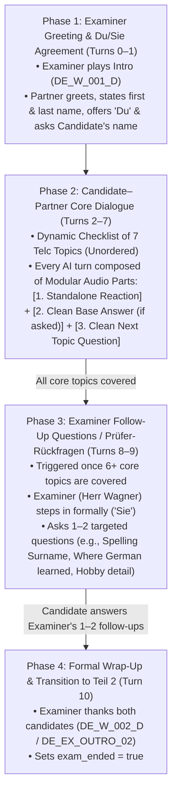

# Telc B1 Speaking Exam (Teil 1: Kontaktaufnahme) — Comprehensive Gap Analysis & Simulation Blueprint

## 1. Executive Summary & Gap Matrix

An exhaustive audit of the **9 authentic Telc Deutsch B1 oral exam transcripts** (`exam_generator/telcexam1.md` through `telcexam9.md`), the current local prompt configuration (`assets/exam_prompts/b1_speaking_teil1_prompt_config.json`), the remote S3 dialogue manifest (`B1_Exam_Sample_01/Teil_1/script.json`), and the Go WebSocket session/audio handlers (`handlers/session.go`, `handlers/exam.go`) reveals **10 critical functional and architectural gaps** between the real Telc B1 exam and our current simulation.

### 1.1 Empirical Analysis Across the 9 Real Telc B1 Transcripts

| Exam ID | Candidates | Format Style | "Du / Sie" Negotiation? | Topics Covered by Candidates | Examiner Follow-Up (Prüfer-Rückfragen)? | Examiner Transition Line |
| :--- | :--- | :--- | :--- | :--- | :--- | :--- |
| **`telcexam1`** | Bahman (Afghanistan/Iran) & Hassan (Syrien) | True Partner Dialogue (42–44 turns) | **Yes** (*"Hallo, können wir du oder Sie sagen?"* → *"Kannst du ruhig du sagen."*) | Vorname/Nachname, Herkunft, Muttersprache/Sprachen, Familienstand/Kinder, Wohnort (Haus/WG), **Wo Deutsch gelernt**, Beruf/Ausbildung | **Implicit check** (*"Sprachen hatten Sie ja schon vorher. Dann ist Teil 1 auch schon fertig."*) | *"Dann ist Teil 1 auch schon fertig. Und wir kommen zu Teil 2."* |
| **`telcexam2`** | Hannah (Ukraine) & Omar (Syrien) | True Partner Dialogue (23–24 turns) | **Yes** (*"Wollen wir du oder Sie sagen?"* → *"Hallo, wir können du sagen."*) | Name, Herkunft (Stadt), Familie/Kinder, **Wo Deutsch gelernt**, Wohnort (Haus/WG), Beruf, Sprachen | None needed (all 7 official points + Deutsch gelernt covered in dialogue) | *"Das war Teil eins. Dann kommen wir zu Teil zwei über ein Thema sprechen."* |
| **`telcexam3`** | Nilufar (Iran) & Janusz (Polen) | True Partner Dialogue (35 turns) | **Yes** (*"Darf ich Sie duzen?"* → *"Sie dürfen mich duzen, ich mag das sehr gerne."*) | Vorname/Nachname, Herkunft, Wohnort (Bezirk), Familie, Sprachen (Muttersprache + weitere Sprachen) | None (cut at ~3:30 mark after deep language discussion) | *"Okay, super, vielen Dank. Das war schon Teil 1. Schon geschafft. Kommen wir zu Teil 2."* |
| **`telcexam4`** | Metin (Türkei) & Herr Doğan (Türkei) | Non-standard / Monologue Intro | No (Instructor-led monologue) | Name, Alter, Herkunft, Wohnort, Beruf, Familienstand/Kind, Deutschziel | N/A (Informal classroom simulation) | *"Ja, dankeschön. Ich würde sagen, das Nächste ist..."* |
| **`telcexam5`** | Roselin (Türkei) & Eren (Türkei) | Partner Dialogue + **Active Examiner Follow-ups** | Implicit *"du"* from turn 1 | Vorname, Herkunft, Wohnort (Essen/Duisburg), Familienname, Alter, Sprachen | **Yes — 2 direct examiner questions:**<br>1. *"Wo haben Sie Deutsch gelernt?"*<br>2. *"Genau. Was möchten Sie beruflich machen?"* | *"Ja, dann viel Erfolg. Dankeschön. So, jetzt kommen wir zum zweiten Teil."* |
| **`telcexam6`** | Nilo (Argentinien) & Pilar (Kolumbien) | Partner Dialogue + **Examiner Interjection** | **Yes** (*"Wollen wir du oder Sie sagen?"* → *"Lass uns du sagen."*) | Vorname/Nachname, Herkunft (Geburtsstadt), Wohnort (WG), Familie, **Wo Deutsch gelernt**, Studium/Beruf/Ausbildung, Sprachen | **Yes — Examiner interjects mid-topic:**<br>*"Arbeitest du auch?"* (and reacts *"Cool!"* at the end) | *"Danke. Jetzt kommen wir zu Teil 2."* |
| **`telcexam7`** | Fatima (Syrien) & Abi (Bangladesch) | Non-standard / Monologue Intro | No (Sequential monologue) | Name, Herkunft, Alter, Wohnort, Sprachen, Beruf, Hobbys | None (Sequential monologue variant) | *"Dann bedanke ich mich bei Ihnen für den ersten Teil dieser Prüfung."* |
| **`telcexam8`** | Esan (Türkei) & Tom (Türkei) | Partner Dialogue + **End Examiner Follow-ups** | **Yes** (*"Darf ich dir duzen? Ja, natürlich."*) | Vorname/Nachname, Alter, Herkunft, Wohnort, **Wo/Wann Deutsch gelernt**, Familie/Wohnung, Beruf/Ausbildung, Sprachen, **Warum Deutsch lernen** | **Yes — 2 direct examiner questions at the end:**<br>1. *"Dann stelle ich auch eine Frage. So, Frau Inci, was sind Ihre Hobbys?"*<br>2. *"Herr Kılıç, was machen Sie in Ihrer Freizeit?"* | *"So, das war Teil 1. Wir machen jetzt mit dem zweiten Teil weiter."* |
| **`telcexam9`** | Hanna (Ukraine) & Omar (Syrien) | True Partner Dialogue | **Yes** (*"Hallo, wollen wir mit du oder Sie sagen?"* → *"Wir können du sagen."*) | Vorname/Nachname, Herkunft, Wohnort (Wohnung/WG), Familienstand/Kinder, Sprachen, **Wo/Seit wann Deutsch gelernt** & Ausbildung | Co-candidate/Examiner prompts (*"Und du?"*) | *"Das war sehr schön. Gut, ja, jetzt kommen wir zu Teil 2..."* |

---

### 1.2 Comprehensive Gap Matrix

| # | Dimension | Standard Telc B1 Teil 1 Requirement (Official & Empirical) | Current App State (`b1_speaking_teil1_prompt_config.json` & `script.json`) | Proposed Fix (Blueprint Design) |
| :--- | :--- | :--- | :--- | :--- |
| **1** | **Modular vs. Baked-in Reactions** | Candidates react naturally to what the partner just said (*"Ehrlich?"*, *"Schön!"*, *"Oh ja, ich verstehe"*, *"Interessant"*), and only when a statement precedes it. | **Baked into Base Answers:** S3 `script.json` hardcodes reactions inside answer clips (e.g., `DE_L_002_A`: *"Schön! Ich komme..."*, `DE_L_003_A`: *"Ah, interessant. Ich lebe..."*, `DE_L_005_A`: *"Verstehe. Ich spreche..."*, `DE_L_007_A`: *"Oh, okay. In meiner Freizeit..."*). If the user asks a question first or the LLM generates a reaction part, the partner either reacts to a question nonsensically or repeats the reaction twice. | **Strict Modular Audio Split:** Record **Category A (Standalone Expression Clips)** separately from **Category B (Clean Base Questions & Answers)**. The LLM dynamically chains `[Expression Audio ID] + [Clean Answer Audio ID] + [Clean Question Audio ID]` in `parts`. |
| **2** | **"Du" vs. "Sie" Opening Ritual** | **6 of 7** authentic dialogic transcripts (`telcexam1, 2, 3, 6, 8, 9`) explicitly negotiate *"Wollen wir du oder Sie sagen?"* / *"Darf ich Sie duzen?"* in the first 2 turns. | **Missing:** `DE_L_001_Q` immediately uses *"du"* (*"Ich freue mich, dich kennenzulernen... Und wie heißt du?"*) with zero `Du/Sie` negotiation clips. | Add dedicated **Du/Sie Agreement** base clips (`Q` and `A` variants) in Phase 1 so the partner either proposes *"du"* or responds naturally when the user asks *"Wollen wir du oder Sie sagen?"*. |
| **3** | **Official Telc B1 Prompt Card Topics ("Deutsch gelernt")** | Official Telc B1 *Kontaktaufnahme* sheet lists: **1. Name, 2. Woher, 3. Wie/Wo wohnen (Wohnung/Haus/WG), 4. Familie, 5. Wo Deutsch gelernt, 6. Was machen Sie (Schule/Studium/Beruf), 7. Sprachen (welche/wie lange/warum)** (+ Hobbys/Freizeit in Prüfer-Rückfragen). **6 of 9** transcripts explicitly ask *"Wo hast du Deutsch gelernt?"*. | **Missing Topic & Misaligned Card:** `exam_hint` lists `Name? Alter? Land? Wohnort? Sprachen? Beruf? Hobby?` and omits **"Wo hast du Deutsch gelernt?"** and housing details (Wohnung/Haus/WG). Also `DE_L_001` has no answer clip (`DE_L_001_A`) if the user asks the partner's name or surname first! | Update `exam_hint` and topic tracker to include **Name (Vor- & Nachname), Herkunft, Wohnort (Wohnung/WG/Haus), Familie, Beruf/Ausbildung, Sprachen & Wo Deutsch gelernt, Hobbys/Freizeit**, with complete `Q` and `A` coverage for every topic including Name/Nachname. |
| **4** | **Examiner Follow-Up Questions (*Prüfer-Rückfragen*)** | Official Telc B1 guidelines and `telcexam5`, `telcexam6`, `telcexam8` feature the **Examiner stepping in at the end of the candidate dialogue** to ask 1–2 short follow-up questions (*"Dann stelle ich auch eine Frage..."*, *"Wo haben Sie Deutsch gelernt?"*, *"Was machen Sie in Ihrer Freizeit?"*, *"Wie schreibt man Ihren Nachnamen?"*). | **Explicitly Forbidden by Prompt:** Current config states: *"The examiner is a PASSIVE OBSERVER and MUST REMAIN SILENT... with ONLY THREE strictly defined exceptions (wrong direction, inappropriate content, conclusion)."* | Introduce **Phase 3 (Prüfer-Rückfragen)**: Once the core partner dialogue covers 5–6 topics, `{{secondary_speaker}}` (Examiner) steps in to ask **1–2 targeted pre-recorded follow-up questions** (addressed formally with *"Sie"*) before concluding Teil 1. |
| **5** | **Rigid Linear Topic Order vs. Natural Turn-Taking** | Real candidates jump topics organically based on context (e.g., Origin → Mother tongue in `telcexam1`; Origin → Family → Deutsch gelernt in `telcexam2`) and frequently use short counter-questions (*"Und du?"*, *"Und bei dir?"*). | **Robotic Fixed Order:** Prompt forces strict sequence (`Name -> Origin -> Residence -> Work -> Languages -> Family -> Hobbies`) and lacks standalone *"Und du?"* / *"Und bei dir?"* audio clips. | Replace rigid ordering with **Unordered Checklist Tracking** in the prompt + pre-recorded **Counter-Question Clips** (`"Und du?"`, `"Und wie ist es bei dir?"`) so the AI follows the user's lead and picks any remaining uncovered topic naturally. |
| **6** | **Partner Persona Variety** | Candidates meet diverse partners in real exams (Syria, Ukraine, Turkey, Poland, Colombia, Argentina, Iran, Afghanistan, Bangladesh). | **Single Static Persona:** Hardcoded solely to `Leyla` (Turkish teacher in Münster). Practicing twice yields the exact same partner biography and answers. | **5 Rotating Partner Personas:** Implement 5 complete, culturally authentic B1 partner profiles (`Leyla`, `Omar`, `Elena`, `Mateo`, `Janusz`) with distinct voices, biographies, and pre-recorded audio sets. |
| **7** | **Politeness & Closing Exchanges** | In `telcexam2`, `telcexam6`, `telcexam8`, `telcexam9`, candidates thank each other at the end of their dialogue (*"Danke für das Gespräch"* → *"Danke dir / Freut mich"*) right before the examiner transitions. | No pre-recorded clips for polite mid-dialogue or end-of-dialogue acknowledgments (*"Gerne!"*, *"Freut mich!"*, *"Danke gleichfalls!"*, *"Ich wünsche dir viel Erfolg!"*). | Add pre-recorded **Social/Politeness & Mutual Encouragement Clips** (inspired by `telcexam2`: *"Ich wünsche dir viel Erfolg!"* and `telcexam6/9`: *"Danke für das Gespräch!"*). |
| **8** | **Backend TTS Waste on Pre-recorded Audio (`handlers/exam.go`)** | When an LLM response part has a valid `audio_id`, the server should **only** emit `play_audio_id` and **never** call ElevenLabs TTS for that part. | **Critical Bug in `handlers/exam.go` (lines 187–196):** The Go handler loops over `responseData.Parts` and calls `tts.Synthesize(ctx, t, vID)` for **every** part where `text != ""`, **even when `audio_id` is non-null**, then discards the synthesized bytes at line 221! This wastes ElevenLabs credits and adds 300–800ms of unnecessary latency to every pre-recorded turn. | Audit finding documented for implementation phase: Guard `tts.Synthesize` in `handlers/exam.go` with `if audioID == "" && text != ""`. |
| **9** | **Frontend Script Map & Audio Pre-downloader (`exam_service.dart`)** | All pre-recorded clips (expressions, base Q/A, follow-up Q/A, examiner prompts) must be cached and mapped by `audio_id`. | `ExamService.downloadAllAudio` and `SpeakingExamCubit._populateScriptMaps` only read `interaction.question`, `interaction.answer`, and `interaction.dialogue` per topic object. | Structure the expanded `script.json` so every modular expression, base clip, and examiner follow-up is represented as standard `interaction` entries (`dialogue` / `question` / `answer`) for 100% backward compatibility with the current Dart model. |
| **10** | **Examiner Intro & Handover Authenticity** | In real exams (`telcexam1, 2, 3, 5, 6, 8, 9`), the examiner welcomes both candidates, introduces the co-examiner, explains the 3-part structure + dialogic format (*"Frage-Antwort, Frage-Antwort"*), and invites them to start. | `auto_play_sequence` immediately plays `DE_W_001_D` + `DE_L_001_Q` back-to-back, forcing the AI partner to always speak first and never letting the candidate initiate the greeting. | Keep `auto_play_sequence: ["DE_W_001_D", "DE_<P>_OPEN_01"]` as default while providing alternative examiner intros and clean `DUSIE_A1` / `NAME_A1` clips when the user speaks or asks back. |

---

## 2. Authentic Flow Breakdown (Chronological)

To replicate a real Telc Deutsch B1 *Teil 1: Kontaktaufnahme* (~3 minutes total, 8–12 conversational turns), the simulation progresses through **4 chronological phases**:



### Phase 1: Examiner Greeting, "Du/Sie" Agreement & Opening (Turns 0–1)
1. **Examiner Welcome (`auto_play_sequence` Part 1):**
   - `{{secondary_speaker}}` (Examiner) welcomes both candidates, introduces their co-examiner, explains that the oral exam has 3 parts starting with *Teil 1: Kontaktaufnahme* in dialogue form (*Frage und Antwort*), and hands the floor to the candidates.
2. **Partner Opening & Du/Sie Proposal (`auto_play_sequence` Part 2):**
   - `{{primary_speaker}}` (Partner) greets the user warmly, introduces their first and last name, proposes using *"du"* (*"Wollen wir du sagen? Ich heiße [Vorname] [Nachname]. Und wie heißt du?"*), and yields the turn.
   - **If the user asks *"Wollen wir du oder Sie sagen?"* or *"Wie ist dein Nachname?"*:** The partner uses clean pre-recorded base clips (`DE_<P>_DUSIE_A1`, `DE_<P>_NAME_A1`) to respond naturally.

### Phase 2: Candidate–Partner Dialogue (Core 7 Topics + Modular Reactions, Turns 2–7)
Instead of a rigid railway track, the LLM maintains an internal **7-Topic Coverage Checklist** aligned with the official Telc B1 candidate prompt sheet:
1. **Name & Nachname** (First & Last Name)
2. **Herkunft & Heimatstadt** (Country of Origin & Hometown)
3. **Wohnort & Wohnsituation** (Current City in Germany, Wohnung / Haus / WG)
4. **Familie & Familienstand** (Single/Married, Children, Siblings, Where family lives)
5. **Beruf, Studium oder Ausbildung** (Current job, profession in home country, Ausbildung/study plans)
6. **Sprachen & Deutschlernen** (Mother tongue, other languages, **where/how long learning German**)
7. **Hobbys & Freizeit** (Weekend activities, sports, interests)

#### The Modular 3-Part Turn Composition Rule:
In every turn during Phase 2, `{{primary_speaker}}` constructs the `parts` array strictly from pre-recorded `audio_id` building blocks:
- **Slot 1 — Standalone Reaction (`DE_<P>_EXP_*`):** Pick 1 contextually appropriate reaction clip matching the emotion of what the user just shared (e.g., empathetic/neutral `"Ach so, ich verstehe."` if the user lives alone or is looking for work; enthusiastic `"Oh, schön!"` or `"Das klingt ja toll!"` if they share a hobby or family news; `"Ah, interessant!"` for origin/languages). **Never** play a celebratory clip (`"Super!"`) if the user says something sad or difficult.
- **Slot 2 — Clean Base Answer (`DE_<P>_*_A1`) [Conditional]:** If (and ONLY if) the user asked the partner a question (e.g., *"Und du?"*, *"Woher kommst du?"*, *"Bist du verheiratet?"*) and the partner hasn't answered that topic yet, play the clean base answer clip for that topic.
- **Slot 3 — Clean Base Question (`DE_<P>_*_Q1` / `Q2`):** Pick the question clip for the next uncovered topic on the checklist (or a natural counter-question `"Und du?"` if the user asked a question first without stating their own answer).

### Phase 3: Examiner Follow-Up Questions (*Prüfer-Rückfragen*, Turns 8–9)
In real Telc B1 exams (`telcexam5`, `telcexam6`, `telcexam8`), once the candidates have introduced themselves across the main topics, the examiner steps in before ending Teil 1:
- **Trigger:** At least 6 of the 7 core topics have been discussed between the candidates.
- **Examiner Turn 1:** `{{primary_speaker}}` wraps up their last answer or says `"Vielen Dank für das nette Gespräch!"` (`DE_<P>_CLOSE_01`), and `{{secondary_speaker}}` (Role: `Examiner`) steps in with a transition + 1st follow-up question addressed formally (`"Sie"`):
  - If the user's **surname spelling** wasn't asked: `DE_EX_FOLLOW_01` (*"Vielen Dank Ihnen beiden. Dann stelle ich auch noch eine kurze Frage an Sie: Können Sie mir bitte Ihren Familiennamen buchstabieren?"*)
  - Or if **where they learned German** wasn't detailed: `DE_EX_FOLLOW_02` (*"Danke schön. Ich hätte noch eine kurze Frage an Sie: Wo und wie lange haben Sie denn schon Deutsch gelernt?"*)
  - Or about **hobbies/weekend**: `DE_EX_FOLLOW_03` (*"Vielen Dank. Dann stelle ich Ihnen auch noch eine Frage: Was machen Sie denn besonders gern am Wochenende in Ihrer Freizeit?"*)
  - Or about **future plans in Germany**: `DE_EX_FOLLOW_04` (*"Danke sehr. Eine kurze Zusatzfrage hätte ich noch an Sie: Was möchten Sie beruflich in Zukunft hier in Deutschland machen?"*)
- **Candidate Response → Phase 4:** Once the user answers the examiner's follow-up question, the examiner proceeds immediately to Phase 4.

### Phase 4: Formal Wrap-Up & Transition to Teil 2 (Turn 10)
- `{{secondary_speaker}}` (Role: `Examiner`) plays the official closing clip `DE_W_002_D` (or `DE_EX_OUTRO_02`):
  *"Sehr schön, vielen Dank für das nette Gespräch. Damit schließen wir den ersten Teil der Prüfung ab."*
- The LLM sets `"exam_ended": true`.

---

## 3. The 5 Rotating Partner Personas (Specifications)

To ensure high replayability and reflect the authentic diversity of Telc B1 test-takers seen in `telcexam1`–`telcexam9`, we define **5 complete rotating partner personas**. Each persona has a distinct age, country of origin, German city, housing situation, family status, profession, language profile, German-learning history, and hobbies.

### Overview of the 5 Partner Personas

| Persona ID | Name | Gender / Age | Origin (City, Country) | Residence in Germany | Family Status | Profession / Ausbildung | Languages & German Learning | Hobbies / Free Time | Suggested ElevenLabs Voice Profile |
| :--- | :--- | :--- | :--- | :--- | :--- | :--- | :--- | :--- | :--- |
| **`P1` (`LEYLA`)** | **Leyla Yılmaz** | Female, 29 | Izmir, Turkey | Münster (Apartment with husband & kids) | Married, 2 children (parents in Turkey) | Primary school teacher (working part-time at a school) | Turkish (native), English, German (learned for 2 years at VHS Münster) | Walking in the park, cycling, cooking Turkish food | `NE7AIW5DoJ7lUosXV2KR` (Existing Leyla voice) |
| **`P2` (`OMAR`)** | **Omar Al-Masri** | Male, 25 | Damascus, Syria | Berlin-Neukölln (3-person WG) | Single, no children, 2 brothers (family in Syria) | Accountant by training; currently doing an *Ausbildung* as *Kaufmann für Büromanagement* | Arabic (native), English, a little French, German (learned in an *Integrationskurs* for 1 year) | Fitness studio, playing football in a club, meeting friends for coffee | Male young-adult warm voice (e.g., `ErXwobaYiN019PkySvjV`) |
| **`P3` (`ELENA`)** | **Elena Kovalenko** | Female, 34 | Kharkiv, Ukraine | München (3-room apartment near center) | Married, 1 son (8 years old) | Nurse (*Krankenschwester*); currently doing a hospital internship for diploma recognition (*Anerkennung*) | Ukrainian (native), Russian, basic English, German (learned online and at a language school for 1.5 years) | Reading books, painting, swimming, going to the park with her son | Female calm European voice (e.g., `EXAVITQu4vr4xnSDxMaL`) |
| **`P4` (`MATEO`)** | **Mateo Morales** | Male, 27 | Madrid, Spain | Frankfurt am Main (Small studio apartment) | Single, lives alone; 1 younger sister in Madrid | Software developer / IT technician; working at a small IT company in Frankfurt | Spanish (native), fluent English, a bit of Italian, German (learned at university in Madrid & evening course in Frankfurt) | Playing guitar, jogging by the river, watching movies, traveling | Male upbeat voice (e.g., `TxGEqnHWrfWFTfGW9XjX`) |
| **`P5` (`JANUSZ`)** | **Janusz Kamiński** | Male, 38 | Kraków, Poland | Essen (House with a small garden) | Married, 1 daughter (10) and 1 son (6) | Trained electrician / technician; working at an automotive parts company in the Ruhrgebiet | Polish (native), English, basic Russian, German (learned at work with international colleagues & evening VHS course) | Gardening, grilling on weekends, watching football, cycling with family | Male mature grounded voice (e.g., `VR6AewLTigWG4xSOukaG`) |

---

## 4. Complete Audio Recording Script Checklist

Every audio line below is engineered according to the **Modular Audio Architecture**:
- **Zero baked-in reactions** in Category B (Clean Base Dialogue). Every answer in Category B can be played immediately after a user's question OR chained after a Category A reaction clip without ever sounding repetitive or unnatural.
- **Consistent ID Naming Convention:**
  - `DE_<PERSONA>_EXP_<NN>`: Category A — Standalone Modular Expressions / Reactions (recorded per persona so the voice timber matches seamlessly when concatenated with Category B clips).
  - `DE_<PERSONA>_<TOPIC>_Q<N>` / `DE_<PERSONA>_<TOPIC>_A<N>`: Category B — Clean Base Questions, Answers, and Counter-questions (`LEY` = Leyla, `OMA` = Omar, `ELE` = Elena, `MAT` = Mateo, `JAN` = Janusz).
  - `DE_EX_<TYPE>_<NN>` (plus existing `DE_W_001_D` and `DE_W_002_D`): Category C — Examiner Audio (`Herr Wagner`).

---

### Category A: Modular Expressions / Reactions (`DE_<P>_EXP_01` – `DE_<P>_EXP_18`)

> **Recording Note:** Record these 18 short, standalone micro-clips (0.8s – 2.0s each) for **each of the 5 partner personas** (`LEY`, `OMA`, `ELE`, `MAT`, `JAN`) so that `[Expression Audio] + [Base Dialogue Audio]` has zero voice switching within a turn.

| Base Expression ID (`<P>` = `LEY`/`OMA`/`ELE`/`MAT`/`JAN`) | Clean German Text | Tone / Emotion | Semantic Usage Trigger (When the LLM selects this clip) |
| :--- | :--- | :--- | :--- |
| **`DE_<P>_EXP_01`** | `"Ah, interessant!"` | Curious, engaged | User shares their country of origin, hometown, languages, or profession. |
| **`DE_<P>_EXP_02`** | `"Oh, schön!"` | Warm, positive | User mentions their family, children, hometown, or a nice apartment/city. |
| **`DE_<P>_EXP_03`** | `"Super!"` | Upbeat, encouraging | User agrees to use *"du"*, or shares a positive hobby, job, or achievement. |
| **`DE_<P>_EXP_04`** | `"Das klingt ja toll!"` | Enthusiastic, friendly | User describes an enjoyable hobby, an interesting job/study field, or nice living situation. |
| **`DE_<P>_EXP_05`** | `"Ach so, ich verstehe."` | Neutral, empathetic, nodding | User says they are single, live alone, are currently unemployed/looking for work, or family is far away. |
| **`DE_<P>_EXP_06`** | `"Oh, wirklich? Das ist ja spannend!"` | Surprised (positive) | User mentions speaking many languages, an unusual profession, or living in Germany for a long/short time. |
| **`DE_<P>_EXP_07`** | `"Alles klar!"` | Casual, acknowledging | User answers a name/spelling/age question or confirms a short fact. |
| **`DE_<P>_EXP_08`** | `"Ja, das kenne ich gut."` | Relatable, empathetic | User mentions learning German at a language school/VHS, finding grammar hard, or missing home. |
| **`DE_<P>_EXP_09`** | `"Cool!"` | Casual, friendly | User shares modern hobbies (sport, music, films, gaming, travel) or languages (`telcexam6`). |
| **`DE_<P>_EXP_10`** | `"Ah, okay!"` | Neutral acknowledgement | Universal safe transition reaction after any factual statement (age, city, apartment size). |
| **`DE_<P>_EXP_11`** | `"Das freut mich!"` | Warm, polite | Right after user introduces their name or says *"Freut mich"*. |
| **`DE_<P>_EXP_12`** | `"Oh, ich auch!"` | Excited connection | User mentions a shared trait (e.g., also learning at a language school, also married, also likes sport). |
| **`DE_<P>_EXP_13`** | `"Ja, das stimmt."` | Agreeing | User makes a general observation (e.g., *"Deutsch ist wichtig für die Arbeit"* or *"Die Wohnungssuche ist schwer"*). |
| **`DE_<P>_EXP_14`** | `"Ich wünsche dir viel Erfolg dabei!"` | Warm, supportive | User says they are looking for a job, an *Ausbildung*, an apartment, or preparing for B2 (`telcexam2`). |
| **`DE_<P>_EXP_15`** | `"Gerne! Kein Problem."` | Polite, reassuring | User says *"Danke"* or *"Vielen Dank"* mid-conversation. |
| **`DE_<P>_EXP_16`** | `"Oh, das tut mir leid."` | Empathetic, gentle | User mentions a difficult situation (e.g., stressed, sick, or family member passed away as in `telcexam3`). |
| **`DE_<P>_EXP_17`** | `"Sehr gut!"` | Encouraging | User answers a question clearly or completes a multi-part explanation. |
| **`DE_<P>_EXP_18`** | `"Danke, gleichfalls!"` | Polite reciprocation | User wishes the partner good luck or says *"Schön, dich kennenzulernen"*. |

---

### Category B: Clean Base Dialogue (Questions, Answers & Counter-Questions for All 5 Personas)

#### B.0 Universal / Shared Structural Questions & Counter-Questions (Recorded per Persona `<P>` = `LEY`, `OMA`, `ELE`, `MAT`, `JAN`)

These clean question clips and counter-questions are identical in text across all 5 personas (recorded in each persona's voice) so any persona can ask any topic question or short counter-question cleanly:

| Audio ID (`<P>` = `LEY`/`OMA`/`ELE`/`MAT`/`JAN`) | Speaker Role | Topic | Clean Text (Zero Leading Fillers) |
| :--- | :--- | :--- | :--- |
| **`DE_<P>_DUSIE_Q1`** | Participant | Du/Sie Agreement | `"Hallo! Wollen wir du oder Sie sagen?"` |
| **`DE_<P>_DUSIE_A1`** | Participant | Du/Sie Agreement | `"Ja, gerne! Wir können sehr gerne du sagen."` |
| **`DE_<P>_NAME_Q1`** | Participant | Name | `"Wie heißt du? Und wie ist dein Nachname?"` |
| **`DE_<P>_NAME_Q2`** | Participant | Name (Surname follow-up) | `"Und wie ist dein Familienname?"` |
| **`DE_<P>_AGE_Q1`** | Participant | Age | `"Und wie alt bist du, wenn ich fragen darf?"` |
| **`DE_<P>_ORIG_Q1`** | Participant | Origin | `"Woher kommst du eigentlich?"` |
| **`DE_<P>_ORIG_Q2`** | Participant | Origin (Hometown follow-up) | `"Aus welcher Stadt kommst du genau?"` |
| **`DE_<P>_RES_Q1`** | Participant | Residence | `"Wo wohnst du jetzt hier in Deutschland?"` |
| **`DE_<P>_RES_Q2`** | Participant | Residence (Housing detail) | `"Wohnst du in einer Wohnung, in einem Haus oder in einer WG?"` |
| **`DE_<P>_FAM_Q1`** | Participant | Family | `"Lebst du allein hier oder hast du Familie in Deutschland?"` |
| **`DE_<P>_FAM_Q2`** | Participant | Family (Marital/Kids) | `"Bist du verheiratet und hast du Kinder?"` |
| **`DE_<P>_WORK_Q1`** | Participant | Work & Education | `"Was machst du beruflich? Arbeitest du schon oder machst du eine Ausbildung?"` |
| **`DE_<P>_LANG_Q1`** | Participant | Languages | `"Welche Sprachen sprichst du? Was ist deine Muttersprache?"` |
| **`DE_<P>_GER_Q1`** | Participant | Learning German | `"Wo und wie lange hast du schon Deutsch gelernt?"` |
| **`DE_<P>_HOB_Q1`** | Participant | Hobbies & Free Time | `"Was machst du gern in deiner Freizeit? Hast du Hobbys?"` |
| **`DE_<P>_BACK_Q1`** | Participant | Counter-question | `"Und du?"` |
| **`DE_<P>_BACK_Q2`** | Participant | Counter-question | `"Und wie ist das bei dir?"` |
| **`DE_<P>_CLAR_Q1`** | Participant | Clarification | `"Entschuldigung, kannst du das bitte noch einmal wiederholen? Ich habe dich akustisch nicht ganz verstanden."` |
| **`DE_<P>_SIL_Q1`** | Participant | Silence Recovery | `"Hallo? Bist du noch da? Wollen wir weitermachen?"` |
| **`DE_<P>_CLOSE_01`** | Participant | Dialogue Closing | `"Vielen Dank für das nette Gespräch! Es hat mich sehr gefreut, dich kennenzulernen."` |

---

#### B.1 Persona 1: Leyla Yılmaz (`LEY`) — Clean Base Answers & Opening

| Audio ID | Speaker Role | Persona | Topic | Clean Text |
| :--- | :--- | :--- | :--- | :--- |
| **`DE_LEY_OPEN_01`** | Participant | Leyla | Opening + Name + Du/Sie | `"Hallo! Wollen wir du sagen? Ich fange einfach mal an: Ich heiße Leyla Yılmaz. Und wie heißt du?"` |
| **`DE_LEY_NAME_A1`** | Participant | Leyla | Name & Surname | `"Mein Vorname ist Leyla und mein Nachname ist Yılmaz. Das schreibt man Y-I-L-M-A-Z."` |
| **`DE_LEY_AGE_A1`** | Participant | Leyla | Age | `"Ich bin neunundzwanzig Jahre alt."` |
| **`DE_LEY_ORIG_A1`** | Participant | Leyla | Origin | `"Ich komme ursprünglich aus der Türkei, aus Izmir. Das ist eine schöne große Stadt direkt am Meer."` |
| **`DE_LEY_RES_A1`** | Participant | Leyla | Residence | `"Ich lebe seit fast zwei Jahren in Deutschland und wohne in Münster. Wir haben dort eine gemütliche Dreizimmerwohnung."` |
| **`DE_LEY_FAM_A1`** | Participant | Leyla | Family | `"Ich bin verheiratet und habe zwei kleine Kinder, einen Sohn und eine Tochter. Meine Eltern und meine Schwester wohnen aber noch in der Türkei."` |
| **`DE_LEY_WORK_A1`** | Participant | Leyla | Work & Education | `"Von Beruf bin ich Grundschullehrerin. Zurzeit arbeite ich in Teilzeit an einer Schule hier in Münster."` |
| **`DE_LEY_LANG_A1`** | Participant | Leyla | Languages | `"Meine Muttersprache ist Türkisch. Außerdem spreche ich gut Englisch und natürlich lerne ich jeden Tag Deutsch."` |
| **`DE_LEY_GER_A1`** | Participant | Leyla | Learning German | `"Ich habe hier in Münster an der Volkshochschule einen Integrationskurs gemacht, weil ich für meine Arbeit als Lehrerin gut Deutsch sprechen muss."` |
| **`DE_LEY_HOB_A1`** | Participant | Leyla | Hobbies & Free Time | `"In meiner Freizeit gehe ich sehr gerne mit meinen Kindern im Park spazieren, ich fahre viel Fahrrad und am Wochenende koche ich gerne für meine Familie."` |

---

#### B.2 Persona 2: Omar Al-Masri (`OMA`) — Clean Base Answers & Opening

| Audio ID | Speaker Role | Persona | Topic | Clean Text |
| :--- | :--- | :--- | :--- | :--- |
| **`DE_OMA_OPEN_01`** | Participant | Omar | Opening + Name + Du/Sie | `"Hallo! Können wir ruhig du sagen? Ich heiße Omar Al-Masri. Und wie ist dein Name?"` |
| **`DE_OMA_NAME_A1`** | Participant | Omar | Name & Surname | `"Ich heiße Omar, und mein Familienname ist Al-Masri."` |
| **`DE_OMA_AGE_A1`** | Participant | Omar | Age | `"Ich bin fünfundzwanzig Jahre alt."` |
| **`DE_OMA_ORIG_A1`** | Participant | Omar | Origin | `"Ich komme aus Syrien, aus der Hauptstadt Damaskus."` |
| **`DE_OMA_RES_A1`** | Participant | Omar | Residence | `"Momentan wohne ich in Berlin in einer Wohngemeinschaft mit zwei Freunden. Aber ich suche gerade eine eigene kleine Wohnung."` |
| **`DE_OMA_FAM_A1`** | Participant | Omar | Family | `"Ich bin noch ledig und habe keine Kinder. Meine Eltern und meine zwei Brüder leben noch in Syrien."` |
| **`DE_OMA_WORK_A1`** | Participant | Omar | Work & Education | `"In Syrien habe ich als Buchhalter gearbeitet. Jetzt mache ich hier in Berlin eine Ausbildung als Kaufmann für Büromanagement."` |
| **`DE_OMA_LANG_A1`** | Participant | Omar | Languages | `"Meine Muttersprache ist Arabisch. Außerdem spreche ich Englisch, ein wenig Französisch und jetzt natürlich Deutsch."` |
| **`DE_OMA_GER_A1`** | Participant | Omar | Learning German | `"Ich lerne seit einem Jahr Deutsch in einer Sprachschule in Berlin. Für meine Ausbildung im Büro brauche ich das B1-Zertifikat."` |
| **`DE_OMA_HOB_A1`** | Participant | Omar | Hobbies & Free Time | `"Nach der Arbeit gehe ich regelmäßig ins Fitnessstudio, ich spiele Fußball im Verein und am Wochenende treffe ich mich gern mit Freunden im Café."` |

---

#### B.3 Persona 3: Elena Kovalenko (`ELE`) — Clean Base Answers & Opening

| Audio ID | Speaker Role | Persona | Topic | Clean Text |
| :--- | :--- | :--- | :--- | :--- |
| **`DE_ELE_OPEN_01`** | Participant | Elena | Opening + Name + Du/Sie | `"Guten Tag! Wollen wir uns duzen? Mein Name ist Elena Kovalenko. Und wie heißt du?"` |
| **`DE_ELE_NAME_A1`** | Participant | Elena | Name & Surname | `"Mein Vorname ist Elena und mein Nachname ist Kovalenko."` |
| **`DE_ELE_AGE_A1`** | Participant | Elena | Age | `"Ich bin vierunddreißig Jahre alt."` |
| **`DE_ELE_ORIG_A1`** | Participant | Elena | Origin | `"Ich komme aus der Ukraine, aus der Stadt Charkiw."` |
| **`DE_ELE_RES_A1`** | Participant | Elena | Residence | `"Zurzeit wohne ich in München. Wir haben dort eine helle Wohnung mit drei Zimmern und einem kleinen Balkon."` |
| **`DE_ELE_FAM_A1`** | Participant | Elena | Family | `"Ich bin verheiratet und wir haben einen Sohn. Er ist acht Jahre alt und geht hier in die Grundschule."` |
| **`DE_ELE_WORK_A1`** | Participant | Elena | Work & Education | `"Ich bin Krankenschwester von Beruf. Im Moment mache ich ein Praktikum im Krankenhaus, weil ich auf die Anerkennung von meinem Diplom warte."` |
| **`DE_ELE_LANG_A1`** | Participant | Elena | Languages | `"Meine Muttersprache ist Ukrainisch, aber ich spreche auch fließend Russisch, ein bisschen Englisch und jetzt Deutsch."` |
| **`DE_ELE_GER_A1`** | Participant | Elena | Learning German | `"Zuerst habe ich drei Monate online im Internet Deutsch gelernt und danach einen Intensivkurs in München besucht."` |
| **`DE_ELE_HOB_A1`** | Participant | Elena | Hobbies & Free Time | `"In meiner Freizeit lese ich sehr gerne Bücher, ich male gern und am Wochenende gehe ich oft mit meinem Sohn schwimmen."` |

---

#### B.4 Persona 4: Mateo Morales (`MAT`) — Clean Base Answers & Opening

| Audio ID | Speaker Role | Persona | Topic | Clean Text |
| :--- | :--- | :--- | :--- | :--- |
| **`DE_MAT_OPEN_01`** | Participant | Mateo | Opening + Name + Du/Sie | `"Hallo! Lass uns gerne du sagen. Ich bin Mateo Morales. Und wie heißt du?"` |
| **`DE_MAT_NAME_A1`** | Participant | Mateo | Name & Surname | `"Ich heiße Mateo, und mein Nachname ist Morales, M-O-R-A-L-E-S."` |
| **`DE_MAT_AGE_A1`** | Participant | Mateo | Age | `"Ich bin siebenundzwanzig Jahre alt."` |
| **`DE_MAT_ORIG_A1`** | Participant | Mateo | Origin | `"Ich komme aus Spanien und bin in der Hauptstadt Madrid geboren."` |
| **`DE_MAT_RES_A1`** | Participant | Mateo | Residence | `"Ich wohne seit einem Jahr in Frankfurt am Main, allein in einer kleinen Zweizimmerwohnung in der dritten Etage."` |
| **`DE_MAT_FAM_A1`** | Participant | Mateo | Family | `"Ich bin ledig und wohne hier allein. Meine Eltern und meine jüngere Schwester leben alle noch in Madrid."` |
| **`DE_MAT_WORK_A1`** | Participant | Mateo | Work & Education | `"Ich bin Informatiker von Beruf und arbeite als Softwareentwickler bei einer Firma hier in Frankfurt."` |
| **`DE_MAT_LANG_A1`** | Participant | Mateo | Languages | `"Meine Muttersprache ist Spanisch. Außerdem spreche ich fließend Englisch, ein bisschen Italienisch und Deutsch."` |
| **`DE_MAT_GER_A1`** | Participant | Mateo | Learning German | `"Ich habe schon in Spanien an der Universität ein bisschen Deutsch gelernt und besuche jetzt abends nach der Arbeit einen Sprachkurs."` |
| **`DE_MAT_HOB_A1`** | Participant | Mateo | Hobbies & Free Time | `"In meiner Freizeit spiele ich gerne Gitarre, ich gehe oft am Fluss joggen und abends schaue ich gerne Filme."` |

---

#### B.5 Persona 5: Janusz Kamiński (`JAN`) — Clean Base Answers & Opening

| Audio ID | Speaker Role | Persona | Topic | Clean Text |
| :--- | :--- | :--- | :--- | :--- |
| **`DE_JAN_OPEN_01`** | Participant | Janusz | Opening + Name + Du/Sie | `"Guten Tag! Du kannst mich gerne duzen. Ich heiße Janusz Kamiński. Wie ist dein Name?"` |
| **`DE_JAN_NAME_A1`** | Participant | Janusz | Name & Surname | `"Mein Vorname ist Janusz und mein Familienname ist Kamiński."` |
| **`DE_JAN_AGE_A1`** | Participant | Janusz | Age | `"Ich bin achtunddreißig Jahre alt."` |
| **`DE_JAN_ORIG_A1`** | Participant | Janusz | Origin | `"Ich komme aus Polen, aus der Nähe von Krakau."` |
| **`DE_JAN_RES_A1`** | Participant | Janusz | Residence | `"Ich wohne jetzt seit drei Jahren in Essen, im Ruhrgebiet. Wir wohnen dort in einem kleinen Haus mit Garten."` |
| **`DE_JAN_FAM_A1`** | Participant | Janusz | Family | `"Ich bin verheiratet und habe zwei Kinder: eine Tochter, sie ist zehn, und einen Sohn, er ist sechs Jahre alt."` |
| **`DE_JAN_WORK_A1`** | Participant | Janusz | Work & Education | `"Von Beruf bin ich Elektriker und arbeite Vollzeit in einer großen Firma, die Autoteile herstellt."` |
| **`DE_JAN_LANG_A1`** | Participant | Janusz | Languages | `"Meine Muttersprache ist Polnisch. Ich spreche auch etwas Englisch, ein bisschen Russisch und natürlich Deutsch."` |
| **`DE_JAN_GER_A1`** | Participant | Janusz | Learning German | `"Am Anfang habe ich Deutsch direkt bei der Arbeit mit meinen Kollegen gelernt, und seit sechs Monaten mache ich noch einen Abendkurs."` |
| **`DE_JAN_HOB_A1`** | Participant | Janusz | Hobbies & Free Time | `"Am Wochenende arbeite ich gern im Garten, im Sommer grillen wir oft mit Freunden und ich schaue sehr gerne Fußball."` |

---

### Category C: Examiner Audio — Intro, Follow-Up Questions (*Prüfer-Rückfragen*), Interventions & Outro (`Herr Wagner`)

| Audio ID | Trigger Context | Clean German Text |
| :--- | :--- | :--- |
| **`DE_W_001_D`** *(Existing / Retained)* | **Phase 1: Opening Intro (Default)** | `"Guten Tag. Herzlich willkommen zur mündlichen Telc B1 Prüfung. Mein Name ist Herr Wagner und das ist mein Kollege, Herr Weber. Wir beginnen heute mit Teil eins: dem gegenseitigen Kennenlernen. Leyla, fangen Sie bitte an und unterhalten Sie sich mit Ihrem Partner."` |
| **`DE_EX_INTRO_02`** | **Phase 1: Opening Intro (Persona-Neutral Dialogic Intro — Matches `telcexam5` & `telcexam8`)** | `"Herzlich willkommen zur mündlichen Prüfung telc Deutsch B1. Mein Name ist Herr Wagner und das ist meine Kollegin Frau Fischer. Die Prüfung besteht aus drei Teilen. Wir beginnen mit Teil eins: Sie lernen sich im Dialog kennen, also immer Frage und Antwort. Bitte beginnen Sie."` |
| **`DE_EX_FOLLOW_01`** | **Phase 3: Examiner Follow-Up — Surname Spelling** (Triggered at end of partner dialogue if candidate hasn't spelled their surname) | `"Vielen Dank Ihnen beiden. Dann stelle ich auch noch eine kurze Frage an Sie: Können Sie mir bitte Ihren Familiennamen buchstabieren?"` |
| **`DE_EX_FOLLOW_02`** | **Phase 3: Examiner Follow-Up — How/Where German Learned** (Triggered like `telcexam5` if candidate didn't explain where they learned German) | `"Danke schön. Ich hätte noch eine kurze Frage an Sie: Wo und wie lange haben Sie denn schon Deutsch gelernt?"` |
| **`DE_EX_FOLLOW_03`** | **Phase 3: Examiner Follow-Up — Hobbies / Weekend** (Triggered like `telcexam8` if candidate's hobbies were brief or skipped) | `"Vielen Dank. Dann stelle ich Ihnen auch noch eine Frage: Was machen Sie denn besonders gern am Wochenende in Ihrer Freizeit?"` |
| **`DE_EX_FOLLOW_04`** | **Phase 3: Examiner Follow-Up — Career / Future Plans** (Triggered like `telcexam5` if work/study plans were brief) | `"Danke sehr. Eine kurze Zusatzfrage hätte ich noch an Sie: Was möchten Sie beruflich in Zukunft hier in Deutschland machen?"` |
| **`DE_EX_FOLLOW_05`** | **Phase 3: Examiner Follow-Up — Living Situation / City** (Triggered if candidate only named their city without saying how they like it) | `"Vielen Dank. Ich habe noch eine kurze Frage: Gefällt es Ihnen in Ihrem Wohnort, oder möchten Sie später umziehen?"` |
| **`DE_EX_INT_TOPIC`** | **Intervention 1: Off-Topic / Wrong Direction** (Candidate wanders off Teil 1 topics) | `"Bitte bleiben Sie beim Thema des ersten Prüfungsteils und unterhalten Sie sich mit Ihrem Partner über die Punkte zur Person."` |
| **`DE_EX_INT_POLITE`** | **Intervention 2: Inappropriate / Rude Input** | `"Bitte bleiben Sie höflich und sachlich im Rahmen dieser Prüfung."` |
| **`DE_EX_INT_DIALOG`** | **Intervention 3: Monologue Warning** (Candidate gives a long monologue without letting partner speak, per `telcexam5`) | `"Darf ich kurz unterbrechen: Bitte führen Sie in Teil eins ein Gespräch im Dialog. Stellen Sie auch Ihrem Partner eine Frage."` |
| **`DE_W_002_D`** *(Existing / Retained)* | **Phase 4: Official Exam Conclusion (Default)** | `"Sehr schön, vielen Dank für das nette Gespräch. Damit schließen wir den ersten Teil der Prüfung ab."` |
| **`DE_EX_OUTRO_02`** | **Phase 4: Official Exam Conclusion + Transition to Teil 2** (Matches `telcexam1`, `telcexam3`, `telcexam8`) | `"Prima, vielen Dank Ihnen beiden! Das war schon Teil eins. Dann kommen wir jetzt zum zweiten Teil der Prüfung."` |

---

## 5. Draft Updated JSON Configuration (`b1_speaking_teil1_prompt_config.json`)

Below is the complete, drop-in replacement draft for `/Users/sarbjyot/StudioProjects/lingua_stories/assets/exam_prompts/b1_speaking_teil1_prompt_config.json`.

### Key Architectural Upgrades in This Draft:
1. **Updated Official Telc B1 Prompt Card (`exam_hint`):** Includes `"Wo Deutsch gelernt?"` and housing context (`Wohnung / WG / Haus`) matching the 9 real Telc B1 exams.
2. **4-Phase Authentic Chronology in `conversation_flow`:**
   - **Phase 1:** Greeting & Du/Sie agreement.
   - **Phase 2:** Unordered 7-topic checklist with natural turn-taking and counter-questions.
   - **Phase 3 (NEW):** Authentic Examiner Follow-up Question (*Prüfer-Rückfrage*) by `{{secondary_speaker}}` once 6+ topics are covered.
   - **Phase 4:** Formal conclusion (`DE_W_002_D` / `DE_EX_OUTRO_02`) after the candidate answers the examiner's follow-up question.
3. **Strict Modular Audio Composition Rules in `system_prompt_template`:** Instructs the LLM to assemble every turn from isolated pre-recorded parts (`[1. Expression Clip] + [2. Clean Base Answer Clip] + [3. Clean Base Question Clip]`) and prioritize `audio_id` clips over dynamic TTS (`audio_id: null`).
4. **Persona-Agnostic Template Variables (`{{primary_speaker}}`, `{{secondary_speaker}}`):** Works seamlessly with any of the 5 rotating personas (`Leyla`, `Omar`, `Elena`, `Mateo`, `Janusz`) injected from the active `script.json`.

```json
{
  "level": "B1",
  "teil_name": "Teil 1: Kontaktaufnahme",
  "primary_speaker": "Leyla",
  "secondary_speaker": "Herr Wagner",
  "exam_hint": "Name (Vor- & Nachname)?\nHerkunft (Land & Stadt)?\nWohnort (Wohnung / WG / Haus)?\nFamilie & Familienstand?\nWo Deutsch gelernt?\nBeruf / Studium / Ausbildung?\nSprachen & Hobbys?",
  "hint_description": {
    "en": "Use the official Telc B1 prompt points below to guide your conversation. Talk naturally in a back-and-forth dialogue (question and answer) with your partner.",
    "es": "Usa los puntos oficiales de Telc B1 a continuación para guiar tu conversación. Habla con naturalidad en un diálogo de preguntas y respuestas con tu compañero.",
    "tr": "Konuşmanızı yönlendirmek için aşağıdaki resmi Telc B1 konu başlıklarını kullanın. Partnerinizle doğal bir soru-cevap diyaloğu kurun.",
    "ar": "استخدم نقاط امتحان Telc B1 الرسمية أدناه لتوجيه محادثتك. تحدث بشكل طبيعي في حوار متبادل (سؤال وجواب) مع شريكك.",
    "ru": "Используйте официальные пункты Telc B1 ниже, чтобы направить свой диалог. Общайтесь естественно в формате вопросов и ответов с партнером.",
    "uk": "Використовуйте офіційні пункты Telc B1 нижче, щоб спрямувати свій діалог. Спілкуйтеся природно у форматі запитань і відповідей з партнером."
  },
  "max_score": 25,
  "personas": "* **{{primary_speaker}} (Primary — Role: `Participant`):** Your default conversational persona. A friendly, authentic fellow B1 test-taker who speaks natural, concise {{level}}-level German. {{primary_speaker}} conducts the entire Phase 1 & Phase 2 getting-to-know-you dialogue with the candidate using 'du'.\n* **{{secondary_speaker}} (Secondary — Role: `Examiner`):** The official Telc B1 examiner. {{secondary_speaker}} addresses candidates formally with 'Sie'. During Phase 2 (the partner dialogue), {{secondary_speaker}} remains silent EXCEPT for strict interventions (off-topic, monologue warning, or inappropriate content). However, in **Phase 3 (Prüfer-Rückfrage)**—once the candidates have covered at least 6 core topics—{{secondary_speaker}} steps in to ask 1 short follow-up question before concluding the exam in **Phase 4**.",
  "conversation_flow": "### CHRONOLOGICAL 4-PHASE TELC B1 FLOW\n* **Phase 1: Greeting & 'Du/Sie' Agreement (Turn 1):**\n  - If the user asks whether to use 'du' or 'Sie' (e.g., \"Wollen wir du oder Sie sagen?\", \"Darf ich dich duzen?\"), {{primary_speaker}} warmly agrees using the pre-recorded Du/Sie answer clip before answering or asking the next question.\n* **Phase 2: Partner Dialogue — Unordered 7-Topic Checklist (Turns 2–7):**\n  - **Core Topics to Track:** (1) Name/Nachname, (2) Herkunft (Land/Heimatstadt), (3) Wohnort & Wohnsituation (Stadt, Wohnung/Haus/WG), (4) Familie (Familienstand/Kinder/Geschwister), (5) Beruf/Studium/Ausbildung, (6) Sprachen & Wo Deutsch gelernt, (7) Hobbys/Freizeit.\n  - **Flexible Topic Order:** DO NOT force a rigid order. If the user asks about Family or Languages early, answer that topic immediately using its clean base answer clip and mark it as covered. Then ask about any remaining uncovered topic.\n  - **Modular Turn Loop (CRITICAL):** Compose {{primary_speaker}}'s response as separate items in `parts`:\n    1. **Reaction Part:** Pick 1 standalone Expression Clip (`DE_*_EXP_*`) that matches the tone of what the user just said (skip if the user only asked a question without sharing info).\n    2. **Answer Part (If Asked):** If the user asked {{primary_speaker}} a question (e.g., \"Und du?\", \"Wo wohnst du?\"), play the clean Base Answer Clip (`DE_*_A*`) for that topic.\n    3. **Next Question Part:** Play a clean Base Question Clip (`DE_*_Q*`) for the next uncovered topic (or `DE_*_BACK_Q1` \"Und du?\" if the user asked a topic question first and hasn't shared their own answer yet).\n* **Phase 3: Examiner Follow-Up Question / Prüfer-Rückfrage (Turn 8):**\n  - Once at least **6 of the 7 core topics** have been covered by both partners, {{primary_speaker}} finishes their final answer (and optionally says thank you for the chat using `CLOSE_01`), and **{{secondary_speaker}} (`Examiner`)** steps in within the same turn (or next turn) to ask **ONE** targeted follow-up question (`DE_EX_FOLLOW_01` to `DE_EX_FOLLOW_05`)—for example, asking the candidate to spell their surname, or asking about their German learning history, hobbies, or career plans. `exam_ended` MUST remain `false` while waiting for the user's answer to the examiner.\n* **Phase 4: Official Exam Conclusion (Turn 9):**\n  - As soon as the user answers {{secondary_speaker}}'s follow-up question, {{secondary_speaker}} (`Examiner`) delivers the official closing line (`DE_W_002_D` or `DE_EX_OUTRO_02`) and sets `\"exam_ended\": true`.\n\n### EXAMINER INTERVENTION PROTOCOLS (DURING PHASE 2)\n1. **WRONG DIRECTION / OFF-TOPIC:** If the candidate deviates completely from the exam topics, {{secondary_speaker}} intervenes using `DE_EX_INT_TOPIC`, followed immediately by {{primary_speaker}} re-asking the current topic question.\n2. **INAPPROPRIATE CONTENT:** If the candidate says something rude, vulgar, or offensive, {{secondary_speaker}} intervenes using `DE_EX_INT_POLITE`.\n3. **MONOLOGUE WARNING:** If the candidate recites all 7 topics in one giant monologue without asking {{primary_speaker}} anything, {{secondary_speaker}} gently reminds them to conduct a dialogue (`DE_EX_INT_DIALOG`), and {{primary_speaker}} asks a follow-up question.\n4. **CANDIDATE POLITENESS ('Danke'):** If the candidate says \"Danke\" mid-conversation, this DOES NOT end the exam! {{primary_speaker}} replies with `DE_*_EXP_15` (\"Gerne! Kein Problem.\") and continues.",
  "scoring_criteria": "Please provide a score for each category (0-5 points):\nA. Aufgabenbewältigung (Task Fulfillment): Did I cover the official Telc B1 Teil 1 points (Name/Surname, Origin, Residence/Housing, Family, Where German learned, Work/Study, Languages, Hobbies) and answer the Examiner's follow-up question? (5 pts)\nB. Interaktion & Dialogführung (Interaction): Did I negotiate 'du/Sie' or greet naturally, react to my partner's answers, and actively ask questions back ('Und du?' / full questions)? (5 pts)\nC. Wortschatz (Vocabulary): Did I use accurate, varied B1-level vocabulary for biography, housing, work, and leisure? (5 pts)\nD. Strukturen & Grammatik (Grammar): Focus on verb placement in main and subordinate clauses (weil, dass, obwohl), prepositions (aus der Türkei, in einer WG, seit zwei Jahren), and Perfekt tense. (5 pts)\nE. Aussprache & Flüssigkeit (Fluency): Did the conversation flow naturally and coherently? (5 pts)",
  "report_format": "1. Numerical Score: [Total Points] / {{max_score}}\n2. Telc Grade: (Pass with Distinction [22-25] / Pass [15-21] / Not yet {{level}} [<15])\n3. Top 3 Mistakes: List the 3 most important grammatical, lexical, or structural errors I made (with the corrected German sentence for each).\n4. Interaction Feedback: How well did I engage with {{primary_speaker}} and respond to {{secondary_speaker}}'s follow-up question?\n5. Foreigner Success Tip: Give me one specific, actionable B1 Telc tip to sound more natural and confident in Teil 1.",
  "system_prompt_template": "You are the conversational engine for a {{level}}-level Telc German speaking test voice simulator ({{teil_name}}).\n\nAVAILABLE PRE-RECORDED AUDIO SCRIPT:\n{{script_json}}\n\n### 1. PERSONAS\n{{personas}}\n\n### 2. CONVERSATION FLOW & 4-PHASE PROTOCOL\n{{conversation_flow}}\n\n### 3. MODULAR AUDIO COMPOSITION RULES (HIGHEST PRIORITY)\nYour #1 architectural mandate is to **maximize the use of pre-recorded `audio_id` clips** from `AVAILABLE PRE-RECORDED AUDIO SCRIPT` and **avoid `\"audio_id\": null` whenever a pre-recorded clip fits**.\n* **Clean Modular Chaining:** Never merge a reaction, an answer, and a question into a single text string. Always split them into separate objects inside the `\"parts\"` array so each part maps 1-to-1 to its exact `audio_id`.\n* **Exact Text Matching:** When you output a part with a pre-recorded `audio_id`, its `\"text\"` field MUST match the script text for that `audio_id`.\n* **Emotionally Appropriate Reactions:** Match your Category A Expression Clip (`EXP_*`) to the user's sentiment:\n  - Positive/Exciting info -> `EXP_02` (\"Oh, schön!\"), `EXP_03` (\"Super!\"), `EXP_04` (\"Das klingt ja toll!\"), `EXP_09` (\"Cool!\")\n  - Factual/Origin/Job info -> `EXP_01` (\"Ah, interessant!\"), `EXP_07` (\"Alles klar!\"), `EXP_10` (\"Ah, okay!\")\n  - Unemployed/Living alone/Separated from family -> `EXP_05` (\"Ach so, ich verstehe.\") or `EXP_14` (\"Ich wünsche dir viel Erfolg dabei!\"). NEVER use \"Super!\" or \"Oh, schön!\" for negative/difficult news.\n\n### 4. VOICE & STT ROBUSTNESS (CRITICAL)\n* **Intent Over Accuracy:** The user is a non-native speaker using Speech-to-Text (STT). Expect phonetic transcriptions, missing articles, or typos (e.g., \"ish\" for \"ich\", \"Wohngemein\" for \"WG\"). Focus 100% on communicative intent.\n* **Empty or Silent Input:** If the user's input is empty or unclear, DO NOT end the exam. Have {{primary_speaker}} play the clarification clip (`CLAR_Q1`) or silence recovery clip (`SIL_Q1`).\n* **NO Corrections:** Never correct the user's grammar or vocabulary during the exam.\n\n### 5. STRICT CONSTRAINTS & OUTPUT SCHEMA\n* **Speaker & Role Gate:**\n  - Partner parts MUST use `\"speaker\": \"{{primary_speaker}}\"` and `\"role\": \"Participant\"`.\n  - Examiner parts (Phase 3 follow-up question, Phase 4 conclusion, or Interventions) MUST use `\"speaker\": \"{{secondary_speaker}}\"` and `\"role\": \"Examiner\"`.\n* **Ending the Exam (CRITICAL):** Set `\"exam_ended\": true` ONLY in Phase 4 when {{secondary_speaker}} delivers the final closing clip (`DE_W_002_D` or `DE_EX_OUTRO_02`) after the partner dialogue and examiner follow-up question are complete. In all other turns, `\"exam_ended\"` MUST be `false`.\n\nJSON SCHEMA TO FOLLOW (Example of Modular 3-Part Turn in Phase 2):\n{\n  \"exam_ended\": false,\n  \"parts\": [\n    {\n      \"text\": \"Ah, interessant!\",\n      \"audio_id\": \"DE_LEY_EXP_01\",\n      \"speaker\": \"{{primary_speaker}}\",\n      \"role\": \"Participant\"\n    },\n    {\n      \"text\": \"Ich lebe seit fast zwei Jahren in Deutschland und wohne in Münster. Wir haben dort eine gemütliche Dreizimmerwohnung.\",\n      \"audio_id\": \"DE_LEY_RES_A1\",\n      \"speaker\": \"{{primary_speaker}}\",\n      \"role\": \"Participant\"\n    },\n    {\n      \"text\": \"Was machst du beruflich? Arbeitest du schon oder machst du eine Ausbildung?\",\n      \"audio_id\": \"DE_LEY_WORK_Q1\",\n      \"speaker\": \"{{primary_speaker}}\",\n      \"role\": \"Participant\"\n    }\n  ]\n}\n\nJSON SCHEMA EXAMPLE (Transition from Phase 2 to Phase 3 Examiner Follow-Up):\n{\n  \"exam_ended\": false,\n  \"parts\": [\n    {\n      \"text\": \"Das klingt ja toll!\",\n      \"audio_id\": \"DE_LEY_EXP_04\",\n      \"speaker\": \"{{primary_speaker}}\",\n      \"role\": \"Participant\"\n    },\n    {\n      \"text\": \"Vielen Dank für das nette Gespräch! Es hat mich sehr gefreut, dich kennenzulernen.\",\n      \"audio_id\": \"DE_LEY_CLOSE_01\",\n      \"speaker\": \"{{primary_speaker}}\",\n      \"role\": \"Participant\"\n    },\n    {\n      \"text\": \"Vielen Dank Ihnen beiden. Dann stelle ich auch noch eine kurze Frage an Sie: Können Sie mir bitte Ihren Familiennamen buchstabieren?\",\n      \"audio_id\": \"DE_EX_FOLLOW_01\",\n      \"speaker\": \"{{secondary_speaker}}\",\n      \"role\": \"Examiner\"\n    }\n  ]\n}",
  "evaluation_prompt_template": "Role: You are a senior Telc {{level}} Speaking Examiner. Evaluate my performance as the candidate in \"{{teil_name}}\" based on the transcript provided.\n\nAssessment Rules:\n1. **STT-Awareness:** The transcript was generated via Speech-to-Text. Ignore capitalization, punctuation, and minor phonetic STT artifacts. Evaluate my spoken German grammar (verb position, clause connectors, prepositions, tense), vocabulary range, and communicative interaction.\n2. **Telc B1 Teil 1 Standard:** Check whether I actively participated in a back-and-forth dialogue (asking questions back to {{primary_speaker}}), covered the key personal topics, and answered {{secondary_speaker}}'s follow-up question appropriately.\n\nThe Scoring System (Max {{max_score}} Points for {{teil_name}}):\n{{scoring_criteria}}\n\nThe Evaluation Report Format:\n{{report_format}}\n\nTRANSCRIPT:\n{{transcript}}"
}
```

---

## 6. Implementation & Backend/Frontend Integration Notes (For Next Phase)

While no application code has been modified in this task, the audit surfaced three small, high-impact code adjustments that will unlock the full power of this blueprint when you are ready to implement:

1. **Fix Redundant TTS Synthesis in `ai_exam_simulator/handlers/exam.go` (Lines 187–196):**
   - Currently, `handlers/exam.go` spawns a goroutine calling `tts.Synthesize(ctx, t, vID)` for **every** part in `responseData.Parts` where `p["text"] != ""`, even when `p["audio_id"]` is a valid pre-recorded clip ID!
   - **Recommended 2-line fix in next phase:** Check `audioID` before spawning the TTS goroutine so pre-recorded modular parts (`EXP` + `A` + `Q`) have **0ms TTS latency** and **zero ElevenLabs cost**:
     ```go
     audioID, _ := p["audio_id"].(string)
     if audioID == "" {
         audioID, _ = p["audioId"].(string)
     }
     if audioID == "" {
         if text, ok := p["text"].(string); ok && text != "" {
             // Synthesize ONLY when audio_id is null/empty
         }
     }
     ```
2. **Rotating Persona Selection in `B1_Exams_manifest.json` / `ExamService`:**
   - Each of the 5 personas (`Leyla`, `Omar`, `Elena`, `Mateo`, `Janusz`) can either be exposed as 5 entries in `B1_Exams_manifest.json` (`B1_S01` through `B1_S05`, each pointing to its own `script.json` with `"voice_profiles"` and `"dialogues"`), or bundled in a unified `Teil_1` folder where `SpeakingExamCubit` randomly selects (or lets the user pick) 1 of the 5 persona scripts (`script_leyla.json`, `script_omar.json`, `script_elena.json`, `script_mateo.json`, `script_janusz.json`) and sets `config.copyWith(primarySpeaker: activePersonaName)`.
3. **100% Backward Compatibility with `Teil1Dialogue` Model (`exam_model.dart`):**
   - Because `ExamService.downloadAllAudio()` and `SpeakingExamCubit._populateScriptMaps()` iterate over `dialogue.interaction.question`, `dialogue.interaction.answer`, and `dialogue.interaction.dialogue`, all Category A (`EXP_*`) and Category C (`DE_EX_*`) clips can be stored inside `dialogues` using `interaction.dialogue`, and all Category B (`Q`/`A`) clips using `interaction.question` and `interaction.answer`—requiring **zero breaking changes** to the existing Freezed data models.
