# Telc B1 Speaking Exam (Teil 2: Gespräch über ein Thema) — Comprehensive Gap Analysis & Simulation Blueprint

## 1. Executive Summary & Gap Matrix

An exhaustive audit of the **9 authentic Telc Deutsch B1 oral exam transcripts** (`exam_generator/telcexam1.md` through `telcexam9.md`), the existing Teil 1 precedent (`TEIL1_IMPROVEMENT_REPORT.md` and `exam_generator/generate_teil1_audio.py`), the S3 manifest (`B1_Exams_manifest.json`), the Flutter client (`exam_service.dart`, `speaking_exam_cubit.dart`, `start_session_view.dart`), and the Go WebSocket / Decisions router (`handlers/session.go`, `services/decision_router.go`, `services/teil_specs.go`) reveals **10 critical functional and architectural gaps** that must be addressed to bring **Teil 2: Gespräch über ein Thema** to production parity with Teil 1.

### 1.1 Empirical Analysis of Teil 2 Across the 9 Real Telc B1 Transcripts

| Exam ID | Candidates | Overarching Topic | Stimulus Text A (Person, Age, Job & Stance) | Stimulus Text B (Person, Age, Job & Stance) | Presentation Order & Examiner Bridge | Discussion Dimensions Covered | Examiner Interventions / Follow-Ups | Examiner Transition Line to Teil 3 |
| :--- | :--- | :--- | :--- | :--- | :--- | :--- | :--- | :--- |
| **`telcexam1`** | Bahman & Hassan | **Rauchen / Rauchverbot** | **Max (40):** Smokes for 20 years even though he knows smoking is unhealthy. | **Sybille März (37, Journalistin):** Finds smoking terrible; never smoked (parents smoked); supports smoking bans & designated zones. | Hassan presents first and tries to jump straight into asking *"Und rauchst du schon?"*. **Examiner intervenes:** *"Ja, oder geben Sie erst Ihr Thema, Ihre Person, und dann unterhalten Sie sich über dieses Thema."* After Bahman presents: *"Und jetzt unterhalten Sie sich über dieses Thema."* | Personal smoking history (10 yrs vs. 20 yrs), smoking indoors vs. outdoors, health impact on others, smoking + sports, attempts to quit. | **Structural Intervention:** Stopped premature discussion before Candidate 2 presented their stimulus card. | *"Thema 2. Dann kommen wir doch schon zu Thema 3, zusammen eine Planung machen."* |
| **`telcexam2`** | Hannah & Omar | **Gesunde Ernährung vs. Fast Food** | **Hannes Leivig (30, Filmproduzent):** Eats Fast Food, ice cream, ready-made meals despite knowing it's unhealthy; travels a lot, lacks time to cook; wants food fast and filling. | **[Name], (28, Musikerin):** Buys groceries at Biomarkt, vegetarian for years, eats no sugar for more energy, cooks healthy food for family. | Examiner: *"Bitte geben Sie zuerst die Meinung der Person wieder."* Hannah presents Hannes → Omar presents the musician → Examiner: *"Dann unterhalten Sie sich einmal über dieses Thema."* | Personal importance of healthy food (for children/vitamins vs. daily fitness/proteins), cheat meals (*"Magst du irgendwann Cheat Meal?"*), cooking at home vs. occasional McDonald's/Imbiss on trips. | None needed (smooth 6-turn discussion after both presentations). | *"Das war Teil 2 und dann kommen wir zum letzten Teil, Teil 3: gemeinsam etwas planen."* |
| **`telcexam3`** | Nilufar & Janusz | **Urlaub: Gruppenreise vs. Individualreise** | **Sabine (33, Bürokauffrau):** Loves group travel, dislikes traveling alone; meets new people easily; tour guide shows sights and gives recommendations. | **Herr Müller:** Views group travel as an efficient way to build friendships and socialize in the evening when moving to a new city. | Examiner: *"Sie haben beide eine kurze Meinung, einen kurzen Text gelesen. Bitte stellen Sie vor, was Sie gelesen haben, und tauschen Sie dann Ihre Meinung und Ihre Erfahrungen darüber aus. Frau Amini, bitte starten Sie."* Nilufar ends presentation with *"Und was hast du darüber gelesen?"* | Pros/cons of group size (harder to make decisions in large groups vs. efficient German organization), tour guides, deep conversations in small groups vs. evening parties. | Post-exam examiner critique notes Janusz drifted slightly off-topic and had too high a speaking share (*Redeanteil*). | *"Das können Sie dann herausfinden auf Ihrer nächsten Reise. Vielen Dank. Das war der Teil 2. Gut. Im letzten, im dritten Teil planen Sie gemeinsam eine Party."* |
| **`telcexam4`** | Metin & Herr Doğan | **Sport & Einkaufen** *(Non-standard classroom format)* | Free topic choice without stimulus cards (Metin chooses Sport/Football; Doğan chooses Shopping in Turkey vs. Germany). | N/A (Informal classroom practice led by instructor). | Sequential monologues with instructor coaching. | Football club (*Alte Herren*), gym/weight loss, shopping in Turkey vs. Germany, traditional food (*Lahmacun*). | Instructor provides vocabulary help (*"Alte Herrenverein"*). | *"Dann kommen wir zum Teil 3. Das ist eine gemeinsame Planung."* |
| **`telcexam5`** | Roselin & Eren | **Wohnen: Leben in der Stadt vs. auf dem Land (Dorf)** | **Ilona Schmitz (40, Lehrerin):** Moved from city to village with son & daughter; loves village life (better for children), but disadvantage is needing a car. | **Marcel Künstler (25, Student):** Lives in the city and loves city life, but will probably move to a village because his girlfriend wants to live together there. | Examiner: *"Sie sagen mir jetzt erstmal, was Sie gelesen haben... Fangen wir mit Ihnen an. Was hat die Person gesagt?"* → After B: *"Okay, vielen Dank. Was hat die Person bei Ihnen gesagt?"* → After C: *"So, jetzt diskutieren Sie über Ihre Meinung. Würden Sie auch gerne in der Stadt leben oder lieber auf dem Land?"* | Current living situation (Essen vs. village), home country comparison (Istanbul megacity vs. German cities), quietness/friendliness of village vs. missing big-city cafés and meeting people. | Examiner bridges between Presentation 1, Presentation 2, and the Discussion phase. | *"Okay, dankeschön. Das reicht auch schon für den zweiten Teil. Jetzt geht es weiter mit dem dritten Teil."* |
| **`telcexam6`** | Nilo & Pilar | **Bewegung & Fitness im Alltag** | **Luca Giotto (32, Manager):** Works a lot, hard to find time for exercise; runs 4 km to work in the morning, does fitness in the evening; wants to work less in a few years. | **Maria Lupo (23, Studentin):** Daily outdoor movement is essential for sleeping well; takes her skateboard everywhere; feels unwell when staying at home. | Examiner asks *"Wer möchte beginnen?"* → Pilar asks *"Möchtest du anfangen, Nilo?"* → Nilo presents and asks *"Was ist dein Thema?"* → Pilar presents → Nilo immediately launches discussion: *"Das glaube ich. Was denkst du denn zum Thema Bewegung, Pilar?"* | Personal opinion on daily exercise, personal routine (football training 4x/week, sleeping better), societal trend (people sitting on sofa with phones ordering food instead of walking). | Candidates transition autonomously from Presentation to Discussion without needing examiner intervention! | *"Danke. Nun kommen wir zu Teil 3. Sie sollen gemeinsam etwas planen."* |
| **`telcexam7`** | Fatima & Abi | **Digitale Medien in Beruf & Freizeit** | **Young Man (25):** Uses smartphone occasionally; warns against being on the phone constantly; values digital detox/pauses and family time. | **Article B:** Digital media makes life much easier (watching films, keeping in touch with friends via social networks, working from home on laptop). | Examiner introduces topic and asks candidates to present their articles and link them to their own experiences. | Need for digital pauses vs. daily utility (YouTube, social networks, home office / work-life balance). | Examiner summarizes grammar feedback at end of exam. | *"So, dann bedanke ich mich bei Ihnen beiden für diesen zweiten Teil der Prüfung. Und wir kommen jetzt zum dritten Teil..."* |
| **`telcexam8`** | Tom & Esan | **Soziale Medien (Vorteile vs. Risiken)** | **Alex Müller (23, Student):** Finds social media very practical for texting friends, sharing photos, meeting people, and staying in touch with family on Instagram, though warns about data privacy (*Datenschutz*). | **Frau Ayşe Özel (43, Lehrerin):** Sees social media as a waste of time; youths compare themselves constantly and become unhappy; warns about Fake News. | Examiner: *"Hier haben Sie 2 verschiedene Meinungen zu einem Thema gelesen. Herr Kılıç, was haben Sie gelesen?"* → Tom ends with *"Was hast du denn gelesen?"* → Esan presents and ends with *"Was denkst du über dieses Thema?"* | Video-calling family in home country (Turkey) via WhatsApp, sharing cooking photos on Instagram, time wasted on TikTok/Instagram, fake accounts stealing photos, setting daily time limits (1 hour/day). | Candidates transition seamlessly from Text 1 → Text 2 → Opinion → Solutions using natural questions. | *"So, das war Teil 2. Wir machen mit dem letzten Teil weiter. Hier sollen Sie gemeinsam etwas planen."* |
| **`telcexam9`** | Hanna & Omar | **Öffentliche Verkehrsmittel (Bus & Bahn) vs. Auto** | **Lena (24, Software-Ingenieurin):** Car is broken so she takes the train; trains are often delayed and cold in winter; misses her car because train takes much longer, even though one can read/listen to music. | **Moritz Siegfried (22, Musiker):** Likes taking the bus to work; has no car because it's too expensive; listens to music and writes ideas on the bus; used to delays. | Examiner: *"Wer möchte beginnen?"* → Hanna: *"Kann ich beginnen?"* → Presents Lena → Omar presents Moritz → Examiner: *"Ja, dann ein kleines Gespräch. Wie ist das mit Ihnen?"* | Preferring car (faster) vs. taking bus now while doing driving license (*Führerschein*) for work, train delays on family trips to Hamburg vs. punctual train to job interview in Osnabrück. | **Supportive Examiner Re-prompting:** When Omar hesitates over grammar (*"Ich nehme einen Bus immer. Das ist irgendwie falsch"*), Examiner reassures him (*"Sie nehmen jetzt immer den Bus, ne? Das ist gut. Und später den Führerschein..."*). | *"Eins geschafft, zwei geschafft. Jetzt kommen wir zu Teil 3, ne, eine Planung machen."* |

---

### 1.2 Comprehensive Gap Matrix (Standard Telc B1 Teil 2 vs. Current App State vs. Proposed Fix)

| # | Dimension | Standard Telc B1 Teil 2 Requirement (Official & Empirical) | Current App State (`lingua_stories` & `voice-exam-simulator`) | Proposed Fix (Blueprint Design) |
| :--- | :--- | :--- | :--- | :--- |
| **1** | **Prompt Configuration Asset (`b1_speaking_teil2_prompt_config.json`)** | Teil 2 requires a dedicated prompt configuration defining the 2-card stimulus format, presentation phase, partner discussion phase, scoring rubric, and modular audio rules. | **Completely Missing:** `assets/exam_prompts/` only contains `b1_speaking_teil1_prompt_config.json`. Calling `rootBundle.loadString('assets/exam_prompts/b1_speaking_teil2_prompt_config.json')` in `ExamService.fetchScript` throws an asset load error and leaves `promptConfig == null`, causing `SpeakingExamCubit.handleMicButtonPress` and `_startEvaluation` to abort! | Create `/Users/sarbjyot/StudioProjects/lingua_stories/assets/exam_prompts/b1_speaking_teil2_prompt_config.json` with full persona-agnostic templates (`{{primary_speaker}}`, `{{secondary_speaker}}`), 5-topic awareness, and STT-aware evaluation guardrails. |
| **2** | **S3 Manifest & Pre-recorded Audio Packages for Teil 2** | Each of the 5 sample exams (`B1_S01`–`B1_S05`) needs a `Teil_2` entry in `B1_Exams_manifest.json` with a complete `script.json` and pre-recorded MP3s for the examiner and partner. | **Missing in S3 Manifest:** `B1_Exams_manifest.json` only lists `Teil 1` under `teils`. Selecting Teil 2 in the UI falls back to `exam.teils.first` (loading Teil 1!) or, if a dummy Teil 2 is used, triggers the hardcoded 1-clip fallback in `ExamService.fetchScript` (lines 87–108) with zero partner audio clips. | Add `Teil_2` (`B1_Exam_Sample_0X/Teil_2/script.json`) to all 5 sample exams in `B1_Exams_manifest.json`, pairing each of the 5 rotating partner personas (`Leyla`, `Omar`, `Elena`, `Mateo`, `Janusz`) and 5 examiners (`EX1`–`EX5`) with 1 of the **5 official Telc B1 Teil 2 topics**. |
| **3** | **Two-Phase Structure: Phase A (Meinung wiedergeben) vs. Phase B (Diskussion)** | Official Telc B1 Teil 2 strictly separates **Phase A** (both candidates summarize the 40–60 word quote of their assigned person: Name, Age, Profession, Opinion, Reason) from **Phase B** (interactive discussion of own opinion, personal habits in Germany, and home country comparison). In `telcexam1`, when a candidate tries to discuss before the second presentation, the examiner stops them! | **Conflated Single-Step Fallback:** The fallback text in `exam_service.dart` (line 103) says *"Sie sollen hier ein Thema präsentieren. Bitte beginnen Sie"* with no distinction between presenting the stimulus person's opinion and discussing personal experiences with the partner. | Implement a **5-Phase Chronological Protocol**: <br>• **Phase 1:** Examiner Intro + Partner's Stimulus Presentation (`PRES_A1`) + Handover Question (`PRES_Q1`).<br>• **Phase 2:** Candidate's Stimulus Presentation.<br>• **Phase 3:** Interactive Partner Discussion (4 core slots: Own Opinion, Habits in Germany, Home Country Comparison, Pros/Cons & Solutions).<br>• **Phase 4:** Examiner Follow-Up Question / Intervention.<br>• **Phase 5:** Examiner Outro & Transition to Teil 3. |
| **4** | **Candidate Stimulus Prompt Card (`exam_hint` UI Display)** | In the real exam, the candidate holds a printed task sheet containing a **short first-person quote (~45–55 words)** with a person's **Name, Age, and Occupation**, plus **Partner Info** and **Discussion Points**. | **No Stimulus Text Shown:** `StartSessionView` renders `examHint` by splitting on `\n` with dividers. Without `b1_speaking_teil2_prompt_config.json` (or per-script topic hints), the user has **no text to summarize** in Phase A! | Populate `exam_hint` (and optional per-topic `exam_hint` override in `script.json`) with the **Candidate's Stimulus Quote Card** (Person's Name, Age, Job, 45–55 word German statement) + **3 clear Leitfragen** (*1. Meinung der Person wiedergeben, 2. Eigene Meinung & Erfahrung in Deutschland, 3. Situation im Heimatland*). |
| **5** | **Modular Discussion Expressions vs. Baked-in Fillers** | In a B1 topic discussion (`telcexam2, 3, 5, 6, 8, 9`), partners react with **discourse-level agreement, polite disagreement, and engagement** (*"Da hast du absolut recht"*, *"Ich stimme dir zu"*, *"Ich sehe das etwas anders"*, *"Guter Punkt!"*) before stating their point. | Currently no Teil 2 expression library exists. If reactions are baked into opinion/experience clips, they sound unnatural when the user asks a direct question or expresses an opposite view. | Create **Category A: 18 Teil 2 Discussion Expression Clips (`DE_<P>_T2_EXP_01` – `EXP_18`)** grouped into **Agreement** (`EXP_01`–`06`), **Polite Disagreement / Nuance** (`EXP_07`–`11`), **Interest / Engagement** (`EXP_12`–`15`), and **Politeness / Meta** (`EXP_16`–`18`). |
| **6** | **Flexible Presentation Order (Partner-First vs. Candidate-First)** | Across the 9 transcripts, sometimes the partner presents first (`telcexam6`, `telcexam8`) and asks *"Und was steht in deinem Text?"*, and sometimes the candidate presents first (`telcexam2`, `telcexam3`, `telcexam5`, `telcexam9`) or asks the partner to start (*"Möchtest du anfangen?"*). | No mechanism to handle both presentation orders or recover if the candidate skips their presentation and immediately states their own opinion. | Record both **`PRES_OPEN_01`** (Partner presents their text first in `auto_play_sequence` and asks *"Und wen stellst du vor? Was steht in deinem Text?"*) AND standalone **`PRES_A1`** / **`PRES_PROMPT_Q1`** clips so that whether the partner starts or the user starts/asks first, the partner never repeats their summary or skips the user's summary. |
| **7** | **Home Country Comparison (*"In meinem Heimatland..."*)** | Official Telc B1 Teil 2 prompt sheets and `telcexam4`, `telcexam5`, `telcexam8` explicitly require comparing the topic in Germany with the candidate's home country (*"Und wie ist das in deinem Heimatland?"*). | No dedicated clips or prompt instructions for home country comparison (*Heimatland-Vergleich*). | Include a dedicated **`HOME_Q1` / `HOME_A1` (`Heimatland-Vergleich`)** slot in every one of the 5 topics, authentically tailored to each partner persona's country (Turkey for Leyla, Syria for Omar, Ukraine for Elena, Spain for Mateo, Poland for Janusz). |
| **8** | **Backend `ScriptCatalogue` & `DecisionRouter` Compatibility (`services/decision_router.go` & `teil_specs.go`)** | `ParseScriptCatalogue` in `decision_router.go` parses clip IDs by splitting on `_` (`parts[2]` = SlotCode, `parts[3]` = `Q1`/`Q2`/`A1`) and matching `_EXP_` and Examiner slots. Currently `NewSpecRegistry()` only registers `DefaultB1Teil1Spec()`. | If Teil 2 uses incompatible clip ID patterns, `ParseScriptCatalogue` will fail to index `PartnerQuestions`, `PartnerAnswers`, and `PartnerExp` when `DecisionsEnabledTeils[2]` is enabled. | Engineer all Teil 2 audio IDs to remain **100% compatible** with `ParseScriptCatalogue` conventions (`DE_<CODE>_<SLOT>_Q1`, `DE_<CODE>_<SLOT>_Q2`, `DE_<CODE>_<SLOT>_A1`, `DE_<CODE>_EXP_01`..`18`, `DE_EX<N>_FOLLOW_01`, `DE_EX<N>_OUTRO_01`) and provide the exact `DefaultB1Teil2Spec()` blueprint for `teil_specs.go`. |
| **9** | **Examiner Moderation, Premature-Discussion Guard & Follow-Up Questions** | In `telcexam1`, the examiner steps in if a candidate skips the second presentation; in `telcexam5` and `telcexam9`, the examiner bridges phases or asks a supportive question; at the end, the examiner transitions to Teil 3. | No Teil 2 examiner intervention clips exist for: (a) reminding the candidate to summarize their stimulus text first (`INT_PRES`), (b) prompting dialogue (`INT_DIALOG`), (c) staying on topic (`INT_TOPIC`), or (d) asking a concluding follow-up question (`FOLLOW_01`/`02`). | Record **7 Examiner Clips per Examiner (`EX1`–`EX5`)** specifically for Teil 2: `INTRO_01`, `BRIDGE_01` (*"Und jetzt unterhalten Sie sich bitte über dieses Thema"*), `FOLLOW_01`, `FOLLOW_02`, `INT_TOPIC`, `INT_DIALOG`, `INT_POLITE`, and `OUTRO_01` (transitioning to Teil 3). |
| **10** | **Whisper STT Bias for Teil 2 Vocabulary (`config/constants.go`)** | Learners in Teil 2 use topic-specific B1 vocabulary (*Meinung, Text, meiner Meinung nach, einerseits, andererseits, Vorteil, Nachteil, Heimatland, Biomarkt, Fast Food, Verkehrsmittel, Verspätung, Gruppenreise, Online-Shopping, Großstadt, Dorf*). | `GroqWhisperPrompt` in `config/constants.go` (line 39) is biased exclusively toward Teil 1 biography words (*Vorname, Nachname, buchstabieren, WG, verheiratet*). | Document the expanded Teil 2 Whisper vocabulary tokens and add Teil 2 phonetic reconstruction rules into `b1_speaking_teil2_prompt_config.json` (`evaluation_prompt_template`). |

---

## 2. Authentic Flow Breakdown (Chronological)

To replicate a real Telc Deutsch B1 **Teil 2: Gespräch über ein Thema** (~4–5 minutes total, 7–10 conversational turns), the simulation progresses through **5 chronological phases**:

```mermaid
flowchart TD
    P1["Phase 1: Examiner Intro & Partner Text Presentation (Turn 0 — auto_play_sequence)<br/>• Examiner (DE_EX_INTRO_01) introduces Teil 2 & invites presentations<br/>• Partner (DE_<P>_OPEN_01) summarizes their stimulus person's text (Name, Age, Job, Opinion, Reason)<br/>• Partner asks Candidate: 'Und wen stellst du vor? Was steht in deinem Text?'"]
    P2["Phase 2: Candidate Text Presentation & Bridge to Discussion (Turn 1)<br/>• Candidate summarizes their assigned stimulus person's quote<br/>• Guard: If Candidate forgets to present their text and only gives own opinion, Partner/Examiner gently asks for their card's person first (PRES_Q2)<br/>• Once Candidate presents, Partner reacts (EXP_*) + states Own Opinion (OPIN_A1) + asks Candidate's personal opinion (OPIN_Q1)"]
    P3["Phase 3: Interactive Partner Discussion — 4 Core Dimensions (Turns 2–6)<br/>• Unordered Checklist of 4 Discussion Slots:<br/>  1. OPIN (Eigene Meinung zum Thema)<br/>  2. EXP / HAB (Eigene Gewohnheiten & Erfahrungen in Deutschland)<br/>  3. HOME (Vergleich mit dem Heimatland: 'Und wie ist das in deinem Heimatland?')<br/>  4. PRO / SOL (Vorteile, Nachteile & Zukunft / Kompromiss)<br/>• Modular Turn Composition:<br/>  [1. Discussion Reaction (Agreement / Polite Disagreement / Interest)] + [2. Clean Base Answer (if asked)] + [3. Clean Discussion Question]"]
    P4["Phase 4: Partner Closing & Examiner Follow-Up Question (Turn 7)<br/>• Triggered once all 4 discussion dimensions are covered<br/>• Partner thanks Candidate for the interesting discussion (CLOSE_01)<br/>• Examiner steps in formally ('Sie') with 1 short concluding question on the topic (FOLLOW_01 / FOLLOW_02)"]
    P5["Phase 5: Examiner Conclusion & Transition to Teil 3 (Turn 8)<br/>• Candidate answers Examiner's follow-up question<br/>• Examiner plays official transition clip (DE_EX_OUTRO_01):<br/>  'Vielen Dank. Das war Teil 2. Wir kommen nun zu Teil 3: Gemeinsam eine Aufgabe lösen.'<br/>• Sets exam_ended = true"]

    P1 --> P2
    P2 -->|"Candidate presented stimulus text"| P3
    P3 -->|"All 4 discussion dimensions covered"| P4
    P4 -->|"Candidate answers Examiner follow-up"| P5
```



### Phase 1: Examiner Introduction & Instructions for Teil 2 (`auto_play_sequence`)
1. **Examiner Welcome & Task Framing (`DE_EX<N>_INTRO_01`):**
   - `{{secondary_speaker}}` (Role: `Examiner`) welcomes the candidates to Teil 2 (*Gespräch über ein Thema*), reminds them that they read two different opinions on the same topic during the 20-minute preparation time, and instructs them:
     1. First, summarize what the person in your text says (*Meinung wiedergeben*).
     2. Second, discuss the topic together, share your own opinions and experiences in Germany and in your home country (*Erfahrungsaustausch & Diskussion*).
2. **Partner Stimulus Presentation & Handover (`DE_<P>_OPEN_01`):**
   - To eliminate dead-air confusion at the start of the voice session while still allowing flexible interaction, `{{primary_speaker}}` (Role: `Participant`) delivers a clean, natural B1 summary of their stimulus card (Person's Name, Age, Occupation, Stance, and Reason) and hands the floor directly to the user—mirroring `telcexam3` (*"Und was hast du darüber gelesen?"*), `telcexam6` (*"Was ist dein Thema?"*), and `telcexam8` (*"Was hast du denn gelesen?"*).
   - **Alternative User-First Flexibility:** If the user interrupts or starts by presenting their own text first, or asks the partner *"Was steht in deinem Text?"* later, a standalone clean presentation clip (`DE_<P>_PRES_A1`) without the opening wrapper is available in the script catalogue.

### Phase 2: Candidate Text Presentation & Transition to Discussion (Turn 1)
1. **Standard Path (Candidate summarizes their stimulus card):**
   - The candidate summarizes the person on their prompt card (e.g., *Hannes Leivig, 30, Filmproduzent* in Topic 1; *Lena Becker, 24, Software-Ingenieurin* in Topic 2; etc.).
   - **If the candidate also asks the partner for their opinion at the end of Turn 1** (e.g., *"Und was denkst du über dieses Thema?"* as in `telcexam8`):
     - **Part 1 (Reaction):** Partner acknowledges the summary (`EXP_12` *"Das ist ja ein interessanter Standpunkt!"* or `EXP_14` *"Ach so, ich verstehe, warum die Person in deinem Text das so sieht."*).
     - **Part 2 (Partner's Own Opinion):** Partner plays their clean personal opinion clip (`DE_<P>_OPIN_A1`).
     - **Part 3 (Next Question):** Partner asks for the candidate's personal opinion (`DE_<P>_OPIN_Q1` *"Und wie siehst du das persönlich? Welcher Meinung stimmst du eher zu?"*) or, if the candidate already gave their own opinion too, asks about their daily habits in Germany (`DE_<P>_HAB_Q1`).
2. **Premature-Discussion Recovery Path (cf. `telcexam1` lines 145–148):**
   - If the candidate **skips summarizing the person in their text** and immediately talks only about themselves (or only asks `"Und was denkst du?"`), `{{primary_speaker}}` (or `{{secondary_speaker}}`) gently prompts them to briefly introduce the person on their card first using `DE_<P>_PRES_Q2`:
     *"Bevor wir über unsere eigene Meinung sprechen: Magst du mir noch kurz erzählen, was die Person in deinem Text zu dem Thema gesagt hat?"*

### Phase 3: Interactive Partner Discussion (Turns 2–6)
Once both stimulus texts have been presented, the conversation enters the free-flowing **B1 Partner Discussion**. Both candidates use **"du"** (continuing the relationship established in Teil 1).

The LLM / DecisionRouter tracks an **Unordered 4-Dimension Discussion Checklist**:
1. **`OPIN` — Eigene Meinung & Stellungnahme zum Text:** Which of the two stimulus people do you agree with more, and what is your personal view on the topic?
2. **`HAB` — Eigene Gewohnheiten & Erfahrungen in Deutschland:** How do you handle this in your everyday life here in Germany? (e.g., cooking vs. Mensa/Fast Food, taking Bus/Bahn with the Deutschlandticket vs. driving, booking trips, online vs. local shopping, living in a German city vs. small town).
3. **`HOME` — Vergleich mit dem Heimatland (*"In meinem Heimatland..."*):** How is this situation in your home country compared to Germany?
4. **`PRO` — Vorteile, Nachteile & Ideale Lösung / Zukunft:** What is the biggest advantage or disadvantage for you, or what is a good compromise/solution?

#### The Modular 3-Part Turn Composition Rule for Teil 2:
Every partner turn in Phase 3 is dynamically assembled from isolated pre-recorded `audio_id` clips:
- **Slot 1 — Discourse Reaction Clip (`DE_<P>_EXP_01` – `EXP_18`):**
  - **If the user agrees or shares a similar view:** Play an Agreement clip (`EXP_01` *"Da hast du absolut recht."*, `EXP_02` *"Ganz genau, das sehe ich genauso."*, `EXP_03` *"Ich stimme dir vollkommen zu."*, `EXP_06` *"Ja, das ist bei mir ganz ähnlich."*).
  - **If the user expresses an opposite preference or highlights a drawback:** Play a Polite Nuance / Disagreement clip (`EXP_07` *"Da bin ich etwas anderer Meinung."*, `EXP_08` *"Das stimmt zwar, aber es gibt auch eine andere Seite."*, `EXP_09` *"Einerseits hast du recht, aber andererseits sehe ich das etwas anders."*, `EXP_10` *"Ehrlich gesagt ist das bei mir ein bisschen anders."*)—or an empathetic understanding clip (`EXP_14`, `EXP_15`).
  - **If the user shares an interesting cultural comparison about their home country:** Play an Engagement clip (`EXP_12` *"Ach wirklich? Das ist ja interessant!"*, `EXP_13` *"Das ist ein sehr guter Punkt!"*, `EXP_14` *"Das kann ich mir gut vorstellen."*).
- **Slot 2 — Clean Base Discussion Statement (`DE_<P>_<SLOT>_A1`) [Conditional]:**
  - Played when the user asks the partner's view/experience (e.g., *"Und wie ist das bei dir?"*, *"Und in deinem Heimatland?"*, *"Was denkst du?"*) or when exchanging views on the active dimension.
- **Slot 3 — Clean Base Discussion Question (`DE_<P>_<SLOT>_Q1` / `Q2` / `BACK_Q1`) [Mandatory]:**
  - Every partner turn during Phase 3 **must end with a question** to keep the B1 discussion moving naturally.

### Phase 4: Examiner Interventions & Follow-Up Questions (`Prüfer-Rückfragen`, Turn 7)
1. **Mid-Discussion Examiner Interventions (Only when triggered):**
   - **Off-Topic (`DE_EX<N>_INT_TOPIC`):** If the candidate wanders completely away from the assigned Teil 2 topic.
   - **Monologue / No Interaction (`DE_EX<N>_INT_DIALOG`):** If the candidate speaks in long monologues without ever asking their partner's opinion or reacting to the partner.
   - **Politeness (`DE_EX<N>_INT_POLITE`):** If the candidate uses rude or inappropriate language.
2. **End-of-Discussion Examiner Follow-Up Question (Turn 7):**
   - Once at least **3–4 discussion dimensions** (`OPIN`, `HAB`, `HOME`, `PRO`) have been exchanged, `{{primary_speaker}}` wraps up their side of the discussion (`DE_<P>_CLOSE_01`: *"Vielen Dank für die spannende Diskussion! Wir haben wirklich viele gute Argumente ausgetauscht."*) and `{{secondary_speaker}}` (`Examiner`) steps in formally (`"Sie"`) with **1 short concluding follow-up question** (`DE_EX<N>_FOLLOW_01` or `DE_EX<N>_FOLLOW_02`), e.g.:
     - *"Vielen Dank für Ihre interessante Diskussion. Eine kurze Frage hätte ich noch an Sie: Was ist für Sie persönlich der wichtigste Vorteil bei diesem Thema?"*
     - Or topic-specific examiner follow-up.

### Phase 5: Examiner Conclusion & Handoff to Teil 3 (Turn 8)
- As soon as the candidate answers the examiner's follow-up question, `{{secondary_speaker}}` (Role: `Examiner`) plays the official closing and transition clip (`DE_EX<N>_OUTRO_01`):
  *"Vielen Dank. Das war Teil 2. Wir kommen nun zu Teil 3: Gemeinsam eine Aufgabe lösen."*
- The LLM / DecisionRouter sets `"exam_ended": true`.

---

## 3. The 5 Topic Specifications & Prompt Cards

To maintain **100% architectural consistency** with Teil 1 (`generate_teil1_audio.py`), each of the **5 rotating Telc B1 Sample Papers (`B1_S01` through `B1_S05`)** pairs its established **Partner Persona** and **Examiner** with one of the **5 official Telc B1 Teil 2 Topics**:

| Sample ID | Folder Path | Partner Persona (Voice ID) | Examiner Persona (Voice ID) | Official Telc B1 Teil 2 Topic | Candidate's Stimulus Person (Card A) | Partner's Stimulus Person (Card B) |
| :--- | :--- | :--- | :--- | :--- | :--- | :--- |
| **`B1_S01`** | `B1_Exam_Sample_01/Teil_2/` | **Leyla Yılmaz** (`LEY` — `NE7AIW5DoJ7lUosXV2KR`) | **Herr Wagner** (`EX1` — `Jvf6TAXwMUVTSR20U0f9`) | **Topic 1: Gesunde Ernährung & Kochen vs. Fast Food / Zeitmangel** *(cf. `telcexam2`)* | **Hannes Leivig (30, Filmproduzent)** — Pro Fast Food / Quick meals due to busy job | **Clara Sommer (28, Musikerin)** — Pro Biomarkt, vegetarian, no sugar, fresh cooking |
| **`B1_S02`** | `B1_Exam_Sample_02/Teil_2/` | **Omar Al-Masri** (`OMA` — `A2eYGaZmwykOiEVBlQ7h`) | **Frau Fischer** (`EX2` — `MGG5Irb57ATHvyIeTEYo`) | **Topic 2: Öffentliche Verkehrsmittel (Bus & Bahn) vs. Eigenes Auto** *(cf. `telcexam9`)* | **Lena Becker (24, Software-Ingenieurin)** — Prefers car; annoyed by train delays & winter cold | **Moritz Siegfried (22, Musiker)** — Prefers bus/train; car too expensive; relaxes & writes ideas |
| **`B1_S03`** | `B1_Exam_Sample_03/Teil_2/` | **Elena Kovalenko** (`ELE` — `gVOibprogMfmHVVyo5r6`) | **Frau Erdoğan** (`EX3` — `zKHQdbB8oaQ7roNTiDTK`) | **Topic 3: Urlaub & Reisen: Individualreise / Allein reisen vs. Gruppenreise** *(cf. `telcexam3`)* | **Sabine Lindner (33, Bürokauffrau)** — Loves group tours, tour guide & meeting new people | **Thomas Krüger (29, Fotograf)** — Prefers traveling individually/alone for freedom & spontaneity |
| **`B1_S04`** | `B1_Exam_Sample_04/Teil_2/` | **Mateo Morales** (`MAT` — `1J0wWp4zPQIvsK7Xwh34`) | **Herr Richter** (`EX4` — `z1EhmmPwF0ENGYE8dBE6`) | **Topic 4: Konsum & Shopping: Einkaufen im Internet vs. im Geschäft vor Ort** | **Julia Neumann (26, Grafikdesignerin)** — Loves online shopping (24/7, price comparison, home delivery) | **Markus Weber (41, Buchhändler)** — Prefers local shops in the city (trying things on, personal advice, no returns) |
| **`B1_S05`** | `B1_Exam_Sample_05/Teil_2/` | **Janusz Kamiński** (`JAN` — `K5ZVtkkBnuPY6YqXs70E`) | **Frau Dr. Meyer** (`EX5` — `4YKI1ONIhgWEKHyAHYPC`) | **Topic 5: Wohnen: Leben in der Großstadt vs. Leben auf dem Land / im Dorf** *(cf. `telcexam5`)* | **Ilona Schmitz (40, Lehrerin)** — Moved from city to village; loves nature & safety for kids, though needs a car | **Marcel Künstler (25, Student)** — Loves vibrant big-city life, culture, cafés & short distances without a car |

---

### 3.1 Topic 1 (`B1_S01` — Partner: Leyla Yılmaz): *Gesunde Ernährung & Kochen vs. Fast Food / Zeitmangel*

#### Candidate (User) Prompt Card — Stimulus A
> **Thema: Gesunde Ernährung oder schnelles Essen?**
>
> **Hannes Leivig (30 Jahre, Filmproduzent):**
> *„Ich esse ziemlich oft Fast Food oder Fertiggerichte aus dem Supermarkt, obwohl ich natürlich weiß, dass das nicht besonders gesund ist. Aber in meinem Beruf bin ich ständig unterwegs und arbeite lange. Deshalb habe ich abends einfach keine Zeit und keine Lust mehr, frisch zu kochen. Mir ist vor allem wichtig, dass das Essen schnell fertig ist, gut schmeckt und mich satt macht.“* (64 Wörter)
>
> **Ihre Aufgabe im Prüfungsgespräch:**
> 1. **Meinung wiedergeben:** Fassen Sie kurz zusammen, was Hannes Leivig sagt (Wer ist er? Was macht er und warum?).
> 2. **Erfahrungsaustausch & Diskussion mit Leyla:**
>    - Was ist Ihre persönliche Meinung zum Thema *Gesunde Ernährung und Fast Food*?
>    - Wie machen Sie das hier in Deutschland (Kochen Sie selbst oder essen Sie oft auswärts)?
>    - Wie ist die Esskultur in Ihrem Heimatland?

#### Partner (AI — Leyla) Prompt Card — Stimulus B
> **Clara Sommer (28 Jahre, Musikerin):**
> *„Für mich spielt gesunde Ernährung eine sehr große Rolle. Ich kaufe mein Obst und Gemüse fast immer frisch auf dem Wochenmarkt oder im Biomarkt. Seit fünf Jahren bin ich Vegetarierin und ich esse auch keinen raffinierten Zucker, weil ich dadurch im Alltag viel mehr Energie habe. Ich koche jeden Tag selbst für meine Familie, denn gutes Essen hält uns gesund.“* (60 Wörter)

#### Leyla's Spoken Text Presentation Script (`DE_LEY_OPEN_01` & `DE_LEY_PRES_A1`)
- **`DE_LEY_OPEN_01` (Used in `auto_play_sequence` when Partner starts):**
  `"Ich fange gerne an. Mein Text handelt auch vom Thema gesunde Ernährung. Darin spricht Clara Sommer. Sie ist achtundzwanzig Jahre alt und Musikerin von Beruf. Sie erzählt, dass ihr gesundes Essen sehr wichtig ist. Deshalb kauft sie ihre Lebensmittel im Biomarkt, lebt vegetarisch und verzichtet komplett auf Zucker, um mehr Energie zu haben. Außerdem kocht sie jeden Tag frisch für ihre Familie. Und wen stellst du vor? Was sagt die Person in deinem Text?"`
- **`DE_LEY_PRES_A1` (Clean standalone presentation if User started first):**
  `"In meinem Text geht es um Clara Sommer. Sie ist achtundzwanzig Jahre alt und arbeitet als Musikerin. Sie sagt, dass sie sehr auf gesunde Ernährung achtet und ihre Lebensmittel immer frisch im Biomarkt kauft. Sie ist Vegetarierin, isst keinen Zucker und kocht jeden Tag selbst für ihre Familie, weil ihr das viel Energie gibt."`

#### Leyla's Discussion Script Library (Topic 1)
- **Own Opinion (`DE_LEY_OPIN_A1`):**
  `"Meiner Meinung nach hat Clara absolut recht. Für mich und meine Familie ist gesunde Ernährung extrem wichtig, weil ich zwei kleine Kinder habe und sie viele Vitamine brauchen, um gesund zu bleiben."`
- **Own Opinion Question (`DE_LEY_OPIN_Q1`):**
  `"Was ist deine persönliche Meinung zur gesunden Ernährung? Findest du frisches Essen auch so wichtig, oder verstehst du Hannes aus deinem Text?"`
- **Habits in Germany (`DE_LEY_HAB_A1`):**
  `"Hier in Münster koche ich fast jeden Tag frisch mit viel Gemüse und Reis. Aber wenn wir am Wochenende einen Ausflug machen oder ich nach der Arbeit in der Schule sehr müde bin, holen wir uns auch manchmal eine Pizza oder einen Döner."`
- **Habits in Germany Question (`DE_LEY_HAB_Q1`):**
  `"Und wie machst du das im Alltag hier in Deutschland? Kochst du meistens selbst zu Hause oder isst du oft Fast Food und Fertiggerichte?"`
- **Home Country Comparison (`DE_LEY_HOME_A1`):**
  `"In meinem Heimatland, in der Türkei, kochen die Familien traditionell sehr viel frisch mit Olivenöl, Gemüse und Salat. Aber in großen Städten wie Izmir oder Istanbul essen junge Leute heute auch immer öfter Fast Food, weil sie lange arbeiten müssen."`
- **Home Country Comparison Question (`DE_LEY_HOME_Q1`):**
  `"Und wie ist das eigentlich in deinem Heimatland? Kochen die Menschen dort noch jeden Tag frisch, oder essen viele Leute auswärts?"`
- **Pros/Cons & Price/Time Discussion (`DE_LEY_PRO_A1`):**
  `"Ich glaube, das größte Problem bei Bio-Lebensmitteln in Deutschland ist der Preis. Im Biomarkt ist alles ziemlich teuer, aber auf dem Wochenmarkt oder im normalen Supermarkt findet man zum Glück auch gutes und günstiges Gemüse."`
- **Pros/Cons Question (`DE_LEY_PRO_Q1`):**
  `"Glaubst du, dass gesundes Essen in Deutschland zu teuer ist, oder liegt es eher daran, dass den Menschen die Zeit zum Kochen fehlt?"`

---

### 3.2 Topic 2 (`B1_S02` — Partner: Omar Al-Masri): *Öffentliche Verkehrsmittel (Bus & Bahn) vs. Eigenes Auto*

#### Candidate (User) Prompt Card — Stimulus A
> **Thema: Öffentliche Verkehrsmittel oder eigenes Auto?**
>
> **Lena Becker (24 Jahre, Software-Ingenieurin):**
> *„Mein Auto ist leider seit einem Monat kaputt, deshalb muss ich jetzt jeden Tag mit dem Zug zur Arbeit fahren. Leider hat die Bahn sehr oft Verspätung, und besonders im Winter ist es am Bahnhof viel zu kalt. Zwar kann man im Zug in Ruhe lesen oder Musik hören, aber mit dem Auto bin ich viel schneller und unabhängiger. Ich vermisse mein Auto sehr.“* (64 Wörter)
>
> **Ihre Aufgabe im Prüfungsgespräch:**
> 1. **Meinung wiedergeben:** Fassen Sie kurz zusammen, was Lena Becker sagt (Wer ist sie? Was ist ihr Problem und warum mag sie das Auto lieber?).
> 2. **Erfahrungsaustausch & Diskussion mit Omar:**
>    - Was ist Ihre eigene Meinung: Fahren Sie lieber mit Bus und Bahn oder mit dem Auto?
>    - Welche Erfahrungen haben Sie mit öffentlichen Verkehrsmitteln in Deutschland gemacht (z. B. Pünktlichkeit, Deutschlandticket)?
>    - Wie funktioniert der Verkehr in Ihrem Heimatland?

#### Partner (AI — Omar) Prompt Card — Stimulus B
> **Moritz Siegfried (22 Jahre, Musiker):**
> *„Ich fahre jeden Tag sehr gerne mit dem Bus und der Straßenbahn zur Arbeit. Ich besitze gar kein eigenes Auto, weil mir Benzin, Versicherung und Parkplätze in der Stadt viel zu teuer sind. Im Bus finde ich es total bequem: Ich kann entspannt Musik hören oder neue Ideen für meine Lieder aufschreiben. Wenn der Bus mal zu spät kommt, nehme ich das gelassen.“* (63 Wörter)

#### Omar's Spoken Text Presentation Script (`DE_OMA_OPEN_01` & `DE_OMA_PRES_A1`)
- **`DE_OMA_OPEN_01` (Used in `auto_play_sequence` when Partner starts):**
  `"Dann beginne ich mal mit meinem Text zum Thema öffentliche Verkehrsmittel. Bei mir spricht Moritz Siegfried. Er ist zweiundzwanzig Jahre alt und Musiker von Beruf. Er sagt, dass er kein eigenes Auto hat, weil ihm ein Auto viel zu teuer ist. Deshalb fährt er jeden Tag gerne und bequem mit dem Bus zur Arbeit, hört dabei Musik und schreibt neue Ideen auf. Und was steht in deinem Text? Wen stellst du vor?"`
- **`DE_OMA_PRES_A1` (Clean standalone presentation if User started first):**
  `"In meinem Text geht es um Moritz Siegfried. Er ist zweiundzwanzig Jahre alt und arbeitet als Musiker. Er erzählt, dass er kein Auto besitzt, weil ihm das zu teuer ist. Er fährt jeden Tag bequem mit dem Bus zur Arbeit und nutzt die Fahrzeit, um Musik zu hören und neue Ideen aufzuschreiben."`

#### Omar's Discussion Script Library (Topic 2)
- **Own Opinion (`DE_OMA_OPIN_A1`):**
  `"Ich persönlich kann beide Seiten gut verstehen. Im Moment mache ich es genau wie Moritz und nutze Bus und Bahn, weil das mit dem Deutschlandticket viel günstiger ist. Aber später möchte ich mir auch ein Auto kaufen, weil man damit am Wochenende viel flexibler ist."`
- **Own Opinion Question (`DE_OMA_OPIN_Q1`):**
  `"Wie siehst du das? Fährst du persönlich lieber mit dem Auto wie Lena, oder findest du Bus und Bahn praktischer?"`
- **Habits in Germany (`DE_OMA_HAB_A1`):**
  `"Hier in Berlin fahre ich jeden Tag mit der U-Bahn und dem Bus zu meiner Ausbildung. Meistens klappt das super, weil alle fünf Minuten eine Bahn kommt. Aber wenn ich mit der Deutschen Bahn in eine andere Stadt fahre, gibt es leider oft Verspätung."`
- **Habits in Germany Question (`DE_OMA_HAB_Q1`):**
  `"Und womit bist du hier in Deutschland meistens unterwegs? Hast du ein eigenes Auto oder nutzt du auch die öffentlichen Verkehrsmittel?"`
- **Home Country Comparison (`DE_OMA_HOME_A1`):**
  `"In meinem Heimatland Syrien, besonders in Damaskus, gibt es zwar viele kleine Busse und Sammeltaxis, aber es gibt keinen festen Fahrplan wie in Deutschland. Deshalb fahren dort fast alle Menschen mit dem eigenen Auto oder mit dem Taxi, und es gibt oft viel Stau."`
- **Home Country Comparison Question (`DE_OMA_HOME_Q1`):**
  `"Wie ist der Verkehr eigentlich in deinem Heimatland? Fahren die Menschen dort eher mit Bus und Bahn oder mit dem eigenen Auto?"`
- **Pros/Cons & Environment/License (`DE_OMA_PRO_A1`):**
  `"Ich finde, in einer großen Stadt sind Bus und Bahn besser für die Umwelt und man muss keinen Parkplatz suchen. Aber wenn man auf dem Dorf wohnt oder nachts arbeitet, braucht man fast immer einen Führerschein und ein eigenes Auto."`
- **Pros/Cons Question (`DE_OMA_PRO_Q1`):**
  `"Was denkst du über die Preise und die Pünktlichkeit bei der Bahn in Deutschland? Findest du das Deutschlandticket eine gute Lösung?"`

---

### 3.3 Topic 3 (`B1_S03` — Partner: Elena Kovalenko): *Urlaub & Reisen: Individualreise / Allein reisen vs. Gruppenreise*

#### Candidate (User) Prompt Card — Stimulus A
> **Thema: Gruppenreise oder lieber individuell reisen?**
>
> **Sabine Lindner (33 Jahre, Bürokauffrau):**
> *„Im Urlaub buche ich am liebsten eine organisierte Gruppenreise. Ich reise überhaupt nicht gerne alleine, weil ich mich dann schnell einsam fühle. In einer Reisegruppe lernt man sofort nette Leute kennen und hat abends immer Gesellschaft beim Essen. Außerdem ist es super praktisch, dass sich ein Reiseführer um das Hotel, den Bus und alle Sehenswürdigkeiten kümmert.“* (56 Wörter)
>
> **Ihre Aufgabe im Prüfungsgespräch:**
> 1. **Meinung wiedergeben:** Fassen Sie kurz zusammen, was Sabine Lindner sagt (Wer ist sie? Wie reist sie gern und warum?).
> 2. **Erfahrungsaustausch & Diskussion mit Elena:**
>    - Was ist Ihre eigene Meinung: Machen Sie lieber eine Gruppenreise oder planen Sie Ihren Urlaub selbst?
>    - Wie und mit wem verreisen Sie normalerweise (mit Familie, Freunden oder allein)?
>    - Wohin reisen die Menschen in Ihrem Heimatland am liebsten im Urlaub?

#### Partner (AI — Elena) Prompt Card — Stimulus B
> **Thomas Krüger (29 Jahre, Fotograf):**
> *„Für mich kommt eine Gruppenreise überhaupt nicht infrage. Wenn ich Urlaub mache, möchte ich frei und unabhängig sein. Ich plane meine Reisen immer selbst im Internet und reise am liebsten allein oder nur mit einem guten Freund. In einer großen Gruppe muss man ständig auf andere warten und hat ein festes Programm. Ich entscheide lieber spontan, wo ich bleibe.“* (59 Wörter)

#### Elena's Spoken Text Presentation Script (`DE_ELE_OPEN_01` & `DE_ELE_PRES_A1`)
- **`DE_ELE_OPEN_01` (Used in `auto_play_sequence` when Partner starts):**
  `"Ich fange gerne mit meinem Text zum Thema Urlaub und Reisen an. Ich habe über Thomas Krüger gelesen. Er ist neunundzwanzig Jahre alt und Fotograf von Beruf. Er sagt, dass er Gruppenreisen überhaupt nicht mag, weil man dort ein festes Programm hat und immer auf andere warten muss. Er plant seine Reisen lieber selbst und reist individuell, um frei und spontan zu sein. Und was hast du über dieses Thema gelesen?"`
- **`DE_ELE_PRES_A1` (Clean standalone presentation if User started first):**
  `"Mein Text handelt von Thomas Krüger. Er ist neunundzwanzig Jahre alt und Fotograf von Beruf. Er erzählt, dass er niemals eine Gruppenreise machen würde, weil er im Urlaub frei und spontan sein möchte. Deshalb plant er seine Reisen immer selbst im Internet und reist lieber allein oder mit einem guten Freund."`

#### Elena's Discussion Script Library (Topic 3)
- **Own Opinion (`DE_ELE_OPIN_A1`):**
  `"Ich persönlich stimme eher Thomas zu. Meiner Meinung nach ist es in einer großen Reisegruppe oft anstrengend, weil so viele Menschen unterschiedliche Wünsche haben. Ich plane unseren Urlaub lieber individuell mit meiner Familie, damit wir unser eigenes Tempo haben."`
- **Own Opinion Question (`DE_ELE_OPIN_Q1`):**
  `"Und wie siehst du das? Würdest du im Urlaub lieber mit einer Reisegruppe fahren wie Sabine, oder planst du deine Reise lieber selbst?"`
- **Habits in Germany (`DE_ELE_HAB_A1`):**
  `"Seit ich in München wohne, machen mein Mann, mein Sohn und ich am Wochenende oft kleine Ausflüge in die Berge oder an einen See. Im Sommer buchen wir uns meistens selbst eine Ferienwohnung am Meer, weil das mit einem Kind viel entspannter ist als ein großes Hotel."`
- **Habits in Germany Question (`DE_ELE_HAB_Q1`):**
  `"Wie machst du eigentlich am liebsten Urlaub? Verreist du lieber mit deiner Familie, mit Freunden oder auch mal ganz alleine?"`
- **Home Country Comparison (`DE_ELE_HOME_A1`):**
  `"In meinem Heimatland, in der Ukraine, fahren viele Familien im Sommer sehr gerne ans Meer oder in die Berge, um in der Natur zu wandern. Viele Menschen besuchen im Urlaub auch ihre Verwandten auf dem Land, aber organisierte Busreisen nach Europa sind ebenfalls sehr beliebt."`
- **Home Country Comparison Question (`DE_ELE_HOME_Q1`):**
  `"Und wie ist das in deinem Heimatland? Wohin fahren die Menschen dort im Urlaub am liebsten, und wie reisen sie?"`
- **Pros/Cons & Tour Guide (`DE_ELE_PRO_A1`):**
  `"Einen Vorteil haben Gruppenreisen aber auf jeden Fall: Wenn man in ein fremdes Land reist und die Sprache dort gar nicht spricht, ist ein Reiseleiter wirklich eine große Hilfe, weil man sich um nichts kümmern muss."`
- **Pros/Cons Question (`DE_ELE_PRO_Q1`):**
  `"Findest du einen Reiseführer im Urlaub eigentlich nützlich, oder informierst du dich lieber vorher selbst im Internet über die Sehenswürdigkeiten?"`

---

### 3.4 Topic 4 (`B1_S04` — Partner: Mateo Morales): *Konsum & Shopping: Einkaufen im Internet vs. Einkaufen im Geschäft vor Ort*

#### Candidate (User) Prompt Card — Stimulus A
> **Thema: Im Internet einkaufen oder im Geschäft vor Ort?**
>
> **Julia Neumann (26 Jahre, Grafikdesignerin):**
> *„Ich kaufe fast alles im Internet, besonders Kleidung, Bücher und Elektronik. Nach der Arbeit habe ich keine Lust mehr, durch volle Geschäfte in der Innenstadt zu laufen. Online kann ich rund um die Uhr bequem auf dem Sofa bestellen und die Preise sofort vergleichen. Außerdem wird das Paket direkt nach Hause geliefert, und was mir nicht passt, schicke ich einfach kostenlos zurück.“* (62 Wörter)
>
> **Ihre Aufgabe im Prüfungsgespräch:**
> 1. **Meinung wiedergeben:** Fassen Sie kurz zusammen, was Julia Neumann sagt (Wer ist sie? Wo kauft sie ein und welche Vorteile nennt sie?).
> 2. **Erfahrungsaustausch & Diskussion mit Mateo:**
>    - Was ist Ihre eigene Meinung: Kaufen Sie lieber online im Internet oder im Geschäft in der Stadt ein?
>    - Was kaufen Sie hier in Deutschland im Internet und was kaufen Sie lieber im Laden?
>    - Wie kaufen die Menschen in Ihrem Heimatland heute meistens ein?

#### Partner (AI — Mateo) Prompt Card — Stimulus B
> **Markus Weber (41 Jahre, Buchhändler):**
> *„Ich gehe viel lieber in richtige Geschäfte in der Stadt als im Internet zu bestellen. Wenn ich Schuhe oder eine Jacke kaufe, möchte ich den Stoff anfassen und alles sofort im Laden anprobieren. Außerdem bekommt man im Fachgeschäft eine persönliche Beratung. Ich finde es auch schlecht für die Umwelt, wenn jeden Tag Millionen Pakete hin und her geschickt werden.“* (59 Wörter)

#### Mateo's Spoken Text Presentation Script (`DE_MAT_OPEN_01` & `DE_MAT_PRES_A1`)
- **`DE_MAT_OPEN_01` (Used in `auto_play_sequence` when Partner starts):**
  `"Dann fange ich direkt an. Mein Text ist zum Thema Einkaufen im Internet oder im Geschäft. Bei mir spricht Markus Weber. Er ist einundvierzig Jahre alt und Buchhändler von Beruf. Er sagt, dass er viel lieber in den Geschäften vor Ort einkauft, weil er Kleidung direkt anprobieren möchte und die persönliche Beratung schätzt. Außerdem findet er die vielen Pakete beim Online-Shopping schlecht für die Umwelt. Und was steht in deinem Text?"`
- **`DE_MAT_PRES_A1` (Clean standalone presentation if User started first):**
  `"Ich habe einen Text über Markus Weber gelesen. Er ist einundvierzig Jahre alt und arbeitet als Buchhändler. Er erzählt, dass er lieber in richtigen Geschäften in der Innenstadt einkauft, weil er die Sachen dort direkt anprobieren kann und eine gute Beratung bekommt. Online-Bestellungen findet er schlecht für die Umwelt."`

#### Mateo's Discussion Script Library (Topic 4)
- **Own Opinion (`DE_MAT_OPIN_A1`):**
  `"Ehrlich gesagt mache ich im Alltag eine Mischung aus beidem. Als Informatiker bestelle ich Technik und Bücher sehr gerne online, weil man dort eine riesige Auswahl hat und schnell Preise vergleichen kann. Aber bei Kleidung und Schuhen gebe ich Markus recht."`
- **Own Opinion Question (`DE_MAT_OPIN_Q1`):**
  `"Wie ist deine Meinung dazu? Kaufst du lieber bequem im Internet ein wie Julia, oder gehst du lieber in die Geschäfte in der Stadt?"`
- **Habits in Germany (`DE_MAT_HAB_A1`):**
  `"Hier in Frankfurt kaufe ich meine Lebensmittel natürlich immer frisch im Supermarkt um die Ecke. Wenn ich aber ein neues Handy-Kabel oder ein Geschenk suche, bestelle ich das meistens abends im Internet, weil die Geschäfte in Deutschland am Sonntag geschlossen sind."`
- **Habits in Germany Question (`DE_MAT_HAB_Q1`):**
  `"Und wie machst du das hier in Deutschland? Welche Sachen bestellst du online und wofür gehst du lieber persönlich ins Geschäft?"`
- **Home Country Comparison (`DE_MAT_HOME_A1`):**
  `"In meinem Heimatland Spanien, vor allem in Madrid, sind die Einkaufsstraßen abends bis einundzwanzig oder zweiundzwanzig Uhr voll mit Menschen, weil Einkaufen dort auch ein soziales Treffen mit Freunden ist. Trotzdem bestellen junge Leute in Spanien heute auch immer mehr im Internet."`
- **Home Country Comparison Question (`DE_MAT_HOME_Q1`):**
  `"Wie ist das eigentlich in deinem Heimatland? Ist Online-Shopping dort auch schon so beliebt wie in Deutschland, oder gehen die Leute lieber auf den Markt und in Geschäfte?"`
- **Pros/Cons & Returns/Packages (`DE_MAT_PRO_A1`):**
  `"Ein großer Nachteil beim Online-Shopping ist für mich, wenn der Paketbote klingelt, während ich im Büro arbeite. Dann muss ich mein Paket erst am nächsten Tag bei den Nachbarn oder in einem Paketshop abholen."`
- **Pros/Cons Question (`DE_MAT_PRO_Q1`):**
  `"Hattest du beim Online-Bestellen auch schon mal Probleme mit der Lieferung oder mit der falschen Größe, oder klappt das bei dir immer gut?"`

---

### 3.5 Topic 5 (`B1_S05` — Partner: Janusz Kamiński): *Wohnen: Leben in der Großstadt vs. Leben auf dem Land / Ruhe*

#### Candidate (User) Prompt Card — Stimulus A
> **Thema: Leben in der Großstadt oder auf dem Land?**
>
> **Ilona Schmitz (40 Jahre, Lehrerin):**
> *„Früher habe ich lange in einer Großstadt gewohnt, aber vor drei Jahren bin ich mit meinem Mann und unseren zwei Kindern in ein kleines Dorf gezogen. Wir lieben das Leben auf dem Land! Hier ist die Luft sauber, wir haben einen eigenen Garten und es ist für die Kinder viel sicherer. Der einzige Nachteil ist, dass man für jeden Einkauf ein Auto braucht.“* (63 Wörter)
>
> **Ihre Aufgabe im Prüfungsgespräch:**
> 1. **Meinung wiedergeben:** Fassen Sie kurz zusammen, was Ilona Schmitz sagt (Wer ist sie? Wo wohnt sie jetzt und welche Vor- und Nachteile nennt sie?).
> 2. **Erfahrungsaustausch & Diskussion mit Janusz:**
>    - Was ist Ihre eigene Meinung: Möchten Sie lieber in einer Großstadt oder ruhig auf dem Land leben?
>    - Wie wohnen Sie aktuell hier in Deutschland, und gefällt Ihnen Ihr Wohnort?
>    - Wie wohnen die meisten Menschen in Ihrem Heimatland (in großen Städten oder auf dem Dorf)?

#### Partner (AI — Janusz) Prompt Card — Stimulus B
> **Marcel Künstler (25 Jahre, Student):**
> *„Ich bin ein absoluter Stadtmensch und wohne mitten im Zentrum einer Großstadt. Auf dem Dorf wäre es mir viel zu ruhig und langweilig. In der Stadt habe ich Kinos, Cafés, Ärzte und Supermärkte direkt vor der Haustür und kann alles mit dem Fahrrad oder der U-Bahn erreichen. Zwar ist meine Miete hoch, aber ich möchte niemals aufs Land ziehen.“* (59 Wörter)

#### Janusz's Spoken Text Presentation Script (`DE_JAN_OPEN_01` & `DE_JAN_PRES_A1`)
- **`DE_JAN_OPEN_01` (Used in `auto_play_sequence` when Partner starts):**
  `"Ich fange gerne an und stelle meinen Text zum Thema Wohnen in der Stadt oder auf dem Land vor. Bei mir spricht Marcel Künstler. Er ist fünfundzwanzig Jahre alt und Student. Er sagt, dass er sehr gerne mitten in der Großstadt lebt, weil dort immer etwas los ist und er Cafés, Kinos und Geschäfte direkt vor der Haustür hat. Auf dem Dorf wäre es ihm viel zu langweilig. Und was hat die Person in deinem Text gesagt?"`
- **`DE_JAN_PRES_A1` (Clean standalone presentation if User started first):**
  `"In meinem Text geht es um Marcel Künstler. Er ist fünfundzwanzig Jahre alt und Student. Er erzählt, dass er trotz der hohen Miete sehr gerne im Zentrum einer Großstadt wohnt, weil er dort Kinos, Ärzte und Geschäfte direkt in der Nähe hat. Ein Leben auf dem Dorf findet er zu langweilig."`

#### Janusz's Discussion Script Library (Topic 5)
- **Own Opinion (`DE_JAN_OPIN_A1`):**
  `"Obwohl ich Marcels Text gelesen habe, denke ich persönlich viel eher wie Ilona aus deinem Text. Wenn man jung und Student ist, ist das Zentrum toll, aber mit Familie und zwei Kindern finde ich ein ruhiges Wohngebiet im Grünen viel angenehmer."`
- **Own Opinion Question (`DE_JAN_OPIN_Q1`):**
  `"Und wie siehst du das? Würdest du lieber mitten in einer lebendigen Großstadt wohnen oder lieber ruhig auf dem Land?"`
- **Habits in Germany (`DE_JAN_HAB_A1`):**
  `"Wir wohnen hier in Essen am ruhigen Stadtrand in einem kleinen Haus mit Garten. Für uns ist das der perfekte Kompromiss: Unsere Kinder können draußen im Garten spielen, es ist abends schön leise, und trotzdem bin ich mit dem Auto in fünfzehn Minuten in der Innenstadt."`
- **Habits in Germany Question (`DE_JAN_HAB_Q1`):**
  `"Wie wohnst du denn im Moment hier in Deutschland? Lebst du in einer größeren Stadt oder eher ländlich, und gefällt es dir dort?"`
- **Home Country Comparison (`DE_JAN_HOME_A1`):**
  `"In meinem Heimatland Polen ziehen heute viele junge Leute zum Arbeiten oder Studieren in große Städte wie Krakau oder Warschau. Aber weil die Wohnungen im Zentrum extrem teuer geworden sind, bauen viele Familien später lieber ein kleines Haus in einem Dorf vor der Stadt."`
- **Home Country Comparison Question (`DE_JAN_HOME_Q1`):**
  `"Und wie ist das in deinem Heimatland? Wohnen die meisten Menschen dort lieber in großen Städten oder auf dem Dorf?"`
- **Pros/Cons & Rent/Neighbors (`DE_JAN_PRO_A1`):**
  `"Ein großer Vorteil auf dem Dorf oder am Stadtrand ist auch, dass man seine Nachbarn viel besser kennt und sich gegenseitig hilft. In der Großstadt wohnt man oft jahrelang im selben Haus und kennt nicht einmal die Namen der Nachbarn."`
- **Pros/Cons Question (`DE_JAN_PRO_Q1`):**
  `"Was ist für dich bei der Wohnungssuche eigentlich wichtiger: eine günstige Miete und viel Ruhe, oder dass Geschäfte und Busse direkt vor der Tür sind?"`

---

## 4. Complete Audio Recording Script Checklist

Every audio clip below adheres strictly to the **Modular Audio Architecture** established in Teil 1 (`generate_teil1_audio.py`) and is **100% compatible** with the Go backend's `ParseScriptCatalogue` (`services/decision_router.go`) and the Flutter client's `ExamService.downloadAllAudio` (`exam_service.dart`).

### Naming Convention & Compatibility Guarantee
- **Category A (18 Discussion Expressions per Persona):** `DE_<CODE>_EXP_01` through `DE_<CODE>_EXP_18` (`<CODE>` = `LEY`, `OMA`, `ELE`, `MAT`, `JAN`). Stored in `Teil_2/` of each sample folder so `AudioDownloadManager` caches them distinctly from Teil 1 or reuses the exact slot parser in `decision_router.go`. *(Note: To avoid filename cache collisions in `AudioDownloadManager.getCachedPath(audioId)` between Teil 1 and Teil 2 on the device, all Teil 2 clips are prefixed or suffixed cleanly as `DE_<CODE>_T2_...` or `DE_<CODE>_...`—Wait: let's inspect `AudioDownloadManager.getCachedPath` and `decision_router.go`!)*
  - In `decision_router.go`:
    - `strings.Contains(id, "_EXP_")` → extracts `id[strings.Index(id, "EXP_"):]` (so `DE_LEY_T2_EXP_01` or `DE_LEY_EXP_21` or `DE_T2_LEY_EXP_01`: wait—in `decision_router.go` line 123: `idx := strings.Index(id, "EXP_"); expCode := id[idx:]`, so `DE_LEY_T2_EXP_01` yields `"EXP_01"`!).
    - And for topic clips in `decision_router.go` line 141: `parts := strings.Split(id, "_")`; if `len(parts) >= 4`, `slot := parts[2]`, `kind := parts[3]`.
    - Therefore, if a Teil 2 topic clip is named `DE_<CODE>_<SLOT>_<KIND>` where `<SLOT>` is unique to Teil 2 (`PRES`, `OPIN`, `HAB`, `HOME`, `PRO`, `T2OPEN`, `T2BACK`, `T2CLAR`, `T2SIL`, `T2CLOSE`) and expressions are named `DE_<CODE>_EXP_21`–`EXP_38` (or `DE_<CODE>_T2EXP_01`), **zero filenames ever collide with Teil 1 (`ORIG`, `RES`, `FAM`, `WORK`, `LANG`, `GER`, `HOB`, `EXP_01`–`18`)** in `AudioDownloadManager`'s flat `storyId` cache AND `parts[2]` / `parts[3]` in `decision_router.go` parses every single slot out-of-the-box!
  - Let's verify this!
    - In `AudioDownloadManager`, `storyId` is the `audio_id` (e.g., `DE_LEY_ORIG_Q1.mp3`). Because `AudioDownloadManager` caches files by `audioId` across the app, using **distinct `audio_id`s for Teil 2** (`DE_<P>_EXP_21`–`EXP_38` for Teil 2 discussion reactions, `DE_<P>_PRES_*`, `DE_<P>_OPIN_*`, `DE_<P>_HAB_*`, `DE_<P>_HOME_*`, `DE_<P>_PRO_*`, `DE_<P>_T2OPEN_01`, `DE_<P>_T2BACK_Q1`, `DE_<P>_T2CLOSE_01`, and `DE_EX<N>_T2_INTRO_01`, `DE_EX<N>_T2_OUTRO_01`, etc.) guarantees **zero local file cache collisions** between Teil 1 and Teil 2 while remaining 100% compatible with `ParseScriptCatalogue`!

---

### Category A: Modular Expressions / Reactions for Discussions (`DE_<P>_EXP_21` – `DE_<P>_EXP_38`)

> **Recording Note:** Record these **18 standalone discussion reaction clips** (1.0s – 2.5s each) for **each of the 5 partner personas** (`LEY`, `OMA`, `ELE`, `MAT`, `JAN` = 90 clips total). None of these clips contain topic-specific nouns, so they can be chained before any opinion, experience, or question clip across all 5 topics.

| Audio ID (`<P>` = `LEY`/`OMA`/`ELE`/`MAT`/`JAN`) | Sub-Category | Clean German Text | Tone / Intent | Semantic Usage Trigger (When the LLM selects this clip) |
| :--- | :--- | :--- | :--- | :--- |
| **`DE_<P>_EXP_21`** | **Agreement** | `"Da hast du absolut recht."` | Warm, convincing agreement | User states a clear argument or opinion that aligns with the partner or makes common sense. |
| **`DE_<P>_EXP_22`** | **Agreement** | `"Ganz genau, das sehe ich genauso."` | Enthusiastic agreement | User shares a viewpoint or conclusion that matches the partner's stance. |
| **`DE_<P>_EXP_23`** | **Agreement** | `"Ich stimme dir vollkommen zu."` | Polite B1 formal/semi-formal agreement | User answers `"Was ist deine Meinung?"` with a well-reasoned point (`telcexam7`, `telcexam8`). |
| **`DE_<P>_EXP_24`** | **Agreement** | `"Ja, das stimmt auf jeden Fall."` | Natural conversational agreement | User mentions a practical everyday fact (e.g., train delays, high rent, fast delivery). |
| **`DE_<P>_EXP_25`** | **Agreement** | `"Das ist ein sehr wichtiges Argument."` | Thoughtful, validating | User brings up health, children, environment, time, or money as a reason. |
| **`DE_<P>_EXP_26`** | **Agreement** | `"Ja, das ist bei mir ganz ähnlich."` | Relatable connection | User describes a personal habit in Germany or home country that matches the partner's experience. |
| **`DE_<P>_EXP_27`** | **Polite Disagreement / Nuance** | `"Da bin ich etwas anderer Meinung."` | Polite, friendly contrast | User takes the opposite side of the topic from the partner's persona stance. |
| **`DE_<P>_EXP_28`** | **Polite Disagreement / Nuance** | `"Das sehe ich nicht ganz so."` | Gentle B1 disagreement | User makes a strong generalization (e.g., *"Alle Menschen sollten..."*) that the partner nuances. |
| **`DE_<P>_EXP_29`** | **Polite Disagreement / Nuance** | `"Ehrlich gesagt ist das bei mir ein bisschen anders."` | Personal contrast without confrontation | User describes their personal habit and asks `"Und bei dir?"` when the partner has a different habit (`telcexam5`). |
| **`DE_<P>_EXP_30`** | **Polite Disagreement / Nuance** | `"Das stimmt zwar, aber es gibt auch eine andere Seite."` | Balanced B1 discussion connector | User focuses only on advantages (or only on disadvantages); partner introduces the counter-perspective. |
| **`DE_<P>_EXP_31`** | **Polite Disagreement / Nuance** | `"Einerseits hast du recht, aber andererseits kommt es auf die Situation an."` | High-scoring B1 *einerseits/andererseits* model | Ideal bridge before the partner shares `PRO_A1` (weighing pros and cons). |
| **`DE_<P>_EXP_32`** | **Interest / Engagement** | `"Ach wirklich? Das ist ja interessant!"` | Curious, engaged | User describes how the topic works in their home country (`HOME`) or shares a personal anecdote. |
| **`DE_<P>_EXP_33`** | **Interest / Engagement** | `"Guter Punkt! Darüber habe ich auch schon nachgedacht."` | Appreciative, engaged | User raises a thoughtful aspect or solution during the discussion (`telcexam8`). |
| **`DE_<P>_EXP_34`** | **Interest / Engagement** | `"Das kann ich mir sehr gut vorstellen."` | Empathetic validation | User explains why something is stressful, expensive, or convenient in their daily life (`telcexam6`). |
| **`DE_<P>_EXP_35`** | **Interest / Engagement** | `"Ja, das kann ich gut nachvollziehen."` | Understanding, supportive | User explains why they or the person in their stimulus text prefers a certain option. |
| **`DE_<P>_EXP_36`** | **Presentation Ack** | `"Danke für die Zusammenfassung! Das ist eine interessante Meinung."` | Polite transition from Phase 2 to Phase 3 | Played right after the user finishes presenting their stimulus person's quote in Turn 1. |
| **`DE_<P>_EXP_37`** | **Clarification / Neutral** | `"Ach so, alles klar, ich verstehe."` | Calm, neutral acknowledgement | Used when the user asks to repeat a question or clarifies a short point. |
| **`DE_<P>_EXP_38`** | **Politeness / Meta** | `"Gerne! Das macht wirklich Spaß, mit dir darüber zu diskutieren."` | Warm, encouraging | Used when the user says `"Danke"` mid-discussion. |

---

### Category B: Clean Base Dialogue for All 5 Topics (`DE_<P>_...`)

#### B.0 Shared Structural & Turn-Taking Clips for Teil 2 (Recorded per Persona `<P>` = `LEY`, `OMA`, `ELE`, `MAT`, `JAN`)

| Audio ID (`<P>` = `LEY`/`OMA`/`ELE`/`MAT`/`JAN`) | Speaker Role | Slot / Type | Clean German Text |
| :--- | :--- | :--- | :--- |
| **`DE_<P>_PRES_Q1`** | Participant | Presentation Handover Question | `"Und wen stellst du vor? Was sagt die Person in deinem Text?"` |
| **`DE_<P>_PRES_Q2`** | Participant | Premature-Discussion Guard (Reminds user to present their card first) | `"Bevor wir über unsere eigene Meinung sprechen: Magst du mir noch kurz erzählen, was die Person in deinem Text zu dem Thema gesagt hat?"` |
| **`DE_<P>_T2BACK_Q1`** | Participant | Discussion Counter-Question 1 | `"Und wie siehst du das? Was denkst du darüber?"` |
| **`DE_<P>_T2BACK_Q2`** | Participant | Discussion Counter-Question 2 | `"Und wie ist das bei dir im Alltag?"` |
| **`DE_<P>_T2CLAR_Q1`** | Participant | Clarification Recovery | `"Entschuldigung, kannst du dein Argument bitte noch einmal kurz wiederholen? Ich habe dich akustisch nicht ganz verstanden."` |
| **`DE_<P>_T2SIL_Q1`** | Participant | Silence Recovery | `"Hallo? Bist du noch da? Wollen wir weiter über unser Thema sprechen?"` |
| **`DE_<P>_T2CLOSE_01`** | Participant | Discussion Closing | `"Vielen Dank für die spannende Diskussion! Wir haben wirklich viele gute Argumente ausgetauscht."` |

---

#### B.1 Topic 1 (`B1_S01` — Leyla Yılmaz `LEY`): *Gesunde Ernährung & Kochen vs. Fast Food*

| Audio ID | Topic | Type | Clean German Text |
| :--- | :--- | :--- | :--- |
| **`DE_LEY_T2OPEN_01`** | Gesunde Ernährung | `presentation` (Opening + Text B Summary + Handover) | `"Ich fange gerne an. Mein Text handelt auch vom Thema gesunde Ernährung. Darin spricht Clara Sommer. Sie ist achtundzwanzig Jahre alt und Musikerin von Beruf. Sie erzählt, dass ihr gesundes Essen sehr wichtig ist. Deshalb kauft sie ihre Lebensmittel im Biomarkt, lebt vegetarisch und verzichtet komplett auf Zucker, um mehr Energie zu haben. Außerdem kocht sie jeden Tag frisch für ihre Familie. Und wen stellst du vor? Was sagt die Person in deinem Text?"` |
| **`DE_LEY_PRES_A1`** | Gesunde Ernährung | `presentation` (Standalone Text B Summary) | `"In meinem Text geht es um Clara Sommer. Sie ist achtundzwanzig Jahre alt und arbeitet als Musikerin. Sie sagt, dass sie sehr auf gesunde Ernährung achtet und ihre Lebensmittel immer frisch im Biomarkt kauft. Sie ist Vegetarierin, isst keinen Zucker und kocht jeden Tag selbst für ihre Familie, weil ihr das viel Energie gibt."` |
| **`DE_LEY_OPIN_A1`** | Gesunde Ernährung | `opinion` (Partner's Own Opinion) | `"Meiner Meinung nach hat Clara absolut recht. Für mich und meine Familie ist gesunde Ernährung extrem wichtig, weil ich zwei kleine Kinder habe und sie viele Vitamine brauchen, um gesund zu bleiben."` |
| **`DE_LEY_OPIN_Q1`** | Gesunde Ernährung | `question` (Ask Candidate's Opinion) | `"Was ist deine persönliche Meinung zur gesunden Ernährung? Findest du frisches Essen auch so wichtig, oder verstehst du Hannes aus deinem Text?"` |
| **`DE_LEY_OPIN_Q2`** | Gesunde Ernährung | `question` (Simpler Opinion Re-ask) | `"Wie findest du das Thema gesunde Ernährung? Achtest du darauf, was du isst?"` |
| **`DE_LEY_HAB_A1`** | Gesunde Ernährung | `experience` (Partner's Habits in Germany) | `"Hier in Münster koche ich fast jeden Tag frisch mit viel Gemüse und Reis. Aber wenn wir am Wochenende einen Ausflug machen oder ich nach der Arbeit in der Schule sehr müde bin, holen wir uns auch manchmal eine Pizza oder einen Döner."` |
| **`DE_LEY_HAB_Q1`** | Gesunde Ernährung | `question` (Ask Candidate's Habits in Germany) | `"Und wie machst du das im Alltag hier in Deutschland? Kochst du meistens selbst zu Hause oder isst du oft Fast Food und Fertiggerichte?"` |
| **`DE_LEY_HAB_Q2`** | Gesunde Ernährung | `question` (Simpler Habits Re-ask) | `"Kochst du in Deutschland gerne selbst, oder hast du unter der Woche wenig Zeit zum Kochen?"` |
| **`DE_LEY_HOME_A1`** | Gesunde Ernährung | `experience` (Partner's Home Country Comparison — Turkey) | `"In meinem Heimatland, in der Türkei, kochen die Familien traditionell sehr viel frisch mit Olivenöl, Gemüse und Salat. Aber in großen Städten wie Izmir oder Istanbul essen junge Leute heute auch immer öfter Fast Food, weil sie lange arbeiten müssen."` |
| **`DE_LEY_HOME_Q1`** | Gesunde Ernährung | `question` (Ask Candidate's Home Country Comparison) | `"Und wie ist das eigentlich in deinem Heimatland? Kochen die Menschen dort noch jeden Tag frisch, oder essen viele Leute auswärts?"` |
| **`DE_LEY_PRO_A1`** | Gesunde Ernährung | `opinion` (Pros/Cons: Price & Time of Healthy Food) | `"Ich glaube, das größte Problem bei Bio-Lebensmitteln in Deutschland ist der Preis. Im Biomarkt ist alles ziemlich teuer, aber auf dem Wochenmarkt oder im normalen Supermarkt findet man zum Glück auch gutes und günstiges Gemüse."` |
| **`DE_LEY_PRO_Q1`** | Gesunde Ernährung | `question` (Ask Candidate's View on Price/Time) | `"Glaubst du, dass gesundes Essen in Deutschland zu teuer ist, oder liegt es eher daran, dass den Menschen die Zeit zum Kochen fehlt?"` |

---

#### B.2 Topic 2 (`B1_S02` — Omar Al-Masri `OMA`): *Öffentliche Verkehrsmittel (Bus & Bahn) vs. Eigenes Auto*

| Audio ID | Topic | Type | Clean German Text |
| :--- | :--- | :--- | :--- |
| **`DE_OMA_T2OPEN_01`** | Öffentliche Verkehrsmittel vs. Auto | `presentation` (Opening + Text B Summary + Handover) | `"Dann beginne ich mal mit meinem Text zum Thema öffentliche Verkehrsmittel. Bei mir spricht Moritz Siegfried. Er ist zweiundzwanzig Jahre alt und Musiker von Beruf. Er sagt, dass er kein eigenes Auto hat, weil ihm ein Auto viel zu teuer ist. Deshalb fährt er jeden Tag gerne und bequem mit dem Bus zur Arbeit, hört dabei Musik und schreibt neue Ideen auf. Und was steht in deinem Text? Wen stellst du vor?"` |
| **`DE_OMA_PRES_A1`** | Öffentliche Verkehrsmittel vs. Auto | `presentation` (Standalone Text B Summary) | `"In meinem Text geht es um Moritz Siegfried. Er ist zweiundzwanzig Jahre alt und arbeitet als Musiker. Er erzählt, dass er kein Auto besitzt, weil ihm das zu teuer ist. Er fährt jeden Tag bequem mit dem Bus zur Arbeit und nutzt die Fahrzeit, um Musik zu hören und neue Ideen aufzuschreiben."` |
| **`DE_OMA_OPIN_A1`** | Öffentliche Verkehrsmittel vs. Auto | `opinion` (Partner's Own Opinion) | `"Ich persönlich kann beide Seiten gut verstehen. Im Moment mache ich es genau wie Moritz und nutze Bus und Bahn, weil das mit dem Deutschlandticket viel günstiger ist. Aber später möchte ich mir auch ein Auto kaufen, weil man damit am Wochenende viel flexibler ist."` |
| **`DE_OMA_OPIN_Q1`** | Öffentliche Verkehrsmittel vs. Auto | `question` (Ask Candidate's Opinion) | `"Wie siehst du das? Fährst du persönlich lieber mit dem Auto wie Lena, oder findest du Bus und Bahn praktischer?"` |
| **`DE_OMA_OPIN_Q2`** | Öffentliche Verkehrsmittel vs. Auto | `question` (Simpler Opinion Re-ask) | `"Was findest du besser im Alltag: ein eigenes Auto oder öffentliche Verkehrsmittel?"` |
| **`DE_OMA_HAB_A1`** | Öffentliche Verkehrsmittel vs. Auto | `experience` (Partner's Habits in Germany) | `"Hier in Berlin fahre ich jeden Tag mit der U-Bahn und dem Bus zu meiner Ausbildung. Meistens klappt das super, weil alle fünf Minuten eine Bahn kommt. Aber wenn ich mit der Deutschen Bahn in eine andere Stadt fahre, gibt es leider oft Verspätung."` |
| **`DE_OMA_HAB_Q1`** | Öffentliche Verkehrsmittel vs. Auto | `question` (Ask Candidate's Habits in Germany) | `"Und womit bist du hier in Deutschland meistens unterwegs? Hast du ein eigenes Auto oder nutzt du auch die öffentlichen Verkehrsmittel?"` |
| **`DE_OMA_HAB_Q2`** | Öffentliche Verkehrsmittel vs. Auto | `question` (Simpler Habits Re-ask) | `"Wie fährst du hier in Deutschland normalerweise zur Arbeit oder zum Sprachkurs?"` |
| **`DE_OMA_HOME_A1`** | Öffentliche Verkehrsmittel vs. Auto | `experience` (Partner's Home Country Comparison — Syria) | `"In meinem Heimatland Syrien, besonders in Damaskus, gibt es zwar viele kleine Busse und Sammeltaxis, aber es gibt keinen festen Fahrplan wie in Deutschland. Deshalb fahren dort fast alle Menschen mit dem eigenen Auto oder mit dem Taxi, und es gibt oft viel Stau."` |
| **`DE_OMA_HOME_Q1`** | Öffentliche Verkehrsmittel vs. Auto | `question` (Ask Candidate's Home Country Comparison) | `"Wie ist der Verkehr eigentlich in deinem Heimatland? Fahren die Menschen dort eher mit Bus und Bahn oder mit dem eigenen Auto?"` |
| **`DE_OMA_PRO_A1`** | Öffentliche Verkehrsmittel vs. Auto | `opinion` (Pros/Cons: City vs. Countryside & Environment) | `"Ich finde, in einer großen Stadt sind Bus und Bahn besser für die Umwelt und man muss keinen Parkplatz suchen. Aber wenn man auf dem Dorf wohnt oder nachts arbeitet, braucht man fast immer einen Führerschein und ein eigenes Auto."` |
| **`DE_OMA_PRO_Q1`** | Öffentliche Verkehrsmittel vs. Auto | `question` (Ask Candidate's View on Prices/Punctuality) | `"Was denkst du über die Preise und die Pünktlichkeit bei der Bahn in Deutschland? Findest du das Deutschlandticket eine gute Lösung?"` |

---

#### B.3 Topic 3 (`B1_S03` — Elena Kovalenko `ELE`): *Urlaub & Reisen: Individualreise vs. Gruppenreise*

| Audio ID | Topic | Type | Clean German Text |
| :--- | :--- | :--- | :--- |
| **`DE_ELE_T2OPEN_01`** | Urlaub & Reisen | `presentation` (Opening + Text B Summary + Handover) | `"Ich fange gerne mit meinem Text zum Thema Urlaub und Reisen an. Ich habe über Thomas Krüger gelesen. Er ist neunundzwanzig Jahre alt und Fotograf von Beruf. Er sagt, dass er Gruppenreisen überhaupt nicht mag, weil man dort ein festes Programm hat und immer auf andere warten muss. Er plant seine Reisen lieber selbst und reist individuell, um frei und spontan zu sein. Und was hast du über dieses Thema gelesen?"` |
| **`DE_ELE_PRES_A1`** | Urlaub & Reisen | `presentation` (Standalone Text B Summary) | `"Mein Text handelt von Thomas Krüger. Er ist neunundzwanzig Jahre alt und Fotograf von Beruf. Er erzählt, dass er niemals eine Gruppenreise machen würde, weil er im Urlaub frei und spontan sein möchte. Deshalb plant er seine Reisen immer selbst im Internet und reist lieber allein oder mit einem guten Freund."` |
| **`DE_ELE_OPIN_A1`** | Urlaub & Reisen | `opinion` (Partner's Own Opinion) | `"Ich persönlich stimme eher Thomas zu. Meiner Meinung nach ist es in einer großen Reisegruppe oft anstrengend, weil so viele Menschen unterschiedliche Wünsche haben. Ich plane unseren Urlaub lieber individuell mit meiner Familie, damit wir unser eigenes Tempo haben."` |
| **`DE_ELE_OPIN_Q1`** | Urlaub & Reisen | `question` (Ask Candidate's Opinion) | `"Und wie siehst du das? Würdest du im Urlaub lieber mit einer Reisegruppe fahren wie Sabine, oder planst du deine Reise lieber selbst?"` |
| **`DE_ELE_OPIN_Q2`** | Urlaub & Reisen | `question` (Simpler Opinion Re-ask) | `"Was gefällt dir im Urlaub besser: eine organisierte Gruppenreise oder individuell zu reisen?"` |
| **`DE_ELE_HAB_A1`** | Urlaub & Reisen | `experience` (Partner's Habits in Germany) | `"Seit ich in München wohne, machen mein Mann, mein Sohn und ich am Wochenende oft kleine Ausflüge in die Berge oder an einen See. Im Sommer buchen wir uns meistens selbst eine Ferienwohnung am Meer, weil das mit einem Kind viel entspannter ist als ein großes Hotel."` |
| **`DE_ELE_HAB_Q1`** | Urlaub & Reisen | `question` (Ask Candidate's Habits in Germany) | `"Wie machst du eigentlich am liebsten Urlaub? Verreist du lieber mit deiner Familie, mit Freunden oder auch mal ganz alleine?"` |
| **`DE_ELE_HAB_Q2`** | Urlaub & Reisen | `question` (Simpler Habits Re-ask) | `"Mit wem fährst du am liebsten in den Urlaub, und wohin reist du gern?"` |
| **`DE_ELE_HOME_A1`** | Urlaub & Reisen | `experience` (Partner's Home Country Comparison — Ukraine) | `"In meinem Heimatland, in der Ukraine, fahren viele Familien im Sommer sehr gerne ans Meer oder in die Berge, um in der Natur zu wandern. Viele Menschen besuchen im Urlaub auch ihre Verwandten auf dem Land, aber organisierte Busreisen nach Europa sind ebenfalls sehr beliebt."` |
| **`DE_ELE_HOME_Q1`** | Urlaub & Reisen | `question` (Ask Candidate's Home Country Comparison) | `"Und wie ist das in deinem Heimatland? Wohin fahren die Menschen dort im Urlaub am liebsten, und wie reisen sie?"` |
| **`DE_ELE_PRO_A1`** | Urlaub & Reisen | `opinion` (Pros/Cons: Tour Guide & Foreign Languages) | `"Einen Vorteil haben Gruppenreisen aber auf jeden Fall: Wenn man in ein fremdes Land reist und die Sprache dort gar nicht spricht, ist ein Reiseleiter wirklich eine große Hilfe, weil man sich um nichts kümmern muss."` |
| **`DE_ELE_PRO_Q1`** | Urlaub & Reisen | `question` (Ask Candidate's View on Tour Guides/Planning) | `"Findest du einen Reiseführer im Urlaub eigentlich nützlich, oder informierst du dich lieber vorher selbst im Internet über die Sehenswürdigkeiten?"` |

---

#### B.4 Topic 4 (`B1_S04` — Mateo Morales `MAT`): *Konsum & Shopping: Einkaufen im Internet vs. im Geschäft vor Ort*

| Audio ID | Topic | Type | Clean German Text |
| :--- | :--- | :--- | :--- |
| **`DE_MAT_T2OPEN_01`** | Einkaufen im Internet vs. im Geschäft | `presentation` (Opening + Text B Summary + Handover) | `"Dann fange ich direkt an. Mein Text ist zum Thema Einkaufen im Internet oder im Geschäft. Bei mir spricht Markus Weber. Er ist einundvierzig Jahre alt und Buchhändler von Beruf. Er sagt, dass er viel lieber in den Geschäften vor Ort einkauft, weil er Kleidung direkt anprobieren möchte und die persönliche Beratung schätzt. Außerdem findet er die vielen Pakete beim Online-Shopping schlecht für die Umwelt. Und was steht in deinem Text?"` |
| **`DE_MAT_PRES_A1`** | Einkaufen im Internet vs. im Geschäft | `presentation` (Standalone Text B Summary) | `"Ich habe einen Text über Markus Weber gelesen. Er ist einundvierzig Jahre alt und arbeitet als Buchhändler. Er erzählt, dass er lieber in richtigen Geschäften in der Innenstadt einkauft, weil er die Sachen dort direkt anprobieren kann und eine gute Beratung bekommt. Online-Bestellungen findet er schlecht für die Umwelt."` |
| **`DE_MAT_OPIN_A1`** | Einkaufen im Internet vs. im Geschäft | `opinion` (Partner's Own Opinion) | `"Ehrlich gesagt mache ich im Alltag eine Mischung aus beidem. Als Informatiker bestelle ich Technik und Bücher sehr gerne online, weil man dort eine riesige Auswahl hat und schnell Preise vergleichen kann. Aber bei Kleidung und Schuhen gebe ich Markus recht."` |
| **`DE_MAT_OPIN_Q1`** | Einkaufen im Internet vs. im Geschäft | `question` (Ask Candidate's Opinion) | `"Wie ist deine Meinung dazu? Kaufst du lieber bequem im Internet ein wie Julia, oder gehst du lieber in die Geschäfte in der Stadt?"` |
| **`DE_MAT_OPIN_Q2`** | Einkaufen im Internet vs. im Geschäft | `question` (Simpler Opinion Re-ask) | `"Was findest du praktischer: Online-Shopping im Internet oder im Geschäft vor Ort einzukaufen?"` |
| **`DE_MAT_HAB_A1`** | Einkaufen im Internet vs. im Geschäft | `experience` (Partner's Habits in Germany) | `"Hier in Frankfurt kaufe ich meine Lebensmittel natürlich immer frisch im Supermarkt um die Ecke. Wenn ich aber ein neues Handy-Kabel oder ein Geschenk suche, bestelle ich das meistens abends im Internet, weil die Geschäfte in Deutschland am Sonntag geschlossen sind."` |
| **`DE_MAT_HAB_Q1`** | Einkaufen im Internet vs. im Geschäft | `question` (Ask Candidate's Habits in Germany) | `"Und wie machst du das hier in Deutschland? Welche Sachen bestellst du online und wofür gehst du lieber persönlich ins Geschäft?"` |
| **`DE_MAT_HAB_Q2`** | Einkaufen im Internet vs. im Geschäft | `question` (Simpler Habits Re-ask) | `"Bestellst du hier in Deutschland oft Pakete im Internet, oder gehst du lieber in die Stadt?"` |
| **`DE_MAT_HOME_A1`** | Einkaufen im Internet vs. im Geschäft | `experience` (Partner's Home Country Comparison — Spain) | `"In meinem Heimatland Spanien, vor allem in Madrid, sind die Einkaufsstraßen abends bis einundzwanzig oder zweiundzwanzig Uhr voll mit Menschen, weil Einkaufen dort auch ein soziales Treffen mit Freunden ist. Trotzdem bestellen junge Leute in Spanien heute auch immer mehr im Internet."` |
| **`DE_MAT_HOME_Q1`** | Einkaufen im Internet vs. im Geschäft | `question` (Ask Candidate's Home Country Comparison) | `"Wie ist das eigentlich in deinem Heimatland? Ist Online-Shopping dort auch schon so beliebt wie in Deutschland, oder gehen die Leute lieber auf den Markt und in Geschäfte?"` |
| **`DE_MAT_PRO_A1`** | Einkaufen im Internet vs. im Geschäft | `opinion` (Pros/Cons: Delivery & Returns) | `"Ein großer Nachteil beim Online-Shopping ist für mich, wenn der Paketbote klingelt, während ich im Büro arbeite. Dann muss ich mein Paket erst am nächsten Tag bei den Nachbarn oder in einem Paketshop abholen."` |
| **`DE_MAT_PRO_Q1`** | Einkaufen im Internet vs. im Geschäft | `question` (Ask Candidate's View on Delivery/Sizing) | `"Hattest du beim Online-Bestellen auch schon mal Probleme mit der Lieferung oder mit der falschen Größe, oder klappt das bei dir immer gut?"` |

---

#### B.5 Topic 5 (`B1_S05` — Janusz Kamiński `JAN`): *Wohnen: Leben in der Großstadt vs. Leben auf dem Land / Ruhe*

| Audio ID | Topic | Type | Clean German Text |
| :--- | :--- | :--- | :--- |
| **`DE_JAN_T2OPEN_01`** | Leben in der Stadt vs. auf dem Land | `presentation` (Opening + Text B Summary + Handover) | `"Ich fange gerne an und stelle meinen Text zum Thema Wohnen in der Stadt oder auf dem Land vor. Bei mir spricht Marcel Künstler. Er ist fünfundzwanzig Jahre alt und Student. Er sagt, dass er sehr gerne mitten in der Großstadt lebt, weil dort immer etwas los ist und er Cafés, Kinos und Geschäfte direkt vor der Haustür hat. Auf dem Dorf wäre es ihm viel zu langweilig. Und was hat die Person in deinem Text gesagt?"` |
| **`DE_JAN_PRES_A1`** | Leben in der Stadt vs. auf dem Land | `presentation` (Standalone Text B Summary) | `"In meinem Text geht es um Marcel Künstler. Er ist fünfundzwanzig Jahre alt und Student. Er erzählt, dass er trotz der hohen Miete sehr gerne im Zentrum einer Großstadt wohnt, weil er dort Kinos, Ärzte und Geschäfte direkt in der Nähe hat. Ein Leben auf dem Dorf findet er zu langweilig."` |
| **`DE_JAN_OPIN_A1`** | Leben in der Stadt vs. auf dem Land | `opinion` (Partner's Own Opinion) | `"Obwohl ich Marcels Text gelesen habe, denke ich persönlich viel eher wie Ilona aus deinem Text. Wenn man jung und Student ist, ist das Zentrum toll, aber mit Familie und zwei Kindern finde ich ein ruhiges Wohngebiet im Grünen viel angenehmer."` |
| **`DE_JAN_OPIN_Q1`** | Leben in der Stadt vs. auf dem Land | `question` (Ask Candidate's Opinion) | `"Und wie siehst du das? Würdest du lieber mitten in einer lebendigen Großstadt wohnen oder lieber ruhig auf dem Land?"` |
| **`DE_JAN_OPIN_Q2`** | Leben in der Stadt vs. auf dem Land | `question` (Simpler Opinion Re-ask) | `"Was gefällt dir persönlich besser: das Leben in einer großen Stadt oder in einem ruhigen Dorf?"` |
| **`DE_JAN_HAB_A1`** | Leben in der Stadt vs. auf dem Land | `experience` (Partner's Habits in Germany) | `"Wir wohnen hier in Essen am ruhigen Stadtrand in einem kleinen Haus mit Garten. Für uns ist das der perfekte Kompromiss: Unsere Kinder können draußen im Garten spielen, es ist abends schön leise, und trotzdem bin ich mit dem Auto in fünfzehn Minuten in der Innenstadt."` |
| **`DE_JAN_HAB_Q1`** | Leben in der Stadt vs. auf dem Land | `question` (Ask Candidate's Habits in Germany) | `"Wie wohnst du denn im Moment hier in Deutschland? Lebst du in einer größeren Stadt oder eher ländlich, und gefällt es dir dort?"` |
| **`DE_JAN_HAB_Q2`** | Leben in der Stadt vs. auf dem Land | `question` (Simpler Habits Re-ask) | `"Ist es dort, wo du jetzt in Deutschland wohnst, eher laut wie in der Großstadt oder ruhig?"` |
| **`DE_JAN_HOME_A1`** | Leben in der Stadt vs. auf dem Land | `experience` (Partner's Home Country Comparison — Poland) | `"In meinem Heimatland Polen ziehen heute viele junge Leute zum Arbeiten oder Studieren in große Städte wie Krakau oder Warschau. Aber weil die Wohnungen im Zentrum extrem teuer geworden sind, bauen viele Familien später lieber ein kleines Haus in einem Dorf vor der Stadt."` |
| **`DE_JAN_HOME_Q1`** | Leben in der Stadt vs. auf dem Land | `question` (Ask Candidate's Home Country Comparison) | `"Und wie ist das in deinem Heimatland? Wohnen die meisten Menschen dort lieber in großen Städten oder auf dem Dorf?"` |
| **`DE_JAN_PRO_A1`** | Leben in der Stadt vs. auf dem Land | `opinion` (Pros/Cons: Neighbors & Rent) | `"Ein großer Vorteil auf dem Dorf oder am Stadtrand ist auch, dass man seine Nachbarn viel besser kennt und sich gegenseitig hilft. In der Großstadt wohnt man oft jahrelang im selben Haus und kennt nicht einmal die Namen der Nachbarn."` |
| **`DE_JAN_PRO_Q1`** | Leben in der Stadt vs. auf dem Land | `question` (Ask Candidate's View on Rent vs. Location) | `"Was ist für dich bei der Wohnungssuche eigentlich wichtiger: eine günstige Miete und viel Ruhe, oder dass Geschäfte und Busse direkt vor der Tür sind?"` |

---

### Category C: Examiner Audio for Teil 2 (`EX1` – `EX5`, 7 Clips per Examiner = 35 Clips)

To preserve the multi-examiner realism established in Teil 1 (`generate_teil1_audio.py`), each of the **5 Examiners** (`Herr Wagner`, `Frau Fischer`, `Frau Erdoğan`, `Herr Richter`, `Frau Dr. Meyer`) has 7 dedicated Teil 2 clips using their exact ElevenLabs `voice_id`:

| Examiner ID & Name | Voice ID | Audio ID | Trigger Context | Clean German Text |
| :--- | :--- | :--- | :--- | :--- |
| **`EX1` — Herr Wagner** *(Topic 1: Ernährung)* | `Jvf6TAXwMUVTSR20U0f9` | **`DE_EX1_T2_INTRO_01`** | **Phase 1: Teil 2 Opening Intro** | `"Kommen wir nun zu Teil zwei der Prüfung: Gespräch über ein Thema. Sie haben in der Vorbereitungszeit zwei kurze Texte zum selben Thema gelesen. Bitte stellen Sie Ihrem Partner zuerst kurz vor, welche Meinung die Person in Ihrem Text vertritt, und unterhalten Sie sich danach über Ihre eigene Meinung und Ihre Erfahrungen. Bitte beginnen Sie."` |
| `EX1` — Herr Wagner | `Jvf6TAXwMUVTSR20U0f9` | **`DE_EX1_T2_FOLLOW_01`** | **Phase 4: Examiner Follow-Up 1** | `"Vielen Dank für Ihre interessante Diskussion. Ich hätte noch eine kurze Frage an Sie: Was ist Ihr persönliches Lieblingsessen, das Sie zu Hause am liebsten selbst kochen?"` |
| `EX1` — Herr Wagner | `Jvf6TAXwMUVTSR20U0f9` | **`DE_EX1_T2_FOLLOW_02`** | **Phase 4: Examiner Follow-Up 2** | `"Danke schön. Eine kurze Zusatzfrage noch an Sie: Worauf achten Sie beim Lebensmitteleinkauf im Supermarkt am meisten – auf den Preis oder auf die Qualität?"` |
| `EX1` — Herr Wagner | `Jvf6TAXwMUVTSR20U0f9` | **`DE_EX1_T2_INT_TOPIC`** | **Intervention: Off-Topic** | `"Darf ich kurz unterbrechen: Bitte bleiben Sie beim Thema Ernährung und tauschen Sie Ihre Meinungen und Erfahrungen dazu aus."` |
| `EX1` — Herr Wagner | `Jvf6TAXwMUVTSR20U0f9` | **`DE_EX1_T2_INT_DIALOG`** | **Intervention: Monologue / No Partner Questions** | `"Kurzer Hinweis: Bitte führen Sie in Teil zwei eine gemeinsame Diskussion. Gehen Sie auf die Argumente Ihres Partners ein und stellen Sie auch Fragen."` |
| `EX1` — Herr Wagner | `Jvf6TAXwMUVTSR20U0f9` | **`DE_EX1_T2_INT_POLITE`** | **Intervention: Politeness** | `"Bitte bleiben Sie auch bei unterschiedlichen Meinungen stets höflich und sachlich im Prüfungsgespräch."` |
| `EX1` — Herr Wagner | `Jvf6TAXwMUVTSR20U0f9` | **`DE_EX1_T2_OUTRO_01`** | **Phase 5: Official Conclusion & Transition to Teil 3** | `"Vielen Dank. Das war Teil 2. Wir kommen nun zu Teil 3: Gemeinsam eine Aufgabe lösen."` |
| **`EX2` — Frau Fischer** *(Topic 2: Verkehrsmittel)* | `MGG5Irb57ATHvyIeTEYo` | **`DE_EX2_T2_INTRO_01`** | **Phase 1: Teil 2 Opening Intro** | `"Gut, dann machen wir jetzt mit Teil zwei weiter: Über ein Thema sprechen. Sie haben beide eine unterschiedliche Meinung zu einem Thema gelesen. Bitte berichten Sie zuerst kurz, was Sie gelesen haben, und tauschen Sie anschließend Ihre eigenen Erfahrungen und Ihre Meinung darüber aus. Fangen Sie bitte an."` |
| `EX2` — Frau Fischer | `MGG5Irb57ATHvyIeTEYo` | **`DE_EX2_T2_FOLLOW_01`** | **Phase 4: Examiner Follow-Up 1** | `"Vielen Dank Ihnen beiden. Eine kurze Frage hätte ich noch an Sie: Welches Verkehrsmittel nutzen Sie persönlich am liebsten, wenn Sie eine längere Reise machen?"` |
| `EX2` — Frau Fischer | `MGG5Irb57ATHvyIeTEYo` | **`DE_EX2_T2_FOLLOW_02`** | **Phase 4: Examiner Follow-Up 2** | `"Danke schön. Noch eine kurze Frage von meiner Seite: Was könnte man Ihrer Meinung nach tun, damit noch mehr Menschen mit Bus und Bahn fahren?"` |
| `EX2` — Frau Fischer | `MGG5Irb57ATHvyIeTEYo` | **`DE_EX2_T2_INT_TOPIC`** | **Intervention: Off-Topic** | `"Bitte bleiben Sie beim Thema Verkehrsmittel und diskutieren Sie darüber mit Ihrem Partner."` |
| `EX2` — Frau Fischer | `MGG5Irb57ATHvyIeTEYo` | **`DE_EX2_T2_INT_DIALOG`** | **Intervention: Monologue** | `"Entschuldigung, denken Sie bitte daran, dass dies ein Dialog ist. Fragen Sie auch Ihren Partner nach seiner Meinung."` |
| `EX2` — Frau Fischer | `MGG5Irb57ATHvyIeTEYo` | **`DE_EX2_T2_INT_POLITE`** | **Intervention: Politeness** | `"Bitte achten Sie während der Diskussion auf einen höflichen und respektvollen Ton."` |
| `EX2` — Frau Fischer | `MGG5Irb57ATHvyIeTEYo` | **`DE_EX2_T2_OUTRO_01`** | **Phase 5: Official Conclusion & Transition to Teil 3** | `"Vielen Dank. Das war Teil 2. Wir kommen nun zu Teil 3: Gemeinsam eine Aufgabe lösen."` |
| **`EX3` — Frau Erdoğan** *(Topic 3: Urlaub & Reisen)* | `zKHQdbB8oaQ7roNTiDTK` | **`DE_EX3_T2_INTRO_01`** | **Phase 1: Teil 2 Opening Intro** | `"So, jetzt kommen wir zum zweiten Teil der Prüfung. Sie haben in der Vorbereitungszeit einen kurzen Text zu einem Thema gelesen. Sagen Sie sich bitte zuerst gegenseitig, was die Person in Ihrem Text gesagt hat, und diskutieren Sie danach über Ihre eigene Meinung und Ihre Erfahrungen. Bitteschön."` |
| `EX3` — Frau Erdoğan | `zKHQdbB8oaQ7roNTiDTK` | **`DE_EX3_T2_FOLLOW_01`** | **Phase 4: Examiner Follow-Up 1** | `"Danke sehr für das Gespräch. Eine kurze Frage noch an Sie: Wohin möchten Sie in Ihrem nächsten Urlaub gerne reisen, und mit wem?"` |
| `EX3` — Frau Erdoğan | `zKHQdbB8oaQ7roNTiDTK` | **`DE_EX3_T2_FOLLOW_02`** | **Phase 4: Examiner Follow-Up 2** | `"Vielen Dank. Ich hätte noch eine kurze Frage: Was war bisher Ihre schönste Reise, an die Sie sich gerne erinnern?"` |
| `EX3` — Frau Erdoğan | `zKHQdbB8oaQ7roNTiDTK` | **`DE_EX3_T2_INT_TOPIC`** | **Intervention: Off-Topic** | `"Bitte kehren Sie zum Thema Urlaub und Reisen zurück und sprechen Sie darüber mit Ihrer Partnerin."` |
| `EX3` — Frau Erdoğan | `zKHQdbB8oaQ7roNTiDTK` | **`DE_EX3_T2_INT_DIALOG`** | **Intervention: Monologue** | `"Kurzer Hinweis: Bitte wechseln Sie sich in der Diskussion ab und stellen Sie auch Ihrer Partnerin eine Frage."` |
| `EX3` — Frau Erdoğan | `zKHQdbB8oaQ7roNTiDTK` | **`DE_EX3_T2_INT_POLITE`** | **Intervention: Politeness** | `"Wir bitten Sie, im Rahmen dieser Prüfung stets sachlich und respektvoll zu diskutieren."` |
| `EX3` — Frau Erdoğan | `zKHQdbB8oaQ7roNTiDTK` | **`DE_EX3_T2_OUTRO_01`** | **Phase 5: Official Conclusion & Transition to Teil 3** | `"Vielen Dank. Das war Teil 2. Wir kommen nun zu Teil 3: Gemeinsam eine Aufgabe lösen."` |
| **`EX4` — Herr Richter** *(Topic 4: Online-Shopping)* | `z1EhmmPwF0ENGYE8dBE6` | **`DE_EX4_T2_INTRO_01`** | **Phase 1: Teil 2 Opening Intro** | `"Dann kommen wir jetzt zum zweiten Prüfungsteil: Gespräch über ein Thema. Sie haben zwei verschiedene Meinungen zum selben Thema vorliegen. Bitte geben Sie zuerst kurz die Meinung Ihrer Person wieder und unterhalten Sie sich anschließend über Ihre persönlichen Erfahrungen. Bitte beginnen Sie."` |
| `EX4` — Herr Richter | `z1EhmmPwF0ENGYE8dBE6` | **`DE_EX4_T2_FOLLOW_01`** | **Phase 4: Examiner Follow-Up 1** | `"Vielen Dank Ihnen beiden. Eine kurze Zusatzfrage hätte ich noch an Sie: Was würden Sie persönlich niemals im Internet kaufen, und warum?"` |
| `EX4` — Herr Richter | `z1EhmmPwF0ENGYE8dBE6` | **`DE_EX4_T2_FOLLOW_02`** | **Phase 4: Examiner Follow-Up 2** | `"Danke sehr. Noch eine kurze Frage an Sie: Glauben Sie, dass es in Zukunft noch kleine Geschäfte in der Innenstadt geben wird?"` |
| `EX4` — Herr Richter | `z1EhmmPwF0ENGYE8dBE6` | **`DE_EX4_T2_INT_TOPIC`** | **Intervention: Off-Topic** | `"Bitte bleiben Sie beim Thema Einkaufen im Internet oder im Geschäft und führen Sie das Gespräch dazu fort."` |
| `EX4` — Herr Richter | `z1EhmmPwF0ENGYE8dBE6` | **`DE_EX4_T2_INT_DIALOG`** | **Intervention: Monologue** | `"Bitte denken Sie daran, nicht nur alleine zu sprechen, sondern mit Ihrem Partner über das Thema zu diskutieren."` |
| `EX4` — Herr Richter | `z1EhmmPwF0ENGYE8dBE6` | **`DE_EX4_T2_INT_POLITE`** | **Intervention: Politeness** | `"Bitte wahren Sie auch in der Diskussion die Höflichkeit im Prüfungsgespräch."` |
| `EX4` — Herr Richter | `z1EhmmPwF0ENGYE8dBE6` | **`DE_EX4_T2_OUTRO_01`** | **Phase 5: Official Conclusion & Transition to Teil 3** | `"Vielen Dank. Das war Teil 2. Wir kommen nun zu Teil 3: Gemeinsam eine Aufgabe lösen."` |
| **`EX5` — Frau Dr. Meyer** *(Topic 5: Stadt vs. Land)* | `4YKI1ONIhgWEKHyAHYPC` | **`DE_EX5_T2_INTRO_01`** | **Phase 1: Teil 2 Opening Intro** | `"Nun kommen wir zu Teil zwei der mündlichen Prüfung: Gespräch über ein Thema. Sie haben zwei kurze Texte mit unterschiedlichen Meinungen gelesen. Stellen Sie bitte zuerst vor, was die Person in Ihrem Text sagt, und diskutieren Sie danach über Ihre eigene Meinung und Ihre Erfahrungen. Bitteschön."` |
| `EX5` — Frau Dr. Meyer | `4YKI1ONIhgWEKHyAHYPC` | **`DE_EX5_T2_FOLLOW_01`** | **Phase 4: Examiner Follow-Up 1** | `"Wunderbar, vielen Dank. Eine kurze Frage noch von meiner Seite: Wo möchten Sie persönlich in zehn Jahren am liebsten wohnen – in der Stadt oder auf dem Land?"` |
| `EX5` — Frau Dr. Meyer | `4YKI1ONIhgWEKHyAHYPC` | **`DE_EX5_T2_FOLLOW_02`** | **Phase 4: Examiner Follow-Up 2** | `"Danke schön. Noch eine kurze Frage an Sie: Was fehlt Ihnen an Ihrem aktuellen Wohnort am meisten?"` |
| `EX5` — Frau Dr. Meyer | `4YKI1ONIhgWEKHyAHYPC` | **`DE_EX5_T2_INT_TOPIC`** | **Intervention: Off-Topic** | `"Bitte konzentrieren Sie sich auf das Thema Wohnen in der Stadt oder auf dem Land."` |
| `EX5` — Frau Dr. Meyer | `4YKI1ONIhgWEKHyAHYPC` | **`DE_EX5_T2_INT_DIALOG`** | **Intervention: Monologue** | `"Bitte beziehen Sie Ihren Prüfungspartner aktiv in die Diskussion mit ein und stellen Sie ihm Fragen."` |
| `EX5` — Frau Dr. Meyer | `4YKI1ONIhgWEKHyAHYPC` | **`DE_EX5_T2_INT_POLITE`** | **Intervention: Politeness** | `"Bitte bleiben Sie im Gespräch sachlich und höflich."` |
| `EX5` — Frau Dr. Meyer | `4YKI1ONIhgWEKHyAHYPC` | **`DE_EX5_T2_OUTRO_01`** | **Phase 5: Official Conclusion & Transition to Teil 3** | `"Vielen Dank. Das war Teil 2. Wir kommen nun zu Teil 3: Gemeinsam eine Aufgabe lösen."` |

---

### Summary of Total Audio Clips to Generate for Teil 2 (`generate_teil2_audio.py` Blueprint)
- **Category A (Modular Discussion Expressions):** `18 expressions × 5 personas` = **90 clips** (`DE_<P>_EXP_21` – `DE_<P>_EXP_38`)
- **Category B.0 (Shared Structural / Turn-Taking Clips):** `7 clips × 5 personas` = **35 clips** (`PRES_Q1`, `PRES_Q2`, `T2BACK_Q1`, `T2BACK_Q2`, `T2CLAR_Q1`, `T2SIL_Q1`, `T2CLOSE_01`)
- **Category B.1–B.5 (Topic Presentation & Discussion Clips):** `12 clips × 5 personas/topics` = **60 clips** (`T2OPEN_01`, `PRES_A1`, `OPIN_A1`, `OPIN_Q1`, `OPIN_Q2`, `HAB_A1`, `HAB_Q1`, `HAB_Q2`, `HOME_A1`, `HOME_Q1`, `PRO_A1`, `PRO_Q1`)
- **Category C (Examiner Clips for Teil 2):** `7 clips × 5 examiners` = **35 clips** (`T2_INTRO_01`, `T2_FOLLOW_01`, `T2_FOLLOW_02`, `T2_INT_TOPIC`, `T2_INT_DIALOG`, `T2_INT_POLITE`, `T2_OUTRO_01`)
- **Total Teil 2 Audio Package:** **220 MP3 clips** across `B1_S01`–`B1_S05` (**44 MP3s per sample exam**), matching the exact scale, caching speed, and cost efficiency of Teil 1 (which has 55 MP3s per sample exam).

---

## 5. Draft Updated JSON Configuration (`b1_speaking_teil2_prompt_config.json`)

Below is the complete, drop-in replacement draft for `/Users/sarbjyot/StudioProjects/lingua_stories/assets/exam_prompts/b1_speaking_teil2_prompt_config.json`.

### Key Architectural Highlights of This Configuration:
1. **Dynamic Topic & Persona Adaptation:** Uses `{{primary_speaker}}`, `{{secondary_speaker}}`, and `{{script_json}}` so the prompt automatically adapts to whichever of the 5 sample exams (`Leyla` / Topic 1, `Omar` / Topic 2, `Elena` / Topic 3, `Mateo` / Topic 4, `Janusz` / Topic 5) is loaded.
2. **Per-Topic Stimulus Card Display (`exam_hint`):** Provides the default stimulus card + a clean multi-topic reference so the candidate always sees their assigned person's quote and the 3 official Telc B1 Teil 2 tasks (*1. Meinung der Person wiedergeben, 2. Eigene Meinung & Erfahrung in Deutschland, 3. Vergleich mit dem Heimatland*). *(See Section 6 for a 3-line optional enhancement in `ExamScript` to override `examHint` per `script.json` so each of the 5 sample papers displays its exact stimulus card on `StartSessionView`.)*
3. **5-Phase Chronological Flow with Premature-Discussion Guard:** Explicitly enforces Phase A (Stimulus Presentations) before Phase B (4-Dimension Partner Discussion), followed by Phase 4 (Examiner Follow-Up) and Phase 5 (Examiner Transition to Teil 3: *"Vielen Dank. Das war Teil 2. Wir kommen nun zu Teil 3: Gemeinsam eine Aufgabe lösen."*).
4. **STT-Aware Telc B1 Teil 2 Evaluation Rubric:** Calibrated to the official 25-point Telc B1 scale with phonetic reconstruction rules tailored to Teil 2 vocabulary (*"Bio Markt"*, *"Fertiggerichte"*, *"Verkehrsmittel"*, *"Verspätung"*, *"Gruppenreise"*, *"Heimatland"*, *"meiner Meinung nach"*).

```json
{
  "level": "B1",
  "teil_name": "Teil 2: Gespräch über ein Thema",
  "primary_speaker": "Leyla",
  "secondary_speaker": "Herr Wagner",
  "exam_hint": "1. Meinung im Text wiedergeben (Name, Alter, Beruf, Meinung & Grund)\n2. Eigene Meinung zum Thema sagen (Zustimmen / Widersprechen)\n3. Eigene Erfahrungen & Gewohnheiten hier in Deutschland\n4. Vergleich: Wie ist die Situation in Ihrem Heimatland?\n5. Fragen an den Partner stellen & auf Argumente reagieren",
  "hint_description": {
    "en": "In Teil 2, first summarize the opinion of the person in your short text (Name, Age, Profession, Opinion & Reason). Then discuss the topic with your partner: share your own opinion, your habits in Germany, and how it is in your home country.",
    "es": "En la Parte 2, primero resume la opinión de la persona de tu texto (nombre, edad, profesión, opinión y motivo). Luego debate el tema con tu compañero: comparte tu opinión, tus hábitos en Alemania y cómo es en tu país de origen.",
    "tr": "Bölüm 2'de önce metninizdeki kişinin görüşünü kısaca özetleyin (İsim, Yaş, Meslek, Görüş ve Neden). Ardından konuyu partnerinizle tartışın: kendi fikrinizi, Almanya'daki alışkanlıklarınızı ve memleketinizdeki durumu paylaşın.",
    "ar": "في الجزء الثاني، لخّص أولاً رأي الشخص المذكور في النص (الاسم، العمر، المهنة، الرأي والسبب). ثم ناقش الموضوع مع شريكك: شارك رأيك الشخصي، عاداتك في ألمانيا، وكيف هو الوضع في بلدك الأم.",
    "ru": "Во 2-й части сначала кратко перескажите мнение человека из вашего текста (имя, возраст, профессия, мнение и причина). Затем обсудите тему с партнером: поделитесь своим мнением, привычками в Германии и тем, как обстоят дела на вашей родине.",
    "uk": "У частині 2 спочатку коротко перекажіть думку людини з вашого тексту (ім'я, вік, професія, думка та причина). Потім обговоріть тему з партнером: поділіться власною думкою, звичками в Німеччині та тим, як це у вашій рідній країні."
  },
  "max_score": 25,
  "personas": "* **{{primary_speaker}} (Primary — Role: `Participant`):** Your default conversational persona. A friendly, authentic fellow B1 test-taker who speaks natural, clear {{level}}-level German using 'du'. In Phase 1, {{primary_speaker}} summarizes their assigned stimulus person's text and asks the candidate about their text. In Phase 3, {{primary_speaker}} discusses the topic interactively with the candidate (sharing own opinion, experiences in Germany, home country comparison, and pros/cons).\n* **{{secondary_speaker}} (Secondary — Role: `Examiner`):** The official Telc B1 examiner. {{secondary_speaker}} addresses candidates formally with 'Sie'. During the partner discussion (Phases 2–3), {{secondary_speaker}} remains silent EXCEPT for strict interventions (off-topic, monologue warning, or inappropriate content). In **Phase 4 (Prüfer-Rückfrage)**—once the candidates have covered the presentation and at least 3–4 discussion dimensions—{{secondary_speaker}} steps in to ask 1 short concluding question before ending Teil 2 in **Phase 5** with the transition to Teil 3.",
  "conversation_flow": "### CHRONOLOGICAL 5-PHASE TELC B1 TEIL 2 FLOW\n\n### INITIAL STATE (ALREADY COMPLETED BEFORE USER SPEAKS):\nBefore Turn 1, in `auto_play_sequence`:\n1. `{{secondary_speaker}}` (`Examiner`) delivered the Teil 2 introduction (`DE_EX*_T2_INTRO_01`).\n2. `{{primary_speaker}}` (`Participant`) ALREADY presented their stimulus person's text (`DE_*_T2OPEN_01`) and asked the candidate: \"Und wen stellst du vor? Was sagt die Person in deinem Text?\"\n\n### CRITICAL RULES FOR TURN 1 (CANDIDATE'S TEXT PRESENTATION):\n1. **DO NOT REPEAT YOUR OWN PRESENTATION:** `{{primary_speaker}}` already summarized their stimulus text in `T2OPEN_01`. NEVER play `PRES_A1` in Turn 1 unless the user explicitly asks you to repeat what your text was about!\n2. **EXPECTED CANDIDATE ACTION IN TURN 1:** The candidate summarizes the stimulus person from their prompt card (or introduces the topic/person and states their view):\n   - *Topic 1 (with Leyla):* Hannes Leivig (30, Filmproduzent) — eats Fast Food / ready-made meals because he travels a lot and has no time to cook.\n   - *Topic 2 (with Omar):* Lena Becker (24, Software-Ingenieurin) — car is broken, takes the train, annoyed by delays and winter cold, prefers driving.\n   - *Topic 3 (with Elena):* Sabine Lindner (33, Bürokauffrau) — loves organized group travel, tour guides, and meeting new people; dislikes traveling alone.\n   - *Topic 4 (with Mateo):* Julia Neumann (26, Grafikdesignerin) — loves online shopping 24/7 on the sofa, comparing prices, and free returns.\n   - *Topic 5 (with Janusz):* Ilona Schmitz (40, Lehrerin) — moved from big city to village with 2 kids; loves nature, garden, and safety, though needs a car.\n3. **PREMATURE-DISCUSSION GUARD (cf. real Telc B1 protocol):**\n   - If the candidate in Turn 1 completely skips presenting their text/person and ONLY asks \"Was denkst du?\" or only gives a 1-sentence personal opinion without mentioning their text, play:\n     * Part 1: `EXP_37` (\"Ach so, alles klar, ich verstehe.\")\n     * Part 2: `PRES_Q2` (\"Bevor wir über unsere eigene Meinung sprechen: Magst du mir noch kurz erzählen, was die Person in deinem Text zu dem Thema gesagt hat?\")\n4. **HOW TO TRANSITION FROM TURN 1 PRESENTATION TO PHASE 3 DISCUSSION:**\n   - Once the candidate presents their text (even briefly):\n     * **Part 1 (Reaction):** Acknowledge their summary using `EXP_36` (\"Danke für die Zusammenfassung! Das ist eine interessante Meinung.\") or `EXP_35` (\"Ja, das kann ich gut nachvollziehen.\").\n     * **Part 2 (Partner's Own Opinion — `OPIN_A1`):** Share `{{primary_speaker}}`'s personal opinion (`DE_*_OPIN_A1`).\n     * **Part 3 (First Discussion Question — MANDATORY):** Ask for the candidate's personal opinion using `DE_*_OPIN_Q1` (or if the candidate already stated their personal opinion in Turn 1, ask about their personal habits in Germany using `DE_*_HAB_Q1`!).\n\n### CLARIFICATION & NON-UNDERSTANDING PROTOCOL:\nIf the user says they didn't understand (e.g., \"Ich habe nicht verstanden\", \"Wie bitte?\", \"Kannst du das wiederholen?\", \"Noch einmal bitte\"):\n- **NEVER use agreement or enthusiastic reactions** (NEVER use \"Da hast du absolut recht\" or \"Ach wirklich? Das ist ja interessant!\").\n- **NEVER advance to a new topic answer clip.**\n- **ONLY output:**\n  1. Reaction Part: `EXP_37` (\"Ach so, alles klar, ich verstehe.\").\n  2. Question Part (MANDATORY): Re-ask the simpler `Q2` variant of the current slot (`OPIN_Q2` or `HAB_Q2`) or repeat the current question clip clearly.\n\n* **Phase 3: Interactive Partner Discussion — Unordered 4-Dimension Checklist (Turns 2–6):**\n  - **Core Discussion Dimensions to Track:**\n    1. `OPIN`: Personal opinion & stance on the two stimulus texts (`DE_*_OPIN_A1` / `DE_*_OPIN_Q1`).\n    2. `HAB`: Personal habits and everyday experiences here in Germany (`DE_*_HAB_A1` / `DE_*_HAB_Q1`).\n    3. `HOME`: Comparison with the home country — \"In meinem Heimatland...\" (`DE_*_HOME_A1` / `DE_*_HOME_Q1`).\n    4. `PRO`: Specific advantages, disadvantages, prices, or practical compromises (`DE_*_PRO_A1` / `DE_*_PRO_Q1`).\n  - **Flexible Discussion Order:** Follow the candidate's lead! If the candidate brings up their home country (`HOME`) early in Turn 2, play `DE_*_HOME_A1` immediately, mark `HOME` as covered, and ask the next uncovered dimension (`HAB_Q1` or `PRO_Q1`).\n  - **Modular Turn Loop (CRITICAL):** Compose `{{primary_speaker}}`'s response as separate items in `parts`:\n    1. **Reaction Part (Agreement / Polite Disagreement / Engagement — NEVER REPEAT):**\n       - Pick 1 standalone Expression Clip (`DE_*_EXP_21` to `EXP_38`) that genuinely matches the candidate's stance.\n       - Use Agreement (`EXP_21`–`26`) when agreeing; Polite Nuance/Disagreement (`EXP_27`–`31`) when contrasting views; Interest/Engagement (`EXP_32`–`35`) when the user shares personal or home-country experiences.\n       - NEVER repeat the same `EXP_*` clip twice in the same exam!\n    2. **Answer / Statement Part (`DE_*_A1`):** If the user asked `{{primary_speaker}}` a question (e.g., \"Und du?\", \"Wie ist das bei dir?\", \"Und in deinem Heimatland?\") or shared their side of a dimension that `{{primary_speaker}}` hasn't answered yet, play the corresponding clean Base Statement Clip (`OPIN_A1`, `HAB_A1`, `HOME_A1`, or `PRO_A1`).\n    3. **Next Question Part (MANDATORY):** EVERY TURN from `{{primary_speaker}}` in Phase 3 MUST END WITH A QUESTION CLIP (`OPIN_Q1`, `HAB_Q1`, `HOME_Q1`, `PRO_Q1`, or `T2BACK_Q1`). Never leave the candidate without a question!\n\n* **Phase 4: Partner Closing & Examiner Follow-Up Question (Turn 7):**\n  - Once the text presentation and at least **3 of the 4 discussion dimensions** (`OPIN`, `HAB`, `HOME`, `PRO`) have been covered, `{{primary_speaker}}` finishes their final statement, plays `DE_*_T2CLOSE_01` (\"Vielen Dank für die spannende Diskussion! Wir haben wirklich viele gute Argumente ausgetauscht.\"), and **`{{secondary_speaker}}` (`Examiner`)** steps in within the same turn to ask **ONE** concluding follow-up question (`DE_EX*_T2_FOLLOW_01` or `DE_EX*_T2_FOLLOW_02`). `exam_ended` MUST remain `false` while waiting for the user's answer to the examiner.\n\n* **Phase 5: Examiner Conclusion & Transition to Teil 3 (Turn 8):**\n  - As soon as the user answers `{{secondary_speaker}}`'s follow-up question, `{{secondary_speaker}}` (`Examiner`) delivers the official closing transition clip (`DE_EX*_T2_OUTRO_01`: \"Vielen Dank. Das war Teil 2. Wir kommen nun zu Teil 3: Gemeinsam eine Aufgabe lösen.\") and sets `\"exam_ended\": true`.\n\n### EXAMINER INTERVENTION PROTOCOLS (DURING PHASES 2–3)\n1. **OFF-TOPIC:** If the candidate deviates completely from the assigned Teil 2 topic, `{{secondary_speaker}}` intervenes using `DE_EX*_T2_INT_TOPIC`, followed immediately by `{{primary_speaker}}` re-asking the current topic question.\n2. **MONOLOGUE / NO INTERACTION:** If the candidate speaks in a giant monologue without asking `{{primary_speaker}}` anything across multiple turns, `{{secondary_speaker}}` reminds them to hold a dialogue (`DE_EX*_T2_INT_DIALOG`), and `{{primary_speaker}}` asks a discussion question.\n3. **INAPPROPRIATE CONTENT:** If the candidate says something rude or offensive, `{{secondary_speaker}}` intervenes using `DE_EX*_T2_INT_POLITE`.\n4. **CANDIDATE POLITENESS ('Danke'):** If the candidate says \"Danke\" mid-discussion, this DOES NOT end the exam! `{{primary_speaker}}` replies with `DE_*_EXP_38` (\"Gerne! Das macht wirklich Spaß, mit dir darüber zu diskutieren.\") and asks the next question.",
  "scoring_criteria": "Evaluate each of the 5 Telc B1 criteria from 0 to 5 points (Max {{max_score}} points total):\nA. Aufgabenbewältigung (Task Fulfillment — 0-5 pts): Did I fulfill the two core requirements of Telc B1 Teil 2: (1) summarizing the stimulus text/person, and (2) discussing my own opinion, my habits in Germany, and/or how it is in my home country, plus answering {{secondary_speaker}}'s follow-up question? IMPORTANT: Do NOT deduct points if {{primary_speaker}} wrapped up the discussion before asking one of the sub-dimensions; judge only how well I handled the turns that occurred.\nB. Interaktion & Argumentation (Interaction & Discussion — 0-5 pts): Did I actively engage with {{primary_speaker}}'s arguments (agreeing, politely disagreeing, reacting) and ask questions back (e.g., 'Was denkst du darüber?', 'Und wie ist das bei dir?', 'Wie ist das in deinem Heimatland?')?\nC. Wortschatz & Redemittel (Vocabulary & Discourse Markers — 0-5 pts): Did I use appropriate B1 topic vocabulary and opinion/discussion connectors (e.g., 'Ich denke, dass...', 'Meiner Meinung nach...', 'Einerseits... andererseits...', 'In meinem Heimatland...', 'Vorteil / Nachteil')?\nD. Strukturen & Grammatik (Spoken Grammar — 0-5 pts): Evaluate ONLY my spoken German grammar (subordinate clauses with 'weil', 'dass', 'obwohl', 'wenn'; verb position; prepositions; modal verbs). NEVER deduct points for capitalization, punctuation, or STT phonetic misspellings.\nE. Aussprache & Flüssigkeit (Communicative Flow — 0-5 pts): Were my presentation and discussion contributions intelligible, coherent, and natural for B1 level?\n\nCalibration Guide:\n- 22–25 pts (Pass with Distinction): Clear presentation + active back-and-forth discussion with opinion connectors and only minor B1 slips.\n- 15–21 pts (Pass): Communicative goal achieved in both presentation and discussion, even with noticeable B1 grammar slips.\n- 0–14 pts (Not yet {{level}}): Only for aborted/incomplete sessions (e.g., 1–3 turns), failing to participate in the discussion, or severe unintelligibility.",
  "report_format": "1. Numerical Score: [Total Points] / {{max_score}}\n2. Telc Grade: (Pass with Distinction [22-25] / Pass [15-21] / Not yet {{level}} [<15])\n3. Top 3 Mistakes: List up to 3 actual SPOKEN German grammar, vocabulary, or sentence-structure mistakes I made, formatted strictly as: \"[What I said / tried to say] → [Natural B1 German correction] ([Brief explanation in English])\".\n4. Interaction Feedback: Write in clear, encouraging English. Assess how well I summarized my text, reacted to {{primary_speaker}}'s arguments, asked questions back, and answered {{secondary_speaker}}'s follow-up question.\n5. Foreigner Success Tip: Write in English with German example phrases (Redemittel). Give me one specific, actionable tip for Telc B1 Teil 2 (e.g., how to transition smoothly from the text summary to personal opinion or how to express polite disagreement).",
  "system_prompt_template": "You are the conversational engine for a {{level}}-level Telc German speaking test voice simulator ({{teil_name}}).\n\nAVAILABLE PRE-RECORDED AUDIO SCRIPT:\n{{script_json}}\n\n### 1. PERSONAS\n{{personas}}\n\n### 2. CONVERSATION FLOW & 5-PHASE PROTOCOL\n{{conversation_flow}}\n\n### 3. MODULAR AUDIO COMPOSITION RULES (HIGHEST PRIORITY)\nYour #1 architectural mandate is to **maximize the use of pre-recorded `audio_id` clips** from `AVAILABLE PRE-RECORDED AUDIO SCRIPT` and **avoid `\"audio_id\": null` whenever a pre-recorded clip fits**.\n* **Clean Modular Chaining:** Never merge a reaction, an opinion/experience statement, and a question into a single text string. Always split them into separate objects inside the `\"parts\"` array so each part maps 1-to-1 to its exact `audio_id`.\n* **Exact Text Matching:** When you output a part with a pre-recorded `audio_id`, its `\"text\"` field MUST match the script text for that `audio_id`.\n* **NEVER Repeat Any Expression (`EXP_*`) or Statement (`_A1`) Clip:** Each `EXP_21`..`EXP_38` and each `_A1` clip may be used at most ONCE in a session.\n* **Mandatory Question at End of Every Partner Turn:** In Phases 2 and 3, EVERY turn from `{{primary_speaker}}` MUST end with a pre-recorded question clip (`_Q1`, `_Q2`, or `T2BACK_Q1`).\n* **Contextual Discussion Reaction Palette (Choose from `EXP_21`–`EXP_38` in the script):**\n  - Summarized the stimulus text in Turn 1 -> `EXP_36` (\"Danke für die Zusammenfassung! Das ist eine interessante Meinung.\") or `EXP_35` (\"Ja, das kann ich gut nachvollziehen.\")\n  - Strong Agreement -> `EXP_21` (\"Da hast du absolut recht.\"), `EXP_22` (\"Ganz genau, das sehe ich genauso.\"), `EXP_23` (\"Ich stimme dir vollkommen zu.\"), `EXP_24` (\"Ja, das stimmt auf jeden Fall.\"), `EXP_25` (\"Das ist ein sehr wichtiges Argument.\")\n  - Shared Habit / Similar Experience -> `EXP_26` (\"Ja, das ist bei mir ganz ähnlich.\")\n  - Polite Disagreement / Different Personal Habit -> `EXP_27` (\"Da bin ich etwas anderer Meinung.\"), `EXP_28` (\"Das sehe ich nicht ganz so.\"), `EXP_29` (\"Ehrlich gesagt ist das bei mir ein bisschen anders.\"), `EXP_30` (\"Das stimmt zwar, aber es gibt auch eine andere Seite.\"), `EXP_31` (\"Einerseits hast du recht, aber andererseits kommt es auf die Situation an.\")\n  - Home Country Comparison / Interesting Detail -> `EXP_32` (\"Ach wirklich? Das ist ja interessant!\"), `EXP_33` (\"Guter Punkt! Darüber habe ich auch schon nachgedacht.\"), `EXP_34` (\"Das kann ich mir sehr gut vorstellen.\")\n  - Clarification / Neutral Acknowledgment -> `EXP_37` (\"Ach so, alles klar, ich verstehe.\")\n  - Responding to 'Danke' mid-discussion -> `EXP_38` (\"Gerne! Das macht wirklich Spaß, mit dir darüber zu diskutieren.\")\n\n### 4. VOICE & STT ROBUSTNESS (CRITICAL)\n* **Intent Over Accuracy:** The user is a non-native speaker using Speech-to-Text (STT). Expect phonetic transcriptions (e.g., \"Fettiggerichte\" for \"Fertiggerichte\", \"obergesunde\" for \"über gesunde\", \"Chick meal\" for \"Cheat Meal\", \"Verkehrsmittel\"). Focus 100% on communicative intent.\n* **Empty or Silent Input:** If the user's input is empty or unclear, DO NOT end the exam. Have `{{primary_speaker}}` play `T2CLAR_Q1` or `T2SIL_Q1`.\n* **NO Corrections:** Never correct the user's grammar or vocabulary during the exam.\n\n### 5. STRICT CONSTRAINTS & OUTPUT SCHEMA\n* **Speaker & Role Gate:**\n  - Partner parts MUST use `\"speaker\": \"{{primary_speaker}}\"` and `\"role\": \"Participant\"`.\n  - Examiner parts (Phase 4 follow-up question, Phase 5 conclusion, or Interventions) MUST use `\"speaker\": \"{{secondary_speaker}}\"` and `\"role\": \"Examiner\"`.\n* **Ending the Exam (CRITICAL):** Set `\"exam_ended\": true` ONLY in Phase 5 when `{{secondary_speaker}}` delivers the final closing transition clip (`DE_EX*_T2_OUTRO_01`) after the partner discussion and examiner follow-up question are complete. In all other turns, `\"exam_ended\"` MUST be `false`.\n\nJSON SCHEMA EXAMPLES:\n\nExample Turn 1 (Candidate summarizes their stimulus text; Partner reacts, shares own opinion, and asks Candidate's opinion):\n{\n  \"exam_ended\": false,\n  \"parts\": [\n    {\n      \"text\": \"Danke für die Zusammenfassung! Das ist eine interessante Meinung.\",\n      \"audio_id\": \"DE_LEY_EXP_36\",\n      \"speaker\": \"{{primary_speaker}}\",\n      \"role\": \"Participant\"\n    },\n    {\n      \"text\": \"Meiner Meinung nach hat Clara absolut recht. Für mich und meine Familie ist gesunde Ernährung extrem wichtig, weil ich zwei kleine Kinder habe und sie viele Vitamine brauchen, um gesund zu bleiben.\",\n      \"audio_id\": \"DE_LEY_OPIN_A1\",\n      \"speaker\": \"{{primary_speaker}}\",\n      \"role\": \"Participant\"\n    },\n    {\n      \"text\": \"Was ist deine persönliche Meinung zur gesunden Ernährung? Findest du frisches Essen auch so wichtig, oder verstehst du Hannes aus deinem Text?\",\n      \"audio_id\": \"DE_LEY_OPIN_Q1\",\n      \"speaker\": \"{{primary_speaker}}\",\n      \"role\": \"Participant\"\n    }\n  ]\n}\n\nExample Turn 2 (Candidate shares opinion and asks 'Und wie machst du das?'; Partner agrees, shares habits in Germany, and asks about Candidate's home country):\n{\n  \"exam_ended\": false,\n  \"parts\": [\n    {\n      \"text\": \"Da hast du absolut recht.\",\n      \"audio_id\": \"DE_LEY_EXP_21\",\n      \"speaker\": \"{{primary_speaker}}\",\n      \"role\": \"Participant\"\n    },\n    {\n      \"text\": \"Hier in Münster koche ich fast jeden Tag frisch mit viel Gemüse und Reis. Aber wenn wir am Wochenende einen Ausflug machen oder ich nach der Arbeit in der Schule sehr müde bin, holen wir uns auch manchmal eine Pizza oder einen Döner.\",\n      \"audio_id\": \"DE_LEY_HAB_A1\",\n      \"speaker\": \"{{primary_speaker}}\",\n      \"role\": \"Participant\"\n    },\n    {\n      \"text\": \"Und wie ist das eigentlich in deinem Heimatland? Kochen die Menschen dort noch jeden Tag frisch, oder essen viele Leute auswärts?\",\n      \"audio_id\": \"DE_LEY_HOME_Q1\",\n      \"speaker\": \"{{primary_speaker}}\",\n      \"role\": \"Participant\"\n    }\n  ]\n}\n\nExample Turn 3 (Transition to Phase 4 Examiner Follow-Up):\n{\n  \"exam_ended\": false,\n  \"parts\": [\n    {\n      \"text\": \"Das ist ein sehr wichtiges Argument.\",\n      \"audio_id\": \"DE_LEY_EXP_25\",\n      \"speaker\": \"{{primary_speaker}}\",\n      \"role\": \"Participant\"\n    },\n    {\n      \"text\": \"Vielen Dank für die spannende Diskussion! Wir haben wirklich viele gute Argumente ausgetauscht.\",\n      \"audio_id\": \"DE_LEY_T2CLOSE_01\",\n      \"speaker\": \"{{primary_speaker}}\",\n      \"role\": \"Participant\"\n    },\n    {\n      \"text\": \"Vielen Dank für Ihre interessante Diskussion. Ich hätte noch eine kurze Frage an Sie: Was ist Ihr persönliches Lieblingsessen, das Sie zu Hause am liebsten selbst kochen?\",\n      \"audio_id\": \"DE_EX1_T2_FOLLOW_01\",\n      \"speaker\": \"{{secondary_speaker}}\",\n      \"role\": \"Examiner\"\n    }\n  ]\n}",
  "evaluation_prompt_template": "Role: You are a senior, fair, and encouraging Telc {{level}} Speaking Examiner. Evaluate the `Candidate`'s spoken performance in \"{{teil_name}}\" based on the transcript below.\n\n### CRITICAL ASSESSMENT & STT RECONSTRUCTION RULES:\n1. **LANGUAGE:** Write all explanations, `interaction_feedback`, and `foreigner_success_tip` in **English** (with German example phrases/corrections).\n2. **SPEECH-TO-TEXT (STT) PHONETIC RECONSTRUCTION (HIGHEST PRIORITY):**\n   - The `Candidate` lines were transcribed by automated Speech-to-Text (Whisper) from a learner's voice. Whisper often mishears spoken German and substitutes phonetically similar words.\n   - **Common Teil 2 STT phonetic hallucinations:**\n     * `\"Fettiggerichte\"` or `\"fertig Gerichte\"` -> The candidate said **\"Fertiggerichte\"**.\n     * `\"obergesunde Ernährung\"` -> The candidate said **\"über gesunde Ernährung\"**.\n     * `\"Hannes leivig\"` / `\"Lena Bäcker\"` / `\"Sabine Lindner\"` -> Stimulus person names from the prompt card.\n     * `\"was denkst zu\"` / `\"und wie siehst zu das\"` -> The candidate actually asked **\"Was denkst du?\"** / **\"Und wie siehst du das?\"**.\n   - **HOW TO HANDLE STT ERRORS:**\n     * Always infer what the candidate **actually said or intended to say** using phonetic similarity + the partner's preceding question and next response.\n     * If the intended spoken phrase was grammatically right, **DO NOT count it as a mistake** and give full credit!\n     * If there is a real spoken grammar error underneath an STT artifact (e.g., verb in second position after `weil` or `dass`, such as `\"Er sagt, dass er hat keine Zeit\"` or `\"weil mit dem Auto schneller ist\"`), correct the **intended spoken sentence** toward natural B1 German: `\"Er sagt, dass er hat keine Zeit. → Er sagt, dass er keine Zeit hat. (In 'dass' subordinate clauses, the conjugated verb goes to the very end)\"`.\n3. **NEVER PENALIZE PUNCTUATION OR CAPITALIZATION:**\n   - You are evaluating **spoken audio**, not a written essay! NEVER mention lowercase nouns, missing commas, or periods in `top_3_mistakes`.\n4. **WHAT TO PUT IN `top_3_mistakes`:**\n   - Pick up to 3 genuine **spoken German grammar, vocabulary, or syntax mistakes** (e.g., verb position in `weil`/`dass`/`obwohl`/`wenn` clauses, wrong preposition like `über das Thema sprechen` vs `auf einem Thema`, wrong word order after `deshalb`/`trotzdem`, or incorrect articles/genders).\n\n### THE SCORING SYSTEM (Max {{max_score}} Points for {{teil_name}}):\n{{scoring_criteria}}\n\n### THE EVALUATION REPORT FORMAT:\n{{report_format}}\n\nTRANSCRIPT:\n{{transcript}}"
}
```

---

## 6. Architecture & Integration Blueprint (For Implementation Phase)

While **no application code has been modified in this audit**, below is the exact engineering checklist for when you authorize implementation:

### 6.1 Per-Topic Stimulus Card Injection in `script.json` (`exam_model.dart` & `exam_service.dart`)
In Teil 1, the prompt card (`exam_hint`) is identical across all 5 sample papers because the 7 biographical points never change. In **Teil 2**, however, each of the 5 sample papers (`B1_S01`–`B1_S05`) has a **different topic and a different 60-word stimulus quote** (Hannes Leivig, Lena Becker, Sabine Lindner, Julia Neumann, Ilona Schmitz).
- **Clean Non-Breaking Solution:** Add an optional `@JsonKey(name: 'exam_hint') String? examHint` field to `ExamScript` in `exam_model.dart`. In `ExamService.fetchScript` (around line 169), if `script.examHint != null && script.examHint!.isNotEmpty`, override `promptConfig = promptConfig.copyWith(examHint: script.examHint)`.
- This allows `StartSessionView` to display the **exact German stimulus quote and task instructions** for Topic 1, 2, 3, 4, or 5 automatically without changing a single UI widget!

### 6.2 `DefaultB1Teil2Spec()` for the Go Backend (`services/teil_specs.go`)
Because our Teil 2 audio IDs follow the exact `DE_<CODE>_<SLOT>_<KIND>` convention (`PRES`, `OPIN`, `HAB`, `HOME`, `PRO`, plus `EXP_21`–`EXP_38` and `T2_FOLLOW_01`, `T2_OUTRO_01`), registering `DefaultB1Teil2Spec()` in `services/teil_specs.go` requires only adding the declarative spec struct and adding `"T2_FOLLOW_01"`, `"T2_FOLLOW_02"`, `"T2_INT_TOPIC"`, `"T2_INT_POLITE"`, `"T2_INT_DIALOG"`, `"T2_OUTRO_01"`, `"T2_INTRO_01"` to the examiner slot list in `ParseScriptCatalogue` (`services/decision_router.go` line 131).

### 6.3 Expanded Whisper STT Prompt (`config/constants.go`)
Append the core Teil 2 B1 vocabulary to `GroqWhisperPrompt` in `config/constants.go`:
```text
Teil 2 Gespräch über ein Thema. Mein Text handelt von, meiner Meinung nach, ich stimme dir zu, da hast du recht, ich bin anderer Meinung, einerseits, andererseits, Vorteil, Nachteil, in meinem Heimatland, gesunde Ernährung, Biomarkt, Fast Food, Fertiggerichte, öffentliche Verkehrsmittel, Bus und Bahn, Deutschlandticket, Verspätung, Führerschein, Gruppenreise, Individualreise, Reiseführer, Sehenswürdigkeiten, Online-Shopping, im Internet bestellen, im Geschäft einkaufen, Großstadt, auf dem Land, auf dem Dorf, Miete.
```
