# Telc B1 Speaking Exam (Teil 3: Gemeinsam etwas planen) — Comprehensive Gap Analysis & Simulation Blueprint

## 1. Executive Summary & Gap Matrix

An exhaustive audit of the **9 authentic Telc Deutsch B1 oral exam transcripts** (`exam_generator/telcexam1.md` through `telcexam9.md`), the established Teil 1 & Teil 2 blueprints (`TEIL1_IMPROVEMENT_REPORT.md`, `TEIL2_IMPROVEMENT_REPORT.md`, `exam_generator/generate_teil1_audio.py`, and `exam_generator/generate_teil2_audio.py`), the S3 manifest (`B1_Exams_manifest.json`), the Flutter client (`lib/CORE/services/exam_service.dart`, `lib/CORE/cubits/speaking_exam_cubit/speaking_exam_cubit.dart`, `lib/UI/screens/exam/speaking/widgets/start_session_view.dart`), and the Go WebSocket / Decisions router (`handlers/session.go`, `services/decision_router.go`, `services/teil_specs.go`, `config/config.go`, `config/constants.go`) reveals **10 critical functional and architectural gaps** that must be resolved to bring **Teil 3: Gemeinsam etwas planen** to full production parity as the final, concluding part of the Telc B1 Speaking Exam.

### 1.1 Empirical Analysis of Teil 3 Across the 9 Real Telc B1 Transcripts

| Exam ID | Candidates | Collaborative Planning Scenario | Examiner Intro & Handover | Leitpunkte (Bullet Points) Negotiated | Objections, Counter-Proposals & Task Division | Candidate Closing Ritual | Examiner Final Exam Sign-Off (`exam_ended: true`) |
| :--- | :--- | :--- | :--- | :--- | :--- | :--- | :--- |
| **`telcexam1`** | Bahman & Hassan | **Besuch einer Kollegin am Wochenende planen** (Abholen, Tagesprogramm, Schlechtwetter-Plan, Übernachtung, Abendprogramm, Transport) | *"Thema 2. Dann kommen wir doch schon zu Thema 3, zusammen eine Planung machen. Sie hatten das Thema schon in der Vorbereitungszeit, dann können Sie direkt beginnen. Genau, Sie können das auch in die Mitte legen, die Aufgabe, dann können Sie beide reingucken."* | **1. Wann & Wer holt sie ab?** (Samstag 15 Uhr)<br>**2. Was tagsüber machen?** (Stadt & Museum bei gutem Wetter)<br>**3. Was bei schlechtem Wetter?** (Kino / Restaurant)<br>**4. Wo übernachten?** (Bei Hassan)<br>**5. Mit welchem Verkehrsmittel?** (Bahmans Auto) | Hassan rejects picking her up (*"Ja, habe ich keine Zeit, muss ich arbeiten. Besser ist du abholst"*) → Bahman agrees (*"Okay, dann 15 Uhr, ich arbeite bis 14 Uhr. Ich hole sie ab"*). Bahman rejects staying at home (*"Lass uns in ein Restaurant gehen, weil immer zu Hause langweilig"*). | *"Haben wir alle besprochen?"* → *"Ich denke ja."* → *"Ja, ich denke auch ja."* | *"Ihre Prüfung ist hiermit beendet. Vielen Dank."* |
| **`telcexam2`** | Hannah & Omar | **Der Nachbarin bei der Gartenarbeit helfen** (Wann helfen, welche Pflanzen kaufen, wo einkaufen, Transport, weitere Helfer) | *"Das war Teil 2 und dann kommen wir zum letzten Teil, Teil 3: gemeinsam etwas planen."* | **1. Wann?** (Freitag vs. Samstag)<br>**2. Was kaufen?** (Sommerblumen)<br>**3. Wo kaufen?** (Internet vs. Gartenmarkt *Postenbörse*)<br>**4. Wie transportieren?** (Hannahs VW-Bus; Omar hat Führerschein und fährt)<br>**5. Wer hilft noch?** (Hannahs Mann fragen) | Hannah proposes Friday (*"Hast du Freitag Zeit?"*) → Omar politely objects and counter-proposes (*"Am Freitag leider habe ich keine Zeit, ich denke Samstag besser für mich"*) → Hannah agrees (*"Okay, das passt mir auch"*). Task division: Hannah brings the VW-Bus, Omar drives, Hannah asks her husband. | *"OK, haben wir alles besprochen?"* → *"Ich denke ja. Bis Samstag."* → *"Bis Samstag. Tschüss."* | *"Das war Teil 3, somit haben Sie die Prüfung beendet. Vielen Dank."* |
| **`telcexam3`** | Nilufar & Janusz | **Gemeinsame Abschieds-/Reisegruppen-Party organisieren** (Wie viele Gäste, Wo feiern, Grillen & Getränke/Eis, Musik/Karaoke, Kosten teilen, Essen für Veganer/Fleischesser) | *"Das war der Teil 2. Gut. Im letzten, im dritten Teil planen Sie gemeinsam eine Party. Und wir sind gespannt."* | **1. Wer / Wie viele?** (10 Leute aus der Gruppe)<br>**2. Wo?** (Biergarten vs. Park)<br>**3. Was mitbringen / Gerät?** (Einweggrill, Bierkasten, Eis zur Kühlung)<br>**4. Musik / Unterhaltung?** (Nilufars Karaoke-Maschine)<br>**5. Kosten & Essen?** (Rechnung per App teilen; Vegan/Tofu + Bratwurst/Rindfleisch) | Janusz proposes a Biergarten → Nilufar objects (*"Ja, aber dann können wir keine Musik spielen, können wir?"*) and counter-proposes the park (*"Wenn das Wetter schön genug ist, können wir im Park die Party machen"*). Nilufar raises missing equipment (*"Aber wir haben keine Grillgeräte, oder?"*) → Janusz suggests a disposable grill and ice blocks; Nilufar offers her karaoke machine and picking up drinks. | *"Okay, und warte, und aha, Essen, Grillen. Dann haben wir eigentlich alles besprochen, oder?"* (Followed by quick check on vegan grill food). | *"Okay, ich denke auch, dass Sie etwas finden für Ihre Party. Vielen Dank. Das war die Prüfung. Danke. Die Ergebnisse erhalten Sie dann in circa 4 Wochen und ich wünsche Ihnen alles Gute."* |
| **`telcexam4`** | Metin & Herr Doğan | **Gemeinsames Picknick am Wochenende planen** (Wann Picknick, was mitbringen, wann gemeinsam einkaufen, Treffpunkt/Uhrzeit, wen noch einladen) | *"Dann kommen wir zum Teil 3. Das ist eine gemeinsame Planung. Sie können sich jetzt vielleicht vorstellen, zusammen ein Picknick zu organisieren, und jeder bringt etwas mit... Okay, fangen Sie an."* | **1. Wann findet das Picknick statt?** (Sonntag 11 Uhr)<br>**2. Was mitbringen?** (Cola, Fleisch, Chips)<br>**3. Wann einkaufen?** (Samstag, da Sonntag alle Geschäfte geschlossen sind)<br>**4. Wann treffen zum Einkaufen?** (Samstag 18 Uhr)<br>**5. Wen noch einladen?** (Kursleiterin Monika) | Doğan checks his Sunday schedule (*"11 Uhr. Ich glaube, ich habe einen anderen Termin, aber es ist um 9 Uhr am Sonntag. Wahrscheinlich ich kann kommen"*) and points out Sunday shop closures (*"Am Sonntag... alle Geschäfte sind geschlossen. Wir können am Samstag uns zusammen treffen"*). | *"Wie wäre um 18 Uhr am Samstagabend? Passt dir gut?"* → *"Ja, das passt mir. Danke. Ja, super."* → *"Okay, dann wir treffen uns am Samstag um 18 Uhr."* | Instructor concludes the practice session warmly. |
| **`telcexam5`** | Roselin & Eren | **Abschlussfeier nach dem Deutschkurs / B1-Zertifikat planen** (Welcher Tag, Ausweichtermin wegen Arbeit, Aktivitäten: Café/Spaziergang/Döner/Billard, wen einladen) | *"Okay, dankeschön. Das reicht auch schon für den zweiten Teil. Jetzt geht es weiter mit dem dritten Teil. Sie dürfen jetzt gemeinsam planen. Und zwar haben Sie den Deutschkurs beendet..."* | **1. Wann?** (Samstag vs. Sonntag vs. nächsten Samstag)<br>**2. Was machen / Wo?** (Kaffee trinken, spazieren gehen, Döner essen)<br>**3. Unterhaltung / Aktivität?** (Billard spielen)<br>**4. Wer kommt mit?** (Sollen wir Ahmed fragen?) | Eren asks *"Hast du Zeit am Samstag?"* → Roselin objects (*"Für mich Sonntag passt besser... Nein, ich muss arbeiten, leider. Könnten wir nächsten Samstag auch machen?"*) → Eren agrees (*"Ja, okay, passt mir"*). Roselin asks whether to invite Ahmed → Eren declines (*"Eigentlich nicht"*) → Roselin agrees to go just the two of them. | *"Okay, dann das passt."* → *"Okay. Bis später."* → *"Bis später."* | *"Okay, dankeschön. Somit ist die Prüfung beendet. Die Notizen bekommen wir natürlich wieder zurück... Die Ergebnisse bekommen Sie dann in ungefähr 4 Wochen. Und wir wünschen Ihnen noch einen schönen Tag und alles Gute. Vielen Dank."* |
| **`telcexam6`** | Nilo & Pilar | **Großes Familientreffen für die Nachbarin organisieren** (Wann/Monat wegen Wetter, Gästeanzahl, Zelt & Tische/Stühle mieten, Hotel für Gäste aus München, Catering & Getränke, Aufgabenverteilung) | *"Danke. Nun kommen wir zu Teil 3. Sie sollen gemeinsam etwas planen. Die Aufgabe haben Sie schon. Machen Sie Vorschläge und reagieren Sie."* | **1. Wann?** (Nächstes Wochenende vs. im Mai wegen Regen)<br>**2. Wie viele Personen?** (ca. 30 Personen)<br>**3. Wo & Ausstattung?** (Zelt, Tische und Stühle für den Garten mieten)<br>**4. Übernachtung für Gäste von weit weg?** (Hotel im Zentrum)<br>**5. Essen & Getränke?** (Catering-Service + Wasser, Saft, Kaffee, Tee) | Pilar asks if next weekend is a good idea → Nilo objects (*"Nein, nächstes Wochenende ist nicht gut. Das Wetter wird nicht gut sein, es könnte regnen. Aber im Mai soll das Wetter sehr gut sein... Würde Mai gut passen?"*). Clear task division: Nilo calls the tent/furniture rental company and the catering service; Pilar calls the hotel in the city center. | **Model B1 Summary by Pilar:** *"Ich glaube, wir haben jetzt alles besprochen. Es kommen 30 Personen im Mai. Die Personen, die von weit weg kommen, schlafen im Hotel. Und wir besorgen Tische, Stühle, ein Zelt und Catering."* → *"Perfekt, dann haben wir alles... Bis Mai, tschüss."* | *"Danke. Die Prüfung ist hiermit beendet und Ihre Ergebnisse kommen in circa 4 bis 6 Wochen. Vielen Dank."* |
| **`telcexam7`** | Fatima & Abi | **Überraschungsparty zum Geburtstag einer Kollegin (Emma) planen** (Wann, Wo: zu Hause vs. Restaurant, Wen einladen, Welches Geschenk, Essen & Musik/DJ, Kosten pro Person) | *"Und wir kommen jetzt zum dritten Teil der Prüfung, und dieser lautet: Gemeinsam etwas planen. Und zwar hat Ihre beste Freundin bald Geburtstag, und Sie möchten eine Überraschungsparty organisieren..."* | **1. Wann & Wo?** (An Emmas Geburtstag; zu Hause vs. im Restaurant)<br>**2. Wen einladen?** (Familie und Arbeitskollegen)<br>**3. Welches Geschenk?** (Armbanduhr oder Marken-Kugelschreiber)<br>**4. Essen & Musik?** (Im Restaurant bestellt jeder selbst; DJ für Musik & Tanzen)<br>**5. Kosten teilen?** (Jeder zahlt 50 € Beitrag) | Fatima contrasts cost options (*"Wenn wir weniger bezahlen müssen, in einem Haus. Wenn wir mehr Geld ausgeben möchten, dann lieber in einem Restaurant"*) → Abi argues for a restaurant so they don't have to cook. Fatima suggests subtly finding out what gift Emma likes. | **Model B1 Summary by Abi:** *"Okay, dann wir können so machen, dann zusammenzufassen: Wir werden diese Überraschungsparty im Restaurant organisieren. Jede Person wird für sich bestellen und jede Person wird 50 Euro für die Teilnahme an der Party bezahlen."* → *"Ja, gut, das klingt gut. Dankeschön."* | *"Ja, ich bedanke mich auch bei Ihnen beiden für diese Prüfung... Ich bin zufrieden und entlasse uns jetzt alle in ein geruhsames Wochenende. Vielen Dank."* |
| **`telcexam8`** | Tom & Esan | **Einem Bekannten beim Hausrenovieren helfen** (Wann helfen, Werkzeuge/Geräte, Farbe besorgen/Baumarkt, Transport/Fahrzeug mieten, Treffpunkt) | *"So, das war Teil 2. Wir machen mit dem letzten Teil weiter. Hier sollen Sie gemeinsam etwas planen. Frau İnce, diesmal dürfen Sie beginnen."* | **1. Wann helfen?** (Nächste Woche unter der Woche vs. am Wochenende)<br>**2. Werkzeuge & Geräte?** (Tom hat viele Geräte in seiner Keller-Garage)<br>**3. Material / Farbe kaufen?** (Im Internet bestellen vs. im großen Baumarkt im Dorf kaufen; Esan fragt den Freund nach der Wunschfarbe)<br>**4. Transport / Fahrzeug?** (Kein eigenes Auto → Auto mieten oder zusammen fahren)<br>**5. Treffpunkt?** (Am Samstagmorgen früh am Bahnhof treffen) | Tom objects to weekday work (*"Nächste Woche habe ich Arbeit, aber am Wochenende habe ich Zeit"*) → Esan agrees (*"Nächste Woche [Wochenende] ist auch für mich geeignet"*). Esan suggests ordering paint online → Tom asks which color and proposes going to the big hardware store (*Baumarkt*) in his village instead. | *"Dann treffen wir danach zum Beispiel Bahnhof, wir können zusammen gehen. Ja, gut, gut, vielen Dank."* | *"So, dankeschön. Hiermit ist die Prüfung zu Ende. Die Ergebnisse bekommen Sie in 4 bis 6 Wochen. Wir wünschen Ihnen alles Gute und einen schönen Tag."* |
| **`telcexam9`** | Hanna & Omar | **Einen Film- oder Serienabend für Freunde aus dem Deutschkurs organisieren** (Bei wem zu Hause, welcher Tag, Film vs. Serie, Essen & Getränke, Zusammenfassung) | *"Eins geschafft, zwei geschafft. Jetzt kommen wir zu Teil 3, ne, eine Planung machen. So, das ist noch mal Ihr letztes Aufgabenblatt."* | **1. Wo / Bei wem?** (Bei Hanna zu Hause, weil sie ein großes Wohnzimmer hat)<br>**2. Wann / Welcher Tag?** (Freitagabend vs. Samstagabend)<br>**3. Was schauen?** (Film statt Serie, weil eine Serie zu lang dauert)<br>**4. Essen & Getränke?** (Omar kauft Cola/Saft/Bier; Hanna bestellt große Pizza)<br>**5. Zusammenfassung** | Omar proposes Friday evening (*"Ich schlage vor, dass wir uns am Freitag treffen, vielleicht Freitagabend. Was denkst du?"*) → Hanna objects (*"Nein, ich denke, am Freitag, das ist nicht so gut, weil am Freitagabend alle Kollegen müde sind. Vielleicht am Samstagabend, weil am Samstag alle frei haben"*) → Omar agrees (*"Stimmt, am Samstag ist besser"*). | *"Schon haben wir alles besprochen."* → *"Ja, weil wir treffen uns und eine Pizza bestellen und einen interessanten Film anschauen."* → *"Schon, bis bald."* | *"Sehr gut gemacht, sehr schön, alle Teile von der mündlichen Prüfung. Vielen Dank, vielen Dank, Sie sind fertig."* |

---

### 1.2 Comprehensive Gap Matrix (Standard Telc B1 Teil 3 vs. Current App State vs. Proposed Fix)

| # | Dimension | Standard Telc B1 Teil 3 Requirement (Official & Empirical) | Current App State (`lingua_stories` & `voice-exam-simulator`) | Proposed Fix (Blueprint Design) |
| :--- | :--- | :--- | :--- | :--- |
| **1** | **Prompt Configuration Asset (`b1_speaking_teil3_prompt_config.json`)** | Teil 3 requires a dedicated prompt configuration defining the collaborative planning task, the 4–5 *Leitpunkte* (When, Where, Food/Equipment/Gifts, Transport & Task Division), negotiation dynamics, Formblatt M10 scoring (Max 30 points), and final exam sign-off. | **Completely Missing:** `/Users/sarbjyot/StudioProjects/lingua_stories/assets/exam_prompts/` only contains `b1_speaking_teil1_prompt_config.json` and `b1_speaking_teil2_prompt_config.json`. Calling `rootBundle.loadString('assets/exam_prompts/b1_speaking_teil3_prompt_config.json')` in [`ExamService.fetchScript`](file:///Users/sarbjyot/StudioProjects/lingua_stories/lib/CORE/services/exam_service.dart#L149-L151) throws an asset load error and leaves `promptConfig == null`, causing [`SpeakingExamCubit._startEvaluation`](file:///Users/sarbjyot/StudioProjects/lingua_stories/lib/CORE/cubits/speaking_exam_cubit/speaking_exam_cubit.dart#L470-L473) to throw `Exception("PromptConfig is missing")`! | Create `/Users/sarbjyot/StudioProjects/lingua_stories/assets/exam_prompts/b1_speaking_teil3_prompt_config.json` with persona-agnostic templates (`{{primary_speaker}}`, `{{secondary_speaker}}`), 5-scenario planning awareness, negotiation mechanics, and STT-aware Formblatt M10 evaluation guardrails (Max 30 pts). |
| **2** | **S3 Manifest & Pre-recorded Audio Packages for Teil 3** | Each sample exam in `B1_Exams_manifest.json` needs a `Teil_3` entry (`index: 3`, `name: "Teil 3"`, `path: "B1_Exam_Sample_0X/Teil_3/"`, `script: "script.json"`) with pre-recorded MP3s for the examiner and partner. | **Missing in S3 Manifest:** `update_manifests()` in [`generate_teil2_audio.py`](file:///Users/sarbjyot/StudioProjects/voice-exam-simulator/exam_generator/generate_teil2_audio.py#L924-L938) only registers `Teil 1` (`index: 1`) and `Teil 2` (`index: 2`). When a user selects Teil 3 (`targetIndex == 3`), [`SpeakingExamCubit.loadExamData`](file:///Users/sarbjyot/StudioProjects/lingua_stories/lib/CORE/cubits/speaking_exam_cubit/speaking_exam_cubit.dart#L580-L600) finds `candidateExams` empty, falls back to `exam.teils.first` (**loading Teil 1 instead of Teil 3!**), or if forced to `Teil 3`, hits the 1-clip hardcoded fallback in [`ExamService.fetchScript`](file:///Users/sarbjyot/StudioProjects/lingua_stories/lib/CORE/services/exam_service.dart#L113-L135) with zero partner clips. | Create `generate_teil3_audio.py` to generate `Teil_3/script.json` and MP3 packages across the **5 official Telc B1 Planning Scenarios (`S1`–`S5`)** paired with the 5 rotating personas (`Leyla`/`EX1`, `Omar`/`EX2`, `Elena`/`EX3`, `Mateo`/`EX4`, `Janusz`/`EX5`) and update `B1_Exams_manifest.json` to include `index: 3` (`Teil 3`). |
| **3** | **Collaborative Negotiation Dynamics (Proposals, Polite Objections & Counter-Proposals)** | Unlike Teil 1 (biographical Q&A) and Teil 2 (opinion debate), **Teil 3 is a goal-oriented negotiation**. In **all 9 transcripts**, candidates make a concrete proposal (*"Hast du am Freitag Zeit?"*), one partner raises a realistic constraint or polite objection (*"Am Freitag habe ich leider keine Zeit, weil ich arbeiten muss. Wie wäre es am Samstag?"* in `telcexam1, 2, 5, 6, 8, 9`), and they agree on a compromise and divide tasks (*Wer macht was?*). | Currently no planning proposals, counter-proposals, or task-division clips exist. If the AI partner simply agrees to everything in 1 turn without proposing alternatives or dividing tasks, the candidate cannot demonstrate B1 negotiation skills (*Vorschläge machen, ablehnen, Gegenvorschläge machen, Kompromisse finden*). | Design a **5-Slot Collaborative Planning Architecture** (`TIME`, `LOC`, `FOOD`/`MAT`, `TASK`/`TRANS`, `SUM`) where each slot includes both a **Primary Proposal (`_Q1` / `_A1`)** and a **Negotiation / Counter-Proposal / Compromise (`_Q2` / `_A1`)** so the partner actively proposes ideas, introduces realistic B1 scheduling/weather/logistic trade-offs, and divides tasks. |
| **4** | **Modular Planning Expression Library (`EXP_41` – `EXP_58`)** | Planning requires specialized B1 conversational interjections: **Enthusiastic Agreement** (*"Das ist eine super Idee!"*, *"Perfekt, das passt mir sehr gut."*), **Polite Objection / Doubt** (*"Hmm, da bin ich mir nicht sicher."*, *"Ehrlich gesagt habe ich da keine Zeit."*), **Counter-Proposal Lead-ins** (*"Ich hätte da einen anderen Vorschlag."*), and **Task-Division / Confirmation** (*"Alles klar, abgemacht!"*, *"Gut, dann übernehme ich das."*). | Teil 1 (`EXP_01`–`18`) has biography reactions and Teil 2 (`EXP_21`–`38`) has debate reactions, neither of which covers planning agreements (*"Abgemacht!"*, *"So machen wir das!"*) or scheduling objections (*"Das wird zeitlich ein bisschen knapp."*). | Create **Category A: 18 Teil 3 Planning & Negotiation Expression Clips (`DE_<P>_EXP_41` – `EXP_58`)** per persona (90 clips total). Numbering `EXP_41`–`58` guarantees **zero filename cache collisions** with Teil 1 (`EXP_01`–`18`) and Teil 2 (`EXP_21`–`38`) in `AudioDownloadManager`! |
| **5** | **Authentic Telc B1 Planning Task Card (`exam_hint` UI Display)** | In the real Telc B1 exam, both candidates look at the shared *Aufgabenblatt Teil 3* (placed in the middle of the table, cf. `telcexam1` line 217) showing a **2–3 sentence Situation** and **4–5 Leitpunkte (bullet points)**. | Fallback Teil 3 in `exam_service.dart` has no `exam_hint`, leaving the candidate with no knowledge of *what* they are supposed to plan or which bullet points to cover. | Inject a rich, scenario-specific **`exam_hint`** into each `Teil_3/script.json` (and default in `b1_speaking_teil3_prompt_config.json`) formatted like an official Telc *Aufgabenblatt*: **Situation** + **4–5 Leitpunkte** (*Wann? Wo? Essen/Material/Geschenk? Transport & Wer macht was?*) + **Redemittel-Tipp**. |
| **6** | **Flexible Opening (Partner-Initiated vs. Candidate-Initiated First Proposal)** | In `telcexam1, 3, 5, 6, 8, 9`, one partner opens by framing the shared goal and asking the first planning question (*"Wollen wir zusammen ... organisieren? Wann hast du Zeit?"*), whereas in `telcexam2` and `telcexam7`, the first speaker invites the other's ideas first (*"Ich würde gerne erstmal deine Ideen kennenlernen. Was denkst du?"*). | Hardcoded `TEIL3_INTRO` fallback in `exam_service.dart` only plays the examiner asking *"Wer möchte beginnen?"* and stops, leaving dead air where the user doesn't know whether to speak or wait. | In `auto_play_sequence: ["DE_EX<N>_T3_INTRO_01", "DE_<P>_T3OPEN_01"]`, the Examiner introduces the task and invites the partner to start; `{{primary_speaker}}` (`T3OPEN_01`) warmly states the shared planning situation, proposes a first idea (or asks the user's preference on the first bullet point: **Wann?**), and hands the turn to the user. If the user immediately counter-proposes or jumps to another bullet point (e.g., *Wo?* or *Essen?*), the unordered slot router adapts seamlessly! |
| **7** | **Explicit Task Division & Plan Summary Ritual (`"Haben wir alles besprochen?"`)** | In **8 of 9 transcripts** (`telcexam1, 2, 3, 4, 5, 6, 7, 9`), Teil 3 concludes with a characteristic **Summary & Check Ritual**:<br>• *"Haben wir alles besprochen?"* (`telcexam1, 2, 3, 9`)<br>• A concise recap of who does what (`telcexam6` lines 206–207, `telcexam7` line 120)<br>• A warm farewell until the agreed day (*"Super, dann bis Samstag! Tschüss!"*, `telcexam2, 5, 6, 9`). | Without dedicated summary/check clips (`SUM_A1`, `SUM_Q1`, `T3CLOSE_01`), the conversation ends abruptly without verifying that tasks are divided and without the natural *"Haben wir alles besprochen? — Ja, bis Samstag!"* closure. | Include a dedicated **Phase 4 (`SUM` & `T3CLOSE_01`)** slot in every scenario where the partner summarizes the agreed plan & task division (`SUM_A1`), asks `"Haben wir damit alles besprochen, oder fehlt noch etwas?"` (`SUM_Q1`), and says goodbye (`T3CLOSE_01`) before the Examiner concludes the exam. |
| **8** | **Examiner Role in Teil 3 & Official Conclusion of the ENTIRE Oral Exam** | Unlike Teil 1 and Teil 2, in real Telc B1 Teil 3 (`telcexam1`–`telcexam9`) the **Examiner does NOT ask post-task follow-up questions**. Instead, the examiner remains a quiet observer (intervening only if candidates stall, speak in monologues, or drift off-topic) and, once the candidates finish their plan and say *"Bis Samstag / Tschüss"*, delivers the **Official Sign-Off for the Entire Oral Exam** (*"Vielen Dank Ihnen beiden. Damit ist die gesamte mündliche Prüfung beendet. Ihre Ergebnisse erhalten Sie in circa vier Wochen..."*, cf. `telcexam1, 2, 3, 5, 6, 8, 9`). | Currently `ParseScriptCatalogue` in [`services/decision_router.go`](file:///Users/sarbjyot/StudioProjects/voice-exam-simulator/services/decision_router.go#L132-L148) only indexes `T2_*` and Teil 1 examiner slots, and `NewSpecRegistry()` in [`services/teil_specs.go`](file:///Users/sarbjyot/StudioProjects/voice-exam-simulator/services/teil_specs.go#L70-L78) only registers Teil 1 and Teil 2 (`DECISIONS_ENABLED_TEILS="1,2"`). | 1. Set `HasExaminerFollowUp: false` in `DefaultB1Teil3Spec()` so that once all 4 core planning slots + summary (`SUM`) are completed, the partner plays `T3CLOSE_01` and the Examiner **immediately** delivers `DE_EX<N>_T3_OUTRO_01` in the same concluding turn with `"exam_ended": true`!<br>2. Add `T3_INTRO_01`, `T3_INT_TOPIC`, `T3_INT_DIALOG`, `T3_INT_POLITE`, `T3_INT_SILENCE`, and `T3_OUTRO_01` to `ParseScriptCatalogue`. |
| **9** | **Backend `ParseScriptCatalogue` & `AudioDownloadManager` Flat-Cache Safety** | `AudioDownloadManager.getCachedPath(audioId)` caches MP3s in a single flat directory by `audioId`, and `ParseScriptCatalogue` splits partner IDs on `_` (`parts[2]` = SlotCode, `parts[3]` = `Q1`/`Q2`/`A1`). | If Teil 3 reuses slot names from Teil 1 (`ORIG`, `WORK`) or Teil 2 (`OPIN`, `HAB`, `HOME`, `PRO`, `EXP_21`–`38`), cached MP3s will collide or overwrite across Teils. | Use **100% distinct Teil 3 slot codes**: `TIME` (Wann/Termin), `LOC` (Wo/Ort & Wetter-Plan), `FOOD` (Essen/Getränke/Material/Geschenk), `TASK` (Transport & Aufgabenverteilung), `SUM` (Zusammenfassung & Check), structural `T3OPEN_01`, `T3BACK_Q1`, `T3BACK_Q2`, `T3CLAR_Q1`, `T3SIL_Q1`, `T3CLOSE_01`, expressions `EXP_41`–`EXP_58`, and examiner `T3_INTRO_01`..`T3_OUTRO_01`. |
| **10** | **Whisper STT Bias & Evaluation Guardrails for Teil 3 (`config/constants.go`)** | In Teil 3, candidates use B1 planning & negotiation Redemittel (*Ich schlage vor, Wie wäre es mit, Am Freitag habe ich leider keine Zeit, Passt dir Samstag, Was sollen wir mitbringen, Ich kümmere mich um, Wer fährt, Haben wir alles besprochen*). | `GroqWhisperPrompt` and `EvaluationGuardrails` in [`config/constants.go`](file:///Users/sarbjyot/StudioProjects/voice-exam-simulator/config/constants.go#L39-L92) currently explicitly list Teil 1 and Teil 2 only, omitting Teil 3 vocabulary and Teil 3 Sentence Baukasten frames. | Expand `GroqWhisperPrompt`, `EvaluationGuardrails`, and `b1_speaking_teil3_prompt_config.json` with Teil 3 phonetic reconstruction rules and official **Formblatt M10** scoring (Max **30 points**, 40% of the 75-point oral exam). |

---

## 2. Authentic Flow Breakdown (Chronological)

To replicate an authentic Telc Deutsch B1 **Teil 3: Gemeinsam etwas planen** (~4–5 minutes total, 6–8 conversational turns), the simulation progresses through **5 chronological phases**:

```mermaid
flowchart TD
    P1["Phase 1: Examiner Introduction & Handover of the Task Sheet (Turn 0 — auto_play_sequence)<br/>• Examiner (DE_EX<N>_T3_INTRO_01) concludes Teil 2, introduces Teil 3 ('Gemeinsam etwas planen'), points to the shared Aufgabenblatt, and invites candidates to start<br/>• Partner (DE_<P>_<S>_T3OPEN_01) greets Candidate, frames the shared planning goal, and makes the first proposal / asks about Bullet Point 1 (TIME: Wann?)"]
    P2["Phase 2: Opening & First Proposal Negotiation (Turn 1)<br/>• Flexible Handling:<br/>  - Path A: Candidate reacts to Partner's time proposal (agrees, or objects & proposes a different day/time)<br/>  - Path B: Candidate proposes a time where Partner has a realistic constraint -> Partner plays polite objection (EXP_47..51) + Counter-Proposal (TIME_A1) + moves to Location (LOC_Q1)<br/>  - Path C: Candidate jumps straight to another Leitpunkt (LOC / FOOD / TASK) -> Unordered slot tracker adapts immediately"]
    P3["Phase 3: Collaborative Planning & Negotiation Across the 4–5 Bullet Points (Turns 2–5)<br/>• Unordered Checklist of 4 Core Planning Slots + 1 Summary Slot:<br/>  1. TIME — Wann? (Tag, Uhrzeit, Ausweichtermin)<br/>  2. LOC — Wo? (Ort, Raum/Park/Wohnung & Schlechtwetter-Alternative)<br/>  3. FOOD — Was mitbringen / besorgen? (Essen, Getränke, Werkzeug, Geschenk, Kosten)<br/>  4. TASK — Aufgabenverteilung & Transport (Wer kümmert sich um was? Wie fahren wir?)<br/>• Modular Turn Composition:<br/>  [1. Planning Reaction Clip (EXP_41..58)] + [2. Partner Proposal / Counter-Proposal / Task Offer (_A1)] + [3. Next Planning Question / Negotiation Prompt (_Q1 / _Q2)]"]
    P4["Phase 4: Task Allocation & Final Summary of the Plan (Turn 6)<br/>• Triggered once TIME, LOC, FOOD, and TASK are agreed upon<br/>• Partner reacts (EXP_41..46) + summarizes the agreed plan & who does what (SUM_A1)<br/>• Partner asks the classic Telc B1 check question (SUM_Q1):<br/>  'Haben wir damit alles besprochen, oder müssen wir noch an etwas denken?'"]
    P5["Phase 5: Final Farewell & Official Examiner Conclusion of the Entire Exam (Turn 7)<br/>• Candidate confirms the plan ('Ja, wir haben alles besprochen. Bis Samstag!') or adds one final detail<br/>• Partner plays warm farewell (DE_<P>_T3CLOSE_01): 'Super, dann machen wir das genau so! Ich freue mich schon. Bis dann, tschüss!'<br/>• Examiner (DE_EX<N>_T3_OUTRO_01) steps in immediately to conclude the ENTIRE Telc B1 oral examination:<br/>  'Vielen Dank Ihnen beiden. Damit sind wir am Ende von Teil 3 und Ihre mündliche Prüfung telc Deutsch B1 ist hiermit beendet...'<br/>• Sets exam_ended = true"]

    P1 --> P2
    P2 --> P3
    P3 -->|"All 4 core planning points (TIME, LOC, FOOD, TASK) covered"| P4
    P4 -->|"Candidate confirms final plan"| P5
```



### Phase 1: Examiner Introduction & Handover of the Task Sheet (`auto_play_sequence`)
1. **Examiner Task Sheet Handover (`DE_EX<N>_T3_INTRO_01`):**
   - `{{secondary_speaker}}` (Role: `Examiner`) transitions from Teil 2 to the third and final part of the exam (*Teil 3: Gemeinsam etwas planen*), reminds the candidates that they have the shared planning sheet (*Aufgabenblatt*) in front of them, instructs them to make proposals, react to each other, and agree on a concrete plan covering all points on the sheet, and invites them to begin.
2. **Partner Opening & First Planning Proposal (`DE_<P>_<S>_T3OPEN_01`):**
   - Directly mirroring `telcexam1` (*"Hast du schon gehört, unsere Kollegin möchte uns besuchen?"*), `telcexam6` (*"Nilo, wir sollen für unsere Nachbarin ein Familientreffen planen. Womit wollen wir anfangen? Weißt du, wann...?"*), `telcexam8` (*"Wir haben einen Bekannten... er braucht Hilfe beim Renovieren"*), and `telcexam9` (*"Wollen wir zusammen einen Filmabend für gemeinsame Freunde organisieren?"*), `{{primary_speaker}}` (`Participant`) opens naturally using `"du"`, introduces the shared situation, and initiates the first planning point (**`TIME` — Wann?**) with a concrete proposal or question.
   - **Flexible Opening Guarantee:** Even though `T3OPEN_01` proposes/asks about `TIME` first, if the candidate responds in Turn 1 by proposing a location (`LOC`), food/materials (`FOOD`), or transport (`TASK`) alongside or instead of `TIME`, the LLM / `DecisionRouter` processes the candidate's chosen slot immediately and never forces a rigid script.

### Phase 2: Opening & First Proposal Negotiation (Turn 1)
In Turn 1, the candidate reacts to `{{primary_speaker}}`'s opening proposal (or makes their own counter-proposal):
- **Sub-Case 2A (Candidate proposes a day/time where Partner negotiates a realistic counter-proposal, or Candidate objects to Partner's initial day):**
  - As seen in `telcexam2` (*"Am Freitag leider habe ich keine Zeit, ich denke Samstag ist besser für mich"*), `telcexam5` (*"Für mich passt Sonntag besser, weil ich am Samstag arbeiten muss"*), and `telcexam9` (*"Am Freitagabend sind alle Kollegen müde, vielleicht am Samstagabend"*), `{{primary_speaker}}` uses a **Polite Objection / Counter-Proposal Reaction** (`EXP_47`–`EXP_53`) or **Enthusiastic Agreement** (`EXP_41`–`EXP_46`), plays `TIME_A1` to seal the agreed day and time (e.g., Saturday afternoon/evening), and asks the next planning question (`LOC_Q1` — **Wo?**).
- **Sub-Case 2B (Candidate immediately agrees with Partner's initial time proposal and asks *"Und wo wollen wir das machen?"*):**
  - `{{primary_speaker}}` plays an enthusiastic agreement clip (`EXP_41` *"Das ist eine super Idee!"* or `EXP_43` *"Perfekt, das passt mir sehr gut."*), plays their location proposal/counter-proposal (`LOC_A1`), and asks for the candidate's view or next point (`LOC_Q1` / `FOOD_Q1`).

### Phase 3: Collaborative Planning & Negotiation Across the 4–5 Bullet Points (Turns 2–5)
During Phase 3, `{{primary_speaker}}` and the candidate negotiate the remaining *Leitpunkte* on the task sheet. The engine tracks an **Unordered 5-Slot Planning Checklist**:

| Slot Index | Slot Code | Official Telc B1 Leitpunkt | Core Negotiation & Compromise Focus |
| :--- | :--- | :--- | :--- |
| **1** | **`TIME`** | **Wann? (Tag, Datum & Uhrzeit)** | Agreeing on day of the week (e.g., Friday vs. Saturday vs. Sunday), exact time of day, and handling work/course schedule constraints. |
| **2** | **`LOC`** | **Wo? (Ort & Wetter-Alternative)** | Choosing the best venue (e.g., Partyraum vs. Park, Wohnung vs. Balkon, See vs. Berge, Krankenhaus-Besuchszeiten) + indoor/outdoor backup plan if it rains (*bei schlechtem Wetter*). |
| **3** | **`FOOD`** | **Was mitbringen / besorgen? (Verpflegung, Material, Geschenk & Kosten)** | Deciding on food & drinks (vegetarian/halal/grill/pizza/snacks), tools/paint, or gifts/flowers, and how to split the budget/costs. |
| **4** | **`TASK`** | **Aufgabenverteilung & Transport (Wer macht was? & Wie hinfahren?)** | Dividing concrete responsibilities (*"Ich kümmere mich um X, übernimmst du Y?"*) and arranging transport (Car/VW-Bus vs. Bus/Bahn/Deutschlandticket, meeting point). |
| **5** | **`SUM`** | **Zusammenfassung & Abschluss-Check** | Summarizing the agreed date, place, and who brings/does what, and asking: *"Haben wir an alles gedacht?"* |

#### The Modular 3-Part Turn Composition Rule for Teil 3:
Every turn from `{{primary_speaker}}` in Phase 3 is dynamically chained from isolated pre-recorded `audio_id` clips:
1. **Part 1 — Planning & Negotiation Reaction Clip (`DE_<P>_EXP_41` – `EXP_58`):**
   - **When accepting a great proposal from the candidate:** Play an Enthusiastic Planning Agreement clip (`EXP_41` *"Das ist eine super Idee!"*, `EXP_42` *"Klasse, so machen wir das!"*, `EXP_43` *"Perfekt, das passt mir sehr gut."*, `EXP_44` *"Einverstanden, das klingt nach einem guten Plan."*, `EXP_45` *"Super Vorschlag, da bin ich sofort dabei!"*, `EXP_46` *"Alles klar, abgemacht!"*).
   - **When introducing a constraint, weather concern, or polite counter-proposal:** Play a Polite Objection / Counter-Proposal Lead-in clip (`EXP_47` *"Hmm, da bin ich mir noch nicht ganz sicher."*, `EXP_48` *"Das wird zeitlich vielleicht ein bisschen knapp."*, `EXP_49` *"Ehrlich gesagt passt mir das nicht so gut."*, `EXP_50` *"Die Idee ist gut, aber was machen wir, wenn das Wetter schlecht ist?"*, `EXP_51` *"Ich hätte da noch einen anderen Vorschlag."*, `EXP_52` *"Wäre es nicht praktischer, wenn wir das anders aufteilen?"*).
   - **When confirming task division (*Wer macht was?*):** Play a Task-Commitment clip (`EXP_54` *"Sehr gerne, darum kümmere ich mich!"*, `EXP_55` *"Abgemacht! Wenn du das übernimmst, mache ich den Rest."*).
2. **Part 2 — Clean Base Proposal / Counter-Proposal / Task Offer (`DE_<P>_<S>_<SLOT>_A1`) [Conditional]:**
   - Shares `{{primary_speaker}}`'s concrete B1 proposal, alternative compromise, or offer to take over a specific task for the active slot (`TIME_A1`, `LOC_A1`, `FOOD_A1`, or `TASK_A1`).
3. **Part 3 — Clean Next Planning Question (`DE_<P>_<S>_<SLOT>_Q1` / `Q2` / `T3BACK_Q1`) [Mandatory]:**
   - Every partner turn in Phase 2 and Phase 3 **must end with a planning question** inviting the candidate's proposal or agreement on the next uncovered bullet point.

### Phase 4: Task Allocation & Final Summary of the Plan (Turn 6)
Once the 4 core planning slots (`TIME`, `LOC`, `FOOD`, `TASK`) have been covered:
1. `{{primary_speaker}}` reacts to the candidate's last point (`EXP_41`–`EXP_46` or `EXP_54`–`EXP_55`).
2. `{{primary_speaker}}` plays the scenario-specific **Plan Summary clip (`DE_<P>_<S>_SUM_A1`)**, which concisely recaps the agreed day/time, location, items, and task division (just like Pilar in `telcexam6` lines 206–207 and Abi in `telcexam7` line 120).
3. `{{primary_speaker}}` plays the **Summary Check Question (`DE_<P>_<S>_SUM_Q1`)**:
   *"Haben wir damit alles besprochen, oder fällt dir noch etwas Wichtiges ein?"*
4. `exam_ended` remains `false` so the candidate gets the final word to confirm the plan (or add one last detail and say goodbye).

### Phase 5: Examiner Interventions (If Stalled) & Official Conclusion of the Entire Exam (Turn 7)
1. **Mid-Planning Examiner Interventions (Only when triggered during Phases 2–4):**
   - **Off-Topic (`DE_EX<N>_T3_INT_TOPIC`):** If the candidate drifts away from the planning task sheet.
   - **Monologue / No Negotiation (`DE_EX<N>_T3_INT_DIALOG`):** If the candidate dictates everything alone without asking the partner or reacting to proposals.
   - **Skipped Bullet Points / Stalled (`DE_EX<N>_T3_INT_SILENCE`):** If the candidate tries to end the conversation after only 1–2 turns (*"Fertig, tschüss"*) when key bullet points (*Essen/Material* or *Aufgabenverteilung*) haven't been discussed yet, the examiner steps in: *"Schauen Sie bitte noch einmal auf Ihr Aufgabenblatt: Haben Sie schon alle Punkte und die Aufgabenverteilung besprochen?"*
   - **Politeness (`DE_EX<N>_T3_INT_POLITE`):** If the candidate uses rude or inappropriate language.
2. **Official Conclusion of the Entire Telc B1 Oral Exam (Turn 7):**
   - As soon as the candidate responds to `SUM_Q1` (e.g., *"Ja, wir haben alles besprochen. Dann bis Samstag, tschüss!"*):
     - **Part 1 (`Participant`):** `{{primary_speaker}}` plays `DE_<P>_T3CLOSE_01` (*"Super, dann machen wir das genau so! Ich freue mich schon darauf. Bis dann, tschüss!"*).
     - **Part 2 (`Examiner`):** `{{secondary_speaker}}` immediately delivers `DE_EX<N>_T3_OUTRO_01`, officially concluding **both Teil 3 and the entire Telc B1 speaking exam**:
       *"Vielen Dank Ihnen beiden. Damit haben wir auch den dritten und letzten Teil geschafft, und Ihre mündliche Prüfung telc Deutsch B1 ist hiermit beendet. Ihre Ergebnisse erhalten Sie in etwa vier Wochen. Ich wünsche Ihnen noch einen schönen Tag und alles Gute. Auf Wiedersehen!"*
   - Sets `"exam_ended": true`, triggering the final evaluation report.

---

## 3. The 5 Planning Scenario Specifications & Task Cards

To maintain total consistency with the persona-to-examiner pairings established in `generate_teil1_audio.py` and `generate_teil2_audio.py`, each of the **5 rotating Telc B1 Sample Papers (`B1_S01` through `B1_S05`)** pairs its Partner Persona and Examiner with one of the **5 official Telc B1 Teil 3 Planning Scenarios**:

| Sample ID | Folder Path | Partner Persona (Voice ID) | Examiner Persona (Voice ID) | Scenario Code | Official Telc B1 Teil 3 Planning Scenario | Grounding in Real Transcripts |
| :--- | :--- | :--- | :--- | :--- | :--- | :--- |
| **`B1_S01`** | `B1_Exam_Sample_01/Teil_3/` | **Leyla Yılmaz** (`LEY` — `NE7AIW5DoJ7lUosXV2KR`) | **Herr Wagner** (`EX1` — `Jvf6TAXwMUVTSR20U0f9`) | **`S1`** | **Scenario 1: Abschiedsparty für den Deutschkurs organisieren** *(Termin, Partyraum vs. Park/Wetter, internationales Buffet & Getränke, Abschiedsgeschenk für die Lehrkraft & Aufgabenverteilung)* | `telcexam3` (Party im Park/Grillen), `telcexam5` (Abschlussfeier nach dem Deutschkurs), `telcexam7` (Überraschungsparty & Geschenk) |
| **`B1_S02`** | `B1_Exam_Sample_02/Teil_3/` | **Omar Al-Masri** (`OMA` — `A2eYGaZmwykOiEVBlQ7h`) | **Frau Fischer** (`EX2` — `MGG5Irb57ATHvyIeTEYo`) | **`S2`** | **Scenario 2: Einem Freund beim Renovieren und Umzug helfen** *(Wann am Wochenende, Farbe & Werkzeug im Baumarkt besorgen, Transporter/Auto & wer fährt, Essen/Pizza für die Helfer)* | `telcexam8` (Bekanntem beim Hausrenovieren helfen, Werkzeug, Farbe, Baumarkt, Fahrzeug) & `telcexam2` (Nachbarin helfen, VW-Bus/Führerschein) |
| **`B1_S03`** | `B1_Exam_Sample_03/Teil_3/` | **Elena Kovalenko** (`ELE` — `gVOibprogMfmHVVyo5r6`) | **Frau Erdoğan** (`EX3` — `zKHQdbB8oaQ7roNTiDTK`) | **`S3`** | **Scenario 3: Gemeinsamer Wochenendausflug / Picknick in der Natur** *(Wann & Uhrzeit, Wohin: See oder Berge & Schlechtwetter-Plan, Anreise per Bahn/Deutschlandticket vs. Auto, Was zum Picknick mitbringen & Aktivitäten)* | `telcexam4` (Picknick am Sonntag planen, Samstag einkaufen) & `telcexam1` (Tagesausflug & Wetter-Alternative) |
| **`B1_S04`** | `B1_Exam_Sample_04/Teil_3/` | **Mateo Morales** (`MAT` — `1J0wWp4zPQIvsK7Xwh34`) | **Herr Richter** (`EX4` — `z1EhmmPwF0ENGYE8dBE6`) | **`S4`** | **Scenario 4: Besuch eines kranken Kollegen / Mitschülers im Krankenhaus** *(Wann besuchen & Besuchszeiten, Geschenk/Blumen/Buch & Genesungskarte besorgen, Wie zum Krankenhaus fahren & Treffpunkt, Wie wir ihm zu Hause/im Kurs helfen können)* | Official Telc B1 Modelltest (*Krankenbesuch planen*) & `telcexam1` (Besuch & Transport/Abholen planen) |
| **`B1_S05`** | `B1_Exam_Sample_05/Teil_3/` | **Janusz Kamiński** (`JAN` — `K5ZVtkkBnuPY6YqXs70E`) | **Frau Dr. Meyer** (`EX5` — `4YKI1ONIhgWEKHyAHYPC`) | **`S5`** | **Scenario 5: Einen Film- und Spieleabend für Freunde veranstalten** *(Wann: Freitag- vs. Samstagabend, Bei wem zu Hause / im Garten, Welcher Film & welche Spiele, Snacks/Pizza & Getränke besorgen)* | `telcexam9` (Film- oder Serienabend für Freunde aus dem Kurs planen: Wohnzimmer, Freitag vs. Samstag, Pizza & Getränke) |

---

### 3.1 Scenario 1 (`B1_S01` — Partner: Leyla Yılmaz `LEY`, Examiner: Herr Wagner `EX1`): *Abschiedsparty für den Deutschkurs organisieren*

#### Authentic Telc B1 Task Card (`exam_hint` on `StartSessionView`)
> **Teil 3: Gemeinsam etwas planen — „Abschiedsparty für den Deutschkurs“**
>
> **Situation:**
> Ihr Deutschkurs geht nächste Woche zu Ende. Sie und Ihre Gesprächspartnerin Leyla möchten zum Abschluss eine schöne Party für alle Kursteilnehmerinnen und Kursteilnehmer sowie Ihre Lehrerin organisieren.
>
> **Planen Sie gemeinsam, was Sie machen wollen. Überlegen Sie sich:**
> - **Wann?** (Welcher Tag und welche Uhrzeit? Was, wenn jemand arbeiten muss?)
> - **Wo?** (Im Stadtpark grillen oder einen Raum mieten? Was machen Sie bei schlechtem Wetter?)
> - **Essen & Getränke?** (Wer bringt was mit? Internationales Buffet, Getränke, Geschirr?)
> - **Geschenk & Aufgabenverteilung?** (Welches Geschenk kaufen Sie für die Lehrerin? Wer kümmert sich um Musik, Einladungen und das Geschenk?)

#### Leyla's Planning Proposals, Counter-Proposals & Summary Script (`S1`)
- **Opening & Proposal 1 (`DE_LEY_S1_T3OPEN_01` — `TIME`):**
  `"Hallo! Unser Deutschkurs ist ja nächste Woche endlich fertig und wir wollen zusammen eine schöne Abschiedsparty für unsere Gruppe organisieren. Wollen wir zuerst überlegen, wann wir feiern? Ich würde Freitagabend um achtzehn Uhr vorschlagen. Passt dir das, oder hast du einen besseren Termin?"`
- **Time Counter-Proposal / Compromise (`DE_LEY_S1_TIME_A1` — `TIME`):**
  `"Am Samstagabend passt es mir sogar noch besser als am Freitag! Am Freitag sind viele aus dem Kurs nach der Arbeit bestimmt müde, aber am Samstag ab siebzehn Uhr haben alle frei und wir haben viel mehr Zeit zum Feiern."`
- **Time Follow-Up Question (`DE_LEY_S1_TIME_Q1` — `TIME`):**
  `"An welchem Tag und um wie viel Uhr sollen wir die Abschiedsparty am besten machen? Passt dir Samstagabend?"`
- **Time Simpler Re-Ask (`DE_LEY_S1_TIME_Q2` — `TIME`):**
  `"Sollen wir die Party lieber am Freitag oder am Samstagabend machen?"`
- **Location Question (`DE_LEY_S1_LOC_Q1` — `LOC`):**
  `"Und wo wollen wir die Party feiern? Sollen wir bei schönem Wetter im Stadtpark grillen, oder hast du eine Idee, falls es regnet?"`
- **Location Simpler Re-Ask (`DE_LEY_S1_LOC_Q2` — `LOC`):**
  `"Was meinst du zum Ort: Feiern wir lieber draußen im Park oder drinnen in einem Raum?"`
- **Location Proposal & Weather Backup (`DE_LEY_S1_LOC_A1` — `LOC`):**
  `"Im Stadtpark zu feiern ist bei Sonne super, aber in Deutschland weiß man beim Wetter ja nie. Falls es regnet, könnten wir den großen Gemeinschaftsraum in unserer Sprachschule reservieren. Ich kann morgen im Büro fragen, ob wir den Schlüssel für Samstag bekommen."`
- **Food & Drinks Question (`DE_LEY_S1_FOOD_Q1` — `FOOD`):**
  `"Wie machen wir das mit dem Essen und den Getränken? Wir sind ja ungefähr fünfzehn Leute aus vielen Ländern – was sollen wir besorgen?"`
- **Food & Drinks Proposal (`DE_LEY_S1_FOOD_A1` — `FOOD`):**
  `"Wenn jeder aus dem Kurs eine Spezialität aus seinem Heimatland mitbringt, haben wir ein tolles internationales Buffet! Ich mache gerne türkisches Börek und einen großen Salat. Für Wasser, Saft und Pappteller könnten wir einfach von jedem fünf Euro einsammeln."`
- **Task Division & Teacher's Gift Question (`DE_LEY_S1_TASK_Q1` — `TASK`):**
  `"Wir brauchen natürlich noch Musik und ein kleines Abschiedsgeschenk für unsere Deutschlehrerin. Was könnten wir ihr schenken, und wie teilen wir die Aufgaben unter uns auf?"`
- **Task Division & Gift Counter-Proposal (`DE_LEY_S1_TASK_A1` — `TASK`):**
  `"Ein Blumenstrauß, eine Packung Pralinen und eine schöne Karte mit den Unterschriften von allen Kursteilnehmern sind eine wunderbare Idee! Ich kann am Freitag die Blumen, die Karte und die Getränke kaufen. Schreibst du dann die Einladung in unsere WhatsApp-Gruppe und bringst eine kleine Musikbox mit?"`
- **Final Plan Summary (`DE_LEY_S1_SUM_A1` — `SUM`):**
  `"Super, dann fasse ich unseren Plan kurz zusammen: Wir feiern am Samstag ab siebzehn Uhr im Park oder bei Regen im Raum der Sprachschule. Jeder bringt etwas für das Buffet mit, ich besorge die Getränke sowie die Blumen und die Karte für unsere Lehrerin, und du schreibst in die WhatsApp-Gruppe und kümmerst dich um die Musik."`
- **Summary Check Question (`DE_LEY_S1_SUM_Q1` — `SUM`):**
  `"Haben wir damit an alles gedacht, oder haben wir noch etwas Wichtiges für die Party vergessen?"`

---

### 3.2 Scenario 2 (`B1_S02` — Partner: Omar Al-Masri `OMA`, Examiner: Frau Fischer `EX2`): *Einem Freund beim Renovieren und Umzug helfen*

#### Authentic Telc B1 Task Card (`exam_hint` on `StartSessionView`)
> **Teil 3: Gemeinsam etwas planen — „Einem Freund beim Renovieren und Umzug helfen“**
>
> **Situation:**
> Ihr gemeinsamer Freund Karim hat eine neue Wohnung gefunden. Bevor er einzieht, müssen die Wände gestrichen und einige Möbel transportiert werden. Sie und Ihr Gesprächspartner Omar möchten ihm am Wochenende dabei helfen.
>
> **Planen Sie gemeinsam, wie Sie Karim helfen. Überlegen Sie sich:**
> - **Wann?** (An welchem Tag und um wie viel Uhr treffen Sie sich? Wie lange dauert es?)
> - **Werkzeuge & Material?** (Was wird zum Streichen und Renovieren gebraucht? Wer hat Werkzeug und wo kaufen Sie Farbe?)
> - **Transport & Fahrzeug?** (Wie transportieren Sie die Möbel und Kartons? Wer hat ein Auto oder einen Führerschein?)
> - **Verpflegung & Aufgabenverteilung?** (Was essen und trinken die Helfer? Wer übernimmt welche Aufgabe?)

#### Omar's Planning Proposals, Counter-Proposals & Summary Script (`S2`)
- **Opening & Proposal 1 (`DE_OMA_S2_T3OPEN_01` — `TIME`):**
  `"Hallo! Unser Freund Karim zieht ja bald in seine neue Wohnung und braucht unsere Hilfe beim Streichen und beim Umzug. Wollen wir planen, wann wir ihm helfen? Ich hätte diesen Sonntag ab elf Uhr Zeit. Passt dir Sonntag auch, oder ist ein anderer Tag besser?"`
- **Time Counter-Proposal / Compromise (`DE_OMA_S2_TIME_A1` — `TIME`):**
  `"Da hast du recht: Am Sonntag darf man in Deutschland wegen der Ruhezeit keinen Lärm mit der Bohrmaschine machen und die Baumärkte sind geschlossen. Dann lass uns lieber am Samstagmorgen früh um neun Uhr anfangen, damit wir bis zum Abend fertig werden!"`
- **Time Follow-Up Question (`DE_OMA_S2_TIME_Q1` — `TIME`):**
  `"Wann sollen wir Karim am besten helfen? Passt dir Samstagmorgen um neun Uhr?"`
- **Time Simpler Re-Ask (`DE_OMA_S2_TIME_Q2` — `TIME`):**
  `"An welchem Tag am Wochenende hast du Zeit zum Renovieren – am Samstag oder am Sonntag?"`
- **Location & Hardware Store / Tools Question (`DE_OMA_S2_LOC_Q1` — `LOC`):**
  `"Wir müssen in der neuen Wohnung zuerst das Wohnzimmer und das Schlafzimmer weiß streichen. Hast du zu Hause Werkzeuge wie Pinsel oder eine Leiter, oder wo sollen wir die Farbe und die Sachen besorgen?"`
- **Location / Material Simpler Re-Ask (`DE_OMA_S2_LOC_Q2` — `LOC`):**
  `"Wo sollen wir die Wandfarbe und die Werkzeuge kaufen, und was können wir selbst von zu Hause mitbringen?"`
- **Location & Tools Proposal (`DE_OMA_S2_LOC_A1` — `LOC`):**
  `"Ich habe im Keller noch eine große Leiter, eine Bohrmaschine und Abdeckfolie, die bringe ich auf jeden Fall mit. Die weiße Wandfarbe und die Farbrollen können wir am Freitagabend zusammen im großen Baumarkt kaufen, dann verlieren wir am Samstagmorgen keine Zeit."`
- **Food & Drinks for Helpers Question (`DE_OMA_S2_FOOD_Q1` — `FOOD`):**
  `"Vom Streichen und Möbeltragen bekommen wir mittags bestimmt großen Hunger, und in Karims neuer Wohnung steht ja noch keine Küche. Was sollen wir zu essen und zu trinken für alle Helfer organisieren?"`
- **Food & Drinks Proposal (`DE_OMA_S2_FOOD_A1` — `FOOD`):**
  `"Das ist eine super Lösung! Ich bringe morgens frische Brötchen vom Bäcker, eine Kanne Kaffee und einen Kasten Wasser mit. Und zum Mittagessen bestellen wir uns einfach zwei große Familienpizzen direkt in die neue Wohnung."`
- **Transport & Task Division Question (`DE_OMA_S2_TASK_Q1` — `TASK`):**
  `"Am Nachmittag müssen wir noch Karims Sofa, das Bett und die Kartons transportieren. Ich habe leider kein eigenes Auto, aber ich habe einen Führerschein. Wie organisieren wir den Transport, und wer kümmert sich um was?"`
- **Transport & Task Division Proposal (`DE_OMA_S2_TASK_A1` — `TASK`):**
  `"Perfekt! Mein Cousin hat einen großen Kleintransporter, den kann ich mir für Samstag kostenlos ausleihen und ich fahre ihn auch gern. Wenn du am Freitag die Farbe besorgst und am Samstag die Pizza bestellst, hole ich den Transporter, das Werkzeug und das Frühstück."`
- **Final Plan Summary (`DE_OMA_S2_SUM_A1` — `SUM`):**
  `"Klasse, dann steht unser Plan fest: Wir treffen uns am Samstagmorgen um neun Uhr bei Karims neuer Wohnung. Ich leihe den Transporter von meinem Cousin, bringe Werkzeug, Leiter, Kaffee und Brötchen mit, und du kümmerst dich um die Wandfarbe und bestellst mittags die Pizza für uns."`
- **Summary Check Question (`DE_OMA_S2_SUM_Q1` — `SUM`):**
  `"Haben wir damit alles Wichtige für die Renovierung und den Umzug besprochen, oder fehlt noch etwas?"`

---

### 3.3 Scenario 3 (`B1_S03` — Partner: Elena Kovalenko `ELE`, Examiner: Frau Erdoğan `EX3`): *Gemeinsamer Wochenendausflug / Picknick in der Natur*

#### Authentic Telc B1 Task Card (`exam_hint` on `StartSessionView`)
> **Teil 3: Gemeinsam etwas planen — „Wochenendausflug & Picknick in der Natur“**
>
> **Situation:**
> Für das kommende Wochenende ist schönes Frühlingswetter angesagt. Sie und Ihre Gesprächspartnerin Elena möchten gemeinsam mit ein paar Freunden einen Tagesausflug mit einem Picknick in der Natur machen.
>
> **Planen Sie gemeinsam den Ausflug. Überlegen Sie sich:**
> - **Wann?** (Samstag oder Sonntag? Um wie viel Uhr treffen Sie sich zur Abfahrt?)
> - **Wohin & Wetter-Alternative?** (An einen See oder zum Wandern in die Berge? Was machen Sie, falls es doch regnet?)
> - **Was mitbringen?** (Essen und Getränke für das Picknick, Decke, Spiele/Ball?)
> - **Verkehrsmittel & Aufgabenverteilung?** (Fahren Sie mit dem Zug/Deutschlandticket oder mit dem Auto? Wer besorgt was?)

#### Elena's Planning Proposals, Counter-Proposals & Summary Script (`S3`)
- **Opening & Proposal 1 (`DE_ELE_S3_T3OPEN_01` — `TIME`):**
  `"Hallo! Am Wochenende soll das Wetter ja endlich warm und sonnig werden, deshalb wollen wir zusammen einen schönen Tagesausflug mit einem Picknick machen. Wollen wir zuerst überlegen, an welchem Tag wir fahren? Mir würde Sonntagmorgen um zehn Uhr sehr gut passen. Wie sieht es bei dir aus?"`
- **Time Counter-Proposal / Compromise (`DE_ELE_S3_TIME_A1` — `TIME`):**
  `"Alles klar, wenn wir uns schon um neun Uhr dreißig treffen, haben wir den ganzen Tag vor uns und es ist noch nicht so voll. Und falls dir Samstag lieber ist, kann ich meinen Termin verschieben – mir passen beide Tage am Wochenende!"`
- **Time Follow-Up Question (`DE_ELE_S3_TIME_Q1` — `TIME`):**
  `"Wann wollen wir unseren Ausflug starten? Passt dir Sonntagmorgen um halb zehn, oder ist dir Samstag lieber?"`
- **Time Simpler Re-Ask (`DE_ELE_S3_TIME_Q2` — `TIME`):**
  `"An welchem Tag und um wie viel Uhr sollen wir uns für den Ausflug treffen?"`
- **Destination & Weather Backup Question (`DE_ELE_S3_LOC_Q1` — `LOC`):**
  `"Wohin wollen wir eigentlich fahren? Sollen wir lieber an den großen See fahren oder in den Bergen wandern gehen – und was machen wir, falls es plötzlich regnet?"`
- **Destination Simpler Re-Ask (`DE_ELE_S3_LOC_Q2` — `LOC`):**
  `"Was gefällt dir besser für unser Picknick: ein Ausflug an den See oder eine Wanderung in den Bergen?"`
- **Destination & Weather Backup Proposal (`DE_ELE_S3_LOC_A1` — `LOC`):**
  `"Ein Ausflug an den Chiemsee ist eine wunderbare Idee! Dort gibt es eine große grüne Wiese direkt am Wasser zum Picknicken und wir können spazieren gehen. Und falls das Wetter doch schlecht wird, gehen wir einfach in das schöne Seecafé oder besuchen das Schloss auf der Insel."`
- **Picnic Food & Equipment Question (`DE_ELE_S3_FOOD_Q1` — `FOOD`):**
  `"Was wollen wir für unser Picknick alles zu essen und zu trinken mitnehmen? Am Sonntag sind die Supermärkte ja geschlossen, deshalb müssen wir schon am Samstag einkaufen."`
- **Picnic Food & Equipment Proposal (`DE_ELE_S3_FOOD_A1` — `FOOD`):**
  `"Genau, am Samstag kaufen wir alles frisch ein! Ich kann gerne Sandwiches mit Käse, frisches Obst wie Erdbeeren und Äpfel sowie eine große Picknickdecke mitbringen. Außerdem nehme ich einen Volleyball und ein Kartenspiel mit, damit uns nicht langweilig wird."`
- **Transport & Task Division Question (`DE_ELE_S3_TASK_Q1` — `TASK`):**
  `"Wie wollen wir eigentlich zum See fahren – mit dem Auto oder lieber gemeinsam mit dem Zug? Und was möchtest du für das Picknick besorgen?"`
- **Transport & Task Division Proposal (`DE_ELE_S3_TASK_A1` — `TASK`):**
  `"Mit dem Regionalzug zu fahren ist super praktisch, weil wir alle das Deutschlandticket haben und am See am Wochenende kaum Parkplätze frei sind. Treffen wir uns einfach um neun Uhr fünfzehn am Hauptbahnhof! Ich mache die Sandwiches und das Obst, und du bringst die Getränke und etwas Süßes mit."`
- **Final Plan Summary (`DE_ELE_S3_SUM_A1` — `SUM`):**
  `"Wunderbar, dann fasse ich kurz zusammen: Wir treffen uns am Sonntag um neun Uhr fünfzehn am Hauptbahnhof und fahren mit dem Zug und dem Deutschlandticket an den See. Ich bringe die Picknickdecke, den Ball, Sandwiches und Obst mit, und du kümmerst dich um die Getränke und die Snacks."`
- **Summary Check Question (`DE_ELE_S3_SUM_Q1` — `SUM`):**
  `"Haben wir damit alles für unseren Ausflug geplant, oder müssen wir noch an etwas denken?"`

---

### 3.4 Scenario 4 (`B1_S04` — Partner: Mateo Morales `MAT`, Examiner: Herr Richter `EX4`): *Besuch eines kranken Kollegen / Mitschülers im Krankenhaus*

#### Authentic Telc B1 Task Card (`exam_hint` on `StartSessionView`)
> **Teil 3: Gemeinsam etwas planen — „Krankenbesuch im Krankenhaus“**
>
> **Situation:**
> Ihr gemeinsamer Mitschüler und Freund Lukas hatte beim Fußballspielen einen Unfall, hat sich das Bein gebrochen und liegt seit gestern im Krankenhaus. Sie und Ihr Gesprächspartner Mateo möchten ihn besuchen und ihm helfen.
>
> **Planen Sie gemeinsam den Besuch. Überlegen Sie sich:**
> - **Wann?** (An welchem Tag und zu welcher Uhrzeit? Wann sind die Besuchszeiten im Krankenhaus?)
> - **Wo treffen & Wie hinfahren?** (Wo treffen Sie sich vorher und fahren Sie mit Bus, Straßenbahn oder Auto?)
> - **Was mitbringen?** (Welches Geschenk oder welche Überraschung bringen Sie Lukas mit, damit ihm nicht langweilig ist?)
> - **Wie noch helfen & Aufgabenverteilung?** (Wie können Sie Lukas im Alltag oder für den Deutschkurs helfen? Wer erledigt was?)

#### Mateo's Planning Proposals, Counter-Proposals & Summary Script (`S4`)
- **Opening & Proposal 1 (`DE_MAT_S4_T3OPEN_01` — `TIME`):**
  `"Hallo! Hast du schon gehört, was passiert ist? Unser Mitschüler Lukas hat sich beim Fußballspielen das Bein gebrochen und liegt im Krankenhaus. Wir sollten ihn unbedingt zusammen besuchen! Ich könnte morgen Nachmittag direkt um vierzehn Uhr. Hast du da schon Zeit, oder musst du arbeiten?"`
- **Time Counter-Proposal / Compromise (`DE_MAT_S4_TIME_A1` — `TIME`):**
  `"Ach so, du hast bis sechzehn Uhr Unterricht beziehungsweise Arbeit, das verstehe ich. Im städtischen Krankenhaus ist die Besuchszeit zum Glück bis neunzehn Uhr geöffnet! Dann lass uns doch morgen Nachmittag um sechzehn Uhr dreißig gehen, dann haben wir eine gute Stunde Zeit bei ihm."`
- **Time Follow-Up Question (`DE_MAT_S4_TIME_Q1` — `TIME`):**
  `"An welchem Tag und um wie viel Uhr wollen wir Lukas im Krankenhaus besuchen? Passt dir morgen um sechzehn Uhr dreißig?"`
- **Time Simpler Re-Ask (`DE_MAT_S4_TIME_Q2` — `TIME`):**
  `"Wann hast du Zeit für den Krankenbesuch – morgen am späten Nachmittag oder lieber am Wochenende?"`
- **Meeting Point & Transport Question (`DE_MAT_S4_LOC_Q1` — `LOC`):**
  `"Wo sollen wir uns vor dem Besuch treffen, und wie kommen wir am besten zum Krankenhaus – mit dem Bus, mit der Straßenbahn oder mit dem Auto?"`
- **Meeting Point Simpler Re-Ask (`DE_MAT_S4_LOC_Q2` — `LOC`):**
  `"Wie wollen wir zum Krankenhaus fahren, und wo treffen wir uns vorher?"`
- **Meeting Point & Transport Proposal (`DE_MAT_S4_LOC_A1` — `LOC`):**
  `"Beim Krankenhaus ist das Parken extrem teuer, deshalb fahren wir am besten mit der Straßenbahn Linie vier. Die hält direkt vor dem Haupteingang! Lass uns um sechzehn Uhr fünfzehn am Bahnhof vor der Bäckerei treffen und dann zusammen hinfahren."`
- **Gift & Care Items Question (`DE_MAT_S4_FOOD_Q1` — `FOOD`):**
  `"Wir können natürlich nicht mit leeren Händen ins Krankenhaus kommen. Im Krankenhaus ist es ja oft total langweilig – was sollen wir Lukas als Geschenk oder kleine Überraschung mitbringen?"`
- **Gift & Care Items Proposal (`DE_MAT_S4_FOOD_A1` — `FOOD`):**
  `"Ein spannendes Buch oder ein paar Sport-Zeitschriften, frisches Obst und seine Lieblingsschokolade sind eine super Idee! Außerdem können wir eine schöne Genesungskarte kaufen, auf der alle aus unserem Deutschkurs unterschreiben."`
- **Helping Lukas & Task Division Question (`DE_MAT_S4_TASK_Q1` — `TASK`):**
  `"Da Lukas mit seinem Gipsbein bestimmt zwei Wochen nicht in den Kurs kommen und auch nicht selbst einkaufen kann: Wie können wir ihm noch helfen, und wer von uns besorgt was für morgen?"`
- **Helping Lukas & Task Division Proposal (`DE_MAT_S4_TASK_A1` — `TASK`):**
  `"Sehr gute Idee! Ich fotografiere jeden Tag unsere Hausaufgaben und Notizen aus dem Deutschkurs und schicke sie ihm per WhatsApp, und ich kaufe heute noch die Karte und die Zeitschriften. Besorgst du dann morgen das Obst und die Schokolade, und wir fragen ihn im Krankenhaus, ob wir am Wochenende für ihn im Supermarkt einkaufen sollen?"`
- **Final Plan Summary (`DE_MAT_S4_SUM_A1` — `SUM`):**
  `"Alles klar, dann fasse ich kurz zusammen: Wir treffen uns morgen um sechzehn Uhr fünfzehn am Bahnhof und fahren mit der Straßenbahn zum Krankenhaus. Ich kümmere mich um die Genesungskarte mit den Unterschriften, die Zeitschriften und die Kursnotizen, und du bringst das Obst und die Schokolade mit."`
- **Summary Check Question (`DE_MAT_S4_SUM_Q1` — `SUM`):**
  `"Haben wir damit an alles für unseren Krankenbesuch gedacht, oder fällt dir noch etwas ein?"`

---

### 3.5 Scenario 5 (`B1_S05` — Partner: Janusz Kamiński `JAN`, Examiner: Frau Dr. Meyer `EX5`): *Einen Film- und Spieleabend für Freunde veranstalten*

#### Authentic Telc B1 Task Card (`exam_hint` on `StartSessionView`)
> **Teil 3: Gemeinsam etwas planen — „Film- und Spieleabend für Freunde“**
>
> **Situation:**
> Sie und Ihr Gesprächspartner Janusz möchten am Wochenende einen gemütlichen Film- und Spieleabend für ein paar gemeinsame Freunde aus Ihrem Deutschkurs veranstalten.
>
> **Planen Sie gemeinsam den Abend. Überlegen Sie sich:**
> - **Wann?** (Freitagabend oder Samstagabend? Um wie viel Uhr sollen die Gäste kommen?)
> - **Wo / Bei wem?** (Bei wem zu Hause findet der Abend statt? Gibt es genug Platz und einen großen Fernseher?)
> - **Welcher Film & welche Spiele?** (Schauen Sie lieber eine Komödie oder einen Actionfilm auf Deutsch? Welche Spiele spielen Sie danach?)
> - **Essen, Getränke & Aufgabenverteilung?** (Pizza bestellen oder selbst Snacks machen? Wer kauft Getränke und wer lädt die Freunde ein?)

#### Janusz's Planning Proposals, Counter-Proposals & Summary Script (`S5`)
- **Opening & Proposal 1 (`DE_JAN_S5_T3OPEN_01` — `TIME`):**
  `"Hallo! Wir wollten doch schon lange mal einen gemütlichen Film- und Spieleabend für unsere Freunde aus dem Deutschkurs organisieren. Lass uns gleich überlegen, wann wir das machen! Wie wäre es diesen Freitagabend um neunzehn Uhr, oder passt dir Samstagabend besser?"`
- **Time Counter-Proposal / Compromise (`DE_JAN_S5_TIME_A1` — `TIME`):**
  `"Da hast du völlig recht: Am Freitagabend sind viele nach der ganzen Woche im Kurs und bei der Arbeit zu müde. Am Samstagabend um neunzehn Uhr dreißig ist es viel entspannter, weil am Sonntag alle ausschlafen können!"`
- **Time Follow-Up Question (`DE_JAN_S5_TIME_Q1` — `TIME`):**
  `"An welchem Tag und um wie viel Uhr wollen wir den Filmabend machen? Sollen wir Samstag um neunzehn Uhr dreißig festlegen?"`
- **Time Simpler Re-Ask (`DE_JAN_S5_TIME_Q2` — `TIME`):**
  `"Passt dir für unseren Filmabend lieber der Freitagabend oder der Samstagabend?"`
- **Location / Whose Apartment Question (`DE_JAN_S5_LOC_Q1` — `LOC`):**
  `"Und bei wem zu Hause sollen wir den Abend machen? Wir sind ungefähr sechs Personen – hast du genug Platz bei dir, oder wollen wir uns bei mir treffen?"`
- **Location Simpler Re-Ask (`DE_JAN_S5_LOC_Q2` — `LOC`):**
  `"Wo wollen wir uns treffen: bei dir in der Wohnung oder bei mir im Haus?"`
- **Location Proposal (`DE_JAN_S5_LOC_A1` — `LOC`):**
  `"Wir können das sehr gerne bei mir zu Hause in Essen machen! Wir haben ein großes Wohnzimmer mit einem gemütlichen Sofa, einem großen Fernseher und genug Stühlen für sechs Leute. Außerdem stören wir im Haus keine Nachbarn, wenn wir später noch Spiele spielen und lachen."`
- **Food & Drinks Question (`DE_JAN_S5_FOOD_Q1` — `FOOD`):**
  `"Zu einem guten Filmabend gehören natürlich auch leckeres Essen und Getränke. Wollen wir selbst etwas kochen, oder was schlägst du für Essen und Trinken vor?"`
- **Food & Drinks Proposal (`DE_JAN_S5_FOOD_A1` — `FOOD`):**
  `"Lange in der Küche zu stehen ist an dem Abend zu stressig. Wenn wir beim Italiener zwei große Familienpizzen bestellen – eine mit Gemüse und eine mit Salami – und dazu Chips, Popcorn, Cola und Saft auf den Tisch stellen, ist für jeden etwas dabei!"`
- **Film/Games Selection & Task Division Question (`DE_JAN_S5_TASK_Q1` — `TASK`):**
  `"Welchen Film und welche Spiele wollen wir eigentlich auswählen? Und wie teilen wir die Aufgaben auf – wer besorgt die Getränke und die Snacks?"`
- **Film/Games Selection & Task Division Proposal (`DE_JAN_S5_TASK_A1` — `TASK`):**
  `"Eine lustige deutsche Komödie mit deutschen Untertiteln ist perfekt für unsere Gruppe, weil eine Serie zu lange dauert, und danach können wir noch Karten oder Activity spielen! Ich bereite das Wohnzimmer vor, kaufe die Getränke und suche zwei Filme zur Auswahl heraus. Bringst du dann die Chips und das Popcorn mit und gibst den anderen in der Gruppe Bescheid?"`
- **Final Plan Summary (`DE_JAN_S5_SUM_A1` — `SUM`):**
  `"Prima, dann fasse ich unseren Plan zusammen: Wir treffen uns am Samstagabend um neunzehn Uhr dreißig bei mir zu Hause. Wir bestellen zusammen Pizza, schauen eine deutsche Komödie und spielen danach Gesellschaftsspiele. Ich besorge die Getränke und bereite alles vor, und du bringst die Snacks mit und lädst unsere Freunde ein."`
- **Summary Check Question (`DE_JAN_S5_SUM_Q1` — `SUM`):**
  `"Haben wir damit alles für unseren Film- und Spieleabend besprochen, oder fehlt noch eine Kleinigkeit?"`


---

## 4. Complete Audio Recording Script Checklist

Every audio clip below adheres strictly to the **Modular Audio Architecture** established in Teil 1 (`generate_teil1_audio.py`) and Teil 2 (`generate_teil2_audio.py`) and is engineered for **zero local cache collisions** in `AudioDownloadManager` and **100% compatibility** with `ParseScriptCatalogue` in [`services/decision_router.go`](file:///Users/sarbjyot/StudioProjects/voice-exam-simulator/services/decision_router.go#L48-L175).

### Naming Convention & Compatibility Guarantee
- **Category A (18 Planning & Negotiation Expressions per Persona):** `DE_<CODE>_EXP_41` through `DE_<CODE>_EXP_58` (`<CODE>` = `LEY`, `OMA`, `ELE`, `MAT`, `JAN`). Because Teil 1 uses `EXP_01`–`EXP_18` and Teil 2 uses `EXP_21`–`EXP_38`, numbering Teil 3 expressions `EXP_41`–`EXP_58` guarantees that `AudioDownloadManager.getCachedPath(audioId)` never collides across Teils while `strings.Contains(id, "_EXP_")` in `decision_router.go` indexes every clip out-of-the-box.
- **Category B.0 (Shared Structural / Turn-Taking Clips per Persona):** `DE_<CODE>_T3BACK_Q1`, `DE_<CODE>_T3BACK_Q2`, `DE_<CODE>_T3CLAR_Q1`, `DE_<CODE>_T3SIL_Q1`, `DE_<CODE>_T3CLOSE_01`.
- **Category B.1–B.5 (Clean Base Planning Dialogue for Scenarios `S1`–`S5`):**
  - Following the exact multi-scenario prefix pattern established in [`generate_teil2_audio.py`](file:///Users/sarbjyot/StudioProjects/voice-exam-simulator/exam_generator/generate_teil2_audio.py#L760-L868) (`DE_<CODE>_<SCENARIO>_<SLOT>_<KIND>` — e.g., `DE_LEY_S1_TIME_Q1`, `DE_LEY_S1_TIME_A1`, `DE_LEY_S1_LOC_Q1`, `DE_LEY_S1_LOC_A1`, `DE_LEY_S1_FOOD_Q1`, `DE_LEY_S1_FOOD_A1`, `DE_LEY_S1_TASK_Q1`, `DE_LEY_S1_TASK_A1`, `DE_LEY_S1_SUM_Q1`, `DE_LEY_S1_SUM_A1`, and `DE_LEY_S1_T3OPEN_01`), every clip has a globally unique ID across S3 and local storage, and `ParseScriptCatalogue` extracts `slot = parts[len(parts)-2]` (`TIME`, `LOC`, `FOOD`, `TASK`, `SUM`) and `kind = parts[len(parts)-1]` (`Q1`, `Q2`, `A1`, `01`) cleanly!
- **Category C (Examiner Audio for Teil 3 & Final Exam Sign-Off):** `DE_EX<N>_T3_INTRO_01`, `DE_EX<N>_T3_INT_TOPIC`, `DE_EX<N>_T3_INT_DIALOG`, `DE_EX<N>_T3_INT_POLITE`, `DE_EX<N>_T3_INT_SILENCE`, and `DE_EX<N>_T3_OUTRO_01`.

---

### Category A: Modular Expressions / Reactions for Planning & Negotiations (`DE_<P>_EXP_41` – `DE_<P>_EXP_58`)

> **Recording Note:** Record these **18 standalone planning & negotiation reaction clips** (1.0s – 2.5s each) for **each of the 5 partner personas** (`LEY`, `OMA`, `ELE`, `MAT`, `JAN` = 90 clips total). None of these clips contain scenario-specific nouns, so they can be dynamically chained before any proposal, counter-proposal, or task-allocation clip across all 5 scenarios.

| Audio ID (`<P>` = `LEY`/`OMA`/`ELE`/`MAT`/`JAN`) | Sub-Category | Clean German Text | Tone / Intent | Semantic Usage Trigger (When the LLM / DecisionRouter selects this clip) |
| :--- | :--- | :--- | :--- | :--- |
| **`DE_<P>_EXP_41`** | **Enthusiastic Agreement** | `"Das ist eine super Idee!"` | Warm, enthusiastic | Candidate makes a great proposal for a location, activity, food item, or gift (`telcexam6`, `telcexam9`). |
| **`DE_<P>_EXP_42`** | **Enthusiastic Agreement** | `"Klasse, so machen wir das!"` | Upbeat, decisive | Candidate agrees to a joint plan or proposes a practical solution (`telcexam6`). |
| **`DE_<P>_EXP_43`** | **Enthusiastic Agreement** | `"Perfekt, das passt mir sehr gut."` | Friendly, confirming | Candidate suggests or accepts a day, date, or meeting time (`telcexam2`, `telcexam4`, `telcexam5`). |
| **`DE_<P>_EXP_44`** | **Enthusiastic Agreement** | `"Einverstanden, das klingt nach einem sehr guten Plan."` | Polite B1 planning agreement | Candidate outlines a multi-step suggestion or compromise (`telcexam7`). |
| **`DE_<P>_EXP_45`** | **Enthusiastic Agreement** | `"Super Vorschlag, da bin ich sofort dabei!"` | Energetic, collaborative | Candidate suggests an activity, food option, or transport idea. |
| **`DE_<P>_EXP_46`** | **Enthusiastic Agreement** | `"Alles klar, abgemacht!"` | Crisp, natural confirmation | Sealing a concrete agreement on time, place, or task division. |
| **`DE_<P>_EXP_47`** | **Doubt / Polite Objection** | `"Hmm, da bin ich mir noch nicht ganz sicher."` | Thoughtful, hesitant | Candidate suggests an option that has a practical drawback (e.g., outdoor party without rain backup). |
| **`DE_<P>_EXP_48`** | **Doubt / Polite Objection** | `"Das wird zeitlich vielleicht ein bisschen knapp."` | Polite scheduling concern | Candidate suggests a time that is too early/tight on a workday (`telcexam1`, `telcexam9`). |
| **`DE_<P>_EXP_49`** | **Doubt / Polite Objection** | `"Ehrlich gesagt passt mir dieser Termin nicht so gut."` | Polite time rejection | Used before `TIME_A1` when negotiating an alternative day/time (`telcexam2`, `telcexam5`). |
| **`DE_<P>_EXP_50`** | **Doubt / Polite Objection** | `"Die Idee ist gut, aber was machen wir, wenn das Wetter schlecht ist?"` | Practical weather caveat | Candidate proposes an outdoor location (park, lake, garden) without mentioning a rain backup (`telcexam1`, `telcexam3`, `telcexam6`). |
| **`DE_<P>_EXP_51`** | **Counter-Proposal Lead-in** | `"Ich hätte da noch einen anderen Vorschlag."` | Constructive B1 negotiation | Introducing an alternative venue, date, or transport option. |
| **`DE_<P>_EXP_52`** | **Counter-Proposal Lead-in** | `"Wäre es nicht praktischer, wenn wir das zusammen erledigen?"` | Collaborative counter-suggestion | Suggesting a joint approach (e.g., shopping together on Saturday or taking the train together). |
| **`DE_<P>_EXP_53`** | **Compromise Acceptance** | `"Ja, du hast recht, das ist wirklich viel praktischer so."` | Validating candidate's counter-proposal | Candidate rejects the partner's initial time/place and gives a sensible reason (`telcexam1`, `telcexam9`). |
| **`DE_<P>_EXP_54`** | **Task Allocation / Commitment** | `"Sehr gerne, darum kümmere ich mich!"` | Helpful, reliable | Candidate asks the partner to take care of a specific task (*"Kannst du dort anrufen / das kaufen?"*, `telcexam6`). |
| **`DE_<P>_EXP_55`** | **Task Allocation / Reciprocity** | `"Abgemacht! Wenn du das übernimmst, kümmere ich mich um den Rest."` | Fair B1 task division | Dividing duties between candidate and partner (`TASK`). |
| **`DE_<P>_EXP_56`** | **Summary Lead-in** | `"Super, wir haben jetzt fast alle Punkte geklärt!"` | Upbeat transition to Phase 4 (`SUM`) | Played right before `SUM_A1` when all 4 core planning slots are covered. |
| **`DE_<P>_EXP_57`** | **Clarification / Neutral** | `"Ach so, alles klar, jetzt habe ich dich verstanden."` | Calm, neutral acknowledgement | Used when the candidate clarifies a point or asks to repeat. |
| **`DE_<P>_EXP_58`** | **Politeness / Meta** | `"Gerne! Es macht richtig Spaß, das mit dir zusammen zu planen."` | Warm, encouraging | Used when the candidate says `"Danke"` mid-planning. |

---

### Category B: Clean Base Dialogue for All 5 Scenarios (`DE_<P>_...`)

#### B.0 Shared Structural & Turn-Taking Clips for Teil 3 (Recorded per Persona `<P>` = `LEY`, `OMA`, `ELE`, `MAT`, `JAN`)

| Audio ID (`<P>` = `LEY`/`OMA`/`ELE`/`MAT`/`JAN`) | Speaker Role | Slot / Type | Clean German Text |
| :--- | :--- | :--- | :--- |
| **`DE_<P>_T3BACK_Q1`** | Participant | Planning Counter-Question 1 | `"Was meinst du dazu? Findest du den Vorschlag gut?"` |
| **`DE_<P>_T3BACK_Q2`** | Participant | Planning Counter-Question 2 | `"Hast du vielleicht noch eine andere Idee dazu?"` |
| **`DE_<P>_T3CLAR_Q1`** | Participant | Clarification Recovery | `"Entschuldigung, ich habe deinen Vorschlag akustisch nicht ganz verstanden. Kannst du das bitte noch einmal kurz wiederholen?"` |
| **`DE_<P>_T3SIL_Q1`** | Participant | Silence Recovery | `"Hallo? Bist du noch da? Wollen wir weiter zusammen planen?"` |
| **`DE_<P>_T3CLOSE_01`** | Participant | Final Partner Farewell (Phase 5) | `"Super, dann machen wir das genau so! Ich freue mich schon sehr darauf. Bis dann, tschüss!"` |

---

#### B.1 Scenario 1 (`B1_S01` — Leyla Yılmaz `LEY`): *Abschiedsparty für den Deutschkurs organisieren*

| Audio ID | Scenario ID | Bullet Point (`Slot`) | Type (`proposal` / `counter_proposal` / `question` / `summary`) | Clean German Text |
| :--- | :--- | :--- | :--- | :--- |
| **`DE_LEY_S1_T3OPEN_01`** | `S1` (Abschiedsparty) | `TIME` (Wann?) | `proposal` (Opening + First Time Proposal) | `"Hallo! Unser Deutschkurs ist ja nächste Woche endlich fertig und wir wollen zusammen eine schöne Abschiedsparty für unsere Gruppe organisieren. Wollen wir zuerst überlegen, wann wir feiern? Ich würde Freitagabend um achtzehn Uhr vorschlagen. Passt dir das, oder hast du einen besseren Termin?"` |
| **`DE_LEY_S1_TIME_A1`** | `S1` (Abschiedsparty) | `TIME` (Wann?) | `counter_proposal` (Saturday Compromise) | `"Am Samstagabend passt es mir sogar noch besser als am Freitag! Am Freitag sind viele aus dem Kurs nach der Arbeit bestimmt müde, aber am Samstag ab siebzehn Uhr haben alle frei und wir haben viel mehr Zeit zum Feiern."` |
| **`DE_LEY_S1_TIME_Q1`** | `S1` (Abschiedsparty) | `TIME` (Wann?) | `question` (Ask Day & Time) | `"An welchem Tag und um wie viel Uhr sollen wir die Abschiedsparty am besten machen? Passt dir Samstagabend?"` |
| **`DE_LEY_S1_TIME_Q2`** | `S1` (Abschiedsparty) | `TIME` (Wann?) | `question` (Simpler Time Re-Ask) | `"Sollen wir die Party lieber am Freitag oder am Samstagabend machen?"` |
| **`DE_LEY_S1_LOC_Q1`** | `S1` (Abschiedsparty) | `LOC` (Wo & Wetter?) | `question` (Ask Venue & Rain Backup) | `"Und wo wollen wir die Party feiern? Sollen wir bei schönem Wetter im Stadtpark grillen, oder hast du eine Idee, falls es regnet?"` |
| **`DE_LEY_S1_LOC_Q2`** | `S1` (Abschiedsparty) | `LOC` (Wo & Wetter?) | `question` (Simpler Location Re-Ask) | `"Was meinst du zum Ort: Feiern wir lieber draußen im Park oder drinnen in einem Raum?"` |
| **`DE_LEY_S1_LOC_A1`** | `S1` (Abschiedsparty) | `LOC` (Wo & Wetter?) | `counter_proposal` (Park + Language School Room Backup) | `"Im Stadtpark zu feiern ist bei Sonne super, aber in Deutschland weiß man beim Wetter ja nie. Falls es regnet, könnten wir den großen Gemeinschaftsraum in unserer Sprachschule reservieren. Ich kann morgen im Büro fragen, ob wir den Schlüssel für Samstag bekommen."` |
| **`DE_LEY_S1_FOOD_Q1`** | `S1` (Abschiedsparty) | `FOOD` (Essen & Getränke) | `question` (Ask Food, Drinks & Budget) | `"Wie machen wir das mit dem Essen und den Getränken? Wir sind ja ungefähr fünfzehn Leute aus vielen Ländern – was sollen wir besorgen?"` |
| **`DE_LEY_S1_FOOD_A1`** | `S1` (Abschiedsparty) | `FOOD` (Essen & Getränke) | `proposal` (International Buffet + 5€ Drink Pool) | `"Wenn jeder aus dem Kurs eine Spezialität aus seinem Heimatland mitbringt, haben wir ein tolles internationales Buffet! Ich mache gerne türkisches Börek und einen großen Salat. Für Wasser, Saft und Pappteller könnten wir einfach von jedem fünf Euro einsammeln."` |
| **`DE_LEY_S1_TASK_Q1`** | `S1` (Abschiedsparty) | `TASK` (Geschenk & Aufgaben) | `question` (Ask Teacher's Gift & Task Division) | `"Wir brauchen natürlich noch Musik und ein kleines Abschiedsgeschenk für unsere Deutschlehrerin. Was könnten wir ihr schenken, und wie teilen wir die Aufgaben unter uns auf?"` |
| **`DE_LEY_S1_TASK_A1`** | `S1` (Abschiedsparty) | `TASK` (Geschenk & Aufgaben) | `proposal` (Flowers/Card + WhatsApp & Music Box Division) | `"Ein Blumenstrauß, eine Packung Pralinen und eine schöne Karte mit den Unterschriften von allen Kursteilnehmern sind eine wunderbare Idee! Ich kann am Freitag die Blumen, die Karte und die Getränke kaufen. Schreibst du dann die Einladung in unsere WhatsApp-Gruppe und bringst eine kleine Musikbox mit?"` |
| **`DE_LEY_S1_SUM_A1`** | `S1` (Abschiedsparty) | `SUM` (Zusammenfassung) | `summary` (Full Plan Recap) | `"Super, dann fasse ich unseren Plan kurz zusammen: Wir feiern am Samstag ab siebzehn Uhr im Park oder bei Regen im Raum der Sprachschule. Jeder bringt etwas für das Buffet mit, ich besorge die Getränke sowie die Blumen und die Karte für unsere Lehrerin, und du schreibst in die WhatsApp-Gruppe und kümmerst dich um die Musik."` |
| **`DE_LEY_S1_SUM_Q1`** | `S1` (Abschiedsparty) | `SUM` (Zusammenfassung) | `question` (Final Completeness Check) | `"Haben wir damit an alles gedacht, oder haben wir noch etwas Wichtiges für die Party vergessen?"` |

---

#### B.2 Scenario 2 (`B1_S02` — Omar Al-Masri `OMA`): *Einem Freund beim Renovieren und Umzug helfen*

| Audio ID | Scenario ID | Bullet Point (`Slot`) | Type (`proposal` / `counter_proposal` / `question` / `summary`) | Clean German Text |
| :--- | :--- | :--- | :--- | :--- |
| **`DE_OMA_S2_T3OPEN_01`** | `S2` (Renovieren & Umzug) | `TIME` (Wann?) | `proposal` (Opening + Initial Sunday Proposal) | `"Hallo! Unser Freund Karim zieht ja bald in seine neue Wohnung und braucht unsere Hilfe beim Streichen und beim Umzug. Wollen wir planen, wann wir ihm helfen? Ich hätte diesen Sonntag ab elf Uhr Zeit. Passt dir Sonntag auch, oder ist ein anderer Tag besser?"` |
| **`DE_OMA_S2_TIME_A1`** | `S2` (Renovieren & Umzug) | `TIME` (Wann?) | `counter_proposal` (Saturday 9:00 AM Compromise due to Sunday Ruhezeit) | `"Da hast du recht: Am Sonntag darf man in Deutschland wegen der Ruhezeit keinen Lärm mit der Bohrmaschine machen und die Baumärkte sind geschlossen. Dann lass uns lieber am Samstagmorgen früh um neun Uhr anfangen, damit wir bis zum Abend fertig werden!"` |
| **`DE_OMA_S2_TIME_Q1`** | `S2` (Renovieren & Umzug) | `TIME` (Wann?) | `question` (Ask Day & Time) | `"Wann sollen wir Karim am besten helfen? Passt dir Samstagmorgen um neun Uhr?"` |
| **`DE_OMA_S2_TIME_Q2`** | `S2` (Renovieren & Umzug) | `TIME` (Wann?) | `question` (Simpler Time Re-Ask) | `"An welchem Tag am Wochenende hast du Zeit zum Renovieren – am Samstag oder am Sonntag?"` |
| **`DE_OMA_S2_LOC_Q1`** | `S2` (Renovieren & Umzug) | `LOC` (Werkzeug & Baumarkt) | `question` (Ask Tools & Paint Shopping) | `"Wir müssen in der neuen Wohnung zuerst das Wohnzimmer und das Schlafzimmer weiß streichen. Hast du zu Hause Werkzeuge wie Pinsel oder eine Leiter, oder wo sollen wir die Farbe und die Sachen besorgen?"` |
| **`DE_OMA_S2_LOC_Q2`** | `S2` (Renovieren & Umzug) | `LOC` (Werkzeug & Baumarkt) | `question` (Simpler Material Re-Ask) | `"Wo sollen wir die Wandfarbe und die Werkzeuge kaufen, und was können wir selbst von zu Hause mitbringen?"` |
| **`DE_OMA_S2_LOC_A1`** | `S2` (Renovieren & Umzug) | `LOC` (Werkzeug & Baumarkt) | `proposal` (Bring Ladder/Drill + Friday Hardware Store) | `"Ich habe im Keller noch eine große Leiter, eine Bohrmaschine und Abdeckfolie, die bringe ich auf jeden Fall mit. Die weiße Wandfarbe und die Farbrollen können wir am Freitagabend zusammen im großen Baumarkt kaufen, dann verlieren wir am Samstagmorgen keine Zeit."` |
| **`DE_OMA_S2_FOOD_Q1`** | `S2` (Renovieren & Umzug) | `FOOD` (Verpflegung) | `question` (Ask Food & Drinks for Helpers) | `"Vom Streichen und Möbeltragen bekommen wir mittags bestimmt großen Hunger, und in Karims neuer Wohnung steht ja noch keine Küche. Was sollen wir zu essen und zu trinken für alle Helfer organisieren?"` |
| **`DE_OMA_S2_FOOD_A1`** | `S2` (Renovieren & Umzug) | `FOOD` (Verpflegung) | `proposal` (Morning Bread Rolls/Coffee + Family Pizza at Noon) | `"Das ist eine super Lösung! Ich bringe morgens frische Brötchen vom Bäcker, eine Kanne Kaffee und einen Kasten Wasser mit. Und zum Mittagessen bestellen wir uns einfach zwei große Familienpizzen direkt in die neue Wohnung."` |
| **`DE_OMA_S2_TASK_Q1`** | `S2` (Renovieren & Umzug) | `TASK` (Transport & Aufgaben) | `question` (Ask Van/Car Transport & Task Division) | `"Am Nachmittag müssen wir noch Karims Sofa, das Bett und die Kartons transportieren. Ich habe leider kein eigenes Auto, aber ich habe einen Führerschein. Wie organisieren wir den Transport, und wer kümmert sich um was?"` |
| **`DE_OMA_S2_TASK_A1`** | `S2` (Renovieren & Umzug) | `TASK` (Transport & Aufgaben) | `proposal` (Borrow Cousin's Van & Split Tasks) | `"Perfekt! Mein Cousin hat einen großen Kleintransporter, den kann ich mir für Samstag kostenlos ausleihen und ich fahre ihn auch gern. Wenn du am Freitag die Farbe besorgst und am Samstag die Pizza bestellst, hole ich den Transporter, das Werkzeug und das Frühstück."` |
| **`DE_OMA_S2_SUM_A1`** | `S2` (Renovieren & Umzug) | `SUM` (Zusammenfassung) | `summary` (Full Plan Recap) | `"Klasse, dann steht unser Plan fest: Wir treffen uns am Samstagmorgen um neun Uhr bei Karims neuer Wohnung. Ich leihe den Transporter von meinem Cousin, bringe Werkzeug, Leiter, Kaffee und Brötchen mit, und du kümmerst dich um die Wandfarbe und bestellst mittags die Pizza für uns."` |
| **`DE_OMA_S2_SUM_Q1`** | `S2` (Renovieren & Umzug) | `SUM` (Zusammenfassung) | `question` (Final Completeness Check) | `"Haben wir damit alles Wichtige für die Renovierung und den Umzug besprochen, oder fehlt noch etwas?"` |

---

#### B.3 Scenario 3 (`B1_S03` — Elena Kovalenko `ELE`): *Gemeinsamer Wochenendausflug / Picknick in der Natur*

| Audio ID | Scenario ID | Bullet Point (`Slot`) | Type (`proposal` / `counter_proposal` / `question` / `summary`) | Clean German Text |
| :--- | :--- | :--- | :--- | :--- |
| **`DE_ELE_S3_T3OPEN_01`** | `S3` (Ausflug & Picknick) | `TIME` (Wann?) | `proposal` (Opening + Sunday 10:00 AM Proposal) | `"Hallo! Am Wochenende soll das Wetter ja endlich warm und sonnig werden, deshalb wollen wir zusammen einen schönen Tagesausflug mit einem Picknick machen. Wollen wir zuerst überlegen, an welchem Tag wir fahren? Mir würde Sonntagmorgen um zehn Uhr sehr gut passen. Wie sieht es bei dir aus?"` |
| **`DE_ELE_S3_TIME_A1`** | `S3` (Ausflug & Picknick) | `TIME` (Wann?) | `counter_proposal` (9:30 AM Compromise / Flexible Day) | `"Alles klar, wenn wir uns schon um neun Uhr dreißig treffen, haben wir den ganzen Tag vor uns und es ist noch nicht so voll. Und falls dir Samstag lieber ist, kann ich meinen Termin verschieben – mir passen beide Tage am Wochenende!"` |
| **`DE_ELE_S3_TIME_Q1`** | `S3` (Ausflug & Picknick) | `TIME` (Wann?) | `question` (Ask Day & Departure Time) | `"Wann wollen wir unseren Ausflug starten? Passt dir Sonntagmorgen um halb zehn, oder ist dir Samstag lieber?"` |
| **`DE_ELE_S3_TIME_Q2`** | `S3` (Ausflug & Picknick) | `TIME` (Wann?) | `question` (Simpler Time Re-Ask) | `"An welchem Tag und um wie viel Uhr sollen wir uns für den Ausflug treffen?"` |
| **`DE_ELE_S3_LOC_Q1`** | `S3` (Ausflug & Picknick) | `LOC` (Wohin & Wetter?) | `question` (Ask Lake vs. Mountains & Rain Backup) | `"Wohin wollen wir eigentlich fahren? Sollen wir lieber an den großen See fahren oder in den Bergen wandern gehen – und was machen wir, falls es plötzlich regnet?"` |
| **`DE_ELE_S3_LOC_Q2`** | `S3` (Ausflug & Picknick) | `LOC` (Wohin & Wetter?) | `question` (Simpler Destination Re-Ask) | `"Was gefällt dir besser für unser Picknick: ein Ausflug an den See oder eine Wanderung in den Bergen?"` |
| **`DE_ELE_S3_LOC_A1`** | `S3` (Ausflug & Picknick) | `LOC` (Wohin & Wetter?) | `proposal` (Chiemsee Lawn + Café/Castle Rain Backup) | `"Ein Ausflug an den Chiemsee ist eine wunderbare Idee! Dort gibt es eine große grüne Wiese direkt am Wasser zum Picknicken und wir können spazieren gehen. Und falls das Wetter doch schlecht wird, gehen wir einfach in das schöne Seecafé oder besuchen das Schloss auf der Insel."` |
| **`DE_ELE_S3_FOOD_Q1`** | `S3` (Ausflug & Picknick) | `FOOD` (Was mitbringen?) | `question` (Ask Picnic Food, Blanket & Games) | `"Was wollen wir für unser Picknick alles zu essen und zu trinken mitnehmen? Am Sonntag sind die Supermärkte ja geschlossen, deshalb müssen wir schon am Samstag einkaufen."` |
| **`DE_ELE_S3_FOOD_A1`** | `S3` (Ausflug & Picknick) | `FOOD` (Was mitbringen?) | `proposal` (Sandwiches, Fruit, Blanket & Volleyball) | `"Genau, am Samstag kaufen wir alles frisch ein! Ich kann gerne Sandwiches mit Käse, frisches Obst wie Erdbeeren und Äpfel sowie eine große Picknickdecke mitbringen. Außerdem nehme ich einen Volleyball und ein Kartenspiel mit, damit uns nicht langweilig wird."` |
| **`DE_ELE_S3_TASK_Q1`** | `S3` (Ausflug & Picknick) | `TASK` (Anreise & Aufgaben) | `question` (Ask Train vs. Car & Task Division) | `"Wie wollen wir eigentlich zum See fahren – mit dem Auto oder lieber gemeinsam mit dem Zug? Und was möchtest du für das Picknick besorgen?"` |
| **`DE_ELE_S3_TASK_A1`** | `S3` (Ausflug & Picknick) | `TASK` (Anreise & Aufgaben) | `proposal` (Regional Train with Deutschlandticket + Split Items) | `"Mit dem Regionalzug zu fahren ist super praktisch, weil wir alle das Deutschlandticket haben und am See am Wochenende kaum Parkplätze frei sind. Treffen wir uns einfach um neun Uhr fünfzehn am Hauptbahnhof! Ich mache die Sandwiches und das Obst, und du bringst die Getränke und etwas Süßes mit."` |
| **`DE_ELE_S3_SUM_A1`** | `S3` (Ausflug & Picknick) | `SUM` (Zusammenfassung) | `summary` (Full Plan Recap) | `"Wunderbar, dann fasse ich kurz zusammen: Wir treffen uns am Sonntag um neun Uhr fünfzehn am Hauptbahnhof und fahren mit dem Zug und dem Deutschlandticket an den See. Ich bringe die Picknickdecke, den Ball, Sandwiches und Obst mit, und du kümmerst dich um die Getränke und die Snacks."` |
| **`DE_ELE_S3_SUM_Q1`** | `S3` (Ausflug & Picknick) | `SUM` (Zusammenfassung) | `question` (Final Completeness Check) | `"Haben wir damit alles für unseren Ausflug geplant, oder müssen wir noch an etwas denken?"` |

---

#### B.4 Scenario 4 (`B1_S04` — Mateo Morales `MAT`): *Besuch eines kranken Kollegen / Mitschülers im Krankenhaus*

| Audio ID | Scenario ID | Bullet Point (`Slot`) | Type (`proposal` / `counter_proposal` / `question` / `summary`) | Clean German Text |
| :--- | :--- | :--- | :--- | :--- |
| **`DE_MAT_S4_T3OPEN_01`** | `S4` (Krankenbesuch) | `TIME` (Wann besuchen?) | `proposal` (Opening + Tomorrow 14:00 Proposal) | `"Hallo! Hast du schon gehört, was passiert ist? Unser Mitschüler Lukas hat sich beim Fußballspielen das Bein gebrochen und liegt im Krankenhaus. Wir sollten ihn unbedingt zusammen besuchen! Ich könnte morgen Nachmittag direkt um vierzehn Uhr. Hast du da schon Zeit, oder musst du arbeiten?"` |
| **`DE_MAT_S4_TIME_A1`** | `S4` (Krankenbesuch) | `TIME` (Wann besuchen?) | `counter_proposal` (16:30 Compromise within Visiting Hours) | `"Ach so, du hast bis sechzehn Uhr Unterricht beziehungsweise Arbeit, das verstehe ich. Im städtischen Krankenhaus ist die Besuchszeit zum Glück bis neunzehn Uhr geöffnet! Dann lass uns doch morgen Nachmittag um sechzehn Uhr dreißig gehen, dann haben wir eine gute Stunde Zeit bei ihm."` |
| **`DE_MAT_S4_TIME_Q1`** | `S4` (Krankenbesuch) | `TIME` (Wann besuchen?) | `question` (Ask Visiting Day & Time) | `"An welchem Tag und um wie viel Uhr wollen wir Lukas im Krankenhaus besuchen? Passt dir morgen um sechzehn Uhr dreißig?"` |
| **`DE_MAT_S4_TIME_Q2`** | `S4` (Krankenbesuch) | `TIME` (Wann besuchen?) | `question` (Simpler Time Re-Ask) | `"Wann hast du Zeit für den Krankenbesuch – morgen am späten Nachmittag oder lieber am Wochenende?"` |
| **`DE_MAT_S4_LOC_Q1`** | `S4` (Krankenbesuch) | `LOC` (Treffpunkt & Anfahrt) | `question` (Ask Meeting Point & Transport) | `"Wo sollen wir uns vor dem Besuch treffen, und wie kommen wir am besten zum Krankenhaus – mit dem Bus, mit der Straßenbahn oder mit dem Auto?"` |
| **`DE_MAT_S4_LOC_Q2`** | `S4` (Krankenbesuch) | `LOC` (Treffpunkt & Anfahrt) | `question` (Simpler Transport Re-Ask) | `"Wie wollen wir zum Krankenhaus fahren, und wo treffen wir uns vorher?"` |
| **`DE_MAT_S4_LOC_A1`** | `S4` (Krankenbesuch) | `LOC` (Treffpunkt & Anfahrt) | `proposal` (Meet at Station Bakery at 16:15 + Tram Line 4) | `"Beim Krankenhaus ist das Parken extrem teuer, deshalb fahren wir am besten mit der Straßenbahn Linie vier. Die hält direkt vor dem Haupteingang! Lass uns um sechzehn Uhr fünfzehn am Bahnhof vor der Bäckerei treffen und dann zusammen hinfahren."` |
| **`DE_MAT_S4_FOOD_Q1`** | `S4` (Krankenbesuch) | `FOOD` (Geschenk & Mitbringsel) | `question` (Ask Gift / Flowers / Entertainment) | `"Wir können natürlich nicht mit leeren Händen ins Krankenhaus kommen. Im Krankenhaus ist es ja oft total langweilig – was sollen wir Lukas als Geschenk oder kleine Überraschung mitbringen?"` |
| **`DE_MAT_S4_FOOD_A1`** | `S4` (Krankenbesuch) | `FOOD` (Geschenk & Mitbringsel) | `proposal` (Book/Magazines, Fruit, Chocolate & Get-Well Card) | `"Ein spannendes Buch oder ein paar Sport-Zeitschriften, frisches Obst und seine Lieblingsschokolade sind eine super Idee! Außerdem können wir eine schöne Genesungskarte kaufen, auf der alle aus unserem Deutschkurs unterschreiben."` |
| **`DE_MAT_S4_TASK_Q1`** | `S4` (Krankenbesuch) | `TASK` (Hilfe & Aufgaben) | `question` (Ask Course/Everyday Help & Task Division) | `"Da Lukas mit seinem Gipsbein bestimmt zwei Wochen nicht in den Kurs kommen und auch nicht selbst einkaufen kann: Wie können wir ihm noch helfen, und wer von uns besorgt was für morgen?"` |
| **`DE_MAT_S4_TASK_A1`** | `S4` (Krankenbesuch) | `TASK` (Hilfe & Aufgaben) | `proposal` (Send Course Notes via WhatsApp + Split Shopping) | `"Sehr gute Idee! Ich fotografiere jeden Tag unsere Hausaufgaben und Notizen aus dem Deutschkurs und schicke sie ihm per WhatsApp, und ich kaufe heute noch die Karte und die Zeitschriften. Besorgst du dann morgen das Obst und die Schokolade, und wir fragen ihn im Krankenhaus, ob wir am Wochenende für ihn im Supermarkt einkaufen sollen?"` |
| **`DE_MAT_S4_SUM_A1`** | `S4` (Krankenbesuch) | `SUM` (Zusammenfassung) | `summary` (Full Plan Recap) | `"Alles klar, dann fasse ich kurz zusammen: Wir treffen uns morgen um sechzehn Uhr fünfzehn am Bahnhof und fahren mit der Straßenbahn zum Krankenhaus. Ich kümmere mich um die Genesungskarte mit den Unterschriften, die Zeitschriften und die Kursnotizen, und du bringst das Obst und die Schokolade mit."` |
| **`DE_MAT_S4_SUM_Q1`** | `S4` (Krankenbesuch) | `SUM` (Zusammenfassung) | `question` (Final Completeness Check) | `"Haben wir damit an alles für unseren Krankenbesuch gedacht, oder fällt dir noch etwas ein?"` |

---

#### B.5 Scenario 5 (`B1_S05` — Janusz Kamiński `JAN`): *Einen Film- und Spieleabend für Freunde veranstalten*

| Audio ID | Scenario ID | Bullet Point (`Slot`) | Type (`proposal` / `counter_proposal` / `question` / `summary`) | Clean German Text |
| :--- | :--- | :--- | :--- | :--- |
| **`DE_JAN_S5_T3OPEN_01`** | `S5` (Film- & Spieleabend) | `TIME` (Wann?) | `proposal` (Opening + Friday 19:00 Proposal) | `"Hallo! Wir wollten doch schon lange mal einen gemütlichen Film- und Spieleabend für unsere Freunde aus dem Deutschkurs organisieren. Lass uns gleich überlegen, wann wir das machen! Wie wäre es diesen Freitagabend um neunzehn Uhr, oder passt dir Samstagabend besser?"` |
| **`DE_JAN_S5_TIME_A1`** | `S5` (Film- & Spieleabend) | `TIME` (Wann?) | `counter_proposal` (Saturday 19:30 Compromise) | `"Da hast du völlig recht: Am Freitagabend sind viele nach der ganzen Woche im Kurs und bei der Arbeit zu müde. Am Samstagabend um neunzehn Uhr dreißig ist es viel entspannter, weil am Sonntag alle ausschlafen können!"` |
| **`DE_JAN_S5_TIME_Q1`** | `S5` (Film- & Spieleabend) | `TIME` (Wann?) | `question` (Ask Day & Time) | `"An welchem Tag und um wie viel Uhr wollen wir den Filmabend machen? Sollen wir Samstag um neunzehn Uhr dreißig festlegen?"` |
| **`DE_JAN_S5_TIME_Q2`** | `S5` (Film- & Spieleabend) | `TIME` (Wann?) | `question` (Simpler Time Re-Ask) | `"Passt dir für unseren Filmabend lieber der Freitagabend oder der Samstagabend?"` |
| **`DE_JAN_S5_LOC_Q1`** | `S5` (Film- & Spieleabend) | `LOC` (Bei wem zu Hause?) | `question` (Ask Whose Home / Space) | `"Und bei wem zu Hause sollen wir den Abend machen? Wir sind ungefähr sechs Personen – hast du genug Platz bei dir, oder wollen wir uns bei mir treffen?"` |
| **`DE_JAN_S5_LOC_Q2`** | `S5` (Film- & Spieleabend) | `LOC` (Bei wem zu Hause?) | `question` (Simpler Location Re-Ask) | `"Wo wollen wir uns treffen: bei dir in der Wohnung oder bei mir im Haus?"` |
| **`DE_JAN_S5_LOC_A1`** | `S5` (Film- & Spieleabend) | `LOC` (Bei wem zu Hause?) | `proposal` (Janusz's Living Room in Essen — Big TV & No Noise Issue) | `"Wir können das sehr gerne bei mir zu Hause in Essen machen! Wir haben ein großes Wohnzimmer mit einem gemütlichen Sofa, einem großen Fernseher und genug Stühlen für sechs Leute. Außerdem stören wir im Haus keine Nachbarn, wenn wir später noch Spiele spielen und lachen."` |
| **`DE_JAN_S5_FOOD_Q1`** | `S5` (Film- & Spieleabend) | `FOOD` (Snacks & Getränke) | `question` (Ask Pizza/Cooking & Drinks) | `"Zu einem guten Filmabend gehören natürlich auch leckeres Essen und Getränke. Wollen wir selbst etwas kochen, oder was schlägst du für Essen und Trinken vor?"` |
| **`DE_JAN_S5_FOOD_A1`** | `S5` (Film- & Spieleabend) | `FOOD` (Snacks & Getränke) | `proposal` (Order 2 Family Pizzas + Chips, Popcorn & Drinks) | `"Lange in der Küche zu stehen ist an dem Abend zu stressig. Wenn wir beim Italiener zwei große Familienpizzen bestellen – eine mit Gemüse und eine mit Salami – und dazu Chips, Popcorn, Cola und Saft auf den Tisch stellen, ist für jeden etwas dabei!"` |
| **`DE_JAN_S5_TASK_Q1`** | `S5` (Film- & Spieleabend) | `TASK` (Filmauswahl & Aufgaben) | `question` (Ask Movie/Board Games & Task Division) | `"Welchen Film und welche Spiele wollen wir eigentlich auswählen? Und wie teilen wir die Aufgaben auf – wer besorgt die Getränke und die Snacks?"` |
| **`DE_JAN_S5_TASK_A1`** | `S5` (Film- & Spieleabend) | `TASK` (Filmauswahl & Aufgaben) | `proposal` (German Comedy with Subtitles + Cards & Split Shopping) | `"Eine lustige deutsche Komödie mit deutschen Untertiteln ist perfekt für unsere Gruppe, weil eine Serie zu lange dauert, und danach können wir noch Karten oder Activity spielen! Ich bereite das Wohnzimmer vor, kaufe die Getränke und suche zwei Filme zur Auswahl heraus. Bringst du dann die Chips und das Popcorn mit und gibst den anderen in der Gruppe Bescheid?"` |
| **`DE_JAN_S5_SUM_A1`** | `S5` (Film- & Spieleabend) | `SUM` (Zusammenfassung) | `summary` (Full Plan Recap) | `"Prima, dann fasse ich unseren Plan zusammen: Wir treffen uns am Samstagabend um neunzehn Uhr dreißig bei mir zu Hause. Wir bestellen zusammen Pizza, schauen eine deutsche Komödie und spielen danach Gesellschaftsspiele. Ich besorge die Getränke und bereite alles vor, und du bringst die Snacks mit und lädst unsere Freunde ein."` |
| **`DE_JAN_S5_SUM_Q1`** | `S5` (Film- & Spieleabend) | `SUM` (Zusammenfassung) | `question` (Final Completeness Check) | `"Haben wir damit alles für unseren Film- und Spieleabend besprochen, oder fehlt noch eine Kleinigkeit?"` |

---

### Category C: Examiner Audio for Teil 3 & Final Exam Sign-Off (`EX1` – `EX5`, 6 Clips per Examiner = 30 Clips)

Unlike Teil 1 and Teil 2, **Teil 3 is the final part of the Telc B1 Oral Exam**. Therefore:
1. The Examiner (`EX1`–`EX5`) introduces the collaborative planning task (`T3_INTRO_01`) and invites the candidates to start.
2. During the planning conversation, the Examiner remains a silent observer, intervening **only** if candidates drift off-topic (`T3_INT_TOPIC`), speak in a one-sided monologue without negotiating (`T3_INT_DIALOG`), stall/skip the bullet points (`T3_INT_SILENCE`), or use inappropriate language (`T3_INT_POLITE`).
3. Once the candidates finish their summary check and say goodbye, the Examiner delivers **`DE_EX<N>_T3_OUTRO_01`**, which officially concludes **both Teil 3 and the entire Telc B1 oral examination** (`exam_ended: true`).

| Examiner ID & Name | Voice ID | Audio ID | Trigger Context | Clean German Text |
| :--- | :--- | :--- | :--- | :--- |
| **`EX1` — Herr Wagner** *(Scenario 1: Abschiedsparty)* | `Jvf6TAXwMUVTSR20U0f9` | **`DE_EX1_T3_INTRO_01`** | **Phase 1: Teil 3 Opening Intro & Handover** | `"Vielen Dank. Wir kommen nun zum dritten und letzten Teil der Prüfung: Gemeinsam etwas planen. Sie haben das gemeinsame Aufgabenblatt vor sich liegen. Bitte machen Sie Vorschläge, reagieren Sie aufeinander und einigen Sie sich am Ende auf einen gemeinsamen Plan. Leyla, möchten Sie beginnen?"` |
| `EX1` — Herr Wagner | `Jvf6TAXwMUVTSR20U0f9` | **`DE_EX1_T3_INT_TOPIC`** | **Intervention: Off-Topic** | `"Entschuldigung, ich muss kurz unterbrechen: Bitte bleiben Sie bei Ihrer Planungsaufgabe auf dem Aufgabenblatt."` |
| `EX1` — Herr Wagner | `Jvf6TAXwMUVTSR20U0f9` | **`DE_EX1_T3_INT_DIALOG`** | **Intervention: Monologue / No Negotiation** | `"Kurzer Hinweis: Bitte planen Sie die Aufgabe gemeinsam im Dialog. Machen Sie Vorschläge und fragen Sie auch Ihre Partnerin nach ihrer Meinung."` |
| `EX1` — Herr Wagner | `Jvf6TAXwMUVTSR20U0f9` | **`DE_EX1_T3_INT_SILENCE`** | **Intervention: Skipped Bullet Points / Premature Stop** | `"Schauen Sie bitte noch einmal kurz auf Ihr Aufgabenblatt: Haben Sie schon alle Punkte besprochen und die Aufgaben untereinander aufgeteilt?"` |
| `EX1` — Herr Wagner | `Jvf6TAXwMUVTSR20U0f9` | **`DE_EX1_T3_INT_POLITE`** | **Intervention: Politeness** | `"Ich bitte Sie um einen höflichen und sachlichen Umgangston während der Prüfung. Bitte fahren Sie fort."` |
| `EX1` — Herr Wagner | `Jvf6TAXwMUVTSR20U0f9` | **`DE_EX1_T3_OUTRO_01`** | **Phase 5: Official Final Sign-Off of the Entire B1 Exam** | `"Vielen Dank Ihnen beiden! Damit haben wir auch den dritten Teil geschafft, und Ihre mündliche Prüfung telc Deutsch B1 ist hiermit beendet. Die Ergebnisse erhalten Sie in circa vier Wochen. Ich wünsche Ihnen noch einen schönen Tag und alles Gute. Auf Wiedersehen!"` |
| **`EX2` — Frau Fischer** *(Scenario 2: Renovieren & Umzug)* | `MGG5Irb57ATHvyIeTEYo` | **`DE_EX2_T3_INTRO_01`** | **Phase 1: Teil 3 Opening Intro & Handover** | `"Danke schön. Jetzt kommen wir zum dritten und letzten Prüfungsteil: Gemeinsam eine Aufgabe lösen. Auf Ihrem Aufgabenblatt sehen Sie die Situation und die Punkte, die Sie zusammen planen sollen. Bitte überlegen Sie gemeinsam, wer was macht. Omar, fangen Sie bitte an."` |
| `EX2` — Frau Fischer | `MGG5Irb57ATHvyIeTEYo` | **`DE_EX2_T3_INT_TOPIC`** | **Intervention: Off-Topic** | `"Darf ich Sie kurz daran erinnern, bei Ihrer gemeinsamen Planungsaufgabe zu bleiben? Bitte planen Sie weiter."` |
| `EX2` — Frau Fischer | `MGG5Irb57ATHvyIeTEYo` | **`DE_EX2_T3_INT_DIALOG`** | **Intervention: Monologue / No Negotiation** | `"Bitte denken Sie daran, dass Sie gemeinsam planen sollen. Gehen Sie auf die Vorschläge Ihres Partners ein und teilen Sie die Aufgaben auf."` |
| `EX2` — Frau Fischer | `MGG5Irb57ATHvyIeTEYo` | **`DE_EX2_T3_INT_SILENCE`** | **Intervention: Skipped Bullet Points / Premature Stop** | `"Überlegen Sie bitte noch kurz gemeinsam: Haben Sie schon alle Punkte auf dem Blatt geklärt und festgelegt, wer was übernimmt?"` |
| `EX2` — Frau Fischer | `MGG5Irb57ATHvyIeTEYo` | **`DE_EX2_T3_INT_POLITE`** | **Intervention: Politeness** | `"Bitte achten Sie während der gesamten Prüfung auf eine höfliche und respektvolle Ausdrucksweise."` |
| `EX2` — Frau Fischer | `MGG5Irb57ATHvyIeTEYo` | **`DE_EX2_T3_OUTRO_01`** | **Phase 5: Official Final Sign-Off of the Entire B1 Exam** | `"Herzlichen Dank Ihnen beiden! Das war der dritte Teil, und damit ist Ihre gesamte mündliche Prüfung beendet. Ihre Ergebnisse bekommen Sie in etwa vier bis sechs Wochen. Wir wünschen Ihnen alles Gute. Tschüss!"` |
| **`EX3` — Frau Erdoğan** *(Scenario 3: Wochenendausflug)* | `zKHQdbB8oaQ7roNTiDTK` | **`DE_EX3_T3_INTRO_01`** | **Phase 1: Teil 3 Opening Intro & Handover** | `"Super, vielen Dank. Nun kommen wir zum letzten Teil der Prüfung, Teil drei: Gemeinsam etwas planen. Sie haben das Aufgabenblatt schon in der Vorbereitungszeit gesehen. Machen Sie bitte Vorschläge, finden Sie Kompromisse und verteilen Sie die Aufgaben. Elena, möchten Sie starten?"` |
| `EX3` — Frau Erdoğan | `zKHQdbB8oaQ7roNTiDTK` | **`DE_EX3_T3_INT_TOPIC`** | **Intervention: Off-Topic** | `"Einen kleinen Moment bitte: Sie weichen gerade von der Aufgabe ab. Kommen Sie bitte zurück zu Ihrer gemeinsamen Planung."` |
| `EX3` — Frau Erdoğan | `MGG5Irb57ATHvyIeTEYo` *(Voice `zKHQdbB8oaQ7roNTiDTK`)* | **`DE_EX3_T3_INT_DIALOG`** | **Intervention: Monologue / No Negotiation** | `"Bitte führen Sie ein gemeinsames Planungsgespräch. Fragen Sie auch Ihre Partnerin, was sie vorschlägt."` |
| `EX3` — Frau Erdoğan | `zKHQdbB8oaQ7roNTiDTK` | **`DE_EX3_T3_INT_SILENCE`** | **Intervention: Skipped Bullet Points / Premature Stop** | `"Schauen Sie bitte noch einmal auf die Punkte auf Ihrem Blatt: Haben Sie schon geklärt, wer was mitbringt und wie Sie fahren?"` |
| `EX3` — Frau Erdoğan | `zKHQdbB8oaQ7roNTiDTK` | **`DE_EX3_T3_INT_POLITE`** | **Intervention: Politeness** | `"Ich möchte Sie bitten, höflich und sachlich miteinander umzugehen. Bitte setzen Sie die Planung fort."` |
| `EX3` — Frau Erdoğan | `zKHQdbB8oaQ7roNTiDTK` | **`DE_EX3_T3_OUTRO_01`** | **Phase 5: Official Final Sign-Off of the Entire B1 Exam** | `"Okay, vielen Dank! Das hat sehr gut geklappt. Damit ist Teil drei und auch Ihre gesamte mündliche Prüfung beendet. Die Notizen lassen Sie bitte hier, und die Ergebnisse erhalten Sie in ungefähr vier Wochen. Einen schönen Tag noch!"` |
| **`EX4` — Herr Richter** *(Scenario 4: Krankenbesuch)* | `z1EhmmPwF0ENGYE8dBE6` | **`DE_EX4_T3_INTRO_01`** | **Phase 1: Teil 3 Opening Intro & Handover** | `"Gut, dann kommen wir jetzt zum dritten und letzten Teil der Prüfung: Gemeinsam etwas planen. Auf dem Blatt vor Ihnen sehen Sie die Situation. Bitte überlegen Sie zusammen, wann und wie Sie das machen und wer welche Aufgabe übernimmt. Mateo, fangen Sie bitte an."` |
| `EX4` — Herr Richter | `z1EhmmPwF0ENGYE8dBE6` | **`DE_EX4_T3_INT_TOPIC`** | **Intervention: Off-Topic** | `"Entschuldigung, bitte bleiben Sie bei der Planungsaufgabe auf Ihrem Aufgabenblatt."` |
| `EX4` — Herr Richter | `z1EhmmPwF0ENGYE8dBE6` | **`DE_EX4_T3_INT_DIALOG`** | **Intervention: Monologue / No Negotiation** | `"Bitte sprechen Sie nicht nur allein, sondern planen Sie gemeinsam mit Ihrem Partner und reagieren Sie auf seine Vorschläge."` |
| `EX4` — Herr Richter | `z1EhmmPwF0ENGYE8dBE6` | **`DE_EX4_T3_INT_SILENCE`** | **Intervention: Skipped Bullet Points / Premature Stop** | `"Prüfen Sie bitte noch kurz auf Ihrem Aufgabenblatt, ob Sie schon alle Punkte und die Aufgabenverteilung besprochen haben."` |
| `EX4` — Herr Richter | `z1EhmmPwF0ENGYE8dBE6` | **`DE_EX4_T3_INT_POLITE`** | **Intervention: Politeness** | `"Bitte bewahren Sie einen sachlichen und höflichen Ton in der Prüfung."` |
| `EX4` — Herr Richter | `z1EhmmPwF0ENGYE8dBE6` | **`DE_EX4_T3_OUTRO_01`** | **Phase 5: Official Final Sign-Off of the Entire B1 Exam** | `"Besten Dank Ihnen beiden! Damit sind alle drei Teile geschafft und Ihre mündliche Prüfung ist hiermit offiziell beendet. Ihre Ergebnisse bekommen Sie in vier bis sechs Wochen. Ich wünsche Ihnen alles Gute und einen schönen Tag!"` |
| **`EX5` — Frau Dr. Meyer** *(Scenario 5: Film- & Spieleabend)* | `4YKI1ONIhgWEKHyAHYPC` | **`DE_EX5_T3_INTRO_01`** | **Phase 1: Teil 3 Opening Intro & Handover** | `"Nun kommen wir zum dritten und letzten Teil der mündlichen Prüfung: Gemeinsam etwas planen. Sie haben Ihr letztes Aufgabenblatt vor sich. Bitte machen Sie Vorschläge, einigen Sie sich auf die Details und verteilen Sie die Aufgaben. Janusz, beginnen Sie bitte."` |
| `EX5` — Frau Dr. Meyer | `4YKI1ONIhgWEKHyAHYPC` | **`DE_EX5_T3_INT_TOPIC`** | **Intervention: Off-Topic** | `"Darf ich Sie kurz unterbrechen? Bitte konzentrieren Sie sich auf Ihre gemeinsame Planungsaufgabe."` |
| `EX5` — Frau Dr. Meyer | `4YKI1ONIhgWEKHyAHYPC` | **`DE_EX5_T3_INT_DIALOG`** | **Intervention: Monologue / No Negotiation** | `"Bitte beziehen Sie Ihren Prüfungspartner aktiv in die Planung mit ein und fragen Sie ihn nach seinen Ideen."` |
| `EX5` — Frau Dr. Meyer | `4YKI1ONIhgWEKHyAHYPC` | **`DE_EX5_T3_INT_SILENCE`** | **Intervention: Skipped Bullet Points / Premature Stop** | `"Werfen Sie bitte noch einen Blick auf Ihr Aufgabenblatt: Haben Sie schon alle Punkte geklärt und die Aufgaben aufgeteilt?"` |
| `EX5` — Frau Dr. Meyer | `4YKI1ONIhgWEKHyAHYPC` | **`DE_EX5_T3_INT_POLITE`** | **Intervention: Politeness** | `"Ich muss Sie bitten, im Prüfungsgespräch höflich und respektvoll zu bleiben."` |
| `EX5` — Frau Dr. Meyer | `4YKI1ONIhgWEKHyAHYPC` | **`DE_EX5_T3_OUTRO_01`** | **Phase 5: Official Final Sign-Off of the Entire B1 Exam** | `"Sehr gut gemacht, vielen Dank Ihnen beiden! Damit haben Sie alle Teile der mündlichen Prüfung erfolgreich abgeschlossen. Die Ergebnisse erhalten Sie in circa vier Wochen. Ich wünsche Ihnen alles Gute. Auf Wiedersehen!"` |

---

### Summary of Total Audio Clips to Generate for Teil 3 (`generate_teil3_audio.py` Blueprint)
- **Category A (Modular Planning & Negotiation Expressions):** `18 expressions × 5 personas` = **90 clips** (`DE_<P>_EXP_41` – `DE_<P>_EXP_58`)
- **Category B.0 (Shared Structural / Turn-Taking Clips):** `5 clips × 5 personas` = **25 clips** (`T3BACK_Q1`, `T3BACK_Q2`, `T3CLAR_Q1`, `T3SIL_Q1`, `T3CLOSE_01`)
- **Category B.1–B.5 (Scenario Planning Proposals, Counter-Proposals & Summaries):** `13 clips × 5 scenarios` = **65 clips** (`T3OPEN_01`, `TIME_A1`, `TIME_Q1`, `TIME_Q2`, `LOC_Q1`, `LOC_Q2`, `LOC_A1`, `FOOD_Q1`, `FOOD_A1`, `TASK_Q1`, `TASK_A1`, `SUM_A1`, `SUM_Q1`)
- **Category C (Examiner Clips for Teil 3 & Final Exam Conclusion):** `6 clips × 5 examiners` = **30 clips** (`T3_INTRO_01`, `T3_INT_TOPIC`, `T3_INT_DIALOG`, `T3_INT_SILENCE`, `T3_INT_POLITE`, `T3_OUTRO_01`)
- **Total Teil 3 Audio Package:** **210 unique MP3 clips** across `B1_S01`–`B1_S05` (**42 MP3s per sample exam**), matching the exact scale, zero-latency caching, and cost efficiency of Teil 1 and Teil 2.

---

## 5. Draft Updated JSON Configuration (`b1_speaking_teil3_prompt_config.json`)

Below is the complete, drop-in replacement draft ready for `/Users/sarbjyot/StudioProjects/lingua_stories/assets/exam_prompts/b1_speaking_teil3_prompt_config.json`.

### Key Architectural Highlights of This Configuration:
1. **Persona- & Scenario-Agnostic Templates (`{{primary_speaker}}`, `{{secondary_speaker}}`, `{{script_json}}`):** Automatically adapts to whichever of the 5 planning scenarios (`S1` Abschiedsparty with `Leyla`, `S2` Renovieren & Umzug with `Omar`, `S3` Wochenendausflug with `Elena`, `S4` Krankenbesuch with `Mateo`, `S5` Film- & Spieleabend with `Janusz`) is loaded from S3.
2. **5-Phase Collaborative Negotiation Protocol:** Explicitly models opening proposals, polite objections & counter-proposals (`TIME`, `LOC`, `FOOD`, `TASK`), the mandatory **Plan Summary & Completeness Check (`SUM_A1` + `SUM_Q1`)**, and the **Official Final Exam Sign-Off (`T3CLOSE_01` + `DE_EX*_T3_OUTRO_01`)** with `"exam_ended": true`.
3. **Official Telc B1 Formblatt M10 Evaluation Rubric (Max 30 Points):** Aligned 100% with [`config/constants.go`](file:///Users/sarbjyot/StudioProjects/voice-exam-simulator/config/constants.go#L71-L94) (`max_score: 30`, Pass with Distinction: `26–30`, Pass: `18–25`, Not yet B1: `0–17`) and the 4 official Formblatt M10 parameters (`Aufgabenbewältigung & Interaktion [A/B/C/D]`, `Ausdrucksfähigkeit [A/B/C/D]`, `Formale Richtigkeit [A/B/C/D]`, `Aussprache & Flüssigkeit [A/B/C/D]`), complete with Teil 3 STT phonetic reconstruction rules and ready-to-memorize B1 Planning Sentence Baukasten frames.

```json
{
  "level": "B1",
  "teil_name": "Teil 3: Gemeinsam etwas planen",
  "primary_speaker": "Leyla",
  "secondary_speaker": "Herr Wagner",
  "exam_hint": "1. Wann? (Tag, Uhrzeit & Ausweichtermin vereinbaren)\n2. Wo? (Ort vorschlagen & Alternative bei schlechtem Wetter)\n3. Was mitbringen / besorgen? (Essen, Getränke, Material oder Geschenk)\n4. Aufgabenverteilung & Transport (Wer kümmert sich um was? Wie fahren wir?)\n5. Zusammenfassung (Am Ende kurz prüfen: Haben wir alles besprochen?)",
  "hint_description": {
    "en": "In Teil 3, plan an event or task together with your partner using the points on the task sheet. Make proposals, react to your partner's ideas (agree or politely suggest an alternative), divide the tasks fairly, and confirm the final plan.",
    "es": "En la Parte 3, planifica un evento o tarea junto con tu compañero siguiendo los puntos de la hoja. Haz propuestas, reacciona a las ideas de tu compañero, reparte las tareas y confirma el plan final.",
    "tr": "Bölüm 3'te görev kağıdındaki maddeleri kullanarak partnerinizle birlikte bir etkinlik veya görev planlayın. Önerilerde bulunun, partnerinizin fikirlerine tepki verin, görevleri paylaşın ve son planı onaylayın.",
    "ar": "في الجزء الثالث، خطط لحدث أو مهمة مع شريكك باستخدام النقاط الموجودة في ورقة المهام. قدّم اقتراحات، وتفاعل مع أفكار شريكك، وقسّم المهام بينكما، وأكّد الخطة النهائية.",
    "ru": "В 3-й части спланируйте мероприятие или задачу вместе с партнером по пунктам из задания. Вносите предложения, реагируйте на идеи партнера, распределите обязанности и подтвердите итоговый план.",
    "uk": "У частині 3 сплануйте захід або завдання разом із партнером за пунктами з аркуша. Пропонуйте ідеї, реагуйте на пропозиції партнера, розподіліть обов'язки та підтвердьте фінальний план."
  },
  "max_score": 30,
  "personas": "* **{{primary_speaker}} (Primary — Role: `Participant`):** Your default conversational persona. A friendly, cooperative fellow B1 test-taker who speaks natural, clear {{level}}-level German using 'du'. In Teil 3, {{primary_speaker}} collaborates with the candidate as an equal partner to plan a joint task: making concrete proposals, raising realistic B1 scheduling/weather/logistical considerations when appropriate, negotiating compromises, offering to take over specific tasks, and summarizing the agreed plan at the end.\n* **{{secondary_speaker}} (Secondary — Role: `Examiner`):** The official Telc B1 examiner. {{secondary_speaker}} addresses candidates formally with 'Sie'. After introducing Teil 3 in Phase 1 (`DE_EX*_T3_INTRO_01`), {{secondary_speaker}} remains a QUIET OBSERVER during the partner planning dialogue (Phases 2–4), intervening ONLY if the candidate goes completely off-topic (`T3_INT_TOPIC`), speaks in a monologue without negotiating (`T3_INT_DIALOG`), tries to stop before covering the bullet points (`T3_INT_SILENCE`), or is rude (`T3_INT_POLITE`). In **Phase 5**, once the candidates confirm their final plan and say goodbye, {{secondary_speaker}} delivers the official closing sign-off (`DE_EX*_T3_OUTRO_01`) that concludes the **ENTIRE Telc B1 oral examination** (`exam_ended: true`).",
  "conversation_flow": "### CHRONOLOGICAL 5-PHASE TELC B1 TEIL 3 PLANNING FLOW\n\n### INITIAL STATE (ALREADY COMPLETED BEFORE USER SPEAKS):\nBefore Turn 1, in `auto_play_sequence`:\n1. `{{secondary_speaker}}` (`Examiner`) introduced Teil 3 (`DE_EX*_T3_INTRO_01`), pointed to the shared planning sheet (*Aufgabenblatt*), and invited `{{primary_speaker}}` to start.\n2. `{{primary_speaker}}` (`Participant`) ALREADY opened the planning conversation (`DE_*_T3OPEN_01`), framed the shared scenario, and made the first proposal / question about **`TIME` (Wann — Day & Time)**:\n   - *Scenario 1 (`S1` — Leyla, Abschiedsparty für den Deutschkurs):* Proposed Friday evening at 18:00 and asked if that fits or if another day is better.\n   - *Scenario 2 (`S2` — Omar, Freund Karim beim Renovieren & Umzug helfen):* Proposed Sunday at 11:00 and asked if Sunday fits or if another day is better.\n   - *Scenario 3 (`S3` — Elena, Wochenendausflug & Picknick in der Natur):* Proposed Sunday morning at 10:00 and asked how that looks for the candidate.\n   - *Scenario 4 (`S4` — Mateo, Krankenbesuch für Mitschüler Lukas im Krankenhaus):* Proposed tomorrow afternoon at 14:00 and asked if the candidate has time then.\n   - *Scenario 5 (`S5` — Janusz, Film- und Spieleabend für Freunde):* Proposed Friday evening at 19:00 and asked whether Friday or Saturday evening is better.\n\n### PHASE 2: OPENING & FIRST PROPOSAL NEGOTIATION (TURN 1):\n1. **Flexible Handling of the Candidate's First Turn:**\n   - **If the candidate objects to the initial day/time or suggests Saturday / a later time** (e.g., \"Am Freitag habe ich leider keine Zeit, ich muss arbeiten. Wie wäre es am Samstag?\" or \"Am Sonntag sind die Geschäfte zu\"): Play `EXP_53` (\"Ja, du hast recht, das ist wirklich viel praktischer so.\") or `EXP_43` (\"Perfekt, das passt mir sehr gut.\"), play `TIME_A1` (confirming the compromise day/time), and ask the next uncovered planning question (`LOC_Q1`).\n   - **If the candidate agrees to the initial day/time** (e.g., \"Ja, Freitag / Sonntag passt mir super! Und wo wollen wir das machen?\"): Play `EXP_41` or `EXP_43`, play `TIME_A1` (or if the user already asked about Location `LOC`, play `LOC_A1` directly!), and end with the next uncovered planning question (`LOC_Q1` or `FOOD_Q1`).\n   - **If the candidate skips `TIME` in Turn 1 and proposes a Location (`LOC`) or Food (`FOOD`) first:** Follow the candidate's lead! Acknowledge their proposal, play the matching `_A1` clip, and then ask `TIME_Q1` to make sure the date/time is also agreed upon.\n\n### CLARIFICATION & NON-UNDERSTANDING PROTOCOL:\nIf the user says they didn't understand (e.g., \"Ich habe nicht verstanden\", \"Wie bitte?\", \"Kannst du das wiederholen?\", \"Noch einmal bitte\"):\n- **NEVER use enthusiastic agreement reactions** (NEVER use \"Das ist eine super Idee!\" or \"Klasse, so machen wir das!\").\n- **NEVER advance to a new planning slot.**\n- **ONLY output:**\n  1. Reaction Part: `EXP_57` (\"Ach so, alles klar, jetzt habe ich dich verstanden.\").\n  2. Question Part (MANDATORY): Re-ask the simpler `Q2` variant of the current planning slot (`TIME_Q2` or `LOC_Q2`) or play `T3CLAR_Q1`.\n\n### PHASE 3: COLLABORATIVE PLANNING & NEGOTIATION ACROSS THE 4 CORE SLOTS (TURNS 2–5):\n* **Unordered 4-Slot Core Planning Checklist (Track until all 4 are covered):**\n  1. `TIME` (**Wann?** — Day, date, exact time, and schedule compromise: `TIME_A1` / `TIME_Q1` / `TIME_Q2`).\n  2. `LOC` (**Wo & Wetter / Treffpunkt?** — Location, room vs. park/lake, hardware store, or hospital tram/meeting point + bad-weather backup: `LOC_A1` / `LOC_Q1` / `LOC_Q2`).\n  3. `FOOD` (**Was mitbringen / besorgen?** — Food & drinks buffet/pizza/sandwiches, tools/paint, or hospital gifts/card & budget: `FOOD_A1` / `FOOD_Q1`).\n  4. `TASK` (**Aufgabenverteilung & Transport** — Who takes care of what? How do we get there — car/transporter/train/tram?: `TASK_A1` / `TASK_Q1`).\n* **Modular 3-Part Turn Composition Loop (CRITICAL):**\n  In every turn during Phases 2–3, compose `{{primary_speaker}}`'s response as separate objects in `parts`:\n  1. **Part 1 — Planning Reaction Clip (`DE_*_EXP_41` to `EXP_58` — NEVER REPEAT):**\n     - Enthusiastic Agreement (`EXP_41`–`46`): When accepting the candidate's proposal.\n     - Polite Objection / Caveat / Counter-Proposal Lead-in (`EXP_47`–`52`): When raising a weather concern (`EXP_50`), time constraint (`EXP_48`, `EXP_49`), or alternative suggestion (`EXP_51`, `EXP_52`).\n     - Compromise Validation (`EXP_53`): When agreeing with the candidate's counter-proposal.\n     - Task Commitment (`EXP_54`, `EXP_55`): When agreeing on who does what (`\"Sehr gerne, darum kümmere ich mich!\"`, `\"Abgemacht! Wenn du das übernimmst, kümmere ich mich um den Rest.\"`).\n     - NEVER repeat the same `EXP_*` clip twice in the same exam!\n  2. **Part 2 — Clean Base Proposal / Counter-Proposal / Task Offer (`DE_*_<SLOT>_A1`):**\n     - Play `{{primary_speaker}}`'s concrete proposal, compromise, or task offer (`TIME_A1`, `LOC_A1`, `FOOD_A1`, or `TASK_A1`) for the slot currently being negotiated (if not already played).\n  3. **Part 3 — Next Planning Question (`DE_*_<SLOT>_Q1` / `Q2` / `T3BACK_Q1` — MANDATORY):**\n     - Every turn from `{{primary_speaker}}` in Phases 2, 3, and 4 MUST END WITH A QUESTION CLIP asking about the next uncovered planning point (or `SUM_Q1` in Phase 4). Never leave the candidate without a clear question!\n\n### PHASE 4: TASK ALLOCATION & FINAL SUMMARY OF THE PLAN (TURN 6):\n* **Trigger:** Once all **4 core planning points** (`TIME`, `LOC`, `FOOD`, `TASK`) have been discussed and agreed upon:\n  1. **Part 1 (Reaction):** Play `EXP_54`, `EXP_55`, or `EXP_56` (\"Super, wir haben jetzt fast alle Punkte geklärt!\").\n  2. **Part 2 (Final Plan Summary — `SUM_A1`):** If `TASK_A1` was not yet played and the candidate just answered `TASK_Q1`, you may play `TASK_A1` or go directly to `DE_*_SUM_A1`, where `{{primary_speaker}}` summarizes the complete agreed plan (When, Where, What, and Who does what).\n  3. **Part 3 (Completeness Check Question — `SUM_Q1` — MANDATORY):** End the turn with `DE_*_SUM_Q1` (\"Haben wir damit an alles gedacht, oder fehlt noch etwas?\").\n  4. **IMPORTANT:** Keep `\"exam_ended\": false` in Phase 4 so the candidate can confirm the plan and say goodbye!\n\n### PHASE 5: FINAL FAREWELL & OFFICIAL CONCLUSION OF THE ENTIRE EXAM (TURN 7):\n* **Trigger:** As soon as the candidate responds to `SUM_Q1` (e.g., \"Ja, wir haben alles besprochen. Bis Samstag, tschüss!\" or adds one final detail):\n  1. **Part 1 (`Participant` Farewell):** `{{primary_speaker}}` plays `DE_*_T3CLOSE_01` (\"Super, dann machen wir das genau so! Ich freue mich schon sehr darauf. Bis dann, tschüss!\").\n  2. **Part 2 (`Examiner` Final Exam Sign-Off):** Within the **exact same turn**, `{{secondary_speaker}}` (`Role: \"Examiner\"`) steps in and plays `DE_EX*_T3_OUTRO_01` (\"Vielen Dank Ihnen beiden! Damit haben wir auch den dritten Teil geschafft, und Ihre mündliche Prüfung telc Deutsch B1 ist hiermit beendet...\").\n  3. **Set `\"exam_ended\": true`!** (Note: In Teil 3, the Examiner does NOT ask follow-up questions after the planning task; concluding Teil 3 concludes the entire Telc B1 speaking exam).\n\n### EXAMINER INTERVENTION PROTOCOLS (DURING PHASES 2–4)\n1. **OFF-TOPIC:** If the candidate talks about something completely unrelated to the planning task, `{{secondary_speaker}}` intervenes using `DE_EX*_T3_INT_TOPIC`, followed immediately by `{{primary_speaker}}` re-asking the active planning question.\n2. **MONOLOGUE / NO NEGOTIATION:** If the candidate dictates the entire plan in a monologue without asking `{{primary_speaker}}` or reacting to proposals, `{{secondary_speaker}}` plays `DE_EX*_T3_INT_DIALOG`, and `{{primary_speaker}}` asks the next planning question.\n3. **PREMATURE STOP / SKIPPED BULLET POINTS:** If the candidate tries to end the conversation early (e.g., \"Okay, tschüss!\") when fewer than 3 planning points have been covered, `{{secondary_speaker}}` plays `DE_EX*_T3_INT_SILENCE`, and `{{primary_speaker}}` asks the next uncovered slot question.\n4. **INAPPROPRIATE CONTENT:** If the candidate is rude or offensive, `{{secondary_speaker}}` plays `DE_EX*_T3_INT_POLITE`.\n5. **CANDIDATE POLITENESS ('Danke'):** Saying \"Danke\" mid-planning does NOT end the exam; `{{primary_speaker}}` plays `DE_*_EXP_58` and continues with the next planning question.",
  "scoring_criteria": "Evaluate my performance using the official Telc B1 Formblatt M10 4-parameter rubric (Max {{max_score}} points total — 40% of the 75-point Telc B1 speaking exam):\n1. Aufgabenbewältigung & Interaktion (Collaborative Planning, Negotiation & Task Division — 0-12 pts, Grade [A/B/C/D]):\n   - Did I actively participate in planning the joint task across the Leitpunkte (Wann? Wo / Wetter-Alternative? Essen / Material / Geschenk? Transport & Wer macht was?)?\n   - Did I make concrete proposals ('Ich schlage vor...', 'Wie wäre es mit...?'), react to {{primary_speaker}}'s proposals (agreeing, raising polite objections/constraints, or finding compromises), take over specific responsibilities ('Ich kümmere mich um...', 'Ich kann ... mitbringen'), and confirm the final plan?\n   - IMPORTANT: Do NOT deduct points if {{primary_speaker}} moved to the summary before a minor sub-detail was mentioned; evaluate only the turns that actually occurred.\n2. Ausdrucksfähigkeit (Planning Vocabulary & B1 Redemittel — 0-6 pts, Grade [A/B/C/D]): Did I use appropriate B1 planning and negotiation expressions (e.g., 'Hast du am ... Zeit?', 'Am Freitag kann ich leider nicht, weil...', 'Wie wäre es stattdessen am Samstag?', 'Ich schlage vor, dass wir...', 'Das ist eine gute Idee!', 'Ich kann ... besorgen / mitbringen', 'Und was übernimmst du?', 'Treffen wir uns um ... Uhr am ...', 'Haben wir alles besprochen?')?\n3. Formale Richtigkeit (Spoken Grammar — 0-6 pts, Grade [A/B/C/D]): Evaluate ONLY my spoken German grammar (time expressions with 'am + Tag', 'um + Uhrzeit'; modal verbs 'können/sollen/müssen/wollen'; Konjunktiv II for polite proposals 'könnten/würden/wäre'; verb-at-end in 'weil/dass/wenn/falls' clauses; cases after prepositions like 'mit dem Zug / bei mir zu Hause'). Minor B1 slips that do NOT block comprehension still earn [B]! NEVER deduct points for capitalization, punctuation, or STT phonetic misspellings.\n4. Aussprache & Flüssigkeit (Communicative Flow — 0-6 pts, Grade [A/B/C/D]): Were my proposals, reactions, and negotiations intelligible, natural, and interactive for B1 level?\n\nOfficial Telc B1 Teil 3 Calibration Guide (Max 30 pts):\n- 26–30 pts (Pass with Distinction — mostly [A]): Active proposals, natural reaction to partner's constraints/ideas, clear task division ('Wer macht was?'), and good B1 planning Redemittel.\n- 18–25 pts (Pass [>=60%] — mostly [B]): Communicative planning goal achieved with clear proposals and agreement, even with noticeable B1 grammar slips.\n- 0–17 pts (Not yet {{level}} [<60%] — [C]/[D]): Only for aborted/incomplete sessions (e.g., 1–2 turns), failing to make proposals or interact, or severe unintelligibility.",
  "report_format": "1. Numerical Score: [Total Points] / {{max_score}}\n2. Telc Grade: (Pass with Distinction [26-30] / Pass [18-25] / Not yet {{level}} [<18])\n3. Top 3 Mistakes: List up to 3 actual SPOKEN German grammar, vocabulary, or sentence-structure mistakes I made, formatted strictly as: \"[What I said / tried to say] → [Natural B1 German correction] ([Brief explanation in English])\".\n4. Interaction Feedback: Start with the exact summary line: \"Formblatt M10 Assessment: Aufgabenbewältigung [A/B/C/D] | Ausdrucksfähigkeit [A/B/C/D] | Formale Richtigkeit [A/B/C/D] | Aussprache & Flüssigkeit [A/B/C/D].\" Then write 2–3 encouraging sentences in English assessing how well I made proposals, reacted to {{primary_speaker}}'s suggestions/counter-proposals, divided tasks ('Wer macht was?'), and helped wrap up the plan.\n5. Foreigner Success Tip: Write in English and give me 2–3 exact, ready-to-memorize German Sentence Baukasten (Redemittel) templates for Telc B1 Teil 3 tailored to what I needed most (e.g., Proposal frame: 'Ich schlage vor, dass wir uns am Samstag um ... Uhr treffen. Passt dir das?'; Polite Objection + Counter-Proposal frame: 'Am Freitag habe ich leider keine Zeit, weil ich arbeiten muss. Wie wäre es stattdessen am Samstag?'; or Task-Division frame: 'Ich kümmere mich um ..., übernimmst du dann ...?').",
  "system_prompt_template": "You are the conversational engine for a {{level}}-level Telc German speaking test voice simulator ({{teil_name}}).\n\nAVAILABLE PRE-RECORDED AUDIO SCRIPT:\n{{script_json}}\n\n### 1. PERSONAS\n{{personas}}\n\n### 2. CONVERSATION FLOW & 5-PHASE PLANNING PROTOCOL\n{{conversation_flow}}\n\n### 3. MODULAR AUDIO COMPOSITION RULES (HIGHEST PRIORITY)\nYour #1 architectural mandate is to **maximize the use of pre-recorded `audio_id` clips** from `AVAILABLE PRE-RECORDED AUDIO SCRIPT` and **avoid `\"audio_id\": null` whenever a pre-recorded clip fits**.\n* **Clean Modular Chaining:** Never merge a planning reaction, a proposal/counter-proposal, and a follow-up question into a single text string. Always split them into separate objects inside the `\"parts\"` array so each part maps 1-to-1 to its exact `audio_id`.\n* **Exact Text Matching:** When you output a part with a pre-recorded `audio_id`, its `\"text\"` field MUST match the script text for that `audio_id`.\n* **NEVER Repeat Any Expression (`EXP_*`) or Proposal (`_A1`) Clip:** Each `EXP_41`..`EXP_58` and each `_A1` clip may be used at most ONCE in a session.\n* **Mandatory Question at End of Every Partner Turn:** In Phases 2, 3, and 4, EVERY turn from `{{primary_speaker}}` MUST end with a pre-recorded question clip (`_Q1`, `_Q2`, `T3BACK_Q1`, or `SUM_Q1`).\n* **Contextual Planning & Negotiation Reaction Palette (Choose from `EXP_41`–`EXP_58` in the script):**\n  - Enthusiastic Agreement with Proposal -> `EXP_41` (\"Das ist eine super Idee!\"), `EXP_42` (\"Klasse, so machen wir das!\"), `EXP_43` (\"Perfekt, das passt mir sehr gut.\"), `EXP_44` (\"Einverstanden, das klingt nach einem sehr guten Plan.\"), `EXP_45` (\"Super Vorschlag, da bin ich sofort dabei!\"), `EXP_46` (\"Alles klar, abgemacht!\")\n  - Polite Objection / Doubt / Constraint -> `EXP_47` (\"Hmm, da bin ich mir noch nicht ganz sicher.\"), `EXP_48` (\"Das wird zeitlich vielleicht ein bisschen knapp.\"), `EXP_49` (\"Ehrlich gesagt passt mir dieser Termin nicht so gut.\"), `EXP_50` (\"Die Idee ist gut, aber was machen wir, wenn das Wetter schlecht ist?\")\n  - Counter-Proposal Lead-in -> `EXP_51` (\"Ich hätte da noch einen anderen Vorschlag.\"), `EXP_52` (\"Wäre es nicht praktischer, wenn wir das zusammen erledigen?\")\n  - Validating Candidate's Counter-Proposal -> `EXP_53` (\"Ja, du hast recht, das ist wirklich viel praktischer so.\")\n  - Task Allocation & Commitment -> `EXP_54` (\"Sehr gerne, darum kümmere ich mich!\"), `EXP_55` (\"Abgemacht! Wenn du das übernimmst, kümmere ich mich um den Rest.\")\n  - Transition to Final Summary -> `EXP_56` (\"Super, wir haben jetzt fast alle Punkte geklärt!\")\n  - Clarification / Neutral Acknowledgment -> `EXP_57` (\"Ach so, alles klar, jetzt habe ich dich verstanden.\")\n  - Responding to 'Danke' mid-planning -> `EXP_58` (\"Gerne! Es macht richtig Spaß, das mit dir zusammen zu planen.\")\n\n### 4. VOICE & STT ROBUSTNESS (CRITICAL)\n* **Intent Over Accuracy:** The user is a non-native speaker using Speech-to-Text (STT). Expect phonetic transcriptions (e.g., \"ich schlage vor\", \"wie wäre es\", \"am Samstag passt mir\", \"Baumarkt\", \"Picknickdecke\", \"Deutschlandticket\", \"Krankenhaus\", \"Spieleabend\", \"Börek\"). Focus 100% on communicative intent.\n* **Empty or Silent Input:** If the user's input is empty or unclear, DO NOT end the exam. Have `{{primary_speaker}}` play `T3CLAR_Q1` or `T3SIL_Q1`.\n* **NO Corrections:** Never correct the user's grammar or vocabulary during the exam.\n\n### 5. STRICT CONSTRAINTS & OUTPUT SCHEMA\n* **Speaker & Role Gate:**\n  - Partner parts MUST use `\"speaker\": \"{{primary_speaker}}\"` and `\"role\": \"Participant\"`.\n  - Examiner parts (Phase 5 final exam sign-off or Interventions) MUST use `\"speaker\": \"{{secondary_speaker}}\"` and `\"role\": \"Examiner\"`.\n* **Ending the Entire Exam (CRITICAL):** Set `\"exam_ended\": true` ONLY in Phase 5 when `{{primary_speaker}}` plays `T3CLOSE_01` and `{{secondary_speaker}}` delivers the final exam sign-off clip (`DE_EX*_T3_OUTRO_01`) after the summary check (`SUM_Q1`) is answered. In all other turns, `\"exam_ended\"` MUST be `false`.\n\nJSON SCHEMA EXAMPLES:\n\nExample Turn 1 (Candidate says Friday is bad because of work and proposes Saturday; Partner validates the counter-proposal, confirms Saturday evening, and asks about the Location & Weather backup):\n{\n  \"exam_ended\": false,\n  \"parts\": [\n    {\n      \"text\": \"Ja, du hast recht, das ist wirklich viel praktischer so.\",\n      \"audio_id\": \"DE_LEY_EXP_53\",\n      \"speaker\": \"{{primary_speaker}}\",\n      \"role\": \"Participant\"\n    },\n    {\n      \"text\": \"Am Samstagabend passt es mir sogar noch besser als am Freitag! Am Freitag sind viele aus dem Kurs nach der Arbeit bestimmt müde, aber am Samstag ab siebzehn Uhr haben alle frei und wir haben viel mehr Zeit zum Feiern.\",\n      \"audio_id\": \"DE_LEY_S1_TIME_A1\",\n      \"speaker\": \"{{primary_speaker}}\",\n      \"role\": \"Participant\"\n    },\n    {\n      \"text\": \"Und wo wollen wir die Party feiern? Sollen wir bei schönem Wetter im Stadtpark grillen, oder hast du eine Idee, falls es regnet?\",\n      \"audio_id\": \"DE_LEY_S1_LOC_Q1\",\n      \"speaker\": \"{{primary_speaker}}\",\n      \"role\": \"Participant\"\n    }\n  ]\n}\n\nExample Turn 2 (Phase 4 — All 4 core slots covered; Partner commits to task division, summarizes the agreed plan, and asks the final completeness check question):\n{\n  \"exam_ended\": false,\n  \"parts\": [\n    {\n      \"text\": \"Super, wir haben jetzt fast alle Punkte geklärt!\",\n      \"audio_id\": \"DE_LEY_EXP_56\",\n      \"speaker\": \"{{primary_speaker}}\",\n      \"role\": \"Participant\"\n    },\n    {\n      \"text\": \"Super, dann fasse ich unseren Plan kurz zusammen: Wir feiern am Samstag ab siebzehn Uhr im Park oder bei Regen im Raum der Sprachschule. Jeder bringt etwas für das Buffet mit, ich besorge die Getränke sowie die Blumen und die Karte für unsere Lehrerin, und du schreibst in die WhatsApp-Gruppe und kümmerst dich um die Musik.\",\n      \"audio_id\": \"DE_LEY_S1_SUM_A1\",\n      \"speaker\": \"{{primary_speaker}}\",\n      \"role\": \"Participant\"\n    },\n    {\n      \"text\": \"Haben wir damit an alles gedacht, oder haben wir noch etwas Wichtiges für die Party vergessen?\",\n      \"audio_id\": \"DE_LEY_S1_SUM_Q1\",\n      \"speaker\": \"{{primary_speaker}}\",\n      \"role\": \"Participant\"\n    }\n  ]\n}\n\nExample Turn 3 (Phase 5 — Candidate confirms 'Ja, wir haben alles besprochen. Bis Samstag!'; Partner says goodbye and Examiner officially concludes the ENTIRE Telc B1 speaking exam):\n{\n  \"exam_ended\": true,\n  \"parts\": [\n    {\n      \"text\": \"Super, dann machen wir das genau so! Ich freue mich schon sehr darauf. Bis dann, tschüss!\",\n      \"audio_id\": \"DE_LEY_T3CLOSE_01\",\n      \"speaker\": \"{{primary_speaker}}\",\n      \"role\": \"Participant\"\n    },\n    {\n      \"text\": \"Vielen Dank Ihnen beiden! Damit haben wir auch den dritten Teil geschafft, und Ihre mündliche Prüfung telc Deutsch B1 ist hiermit beendet. Die Ergebnisse erhalten Sie in circa vier Wochen. Ich wünsche Ihnen noch einen schönen Tag und alles Gute. Auf Wiedersehen!\",\n      \"audio_id\": \"DE_EX1_T3_OUTRO_01\",\n      \"speaker\": \"{{secondary_speaker}}\",\n      \"role\": \"Examiner\"\n    }\n  ]\n}",
  "evaluation_prompt_template": "Role: You are a senior, fair, and encouraging Telc {{level}} Speaking Examiner. Evaluate the `Candidate`'s spoken performance in \"{{teil_name}}\" (the final collaborative planning part of the Telc B1 oral exam) based on the transcript below.\n\n### CRITICAL ASSESSMENT & STT RECONSTRUCTION RULES:\n1. **LANGUAGE:** Write all explanations, `interaction_feedback`, and `foreigner_success_tip` in **English** (with German example phrases/corrections).\n2. **SPEECH-TO-TEXT (STT) PHONETIC RECONSTRUCTION (HIGHEST PRIORITY):**\n   - The `Candidate` lines were transcribed by automated Speech-to-Text (Whisper) from a learner's voice. Whisper often mishears spoken German and substitutes phonetically similar words.\n   - **Common Teil 3 STT phonetic hallucinations:**\n     * `\"ich schlage vor\"` / `\"wie wäre es\"` / `\"passt dir das\"` / `\"hast zu Zeit\"` -> The candidate said **\"Ich schlage vor\"** / **\"Wie wäre es\"** / **\"Passt dir das?\"** / **\"Hast du Zeit?\"**.\n     * `\"Börek\"` / `\"Postenbörse\"` / `\"Chiemsee\"` / `\"Kleintransporter\"` / `\"Genesungskarte\"` -> Scenario-specific planning nouns.\n     * `\"ich kümmere mich\"` / `\"übernimmst zu\"` -> The candidate said **\"Ich kümmere mich um...\"** / **\"Übernimmst du...?\"**.\n   - **HOW TO HANDLE STT ERRORS:**\n     * Always infer what the candidate **actually said or intended to say** using phonetic similarity + the partner's preceding question and subsequent reaction.\n     * If the intended spoken phrase was grammatically right, **DO NOT count it as a mistake** and give full credit!\n     * If there is a real spoken grammar error underneath an STT artifact (e.g., wrong preposition before days/times like `\"in Samstag\"` instead of `\"am Samstag\"`, `\"in 18 Uhr\"` instead of `\"um 18 Uhr\"`, or verb in 2nd position after `weil`/`dass`/`wenn`, such as `\"weil ich muss am Freitag arbeiten\"`), correct the **intended spoken sentence** toward natural B1 German: `\"Ich habe keine Zeit in Freitag, weil ich muss arbeiten. → Am Freitag habe ich leider keine Zeit, weil ich arbeiten muss. (Use 'am' for days of the week and put the conjugated verb at the end after 'weil')\"`.\n3. **NEVER PENALIZE PUNCTUATION OR CAPITALIZATION:**\n   - You are evaluating **spoken audio**, not a written essay! NEVER mention lowercase nouns, missing commas, or periods in `top_3_mistakes`.\n4. **WHAT TO PUT IN `top_3_mistakes`:**\n   - Pick up to 3 genuine **spoken German grammar, vocabulary, or syntax mistakes** (e.g., time prepositions `am Samstag` / `um 18 Uhr`, verb position in `weil`/`dass`/`wenn`/`falls` clauses, modal verb structure, or cases after `mit dem Zug` / `für unsere Lehrerin`).\n\n### THE SCORING SYSTEM (Max {{max_score}} Points for {{teil_name}}):\n{{scoring_criteria}}\n\n### THE EVALUATION REPORT FORMAT:\n{{report_format}}\n\nTRANSCRIPT:\n{{transcript}}"
}
```

---

## 6. Architecture & Audio Generation Roadmap

While **no application code or audio files have been modified in this audit phase**, below is the complete, step-by-step engineering specification for implementing `generate_teil3_audio.py` and wiring Teil 3 end-to-end across the backend and Flutter client.

### 6.1 Specification for `exam_generator/generate_teil3_audio.py`

Create `/Users/sarbjyot/StudioProjects/voice-exam-simulator/exam_generator/generate_teil3_audio.py` following the exact architecture of [`generate_teil1_audio.py`](file:///Users/sarbjyot/StudioProjects/voice-exam-simulator/exam_generator/generate_teil1_audio.py) and [`generate_teil2_audio.py`](file:///Users/sarbjyot/StudioProjects/voice-exam-simulator/exam_generator/generate_teil2_audio.py):

1. **ElevenLabs Synthesis & Caching Settings:**
   - **Model:** `MODEL_ID = "eleven_flash_v2_5"`
   - **Voice Settings:** `{"stability": 0.60, "similarity_boost": 0.75}`
   - **Content-Addressed Cache Directory:** `CACHE_DIR = os.path.join(BASE_DIR, "audio_cache_teil3")` using `hashlib.md5(f"{voice_id}:{MODEL_ID}:{text}".encode("utf-8")).hexdigest()[:16]` so re-runs never re-bill unchanged lines.
   - **Concurrency:** `ThreadPoolExecutor(max_workers=3)` with `--dry-run` flag support.
2. **Identical Voice IDs Across All 3 Teils:**
   - **`P1` (`B1_S01` — Scenario `S1`):** Partner `Leyla` (`LEY` — `NE7AIW5DoJ7lUosXV2KR`) & Examiner `Herr Wagner` (`EX1` — `Jvf6TAXwMUVTSR20U0f9`)
   - **`P2` (`B1_S02` — Scenario `S2`):** Partner `Omar` (`OMA` — `A2eYGaZmwykOiEVBlQ7h`) & Examiner `Frau Fischer` (`EX2` — `MGG5Irb57ATHvyIeTEYo`)
   - **`P3` (`B1_S03` — Scenario `S3`):** Partner `Elena` (`ELE` — `gVOibprogMfmHVVyo5r6`) & Examiner `Frau Erdoğan` (`EX3` — `zKHQdbB8oaQ7roNTiDTK`)
   - **`P4` (`B1_S04` — Scenario `S4`):** Partner `Mateo` (`MAT` — `1J0wWp4zPQIvsK7Xwh34`) & Examiner `Herr Richter` (`EX4` — `z1EhmmPwF0ENGYE8dBE6`)
   - **`P5` (`B1_S05` — Scenario `S5`):** Partner `Janusz` (`JAN` — `K5ZVtkkBnuPY6YqXs70E`) & Examiner `Frau Dr. Meyer` (`EX5` — `4YKI1ONIhgWEKHyAHYPC`)
3. **Per-Sample `script.json` Structure (`B1_Exam_Sample_0X/Teil_3/script.json`):**
   - Each `script.json` writes:
     - `"exam_id"`: `"B1_S01"`..`"B1_S05"`
     - `"topic_title"`: Scenario title (e.g. `"Abschiedsparty für den Deutschkurs organisieren"`)
     - `"exam_hint"`: The full German Task Card (*Situation* + *4–5 Leitpunkte*) from Section 3, which [`ExamService.fetchScript`](file:///Users/sarbjyot/StudioProjects/lingua_stories/lib/CORE/services/exam_service.dart#L85-L87) already reads and injects into `promptConfig.examHint` automatically!
     - `"voice_profiles"`: `{p_name: p_voice, ex_name: ex_voice}`
     - `"auto_play_sequence"`: `["DE_EX<N>_T3_INTRO_01", "DE_<P>_<S>_T3OPEN_01"]`
     - `"end_audio_id"`: `"DE_EX<N>_T3_OUTRO_01"`
     - `"dialogues"`: Standard `question`/`answer` and `dialogue` interaction entries for all 42 clips in that scenario.
4. **Unified Multi-Teil `B1_Exams_manifest.json` Generation:**
   - Update `B1_Exams_manifest.json` in both `output_s3/` and `upload_package/telc/b1/speaking/` so every exam entry (`B1_S01`–`B1_S16`) includes all three Teils:
     - `index: 1` (`"name": "Teil 1"`, `"path": "B1_Exam_Sample_0X/Teil_1/"`)
     - `index: 2` (`"name": "Teil 2"`, `"path": "B1_Exam_Sample_XX/Teil_2/"`)
     - `index: 3` (`"name": "Teil 3"`, `"path": "B1_Exam_Sample_0X/Teil_3/"`)
   - Because [`SpeakingExamCubit.loadExamData`](file:///Users/sarbjyot/StudioProjects/lingua_stories/lib/CORE/cubits/speaking_exam_cubit/speaking_exam_cubit.dart#L579-L585) deduplicates candidate exams by `matching.first.path`, `targetIndex == 3` will automatically rotate cleanly through the 5 unique Teil 3 planning scenarios (`B1_Exam_Sample_01/Teil_3/` through `B1_Exam_Sample_05/Teil_3/`)!

---

### 6.2 Go Backend Updates (`services/decision_router.go`, `services/teil_specs.go` & `config/`)

#### 1. `ParseScriptCatalogue` Support for Scenario-Prefixed Partner IDs & `T3_*` Examiner Slots ([`services/decision_router.go`](file:///Users/sarbjyot/StudioProjects/voice-exam-simulator/services/decision_router.go#L126-L170))
- **Examiner Slots (line 132):** Add the 6 Teil 3 examiner slots to the recognition slice:
  ```go
  "T3_INTRO_01", "T3_INT_TOPIC", "T3_INT_POLITE", "T3_INT_DIALOG", "T3_INT_SILENCE", "T3_OUTRO_01",
  ```
- **Partner Slots (line 152):** In `ParseScriptCatalogue`, update `parts := strings.Split(id, "_")` so that for both 4-part IDs (`DE_LEY_ORIG_Q1`) and 5-part scenario/topic-prefixed IDs (`DE_LEY_S1_TIME_Q1` or `DE_LEY_T1_HAB_Q1`), `slot` and `kind` are extracted from the **last two segments**:
  ```go
  if len(parts) >= 4 {
      slot := parts[len(parts)-2]
      kind := parts[len(parts)-1]
      // indexes slot ("TIME", "LOC", "FOOD", "TASK", "SUM", "T3CLOSE") and kind ("Q1", "Q2", "A1", "01")
  }
  ```
- **Phase 4 → Phase 5 Final Sign-Off Without Examiner Follow-Up Question (`composeNormalTurn`):**
  - In Teil 1 and Teil 2 (`HasExaminerFollowUp: true`), reaching `MinTopicsForWrapUp` plays `PartnerCloseSlot` + `FOLLOW_01` (`exam_ended: false`) and waits one more turn for `ExaminerOutroSlot`.
  - In **Teil 3 (`HasExaminerFollowUp: false`)**, once the 4 core slots (`TIME`, `LOC`, `FOOD`, `TASK`) are covered, Turn 6 plays `SUM_A1` + `SUM_Q1` (since `SUM` is the 5th required slot in `Topics`). Then, on Turn 7 (`coveredRequired >= spec.MinTopicsForWrapUp` and `!spec.HasExaminerFollowUp`), the router chains:
    1. `cat.PartnerSpecial[spec.PartnerCloseSlot]` (`DE_<P>_T3CLOSE_01`)
    2. `cat.ExaminerClips[spec.ExaminerOutroSlot]` (`DE_EX<N>_T3_OUTRO_01`)
    and immediately returns `ExamEnded: true` (`"exam_ended": true`)!

#### 2. `DefaultB1Teil3Spec()` Blueprint for [`services/teil_specs.go`](file:///Users/sarbjyot/StudioProjects/voice-exam-simulator/services/teil_specs.go)
Register `r.Register(DefaultB1Teil3Spec())` in `NewSpecRegistry()`:

```go
// DefaultB1Teil3Spec returns the official Telc B1 Teil 3 (Gemeinsam etwas planen) specification.
func DefaultB1Teil3Spec() *TeilDecisionSpec {
	return &TeilDecisionSpec{
		Level:          "B1",
		TeilNumber:     3,
		TeilName:       "Teil 3: Gemeinsam etwas planen",
		ContextSummary: "Telc B1 German speaking exam, Teil 3 (collaboratively planning an event or task with a partner across 4-5 bullet points: When, Where/Weather backup, Food/Materials/Gift, Transport & Task division, and Final Summary).",
		FallbackInstruction: "Did the learner ask a highly unusual, specific question to the partner that CANNOT be reasonably answered by the partner's standard planning clips (date/time negotiation, location/weather backup, food/drinks/materials/gift, transport & task division, or final plan summary)? Answer true ONLY if pre-recorded planning clips cannot reasonably fit.",
		FallbackThreshold:   0.70,

		Topics: []TopicSpec{
			{Key: "time", SlotCode: "TIME", Description: "when to meet (day of the week, date, time of day, schedule conflicts)", Required: true},
			{Key: "location", SlotCode: "LOC", Description: "where to meet or hold the event, venue, hardware store, tram/meeting point, or bad-weather alternative", Required: true},
			{Key: "food_items", SlotCode: "FOOD", Description: "what food, drinks, buffet, pizza, tools, paint, or hospital gifts/flowers to bring or buy", Required: true},
			{Key: "tasks_transport", SlotCode: "TASK", Description: "how to divide tasks (who does/buys what), invitations, music/movies, or transport (car, van, train, Deutschlandticket)", Required: true},
			{Key: "summary", SlotCode: "SUM", Description: "confirming the final summary of the plan ('Haben wir alles besprochen?') and saying goodbye", Required: true},
		},

		InitialCoveredTopics: []string{"time"},
		NoSelfAnswerOnTurn1:  []string{"T3OPEN"},

		Reactions: []ReactionSpec{
			{Code: "EXP_41", Description: "enthusiastic agreement with a good proposal (Das ist eine super Idee!)"},
			{Code: "EXP_42", Description: "upbeat decisive agreement (Klasse, so machen wir das!)"},
			{Code: "EXP_43", Description: "confirming a proposed day, time, or meeting point (Perfekt, das passt mir sehr gut.)"},
			{Code: "EXP_44", Description: "polite agreement with a multi-part plan (Einverstanden, das klingt nach einem sehr guten Plan.)"},
			{Code: "EXP_45", Description: "energetic agreement with an activity or food suggestion (Super Vorschlag, da bin ich sofort dabei!)"},
			{Code: "EXP_46", Description: "crisp confirmation sealing a deal (Alles klar, abgemacht!)"},
			{Code: "EXP_47", Description: "hesitation or doubt about a proposal (Hmm, da bin ich mir noch nicht ganz sicher.)"},
			{Code: "EXP_48", Description: "polite concern that a time is too tight (Das wird zeitlich vielleicht ein bisschen knapp.)"},
			{Code: "EXP_49", Description: "polite rejection of an inconvenient date/time (Ehrlich gesagt passt mir dieser Termin nicht so gut.)"},
			{Code: "EXP_50", Description: "weather caveat for an outdoor proposal (Die Idee ist gut, aber was machen wir, wenn das Wetter schlecht ist?)"},
			{Code: "EXP_51", Description: "introducing a counter-proposal (Ich hätte da noch einen anderen Vorschlag.)"},
			{Code: "EXP_52", Description: "suggesting doing something together (Wäre es nicht praktischer, wenn wir das zusammen erledigen?)"},
			{Code: "EXP_53", Description: "validating the learner's counter-proposal or schedule reason (Ja, du hast recht, das ist wirklich viel praktischer so.)"},
			{Code: "EXP_54", Description: "gladly taking over a task (Sehr gerne, darum kümmere ich mich!)"},
			{Code: "EXP_55", Description: "reciprocal task division (Abgemacht! Wenn du das übernimmst, kümmere ich mich um den Rest.)"},
			{Code: "EXP_56", Description: "upbeat transition before summarizing the plan (Super, wir haben jetzt fast alle Punkte geklärt!)"},
			{Code: "EXP_57", Description: "neutral clarification acknowledgment (Ach so, alles klar, jetzt habe ich dich verstanden.)"},
			{Code: "EXP_58", Description: "warm response to 'Danke' mid-planning (Gerne! Es macht richtig Spaß, das mit dir zusammen zu planen.)"},
		},
		NoRepeatReactions: true,

		MinTopicsForWrapUp:  5,
		HasExaminerFollowUp: false, // Teil 3 ends directly with T3CLOSE_01 + T3_OUTRO_01 (no post-task examiner question)
		PartnerCloseSlot:    "T3CLOSE_01",
		ExaminerOutroSlot:   "T3_OUTRO_01",

		Interventions: InterventionSpec{
			OffTopicSlot:    "T3_INT_TOPIC",
			PolitenessSlot:  "T3_INT_POLITE",
			DialogueSlot:    "T3_INT_DIALOG",
			ClarifyExpSlot:  "EXP_57",
			ClarifyQuestion: "T3CLAR_Q1",
			SilenceQuestion: "T3SIL_Q1",
			ThanksExpSlot:   "EXP_58",
		},
	}
}
```

#### 3. Enable Teil 3 in `config/config.go` & Expand STT/Evaluation Guardrails in `config/constants.go`
- In [`config/config.go`](file:///Users/sarbjyot/StudioProjects/voice-exam-simulator/config/config.go#L75) line 75: Update default `DECISIONS_ENABLED_TEILS` from `"1,2"` to `"1,2,3"`.
- In [`config/constants.go`](file:///Users/sarbjyot/StudioProjects/voice-exam-simulator/config/constants.go#L39) (`GroqWhisperPrompt`): Append compact Teil 3 planning tokens (staying under Whisper's 896-char prompt limit):
  ```text
  Teil 3 Gemeinsam planen: Ich schlage vor, wie wäre es am Samstag, leider keine Zeit, im Park grillen, bei schlechtem Wetter, Buffet, Baumarkt, Kleintransporter, Picknickdecke, Krankenhaus, Besuchszeit, Genesungskarte, Spieleabend, ich kümmere mich um, haben wir alles besprochen?
  ```
- In [`config/constants.go`](file:///Users/sarbjyot/StudioProjects/voice-exam-simulator/config/constants.go#L90) (`EvaluationGuardrails`): Add the Teil 3 Baukasten bullet under Rule 6:
  ```text
  - For Teil 3: Proposal frame ("Ich schlage vor, dass wir uns am Samstag um ... Uhr treffen. Passt dir das?"), Polite Objection & Counter-Proposal ("Am Freitag habe ich leider keine Zeit, weil ich arbeiten muss. Wie wäre es stattdessen am Samstag?"), and Task-Division ("Ich kümmere mich um ..., übernimmst du dann ...?").
  ```
