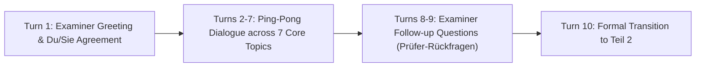
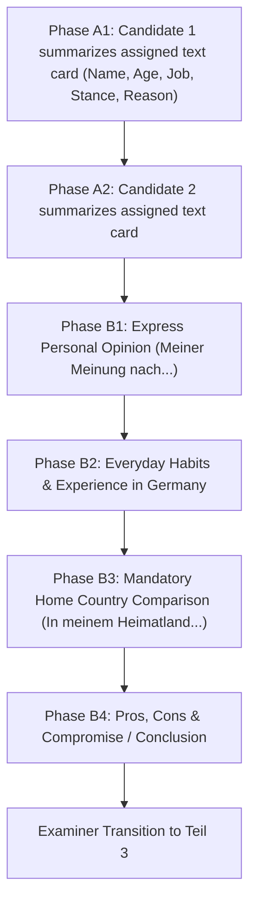
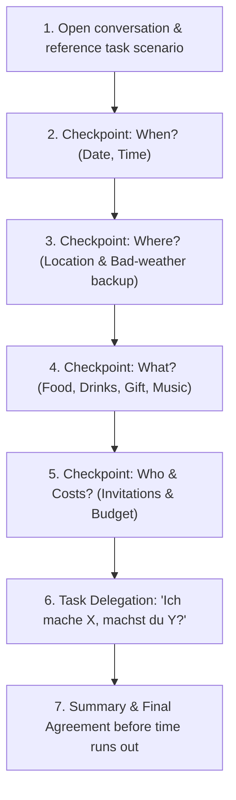

# Telc Deutsch B1 Speaking Exam (Mündliche Prüfung) — Master Preparation Guide
> **Comprehensive Strategy, Empirical Analysis, Sentence Baukasten & Formblatt M10 Scoring Blueprint**  
> *Based on empirical analysis of all 9 authentic Telc B1 oral exam transcripts (`telcexam1.md` – `telcexam9.md`) in this repository.*

---

## Table of Contents
1. [Exam Architecture & Overview](#1-exam-architecture--overview)
2. [Formblatt M10 & Official Telc Grading Rubric](#2-formblatt-m10--official-telc-grading-rubric)
   - [What is Formblatt M10?](#what-is-formblatt-m10)
   - [Point Distribution per Teil](#point-distribution-per-teil)
   - [The 4 Evaluation Parameters](#the-4-evaluation-parameters)
   - [The Letter Grading Scale (A, B, C, D)](#the-letter-grading-scale-a-b-c-d)
   - [The Post-Exam Examiner Conference (Beschlussfassung)](#the-post-exam-examiner-conference-beschlussfassung)
3. [Empirical Insights Across the 9 Real Transcripts](#3-empirical-insights-across-the-9-real-transcripts)
4. [Teil 1: Kontaktaufnahme (Getting to Know Each Other)](#4-teil-1-kontaktaufnahme-getting-to-know-each-other)
   - [Step 0: The "Du / Sie" Opening Ritual](#step-0-the-du--sie-opening-ritual)
   - [The 7 Core Topics & Sentence Builders](#the-7-core-topics--sentence-builders)
   - [Natural Reaction Fillers](#natural-reaction-fillers)
   - [Examiner Follow-Up Questions (Prüfer-Rückfragen)](#examiner-follow-up-questions-prüfer-rückfragen)
   - [Full Model Dialogue (Teil 1)](#full-model-dialogue-teil-1)
5. [Teil 2: Gespräch über ein Thema (Topic Discussion & Text Summary)](#5-teil-2-gespräch-über-ein-thema-topic-discussion--text-summary)
   - [Phase A: Stimulus Card Summary (Meinung wiedergeben)](#phase-a-stimulus-card-summary-meinung-wiedergeben)
   - [Phase B: Interactive Partner Discussion](#phase-b-interactive-partner-discussion)
   - [The Mandatory Home Country Comparison (Heimatland-Vergleich)](#the-mandatory-home-country-comparison-heimatland-vergleich)
   - [Full Model Dialogue (Teil 2)](#full-model-dialogue-teil-2)
6. [Teil 3: Gemeinsam etwas planen (Joint Planning)](#6-teil-3-gemeinsam-etwas-planen-joint-planning)
   - [Step 1: Taking the Initiative & Starting](#step-1-taking-the-initiative--starting)
   - [Step 2: Making Suggestions (4 Core Formulas)](#step-2-making-suggestions-4-core-formulas)
   - [Step 3: Polite Disagreement & Counter-Proposals](#step-3-polite-disagreement--counter-proposals)
   - [Step 4: The 4 Standard Planning Checkpoints](#step-4-the-4-standard-planning-checkpoints)
   - [Step 5: Task Delegation (Wer macht was?)](#step-5-task-delegation-wer-macht-was)
   - [Step 6: Summary & Closing](#step-6-summary--closing)
   - [Full Model Dialogue (Teil 3)](#full-model-dialogue-teil-3)
7. [Universal Emergency Lifesavers (What to Do If You Get Stuck)](#7-universal-emergency-lifesavers-what-to-do-if-you-get-stuck)

---

## 1. Exam Architecture & Overview

The Telc Deutsch B1 oral examination (*Mündliche Prüfung*) is conducted as a **pair exam** (*Paarprüfung*) with two candidates and two certified examiners (*Prüfer 1* and *Prüfer 2*).

* **Total Speaking Exam Duration:** ~15 minutes active speaking time (plus 20 minutes preparation time beforehand).
* **Total Score:** **75 Points** (representing 25% of the total 300 points for the full Telc B1 Certificate).
* **Passing Threshold:** At least **45 out of 75 points (60%)** must be achieved in the speaking subtest.
* **Preparation Time (20 minutes):** Candidates receive a sheet with the stimulus texts for Teil 2 and the task scenario for Teil 3. You may write down keywords (*Stichpunkte*), but **you must never read full sentences from your notes during the exam**.

---

## 2. Formblatt M10 & Official Telc Grading Rubric

### What is Formblatt M10?
**Formblatt M10** (*Bewertungsbogen M10*) is the official grading protocol sheet issued by Telc gGmbH. The **„M“** stands for **Mündlich** *(Oral)*, and **„10“** is the form reference code. 

During the exam, both examiners sit with individual copies of Formblatt M10 on their clipboards, independently scoring **Teilnehmer A** and **Teilnehmer B** without consulting each other until after the candidates leave the room.

```
┌────────────────────────────────────────────────────────────────────────┐
│                   telc Deutsch B1 — Formblatt M10                      │
│                  Bewertungsbogen Mündliche Prüfung                     │
├────────────────────────────────────────────────────────────────────────┤
│ Prüfungszentrum: ...................   Datum: ........................ │
│ Prüfer 1: ..........................   Prüfer 2: ..................... │
├──────────────────────────────────────┬─────────────────────────────────┤
│ KRITERIEN                            │ TEILNEHMER A   │  TEILNEHMER B  │
├──────────────────────────────────────┼────────────────┼────────────────┤
│ 1. Aufgabenbewältigung Teil 1        │ [A] [B] [C] [D]│ [A] [B] [C] [D]│
│    (Kontaktaufnahme / 15 Pkt)        │                │                │
├──────────────────────────────────────┼────────────────┼────────────────┤
│ 2. Aufgabenbewältigung Teil 2        │ [A] [B] [C] [D]│ [A] [B] [C] [D]│
│    (Thema präsentieren / 30 Pkt)     │                │                │
├──────────────────────────────────────┼────────────────┼────────────────┤
│ 3. Aufgabenbewältigung Teil 3        │ [A] [B] [C] [D]│ [A] [B] [C] [D]│
│    (Gemeinsam planen / 30 Pkt)       │                │                │
├──────────────────────────────────────┼────────────────┼────────────────┤
│ 4. Ausdrucksfähigkeit (Wortschatz)   │ [A] [B] [C] [D]│ [A] [B] [C] [D]│
│ 5. Formale Richtigkeit (Grammatik)   │ [A] [B] [C] [D]│ [A] [B] [C] [D]│
│ 6. Aussprache und Intonation         │ [A] [B] [C] [D]│ [A] [B] [C] [D]│
├──────────────────────────────────────┴────────────────┴────────────────┤
│ Notizen des Prüfers / Beobachtungen zur Sprache:                       │
│ ...................................................................... │
└────────────────────────────────────────────────────────────────────────┘
```

---

### Point Distribution per Teil

| Section | Task Description | Max Points | Weight |
| :--- | :--- | :---: | :---: |
| **Teil 1** | **Kontaktaufnahme** *(Introduction & Follow-up Q&A)* | **15 Points** | 20% |
| **Teil 2** | **Gespräch über ein Thema** *(Stimulus Summary & Discussion)* | **30 Points** | 40% |
| **Teil 3** | **Gemeinsam etwas planen** *(Joint Negotiation & Planning)* | **30 Points** | 40% |
| **TOTAL** | **Entire Speaking Exam** | **75 Points** | **100%** |
| **PASS** | **Minimum Passing Mark (60%)** | **45 Points** | — |

> [!IMPORTANT]
> **Teil 2 and Teil 3 carry 80% of your total speaking marks.** Even if you are anxious in Teil 1, a solid performance in Teil 2 and Teil 3 easily secures an above-average pass.

---

### The 4 Evaluation Parameters

Examiners evaluate your spoken German against 4 criteria:

```
                              ┌────────────────────────────────────────┐
                              │     TELC B1 EVALUATION PARAMETERS      │
                              └───────────────────┬────────────────────┘
             ┌─────────────────────────┬──────────┴──────────────┬────────────────────────┐
             ▼                         ▼                         ▼                        ▼
 1. Aufgabenbewältigung     2. Ausdrucksfähigkeit      3. Formale Richtigkeit   4. Aussprache & Intonation
 (Task & Interaction)      (Vocabulary & Fluency)         (Grammar & Syntax)    (Clarity & Comprehension)
```

#### 1. Aufgabenbewältigung (Task Fulfillment & Interaction) — *Evaluated per Teil*
* Did you address the task requirements on the card?
* Did you maintain active dialogue with your partner (*Frage-Antwort, Ping-Pong*) rather than reciting monologues?
* **Teil 1:** Did you answer your partner's questions, ask counter-questions, and respond to the examiner’s follow-up?
* **Teil 2:** Did you summarize your card's person before debating? Did you compare the topic with your home country?
* **Teil 3:** Did you suggest ideas, negotiate compromises, and delegate tasks?

#### 2. Ausdrucksfähigkeit (Vocabulary Range & Fluency) — *Evaluated Across All Parts*
* Do you possess sufficient B1 vocabulary to talk about work, hobbies, opinions, and everyday situations?
* Do you use B1 discourse connectors (*„Meiner Meinung nach...“*, *„Ich stimme dir zu, aber...“*, *„Einerseits..., andererseits...“*) instead of repeating elementary words like *„gut“*, *„schlecht“*, *„ich denke“*?
* **Paraphrasing:** Can you describe a concept if you forget an exact noun? (*„dieses Ding für Musik“*).

#### 3. Formale Richtigkeit (Grammar & Syntax) — *Evaluated Across All Parts*
* **Word Order:** Subordinate clauses with conjugated verb at the end (*„weil...“*, *„dass...“*, *„obwohl...“*, *„wenn...“*).
* **Inversion:** Verb in position 2 after introductory phrases (*„Meiner Meinung nach **ist** das wichtig“*).
* **Prepositions & Cases:** Dative after *aus, mit, seit, zu*; Accusative after *für, ohne*.
* **Tenses & Modals:** Present (*Präsens*), Perfect (*Perfekt*), and Subjunctive II (*Konjunktiv II: wir könnten, ich würde*).
* **Telc Principle:** Errors are completely acceptable at B1 level **as long as they do not hinder communication**.

#### 4. Aussprache und Intonation (Pronunciation & Intonation) — *Evaluated Across All Parts*
* Is your speech intelligible without causing major strain to the listener?
* Natural sentence melody (rising pitch on questions, falling on statements).
* **Accent Policy:** Having a foreign accent is 100% permitted and does **not** cost marks.

---

### The Letter Grading Scale (A, B, C, D)

For each criterion on Formblatt M10, examiners assign a letter grade:

| Grade | Official Telc Description | Score Value | Practical Meaning |
| :---: | :--- | :---: | :--- |
| **[A]** | **Voll erfüllt** *(Fully achieved)* | **100%** | Flawless B1 fulfillment. Fluent, proactive interaction, clear sentence structures. |
| **[B]** | **Weitgehend erfüllt** *(Largely achieved)* | **~75%** | Solid B1 pass. Minor grammar slips or word searching, but communication is smooth. |
| **[C]** | **Teilweise erfüllt** *(Partially achieved)* | **~50%** | Below B1 level (A2 standard). Monosyllabic, passive, or reads verbatim from notes. |
| **[D]** | **Nicht erfüllt** *(Not achieved)* | **0%** | Task not understood; unable to communicate or remains silent. |

---

### The Post-Exam Examiner Conference (*Beschlussfassung*)
1. Immediately after both candidates exit the room, the two examiners spend 2–3 minutes reconciling their notes on **Formblatt M10**.
2. If Examiner 1 scored **[B]** and Examiner 2 scored **[A]**, they deliberate based on evidence (e.g. *„Did the candidate mention their home country? Yes. Then let's agree on [A]“*).
3. The agreed consensus marks are shaded onto the optical scantron sheet (**Antwortbogen S30**), which is shipped to Telc headquarters in Frankfurt. Formblatt M10 is archived at the test center as the official legal audit trail.

---

## 3. Empirical Insights Across the 9 Real Transcripts

Analysis of `telcexam1.md` through `telcexam9.md` in this repository highlights critical success factors:

1. **The "Du / Sie" Opening Ritual (6 of 7 Dialogic Transcripts):** In `telcexam1, 2, 3, 6, 8, 9`, candidates actively agreed on *"Wollen wir du oder Sie sagen?"* in Turn 1.
2. **The Premature Discussion Trap (`telcexam1`):** In Exam 1, Hassan started discussing smoking before Bahman could present his stimulus text card. The examiner immediately halted him:  
   *„Ja, oder geben Sie erst Ihr Thema, Ihre Person, und dann unterhalten Sie sich über dieses Thema.“*  
   **Rule:** Always allow both stimulus cards to be presented before opening the debate!
3. **The Monologue Penalty (`telcexam3`):** Candidate Janusz spoke for over 2 minutes straight without asking his partner a single question. The examiners noted this negatively under *Aufgabenbewältigung / Interaktion*.
4. **The Home Country Bonus (`telcexam5` & `telcexam8`):** In Exam 5 and Exam 8, candidates proactively introduced comparisons (*„In der Türkei ist das so...“*), which earned them the highest marks on Teil 2.
5. **Role Delegation in Planning (`telcexam6`):** In Exam 6, candidates explicitly divided tasks (*„Ich rufe die Zeltfirma an, würdest du das Hotel buchen?“*), delivering a textbook B1 planning session.
6. **Word Order Traps (`telcexam7` & `telcexam9`):** The examiner in Exam 7 pointed out: Say *„Wen laden wir ein?“*, not *„Wen einladen wir?“*. In Exam 9, candidate Omar corrected his own word order (*„Ich nehme einen Bus immer... das ist falsch“*), which the examiner positively acknowledged.

---

## 4. Teil 1: Kontaktaufnahme (Getting to Know Each Other)

* **Duration:** ~2–3 minutes total (~8–12 conversational turns).
* **Format:** Interactive Q&A dialogue between candidates, concluded by 1–2 formal examiner follow-up questions.



---

### Step 0: The "Du / Sie" Opening Ritual

| German Phrase | English Translation | Usage Notes |
| :--- | :--- | :--- |
| *„Hallo! Wollen wir **du** oder **Sie** sagen?“* | "Hello! Shall we say 'du' or 'Sie'?" | **Best proactive opening!** |
| *„Darf ich Sie duzen?“* | "May I use 'du' with you?" | Polite way to offer 'du'. |
| *„Klar, wir können ruhig **du** sagen.“* | "Sure, we can easily say 'du'." | Standard friendly response. |
| *„Sehr gerne, das ist mir auch lieber.“* | "With pleasure, I prefer that too." | Natural agreement. |

---

### The 7 Core Topics & Sentence Builders

#### 1. Name & Spelling (*Vorname, Nachname, Buchstabieren*)
* **Questions you can ask / hear:**
  * *„Wie heißt du?“* / *„Wie ist dein Vor- und Nachname?“* (*"What is your name / first and last name?"*)
  * *„Kannst du deinen Nachnamen bitte buchstabieren?“* (*"Can you please spell your last name?"*)
* **How to answer:**
  * *„Ich heiße [Vorname] und mein Nachname ist [Nachname].“*
  * *„Mein Nachname schreibt man: [B-A-H-M-A-N-N].“*
* **Bounce back:** *„Und wie heißt du mit Nachnamen?“*

#### 2. Origin & Hometown (*Herkunft & Heimatstadt*)
> [!NOTE]
> Use **„aus“ + Dative**. Decline countries with articles: *„aus **der** Türkei“*, *„aus **der** Ukraine“*, *„aus **dem** Iran“*, *„aus **den** USA“*.

* **Questions you can ask / hear:**
  * *„Woher kommst du?“* / *„Aus welchem Land kommst du?“*
* **How to answer:**
  * *„Ich komme aus Syrien / Polen / Kolumbien, aus der Stadt [Stadt].“*
  * *„Ich bin in Aleppo geboren, aber ich habe lange in Damaskus gelebt.“*
* **Bounce back:** *„Und aus welchem Land kommst du?“*

#### 3. Living Situation in Germany (*Wohnort & Wohnung / Haus / WG*)
* **Questions you can ask / hear:**
  * *„Wo wohnst du jetzt in Deutschland?“*
  * *„Wohnst du in einer Wohnung, in einem Haus oder in einer WG?“*
* **How to answer:**
  * *„Im Moment wohne ich in Essen in einer Dreizimmerwohnung im Zentrum.“*
  * *„Ich wohne zurzeit in einer WG mit zwei Kollegen, aber ich suche eine eigene Wohnung.“*
* **Bounce back:** *„Und wie wohnst du? Wohnst du alleine oder mit deiner Familie?“*

#### 4. Family & Marital Status (*Familie & Familienstand*)
* **Questions you can ask / hear:**
  * *„Bist du verheiratet oder ledig?“*
  * *„Hast du Kinder oder Geschwister?“*
* **How to answer:**
  * *„Ich bin verheiratet und habe zwei Kinder. Mein Sohn ist 8 und meine Tochter ist 5 Jahre alt.“*
  * *„Nein, ich bin noch ledig und habe keine Kinder. Meine Eltern und Geschwister leben in [Heimatland].“*
* **Bounce back:** *„Und wie sieht es bei dir aus? Hast du auch Familie hier in Deutschland?“*

#### 5. Learning German (*Wo und seit wann Deutsch gelernt*)
> [!IMPORTANT]
> Use **„seit“ + Dative with Present Tense** for ongoing actions:  
> *„Ich lerne Deutsch **seit sechs Monaten**“* *(NOT: „Ich habe Deutsch seit sechs Monaten gelernt“)*.

* **Questions you can ask / hear:**
  * *„Wo und seit wann lernst du Deutsch?“*
  * *„Hast du einen Integrationskurs besucht?“*
* **How to answer:**
  * *„Ich lerne seit acht Monaten Deutsch und besuche hier einen Integrationskurs an der VHS.“*
  * *„Am Anfang habe ich mit Apps gelernt, aber jetzt besuche ich eine Sprachschule.“*
* **Bounce back:** *„Und wie lange lernst du schon Deutsch? Findest du die Sprache schwer?“*

#### 6. Profession & Future Plans (*Beruf / Ausbildung / Zukunft*)
* **Questions you can ask / hear:**
  * *„Was bist du von Beruf?“* / *„Was machst du beruflich?“*
  * *„Arbeitest du schon hier in Deutschland?“*
* **How to answer:**
  * *„In meiner Heimat habe ich als Elektriker gearbeitet. Hier lerne ich Deutsch und suche eine Stelle.“*
  * *„Ich mache zurzeit ein Praktikum, aber nach der B1-Prüfung möchte ich eine Ausbildung machen.“*
* **Bounce back:** *„Und was möchtest du in Zukunft beruflich in Deutschland machen?“*

#### 7. Languages (*Muttersprache & Fremdsprachen*)
* **Questions you can ask / hear:**
  * *„Welche Sprachen sprichst du?“* / *„Was ist deine Muttersprache?“*
* **How to answer:**
  * *„Meine Muttersprache ist Arabisch. Außerdem spreche ich Englisch und jetzt lerne ich Deutsch.“*
* **Bounce back:** *„Sprichst du neben Deutsch noch andere Fremdsprachen?“*

---

### Natural Reaction Fillers

Insert a 1-second reaction before answering to sound like a native dialogue partner:
* **Enthusiastic:** *„Oh, schön!“* / *„Das klingt ja super!“*
* **Interested:** *„Ah, wirklich? Das ist ja interessant!“*
* **Empathetic:** *„Ach so, ich verstehe.“*
* **Encouraging:** *„Das schaffst du bestimmt! Ich wünsche dir viel Erfolg.“*

---

### Examiner Follow-Up Questions (*Prüfer-Rückfragen*)

Examiners will address you formally with **„Sie“**:

1. **Surname Spelling:**  
   *Examiner:* *„Können Sie bitte Ihren Nachnamen buchstabieren?“*  
   *Candidate:* *„Ja, sehr gerne: [M-A-Y-E-R].“*
2. **Where you learned German:**  
   *Examiner:* *„Und wo genau haben Sie bisher Deutsch gelernt?“*  
   *Candidate:* *„Ich habe in meiner Heimat einen A1-Kurs gemacht und besuche seit 6 Monaten einen B1-Kurs an der Volkshochschule hier in Frankfurt.“*
3. **Hobbies & Free Time:**  
   *Examiner:* *„Was machen Sie denn gern am Wochenende in Ihrer Freizeit?“*  
   *Candidate:* *„In meiner Freizeit gehe ich gerne joggen oder koche am Wochenende für meine Familie.“*

---

### Full Model Dialogue (Teil 1)

```
EXAMINER:
"Guten Tag und willkommen zur Prüfung. Wir beginnen mit Teil 1, dem Kennenlernen. 
Bitte führen Sie ein kurzes Gespräch. Wer möchte anfangen?"

CANDIDATE A:
"Hallo! Wollen wir du oder Sie sagen?"

CANDIDATE B:
"Hallo! Wir können gerne du sagen. Ich heiße Omar. Und wie heißt du?"

CANDIDATE A:
"Freut mich, Omar! Ich heiße Bahman. Ich komme aus Afghanistan, aus Kabul. 
Und woher kommst du?"

CANDIDATE B:
"Ich komme aus Syrien, aus Aleppo. Und wo wohnst du jetzt hier in Deutschland?"

CANDIDATE A:
"Ich wohne zurzeit in Münster in einer Zweizimmerwohnung. Meine Wohnung liegt 
sehr zentral. Und wie wohnst du? Wohnst du alleine oder mit der Familie?"

CANDIDATE B:
"Oh, schön. Ich wohne mit meiner Familie in Dortmund. Ich bin verheiratet und habe 
zwei Kinder. Bist du auch verheiratet?"

CANDIDATE A:
"Nein, ich bin noch ledig. Meine Familie lebt noch im Ausland. 
Sag mal, wo hast du eigentlich Deutsch gelernt?"

CANDIDATE B:
"Ich habe einen Integrationskurs besucht und spreche viel Deutsch mit Kollegen. 
Und was machst du beruflich?"

CANDIDATE A:
"In meiner Heimat habe ich als Informatiker gearbeitet. Jetzt lerne ich Deutsch, 
um hier eine Arbeit in einer IT-Firma zu finden. Und was ist dein Beruf?"

CANDIDATE B:
"Ich bin Schlosser von Beruf und suche hier eine Ausbildung."

CANDIDATE A:
"Das klingt toll! Ich wünsche dir viel Erfolg dabei."

EXAMINER (Prüfer-Rückfrage):
"Sehr schön. Herr Bahman, könnten Sie mir bitte Ihren Familiennamen buchstabieren?"

CANDIDATE A:
"Ja, selbstverständlich: B-A-H-M-A-N-N."

EXAMINER:
"Vielen Dank Ihnen beiden. Das war Teil 1. Wir kommen nun zu Teil 2."
```

---

## 5. Teil 2: Gespräch über ein Thema (Topic Discussion & Text Summary)

* **Duration:** ~5–6 minutes total (~6–9 conversational turns).
* **Format:** Phase A (Sequential monologue summaries of stimulus cards) followed by Phase B (Spontaneous partner discussion).



---

### Phase A: Stimulus Card Summary (*Meinung wiedergeben*)

> [!IMPORTANT]
> **Subordinate Clause Rule:** After *„dass...“* and *„weil...“*, the verb moves to the end!

* **Topic Introduction:**
  * *„In meinem Text geht es um das Thema [gesunde Ernährung / öffentliche Verkehrsmittel].“*
* **Introducing the person:**
  * *„Die Person in meinem Text heißt [Hannes Leivig]. Er ist [30] Jahre alt und von Beruf [Filmproduzent].“*
* **Stating their opinion & reason (*Verb at end!*):**
  * *„Er sagt, **dass** er oft Fast Food **isst**, **obwohl** er weiß, dass es ungesund **ist**.“*
  * *„Er findet das praktisch, **weil** er beruflich viel unterwegs **ist** und keine Zeit zum Kochen **hat**.“*
  * *„Wichtig ist für ihn vor allem, **dass** das Essen schnell **geht** und ihn satt **macht**.“*
* **Handover to partner:**
  * *„Das steht in meinem Text. Und was hast du über dieses Thema gelesen?“*
  * *„Wer ist die Person auf deinem Blatt und was ist ihre Meinung?“*

---

### Phase B: Interactive Partner Discussion

#### 1. Bridge to discussion & expressing own opinion:
* *„Das ist ein interessanter Standpunkt. Was denkst du persönlich darüber?“*
* *„**Meiner Meinung nach ist** frisches Essen sehr wichtig.“* *(Verb in position 2!)*
* *„**Ich bin der Meinung, dass** man mehr auf seine Gesundheit achten **sollte**.“* *(Verb at end!)*
* *„Ich stimme eher [Clara] zu, weil ich jeden Tag für meine Familie koche.“*

#### 2. Reacting to your partner (Agreement & Polite Disagreement):
* **Agreement:**
  * *„**Da hast du absolut recht.**“*
  * *„**Ich stimme dir vollkommen zu.**“*
  * *„**Das sehe ich ganz genauso.**“*
  * *„**Das ist ein sehr guter Punkt.**“*
* **Polite Disagreement / Nuance:**
  * *„**Das stimmt zwar, aber** meiner Meinung nach ist Bio-Essen oft sehr teuer.“*
  * *„**Einerseits hast du recht, andererseits** fehlt vielen Menschen nach der Arbeit die Zeit.“*
  * *„**Da bin ich etwas anderer Meinung, weil** ...“*

#### 3. Habits in Germany:
* *„Aus meiner eigenen Erfahrung in Deutschland kann ich sagen, dass ...“*
* *„In meinem Alltag hier in Deutschland fahre ich meistens mit dem Bus zur Schule.“*
* *„Normalerweise koche ich zu Hause, aber am Wochenende hole ich mir auch mal einen Döner.“*

---

### The Mandatory Home Country Comparison (*Heimatland-Vergleich*)

> [!TIP]
> Proactively introducing this sentence without waiting for the examiner to prompt you is the fastest way to earn an **[A]** on Teil 2:

* *„**In meinem Heimatland ist die Situation ganz anders als hier in Deutschland.**“*
* *„**Bei uns in [Heimatland]** kochen die Familien traditionell jeden Tag frisch mit Gemüse und Olivenöl.“*
* *„**Im Vergleich zu Deutschland** gibt es in meiner Heimat leider kein gutes Bus- und Bahnnetz, deshalb braucht fast jeder ein eigenes Auto.“*
* *„**Und wie ist das eigentlich in deinem Heimatland?** Gibt es dort viele öffentliche Verkehrsmittel?“*

---

### Full Model Dialogue (Teil 2: *Öffentliche Verkehrsmittel vs. Auto*)

```
EXAMINER:
"Das war Teil 1. Nun kommen wir zu Teil 2: Ein Gespräch über ein Thema. 
Sie haben beide einen kurzen Text gelesen. Bitte stellen Sie zuerst Ihren Text vor 
und tauschen Sie danach Ihre Meinungen aus. Wer möchte beginnen?"

CANDIDATE A (Text A Summary):
"Ich beginne gerne. In meinem Text geht es um öffentliche Verkehrsmittel. 
Die Person heißt Lena. Sie ist 24 Jahre alt und Software-Ingenieurin von Beruf. 
Ihr Auto ist kaputt und sie fährt jetzt immer mit dem Zug. Sie sagt aber, dass der Zug 
oft Verspätung hat und es im Winter sehr kalt ist. Trotzdem findet sie gut, dass man 
im Zug lesen kann. Und was steht in deinem Text?"

CANDIDATE B (Text B Summary):
"In meinem Text geht es um Moritz Siegfried. Er ist 22 Jahre alt und arbeitet als Musiker. 
Er erzählt, dass er kein Auto hat, weil es zu teuer ist. Deshalb fährt er jeden Tag mit 
dem Bus zur Arbeit. Er hört dabei Musik und schreibt neue Ideen auf. Wenn der Bus 
Verspätung hat, ärgert er sich zwar, aber er mag öffentliche Verkehrsmittel trotzdem. 
Was denkst du persönlich darüber, Bahman?"

CANDIDATE A (Personal Opinion & Habits in Germany):
"Das ist interessant. Ich persönlich stimme eher Moritz zu. Meiner Meinung nach 
sind Bus und Bahn viel günstiger und besser für die Umwelt. Ich habe das 
Deutschlandticket und fahre jeden Tag mit der Bahn zur Sprachschule. 
Und wie bist du hier in Deutschland unterwegs?"

CANDIDATE B (Partner Habit & Contrast):
"Ich fahre im Moment auch mit dem Bus, aber ich mache gerade meinen Führerschein. 
Mit dem Auto ist man einfach flexibler, besonders wenn man am Wochenende Ausflüge 
mit der Familie machen möchte."

CANDIDATE A (Heimatland-Vergleich):
"Da hast du recht, das Auto ist flexibler. Aber in meinem Heimatland, in Afghanistan, 
gibt es kaum geregelte Busse oder Züge. Der Verkehr in den Städten ist chaotisch und 
jeder muss mit dem Auto oder Taxi fahren. Im Vergleich dazu finde ich die öffentlichen 
Verkehrsmittel hier in Deutschland super organisiert. Wie ist der Verkehr in deinem Heimatland?"

CANDIDATE B (Partner Heimatland & Conclusion):
"In Syrien ist das ähnlich: In Großstädten wie Aleppo gibt es zwar Sammeltaxis, aber 
keine pünktlichen Fahrpläne wie in Deutschland. Ich denke, eine Kombination ist ideal: 
In der Stadt nimmt man die Bahn, und für weite Strecken kann man das Auto nutzen."

CANDIDATE A:
"Ganz genau, das sehe ich genauso!"

EXAMINER:
"Vielen Dank Ihnen beiden für die interessante Diskussion. Das war Teil 2. 
Wir kommen nun zum letzten Teil, Teil 3."
```

---

## 6. Teil 3: Gemeinsam etwas planen (Joint Planning)

* **Duration:** ~3–4 minutes total (~6–10 conversational turns).
* **Format:** Interactive collaboration based on a scenario card with 4–5 bullet points.



---

### Step 1: Taking the Initiative & Starting

* *„Wir haben ja die Aufgabe bekommen, zusammen [eine Party / ein Picknick] zu organisieren. Wollen wir anfangen?“*
* *„Ich schlage vor, wir gehen die Punkte auf dem Blatt einfach der Reihe nach durch. Was meinst du?“*
* *„Hast du schon eine Idee, womit wir starten wollen?“*

---

### Step 2: Making Suggestions (4 Core Formulas)

1. **Using *„Wir könnten...“* + Infinitive at end:**
   * *„Wir **könnten** uns am Samstag um 14 Uhr **treffen**.“*
   * *„Wir **könnten** doch alle Kollegen aus dem Kurs **einladen**.“*
2. **Using *„Ich schlage vor, dass wir...“* + Verb at end:**
   * *„Ich schlage vor, **dass** wir die Feier im Park **machen**.“*
   * *„Ich schlage vor, **dass** jeder etwas zu essen **mitbringt**.“*
3. **Using *„Wie wäre es, wenn wir...“* + Verb at end:**
   * *„Wie wäre es, **wenn** wir zusammen mit dem Zug dorthin **fahren**?“*
4. **Using *„Wollen wir vielleicht...“* + Infinitive at end:**
   * *„Wollen wir vielleicht eine WhatsApp-Gruppe **erstellen**?“*

---

### Step 3: Polite Disagreement & Counter-Proposals

> [!CAUTION]
> **Never just say "Nein"!** Follow this 3-step formula:  
> **1. Regret** (*Am Freitag kann ich leider nicht...*) + **2. Reason with *weil*** (*...weil ich arbeiten muss.*) + **3. Counter-proposal** (*Wie wäre es stattdessen am Samstag?*).

* *„Am Freitag geht es leider nicht, **weil** ich bis 18 Uhr arbeiten muss. **Wie wäre es stattdessen am Samstag?**“*
* *„Das Restaurant ist eine gute Idee, **aber** ziemlich teuer. **Findest du nicht, wir sollten lieber** selbst etwas kochen?“*
* *„Ein Picknick ist schön, **aber** am Wochenende soll es regnen. **Was hältst du davon, wenn** wir zu mir nach Hause gehen?“*

---

### Step 4: The 4 Standard Planning Checkpoints

#### A. Wann? (Date & Time)
* *„Welcher Tag passt dir am besten?“*
* *„Um wie viel Uhr wollen wir uns treffen? Passt dir 15:00 Uhr?“*
* *„Ja, 15:00 Uhr passt mir super.“*

#### B. Wo? (Location & Weather Backup)
* *„Wo wollen wir das machen? Hast du einen Vorschlag für einen Ort?“*
* *„Ich habe ein großes Wohnzimmer, wir können das gerne bei mir machen.“*
* *„Und was machen wir, wenn das Wetter schlecht wird? Haben wir einen Plan B?“*

#### C. Was? (Food, Drinks, Gift, Music)
* *„Was wollen wir essen und trinken? Sollen wir Pizza bestellen oder grillen?“*
* *„Wir sollten auch an vegetarisches Essen und alkoholfreie Getränke denken.“*
* *„Welches Geschenk wollen wir besorgen? Wie wäre es mit einem Gutschein?“*

#### D. Wer & Wie viel? (Guests & Budget)
* *„Wen laden wir eigentlich alles ein? Sollen wir den ganzen Kurs fragen?“* *(Say „Wen **laden** wir ein?“, not „Wen einladen wir?“)*
* *„Wie viel Geld wollen wir ausgeben? Ich denke, 15 bis 20 Euro pro Person sind ausreichend.“*

---

### Step 5: Task Delegation (*Wer macht was?*)

Examiners award high marks when candidates divide responsibilities:
* *„**Ich kann mich gerne um** die Getränke und den Salat **kümmern**.“*
* *„**Würdest du** dort anrufen und die Tische reservieren?“*
* *„**Soll ich** die Einladungen schreiben oder **machst du das lieber?**“*
* *„Ich habe ein Auto, **deshalb kann ich** die schweren Einkäufe erledigen.“*

---

### Step 6: Summary & Closing

Conclude proactively before the examiner stops you:
* *„**Haben wir noch etwas Wichtiges vergessen?**“*
* *„Ich glaube, wir haben alle Punkte besprochen.“*
* *„**Lass uns kurz zusammenfassen:** Wir treffen uns am Samstag um 14 Uhr bei dir. Du kaufst die Getränke und ich backe den Kuchen.“*
* *„Perfekt, das ist ein super Plan. Ich freue mich schon darauf. Bis Samstag!“*

---

### Full Model Dialogue (Teil 3: *Ein Picknick planen*)

```
EXAMINER:
"Kommen wir nun zu Teil 3: Gemeinsam eine Aufgabe lösen. 
Hier ist Ihr Aufgabenblatt. Sie sollen zusammen ein Picknick planen. 
Bitte beginnen Sie."

CANDIDATE A:
"Hallo! Wir sollen ja zusammen ein Picknick für unseren Deutschkurs organisieren. 
Wollen wir gleich anfangen? Hast du am kommenden Samstag Zeit?"

CANDIDATE B:
"Hallo! Am Samstagvormittag muss ich leider arbeiten. Aber ab 14:00 Uhr habe ich frei. 
Passt dir das?"

CANDIDATE A:
"Ja, 14:00 Uhr passt mir sehr gut. Wo wollen wir das Picknick machen? 
Ich schlage vor, dass wir in den Stadtpark gehen, weil es dort schöne Wiesen gibt."

CANDIDATE B:
"Gute Idee! Aber was machen wir, wenn es am Samstag regnet?"

CANDIDATE A:
"Keine Sorge, wenn es regnet, können wir einfach zu mir in die Wohnung gehen. 
Ich habe ein großes Wohnzimmer. Was wollen wir denn zu essen mitbringen?"

CANDIDATE B:
"Wir könnten belegte Brötchen, Salate und Obst mitbringen. Und Saft und Mineralwasser."

CANDIDATE A:
"Das klingt lecker. Ich kann gerne einen großen Nudelsalat vorbereiten und 
die Getränke kaufen. Würdest du dich um das Brot, das Obst und Pappteller kümmern?"

CANDIDATE B:
"Klar, das übernehme ich sehr gerne. Und wie informieren wir die anderen Teilnehmer aus dem Kurs?"

CANDIDATE A:
"Ich schlage vor, dass wir eine WhatsApp-Gruppe erstellen und allen schreiben. 
Dann haben wir eigentlich alles besprochen, oder? 14:00 Uhr am Samstag im Park!"

CANDIDATE B:
"Perfekt! Das ist ein super Plan. Bis Samstag!"

EXAMINER:
"Vielen Dank Ihnen beiden! Damit ist die Prüfung beendet. 
Sie erhalten Ihre Ergebnisse in vier bis sechs Wochen per Post. Auf Wiedersehen!"
```

---

## 7. Universal Emergency Lifesavers (What to Do If You Get Stuck)

| Situation | Say this in German | English Translation |
| :--- | :--- | :--- |
| **You need 5 seconds to think** | *„Das ist eine sehr interessante Frage. Lass mich kurz überlegen...“* | "That's a very interesting question. Let me think for a second..." |
| **You forgot a German noun** | *„Wie sagt man das noch gleich... Ich meine dieses Gerät für Musik.“* | "How do you say that again... I mean this device for music." |
| **You didn't understand the partner** | *„Entschuldige, kannst du das bitte noch einmal wiederholen?“* | "Excuse me, could you please repeat that once more?" |
| **The partner speaks too fast** | *„Könntest du bitte ein bisschen langsamer sprechen?“* | "Could you please speak a bit slower?" |
| **Partner is completely silent** | *„Was hältst du von meinem Vorschlag? Passt dir das?“* | "What do you think of my suggestion? Does that suit you?" |
| **Partner talks too much (Monologue)** | *„Darf ich kurz einhaken? Ich sehe das nämlich so: ...“* | "May I briefly jump in? Because I see it like this: ..." |
| **The examiner asks a surprise question** | *„Ja, genau. Aus meiner persönlichen Erfahrung kann ich sagen, dass...“* | "Yes, exactly. From my personal experience I can say that..." |
